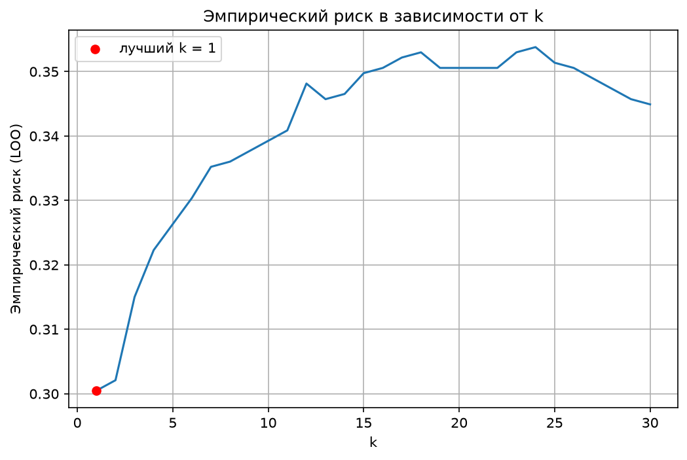
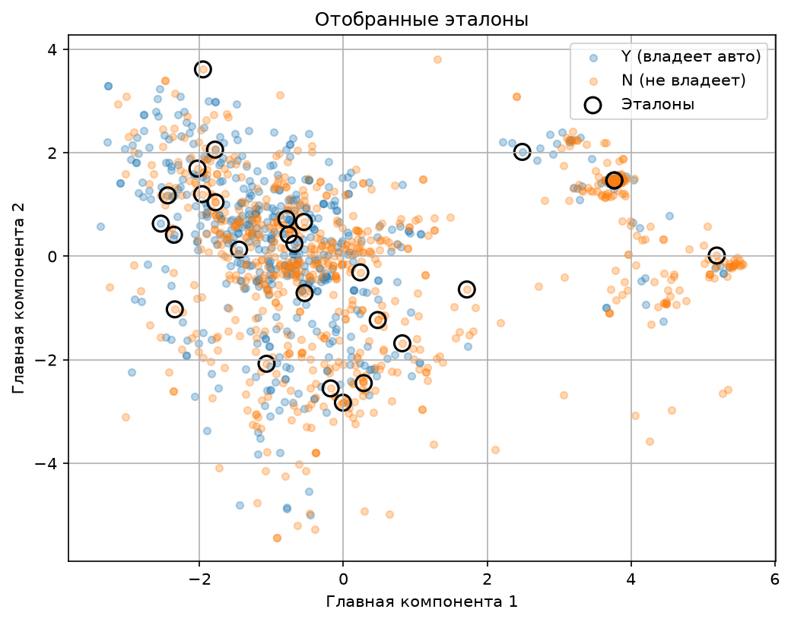
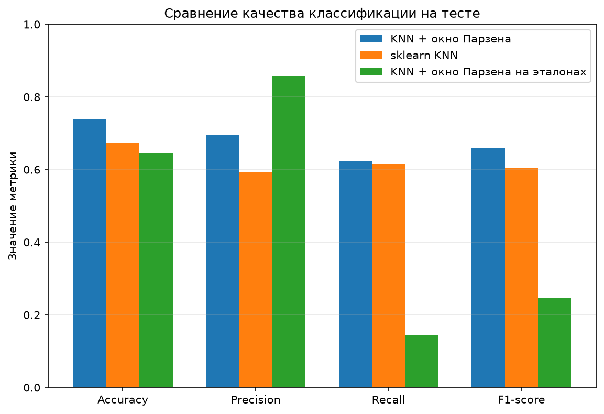

# Лабораторная работа №2. Метрическая классификация

## Данные

Взят датасет Credit Card Approval.
Целевой признак - `Car_Owner` (есть ли у человека автомобиль), в выборке 1548 объектов: 924 класса N и 624 класса Y. Данные сразу делятся на обучающую (1238) и тестовую (310) части,
кодируются категории и выполняется стандартизация. Стандартизация нужна, потому что KNN работает с расстояниями: без неё признак 'годовой доход' полностью заглушил бы все остальные. Классы кодируются как +1 (Y) и −1 (N). После кодировки получается 45 признаков.

## Метод парзеновского окна

Расстояние евклидово. Используется окно переменной ширины: для классифицируемого объекта x ширина окна равна расстоянию до его (k+1)-го ближайшего соседа,

$$
h(x) = \rho(x, x^{(k+1)}).
$$

Ядро гауссово:

$$
K(r) = \exp(-2r^2).
$$

Для каждого класса считается сумма весов всех объектов обучающей выборки этого класса, объект относится к классу с большей суммой:

$$
\Gamma_y(x) = \sum_{i:\, y_i = y} K\left(\frac{\rho(x, x_i)}{h(x)}\right).
$$

Параметр k не задаёт число голосующих объектов, он определяет только ширину окна. Так как ядро гауссово, голосуют все объекты, но вклад далёких быстро убывает, поэтому k = 1 не равно классическому 1-NN: окно определяется вторым соседом, а вес первого соседа и остальных близких объектов считается плавно.

## Подбор k методом LOO

Для каждого k от 1 до 30 каждый объект обучающей выборки по очереди исключался и классифицировался по остальным, доля ошибок — эмпирический риск LOO. Параметры метода (метрика, ядро, способ выбора ширины окна) зафиксированы, подбирался только k, и только по обучающей выборке.

Минимальный риск получен при k = 1 и равен 0.3005. При k = 2 он 0.3021, дальше риск в целом растёт и держится на уровне 0.34–0.35. Для сравнения, классификатор «всегда N» ошибался бы в 40.3% случаев. Лучшее значение k оказалось на границе перебираемого диапазона, но это не случайность: при увеличении окна риск в целом растёт, то есть на этих данных важнее всего самые близкие объекты.

## Сравнение со sklearn

Сравнение на тестовой выборке при k = 1 с `KNeighborsClassifier` (евклидова метрика, число соседей k = 1). Положительный класс — Y.

| Модель | Accuracy | Precision | Recall | F1 |
|---|---|---|---|---|
| KNN + окно Парзена (наш) | 0.7387 | 0.6964 | 0.6240 | 0.6582 |
| sklearn KNN | 0.6742 | 0.5923 | 0.6160 | 0.6039 |

Собственная реализация лучше по Accuracy, Precision и F1, Recall практически одинаковый. Это ожидаемо: sklearn при k = 1 берёт ровно одного соседа, а метод Парзена учитывает ещё и остальных близких объектов с убывающими весами, что сглаживает влияние единичных случайных соседей.

## Отбор эталонов

Реализован жадный алгоритм по критерию CCV (Complete Cross-Validation) для длины контрольной выборки 1, то есть LOO-ошибка классификатора ближайшего эталона. Алгоритм начинает с двух эталонов (первый объект каждого класса). На каждом шаге перебираются все оставшиеся объекты, и добавляется тот, после которого CCV становится наименьшим; объект при проверке не может быть эталоном сам для себя. Отбор прекращается, когда ни одно добавление CCV не уменьшает.

Результат: из 1238 обучающих объектов оставлено 27 эталонов (2.2%), 8 класса Y и 19 класса N. CCV уменьшился с 0.4669 до 0.2625.

Для визуализации объекты спроецированы на две главные компоненты (PCA). Проекция нужна только для картинки и в отборе не участвует. Классы на ней перемешаны, поскольку двух компонент не хватает, чтобы разделить этот датасет.

Сравнение KNN с окном Парзена (k = 1) на всей выборке и на эталонах:

| Модель | Объектов в обучении | Accuracy | Precision | Recall | F1 |
|---|---|---|---|---|---|
| KNN без отбора эталонов | 1238 | 0.7387 | 0.6964 | 0.6240 | 0.6582 |
| KNN с отбором эталонов | 27 | 0.6452 | 0.8571 | 0.1440 | 0.2466 |

На диаграмме ниже все три варианта сравниваются по четырём метрикам.

На эталонах качество заметно хуже. Причина в несоответствии: эталоны подбирались по критерию «ближайший эталон» (1-NN), а классифицирует окно Парзена, в котором голосуют все эталоны сразу. Среди 27 эталонов 19 принадлежат классу N и только 8 классу Y, поэтому сумма весов чаще оказывается больше у N, и recall класса Y падает до 0.144. Если классифицировать по тем же 27 эталонам ближайшим соседом (как и при отборе), Accuracy получается 0.6839, Recall 0.52, то есть отбор сохраняет почти всё качество при сжатии выборки в 46 раз.

## Выводы

Реализован KNN с окном Парзена переменной ширины и гауссовым ядром. По LOO выбрано k = 1 (риск 0.3005), на тесте собственная реализация показала Accuracy 0.7387 и F1 0.6582 против 0.6742 и 0.6039 у `KNeighborsClassifier` с тем же k. Жадный отбор эталонов по CCV сократил обучающую выборку с 1238 до 27 объектов (2.2%), но классификатор Парзена на этих эталонах работает заметно хуже (Accuracy 0.6452), потому что критерий отбора и классификатор различаются. Тестовая выборка небольшая (310 объектов), поэтому разницу между близкими значениями не следует считать надёжной.