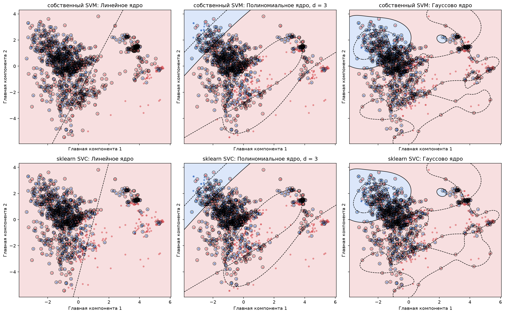

# Лабораторная работа №3. SVM

SVM через решение двойственной задачи по λ, линейное, полиномиальное и RBF-ядра, сравнение с `sklearn.svm.SVC`.

## Датасет

[Credit Card Approval](https://github.com/AbhishekDataAnalyst/Credit-Card-Approval): 1548 клиентов, 16 признаков, бинарная классификация по `Car_Owner` (есть ли у клиента машина). Данные читаются по ссылке с GitHub. После удаления `Ind_ID` и кодирования категориальных признаков остаётся 45 признаков.

Разбиение стратифицированное 80/20: 1238 объектов в обучении (739 с меткой −1 и 499 с меткой +1) и 310 в тесте (185 и 125). Пропуски заполняются статистиками обучающей выборки (мода для пола, медиана для дохода и возраста, `Unknown` для профессии), чтобы тест не влиял на обучение. Метки переведены в {−1, +1}, признаки стандартизованы по обучающей выборке.

## Структура кода

Всё в одном файле `lab3.py` в виде ячеек `#%%`: подготовка данных, класс `SVM`, метрики, линейный классификатор со сравнением с `SVC`, ядра, проекция на две главные компоненты, графики решения и типы объектов.

## Метод

Двойственная задача:

$$-\sum_i \lambda_i + \frac12 \sum_{i,j} \lambda_i\lambda_j y_i y_j K(x_i, x_j) \to \min_\lambda, \qquad 0 \le \lambda_i \le C, \quad \sum_i \lambda_i y_i = 0$$

Решается через `scipy.optimize.minimize(method="SLSQP")` с аналитическим градиентом, `maxiter = 1000`. Объекты с λ > 10⁻⁶ считаются опорными. Свободный член w₀ вычисляется как среднее значение $\sum_j \lambda_j y_j K(x_j, x_i) - y_i$ по опорным-граничным объектам (0 < λ < C), они лежат ровно на краю полосы.

Классификатор:

$$a(x) = \mathrm{sign}\Big(\sum_i \lambda_i y_i K(x_i, x) - w_0\Big)$$

Трюк с ядром: скалярное произведение в двойственной задаче и в решающем правиле заменяется на $K(x, x')$, остальной код не меняется. Для линейного ядра классификатор строится явно: $w = \sum_i \lambda_i y_i x_i$, $a(x) = \mathrm{sign}(\langle w, x \rangle - w_0)$.

Ядра:

- линейное $K(x, x') = \langle x, x' \rangle$;
- полиномиальное $K(x, x') = (\gamma\langle x, x' \rangle + 1)^3$, γ = 1/45;
- RBF $K(x, x') = \exp(-\gamma \|x - x'\|^2)$, γ = 1/45.

## Результаты

C = 1, метрики на тесте (310 объектов), положительный класс — владелец машины. В парах: собственная реализация / `SVC`.

| ядро | accuracy | precision | recall | F1 | опорных | время, с |
|---|---|---|---|---|---|---|
| линейное | 0.690 / 0.690 | 0.636 / 0.636 | 0.544 / 0.544 | 0.586 / 0.586 | 1196 / 959 | 204 / 0.05 |
| полиномиальное | 0.726 / 0.726 | 0.682 / 0.682 | 0.600 / 0.600 | 0.638 / 0.638 | 838 / 822 | 872 / 0.06 |
| RBF | 0.706 / 0.706 | 0.673 / 0.673 | 0.528 / 0.528 | 0.592 / 0.592 | 925 / 914 | 398 / 0.07 |

Предсказания на тесте совпадают со `SVC` во всех трёх случаях (100% объектов).

Линейный классификатор: условие $\sum_i \lambda_i y_i = 0$ выполняется с точностью 10⁻¹¹, вектор w отличается от `SVC.coef_` не больше чем на 0.0005, w₀ = 0.32803 против 0.32802 у `SVC`.

Типы объектов линейного SVM: 42 периферийных (λ = 0), 823 опорных-граничных (0 < λ < C) и 373 опорных-нарушителя (λ = C). Из нарушителей 15 классифицированы верно (отступ от 0 до 1) и 358 неверно (отступ меньше 0).

Сверху собственная реализация, снизу `SVC`. Модели обучены на двух главных компонентах (γ = 0.5 для полиномиального и RBF-ядер, для SLSQP на этих моделях задано `maxiter = 200`; на RBF он остановился по лимиту итераций, но accuracy и предсказания совпали со `SVC`). Сплошная линия — граница f(x) = 0, пунктир — края полосы f(x) = ±1, кружки — опорные векторы.

## Выводы

- Реализация находит то же решение, что и `SVC`: совпадают метрики, предсказания, вектор w и w₀.
- Качество у всех ядер 0.69–0.73, различия в пару процентов на тесте в 310 объектов (несколько объектов), поэтому нелинейные ядра заметного выигрыша не дают. Классы в этом датасете сильно перекрываются: по анкете плохо видно, есть ли у клиента машина.
- Число опорных векторов у собственной реализации и у `SVC` различается (у линейного 1196 против 959). В обучающей выборке 114 полных дубликатов строк, и для них λ определены неоднозначно: решатели раскладывают их между дублями по-разному, а w и предсказания при этом совпадают.
- На двух главных компонентах линейный SVM вырождается: лучшее решение при C = 1 это почти нулевой w, то есть «всем отвечать −1», поэтому на графике у линейного ядра нет сплошной линии. `SVC` находит такое же решение. Нелинейные ядра на этих же компонентах границу строят.
- `SVC` быстрее в тысячи раз (доли секунды против минут): libsvm решает задачу методом SMO, меняя по два λ за шаг, а SLSQP — общий метод, который на каждой итерации работает с плотной матрицей 1238×1238