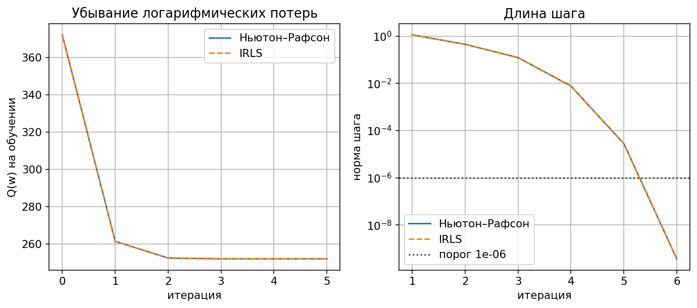
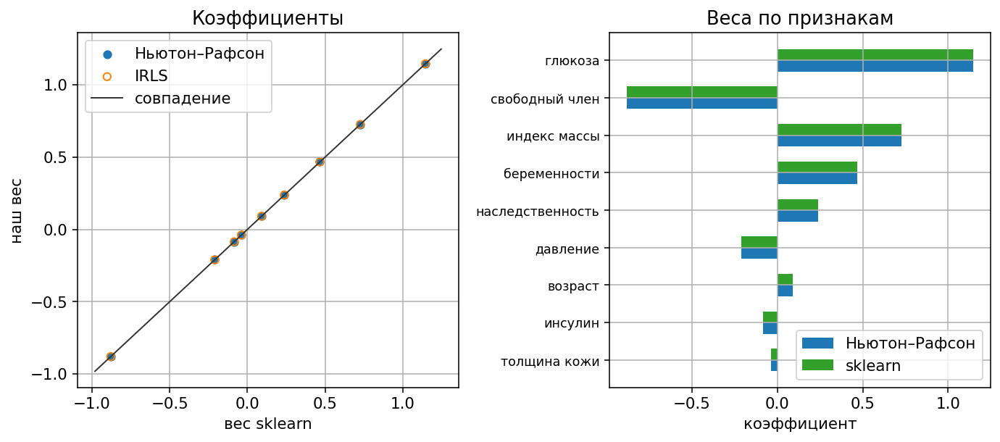
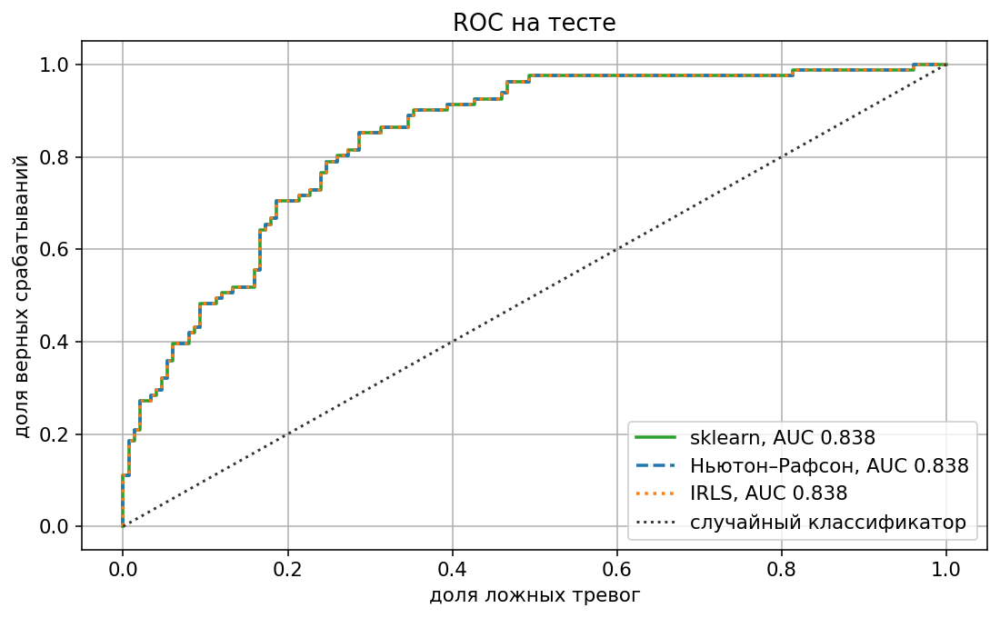

# Лабораторная работа №5. Логистическая регрессия

Логистическая регрессия без регуляризации. Один и тот же функционал минимизируется методом Ньютона–Рафсона и итеративным взвешенным МНК. Эталон — `sklearn.linear_model.LogisticRegression` с `penalty=None`.

Запуск:

```bash
python students/aleksandruk-bs/lab5/source/train.py
```

Таблица скачивается при запуске и в репозиторий не кладётся.

## Датасет

[Pima Indians Diabetes](https://www.kaggle.com/datasets/uciml/pima-indians-diabetes-database): 768 пациенток, 8 признаков, ответ — диабет или нет. Диабет у 268, нет у 500.

Обучение 537 (187 с диабетом), тест 231 (81 с диабетом), разбиение стратифицированное, `random_state = 42`. Среднее и СКО считаются только по обучению. После нормировки к матрице справа дописывается столбец единиц: это свободный член, его не делят на СКО.

В файле ноль у глюкозы, давления, толщины кожи, инсулина и индекса массы тела стоит вместо пропуска: таких клеток 5, 35, 227, 374 и 11. В модель они входят как нули. У беременностей ноль — обычное значение, их 111.

Wisconsin Breast Cancer для этой постановки не подходит: на обучении классы линейно разделяются, потери уходят к нулю, а шаг не затухает. Без регуляризации конечного вектора весов нет, и сравнивать коэффициенты со sklearn не с чем. У Pima минимум конечный, число обусловленности гессиана в нём около 5,6.

## Модель

Ответ берётся из распределения Бернулли. Вероятность диабета μ, вероятность против 1 − μ. Минус логарифм правдоподобия одного объекта:

$$
-y \ln \mu - (1 - y) \ln(1 - \mu), \qquad y \in \{0, 1\}.
$$

Логит связывает вероятность с линейным счётом:

$$
\ln \frac{\mu}{1 - \mu} = w^{\mathsf T} x,
\qquad
\mu = \frac{1}{1 + e^{-w^{\mathsf T} x}}.
$$

Та же сумма записывается через отступ. Метка, отступ и потери одного объекта:

$$
\tilde y = 2y - 1 \in \{-1, +1\},
\qquad
M = \tilde y\, w^{\mathsf T} x,
\qquad
\ln(1 + e^{-M}).
$$

Для y = 1 и y = 0 это соответственно

$$
\ln\bigl(1 + e^{-w^{\mathsf T} x}\bigr)
\qquad\text{и}\qquad
\ln\bigl(1 + e^{w^{\mathsf T} x}\bigr).
$$

Сумма по выборке:

$$
Q(w) = \sum_{i=1}^{\ell} \ln \bigl(1 + e^{-\tilde y_i w^{\mathsf T} x_i}\bigr) \to \min_w.
$$

Сигмоида от отступа, не от сырого счёта:

$$
\sigma_i = \frac{1}{1 + e^{-\tilde y_i w^{\mathsf T} x_i}}.
$$

Производные:

$$
\frac{\partial Q}{\partial w} = -F^{\mathsf T} \bigl(\tilde y \odot (1 - \sigma)\bigr),
\qquad
\frac{\partial^2 Q}{\partial w\, \partial w^{\mathsf T}} = F^{\mathsf T} \operatorname{diag}\bigl(\sigma \odot (1 - \sigma)\bigr)\, F.
$$

Гессиан неотрицательно определён: это сумма ранга-1 матриц с весами σᵢ(1 − σᵢ). На Pima в найденной точке он ещё и невырожден.

Вероятность для ROC — другая сигмоида, уже от сырого счёта:

$$
P(\tilde y = +1 \mid x) = \frac{1}{1 + e^{-w^{\mathsf T} x}}.
$$

## Ньютон–Рафсон

Старт из нулевого вектора, шаг h = 1. Итерация:

$$
w := w - H(w)^{-1} \nabla Q(w).
$$

Порог остановки: норма шага меньше 10⁻⁶. Из нуля это пять обновлений. Шестое направление уже имеет норму 3,6·10⁻¹⁰, его не делают.

| итерация | Q(w) | норма шага |
|---:|---:|---:|
| 0 | 372,220 | |
| 1 | 261,506 | 1,142 |
| 2 | 252,534 | 0,451 |
| 3 | 252,126 | 0,123 |
| 4 | 252,125 | 0,00768 |
| 5 | 252,125 | 2,78·10⁻⁵ |

Дальше Q стоит на 252,125. Делённое на 537 это 0,4695 — среднее логарифмическое потерь, оно совпало со `sklearn.metrics.log_loss` на обучении.

Отношение длины следующего шага к квадрату предыдущего остаётся порядка единицы и к концу выходит на 0,47:

$$
\frac{\lVert \Delta w_{t+1} \rVert}{\lVert \Delta w_t \rVert^2} \approx 0{,}47.
$$

Сам шаг при этом падает с 0,12 до 10⁻¹⁰. Это квадратичная сходимость: число верных знаков удваивается за итерацию.



## IRLS

Тот же шаг записывается как взвешенный МНК. Вес объекта и взвешенная матрица:

$$
\gamma_i = \sqrt{\sigma_i(1 - \sigma_i)},
\qquad
\tilde F = \operatorname{diag}(\gamma)\, F.
$$

Модифицированный ответ:

$$
z_i = \frac{\tilde y_i (1 - \sigma_i)}{\gamma_i} = \tilde y_i \sqrt{\frac{1 - \sigma_i}{\sigma_i}}.
$$

Подстановка даёт гессиан и минус градиент:

$$
\tilde F^{\mathsf T} \tilde F = H,
\qquad
\tilde F^{\mathsf T} z = F^{\mathsf T}\bigl(\tilde y \odot (1 - \sigma)\bigr) = -\nabla Q.
$$

Поэтому направление совпадает с ньютоновским:

$$
\bigl(\tilde F^{\mathsf T} \tilde F\bigr)^{-1} \tilde F^{\mathsf T} z = -H^{-1} \nabla Q.
$$

Прибавить это к w с шагом 1 — то же самое, что шаг Ньютона. Если в числителе z оставить только метку и не умножать на (1 − σ), справа получится не градиент:

$$
F^{\mathsf T} \tilde y.
$$

Оба метода идут из нуля с шагом 1. Траектории совпали: максимум разности координат по всем итерациям 2·10⁻¹⁶. Отдельная проверка одного шага из нуля и из случайной точки даёт расхождение направлений 7·10⁻¹⁶.

## Сравнение со sklearn

`LogisticRegression(penalty=None, solver="lbfgs", fit_intercept=False, tol=1e-6)` учится на той же матрице со столбцом единиц. Свободный член в оценке уже есть, поэтому `fit_intercept=False`. Регуляризации нет ни там, ни там.

| признак | Ньютон | IRLS | sklearn |
|---|---:|---:|---:|
| беременности | 0,467060 | 0,467060 | 0,467053 |
| глюкоза | 1,146460 | 1,146460 | 1,146460 |
| давление | −0,209634 | −0,209634 | −0,209637 |
| толщина кожи | −0,038674 | −0,038674 | −0,038671 |
| инсулин | −0,084801 | −0,084801 | −0,084803 |
| индекс массы | 0,726784 | 0,726784 | 0,726787 |
| наследственность | 0,238319 | 0,238319 | 0,238319 |
| возраст | 0,091197 | 0,091197 | 0,091205 |
| свободный член | −0,879700 | −0,879700 | −0,879702 |

Норма разности векторов Ньютона и IRLS равна 2·10⁻¹⁶. Норма разности с sklearn равна 1,2·10⁻⁵: lbfgs останавливается по своему критерию при том же `tol`, до общих знаков после пятого это один и тот же вектор. Вероятности на тесте отличаются не больше чем на 6·10⁻⁶.

Коэффициент — добавка к логиту на одно СКО признака. Глюкоза 1,15 и индекс массы 0,73 умножают шансы диабета так:

$$
e^{1{,}15} \approx 3{,}1,
\qquad
e^{0{,}73} \approx 2{,}1.
$$

Свободный член −0,88: у пациентки со средними признаками счёт отрицательный, вероятность ниже половины. Инсулин и толщина кожи почти на нуле: в этих столбцах ноль стоит у половины и трети строк.



На тесте все три модели дают одно и то же: 172 верных ответа из 231, точность 0,745, ROC-AUC 0,838, средние логарифмические потери 0,479. Ответ «диабета нет» на всех объектах теста дал бы 150 из 231, то есть 0,649.



## Реализация

| Пункт | Где |
|---|---|
| загрузка Pima, нормировка, столбец единиц, метки ±1 | `dataset.py` |
| потери, шаг Ньютона, шаг IRLS | `logistic.py` |
| графики и сравнение со sklearn | `train.py` |

Своя оптимизация — в `logistic.py`. sklearn даёт разбиение, эталонную модель, точность, ROC-AUC и средние логарифмические потери.

## Выводы

1. Минус логарифм бернуллиевского правдоподобия при логит-связи совпадает с суммой ln(1 + exp(−M)) по меткам −1 и +1.
2. Шаг Ньютона и шаг взвешенного МНК — одна линейная система. На всех итерациях веса совпали до 10⁻¹⁶.
3. Из нуля при шаге 1 порог 10⁻⁶ пройден за пять обновлений. Отношение длины шага к квадрату предыдущего около 0,47: сходимость квадратичная.
4. Со sklearn при выключенной регуляризации и общем столбце единиц веса разошлись на 1,2·10⁻⁵. Точность и AUC на тесте совпали: 0,745 и 0,838.
5. Счёт держат глюкоза и индекс массы. Столбцы, где ноль означает пропуск, почти не входят в вес.
