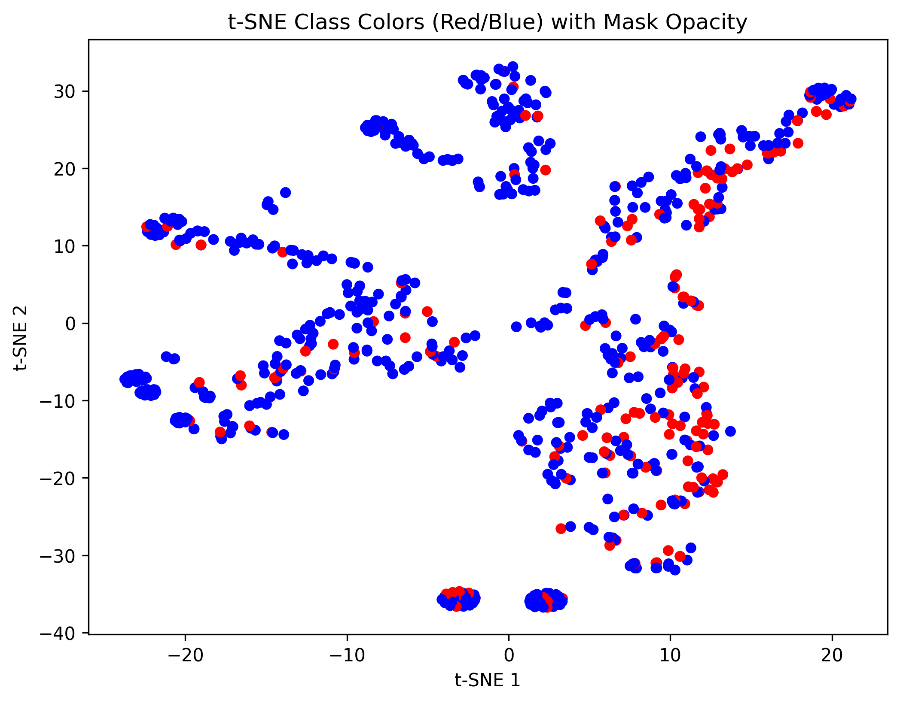
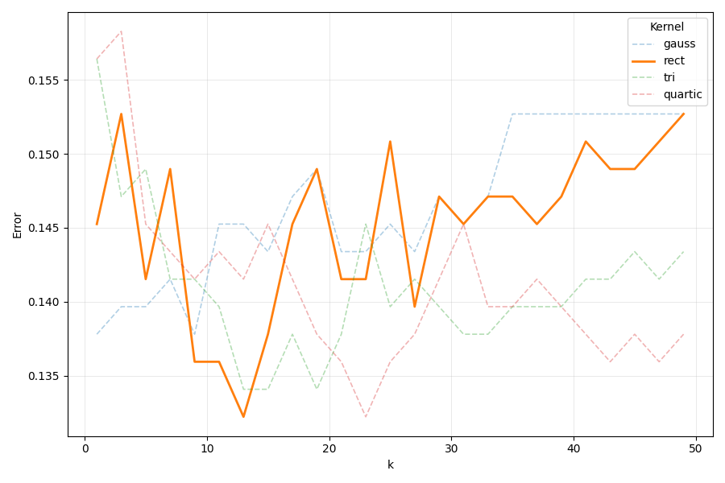
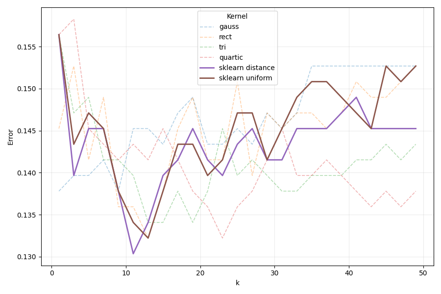
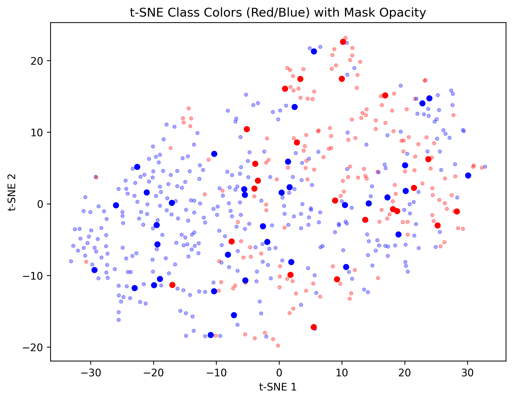

## Usage

- Запуск `uv run main`
- Тестирование `uv run pytest`

## Dataset

Для выполнения лабораторной работы был выбран датасет
[диабет индейцев пима](https://www.kaggle.com/datasets/jamaltariqcheema/pima-indians-diabetes-dataset)
Всего 2 класса. Есть ли у пациента диабет.

## KNN implementation

Были реализованы несколько моделей KNN

- `model/SimpleKNN.py` - выбирает самый популярный класс среди k соседей
- `model/ParzenKNN.py` - использует взвешенные голоса относительно расстояния до объектов, ядра и выбранной ширины ядра. Ядра: `rect` , `tri` , `epanechnikov` , `quartic` , `gauss`
- `model/AdaptiveParzenKNN.py` - автоматически подбирает ширину ядра относительно расстояния до K+1 соседа

## Parameter search

Внешний test (30%) отделён до подбора параметров, поэтому LOO считается только на train и не использует объекты будущего test.

В лекции было сказано, что CCV не сильно зависит от размера разбиения. Поэтому я использовал LOO для подбора параметров ядра и ширины ядра

Я посчитал LOO на train для каждой пары (ширина ядра, тип ядра) для адаптивного алгоритма Парзена

Самым лучшим оказались параметры 
- h - 13
- Kernel - rect
При таких параметрах LLO = 0.1322

Были выбраны именно такие параметры, тк график для ядра `rect` имеет минимум не выше минимумов других ядер; этот минимум находится при h = 13. Если несколько конфигураций дают одинаковый LOO, выбирается первая.

## scikit-learn compare
Затем я сравнил свой лучший алгоритм с реализацией из sklearn. Я также попробовал 2 ядра `distance` и `uniform`. 

Сравнение лучших конфигураций (LOO на train и точность на общем test):

- h - 11
- Kernel - sklearn distance

При таких параметрах LLO (train) = 0.1304, точность на test = 0.8615.

## Reference search

Для реализации алгоритма отбор эталонов я использовал жадный алгоритм исключения. Для этого я реализовал вычисление профиля компактности `train/ccv.py:21-30` и также CCV через профиль компактности `train/ccv.py:33-51`.

Для поиска эталонов я сначала брал весь train и на каждом шаге искал такой элемент, убрав который получим минимальный CCV. Если же минимальный CCV будет больше текущего CCV, то останавливаемся.

Для оптимизированного подсчета изменение профиля компактности при m=1 была реализована функция `remove_row_set_compact_profile` `train/ccv.py:155-187`. В ней реализован кэширование матрицы расстояний и векторное вычисление вклада для каждого объекта.

В `train/ref_selection.py` была реализована отбора эталонов по описанному ранее условию.

Параметры эталонной модели подбираются LOO на train; при проверке объекта из эталонного набора он исключается из обучающей выборки (`mask=ref_mask`).

В итоге получились следующие результаты

- Мелкие прозрачные круги - удаленные объекты
- Большие четкие круги - выбранные эталоны

### Подбор параметров (train)

LOO считается только на train; test не участвует в выборе.

|Модель|Размер train|LOO (train)|
|-|-|-|
|Полная|537|0.1322|
|Эталонная|59 (11.0% от train)|0.0708|
|sklearn|537|0.1304|

Для сравнения: в старом протоколе (поиск по всему X) LOO полного набора (768, включая test) = 0.1289; в новом протоколе он включает test и не используется для выбора.

### Качество на общем test

Тест не участвовал ни в отборе эталонов, ни в подборе параметров (n=231).

|Модель|Точность|
|-|-|
|Полная|0.8571|
|Эталонная|0.8268|
|sklearn|0.8615|

LOO эталонной модели ниже, но точность на test ниже: LOO считается на train, по которому отбирались эталоны, поэтому он оптимистичен.

# Вывод

Были выполнены все пункты задания лабораторной работы

Параметры обеих моделей подбирались только на train (LOO), сравнение — на одном нетронутом test (231 объектов):

- полная модель: LOO (train) = 0.1322, test acc = 0.8571;
- эталонная модель: LOO (train) = 0.0708, test acc = 0.8268;
- sklearn: LOO (train) = 0.1304, test acc = 0.8615.