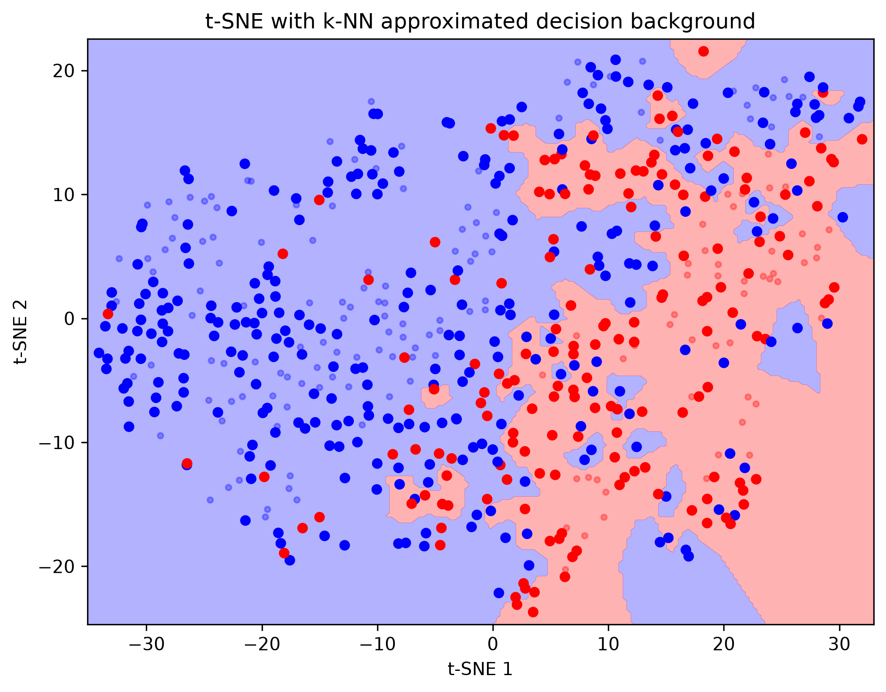
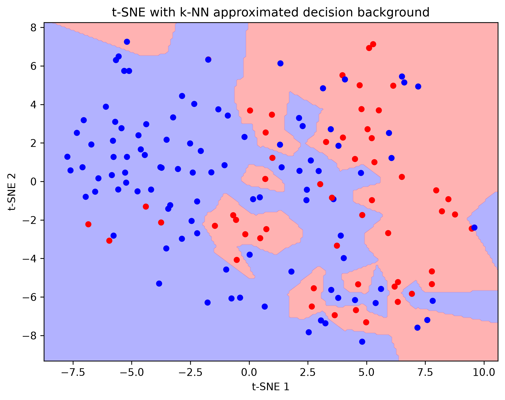

# Лабораторная работа №3. SVM

## 1. Датасет для бинарной классификации

Для бинарной классификации выбран датасет **Pima Indians Diabetes** (загрузка и препроцессинг — `src/lab3/datasets/pima.py`). Он содержит 768 объектов и 8 числовых признаков. Целевая переменная `Outcome` перекодируется в метки `{-1, +1}`.

Данные стандартизуются (`StandardScaler`), а разбиение на обучающую и тестовую выборки выполняется стратифицированно (`train_test_split(..., stratify=y)`, 80/20), чтобы сохранить баланс классов.

## 2. Решение двойственной задачи по λ

Реализация SVM находится в **`src/lab3/model/SVM.py`** (класс `SVM`). Решается двойственная задача мягкого SVM:

$$\max_{\lambda}\ \sum_i \lambda_i - \frac{1}{2}\sum_i\sum_j \lambda_i\lambda_j\,y_i y_j\,K(x_i, x_j)
\qquad\text{при}\qquad 0 \le \lambda_i \le C,\quad \sum_i \lambda_i y_i = 0.$$

Для численного решения используется **`scipy.optimize.minimize`** (метод SLSQP). Минимизируется отрицание двойственной цели:

```python
K = self.kernel(x)  # (n, n) — грам-матрица, считается один раз
H = np.outer(y, y) * K
fun = lambda lam: -lam.sum() + 0.5 * lam @ H @ lam
```

Ограничения задачи заданы через `bounds=[(0, self.c)] * n` (условие `0 ≤ λᵢ ≤ C`) и равенство `constraints={"type": "eq", "fun": lambda lam: lam @ y}` (условие `Σ λᵢyᵢ = 0`). Оптимизация векторизована: вместо двойного цикла по `n²` парам используется квадратичная форма `λᵀHλ`, где `H` вычисляется один раз.

## 3. Трюк с ядром

Ядра вынесены в отдельный модуль **`src/lab3/model/kernels.py`**; каждое ядро принимает матрицы объектов и возвращает грам-матрицу `K(x_i, x_j)`. Реализованы **три типа ядер**:

- **линейное** — `linear`: `K = a @ b.T`;
- **полиномиальное** — `polynomial`: `K = (a @ b.T) ** d`;
- **радиально-базисное (RBF/гауссово)** — `rbf`: `K = exp(-gamma * ||a - b||^2)`.

Трюк с ядром заключается в том, что скалярные произведения `x_i · x_j` заменяются значениями ядра `K(x_i, x_j)`, поэтому переход к нелинейному классификатору сводится к замене функции ядра — сама задача оптимизации и реализация SVM не меняются. Выбор ядра передаётся в конструктор: `SVM(C, kernels.rbf)`.

## 4. Линейный классификатор

При линейном ядре решение можно записать в явном виде через веса:

$$w = \sum_i \lambda_i y_i x_i,\qquad f(x) = w\cdot x + b,$$

где `b` (свободный член) вычисляется по опорным векторам (объектам с `0 < λᵢ < C`). Для нелинейных ядер используется двойственная форма `f(x) = Σᵢ λᵢ yᵢ K(xᵢ, x) + b`, что и реализовано в **`src/lab3/model/SVM.py`** `decision`/`predict`.

## 5. Визуализация решения

Визуализация — `src/lab3/visual/utils.py`:

- `draw_dataset` — проекция данных на 2D с помощью **t-SNE**; фон решения строится аппроксимацией k-NN по предсказаниям модели.
- `draw_dataset_pca` — проекция на **PCA** (через сингулярное разложение, SVD); координаты сетки обратным преобразованием возвращаются в исходное пространство признаков и подаются на вход модели (`model.predict`), после чего рисуются настоящие области решений классификатора.

Точки классов −1/+1 окрашены в синий/красный, опорные векторы (граничные и нарушители, где ` 0 < λ <= C`) выделены жирным.
### Train

### Test



## 6. Сравнение с эталонной реализацией

В качестве эталона используется `sklearn.svm.SVC(kernel="rbf", C=1.0, gamma=0.1)`. Обе модели обучались на одних и тех же стандартизованных данных с одинаковым стратифицированным разбиением. Вывод программы (`main.py`):

```
train accuracy: 0.8909
test accuracy: 0.8377
sklearn: train accuracy: 0.8909
sklearn: test accuracy: 0.8377
```

| Модель                | Train accuracy | Test accuracy |
|-----------------------|:--------------:|:-------------:|
| Собственный SVM (RBF) | 0.8909         | 0.8377        |
| sklearn `SVC` (RBF)   | 0.8909         | 0.8377        |

## Вывод

Собственная реализация SVM даёт качество, практически не отличающееся от эталонной библиотеки: точность на тесте полностью совпадает (`0.8377`), а на обучении отличается незначительно. Абсолютные значения (≈0.84) нельзя назвать высокими — датасет Pima Indians Diabetes имеет сильное пересечение классов, и линейно/радиально разделить его с высокой точностью трудно. Тем не менее совпадение результата с эталонным `sklearn` подтверждает корректность реализации двойственной задачи, ядрового трюка и построенного классификатора. Ожидаемо повысить качество можно подбором гиперпараметров (`C`, `gamma` для RBF, степень полинома), а также отбором/масштабированием признаков.
