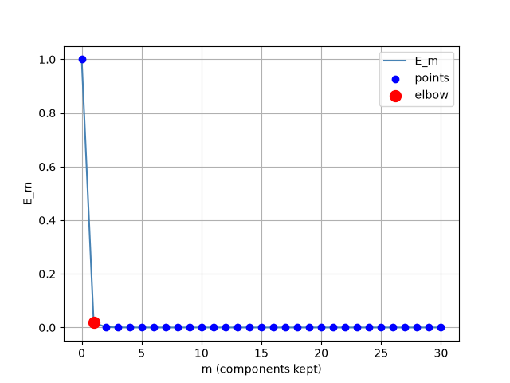

# Лабораторная работа №4. PCA

## 1. Выбор датасета

В качестве набора данных выбран встроенный датасет
`sklearn.datasets.load_breast_cancer` (569 наблюдений, 30 признаков).
Загрузка и предобработка вынесены в `src/lab4/dataset.py`:

- `download_dataset()` — загружает датасет;
- `preprocess_data(df)` — возвращает матрицу признаков `df["data"]`.

Матрица признаков имеет размер `569 x 30`.

## 2. Реализация PCA через сингулярное разложение

Ключевая часть работы — собственная реализация SVD в `src/lab4/PCA.py`.
Функция `my_svd(X)` вычисляет сингулярное разложение `X = U * S * Vt` через
собственные значения, что позволяет работать с прямоугольными матрицами:

- правые сингулярные векторы `V` и сингулярные числа `s` находятся из
  собственного разложения `XTX = X.T @ X`, при этом `s = sqrt(eigvals)`;
- левые сингулярные векторы `U` находятся из собственного разложения `XXT = X @ X.T`;
- знаки столбцов `U` синхронизируются со столбцами проекции `X @ Vt.T`, чтобы
  устранить неоднозначность знака собственных векторов.

Класс `PCA` надстраивается над `my_svd`:

- центрирует данные: `self.x = x - self.mean`;
- хранит разложение `v`, `s`, `u_t` и проекцию `g = self.x @ self.u_t.T`;
- `reduce_component(cnt)` сокращает число компонент на `cnt`, оставляя первые
  `n - cnt` сингулярных чисел;
- `reconstruct()` восстанавливает данные из усечённого представления;
- свойство `reduced` возвращает координаты в новом (усечённом) базисе.

## 3. Эффективная размерность выборки

Эффективная размерность определяется по графику «каменистой осыпи»
(анализа дисперсии). Скрипт `src/lab4/draw_e_plot.py` строит функцию
остаточной дисперсии:

```
E_m = sum(s_i^2, i >= m) / sum(s_i^2, i >= 0)
```

где `s` — сингулярные числа центрированных данных. Величина `E_m` показывает
долю дисперсии, которая теряется при отбрасывании всех компонент, начиная с
`m`-й. График сохраняется в `images/e_plot.png`:



Наблюдения:

- `E_0 = 1.0` — при отсутствии компонент теряется вся дисперсия;
- `E_1 ≈ 0.0180` — уже первая главная компонента сохраняет около `98.2%`
  суммарной дисперсии;
- далее кривая практически плоская (`E_2 ≈ 0.00178`).

Таким образом, **эффективная размерность выборки равна 1**: одной главной
компоненты достаточно, чтобы описать подавляющую часть разброса данных
(«локоть» графика находится в точке `m = 1`). Это согласуется с тем фактом,
что признаки не масштабировались: они измеряются в разных единицах, и признак
с наибольшим масштабом доминирует в первой компоненте.

## 4. Эквивалентность эталонной реализации

Для проверки корректности в `tests/pca_test.py` добавлен набор тестов,
сравнивающий собственную реализацию с `sklearn.decomposition.PCA`.
Основной тест `test_compare_pca` для числа компонент `k` из диапазона
`1..9` сравнивает координаты, полученные `PCA` и эталоном, покомпонентно
по относительной погрешности:

```
abs_error = |(pca.reduced - sk_x) / sk_x|
abs_error = min(abs_error, |2 - abs_error|)   # учёт возможной разницы знаков
assert abs_error.max() < 1e-4
```

Модуль отражения знаков `min(..., |2 - abs_error|)` учитывает, что собственный
вектор определён с точностью до знака, поэтому сравниваются как совпадающие,
так и противоположные по знаку компоненты. Дополнительно проверяются
точность восстановления (`test_reconstruct`) и связь ошибки усечения с суммой
квадратов отброшенных сингулярных чисел (`test_reduce_components`).

Результат запуска тестов:

```
$ uv run pytest
================================================== test session starts ==================================================
platform linux -- Python 3.14.3, pytest-9.1.1, pluggy-1.6.0
rootdir: /home/artem/Documents/itmo/mag/mla/fall-2026/students/am-zaytsev/lab4
configfile: pyproject.toml
plugins: platformdirs-4.13.0
collected 19 items

tests/pca_test.py ...................                                                                             [100%]

================================================== 19 passed in 0.70s ===================================================
```

Все 19 тестов пройдены, что подтверждает эквивалентность собственной
реализации PCA эталонной.

## Вывод

Собственная реализация SVD и PCA корректно совпадает с реализацией
`scikit-learn` (максимальная относительная погрешность компонент `< 1e-4`).
Для выбранного датасета breast cancer без масштабирования признаков
эффективная размерность равна `1`: первая главная компонента описывает
около `98.2%` дисперсии.
