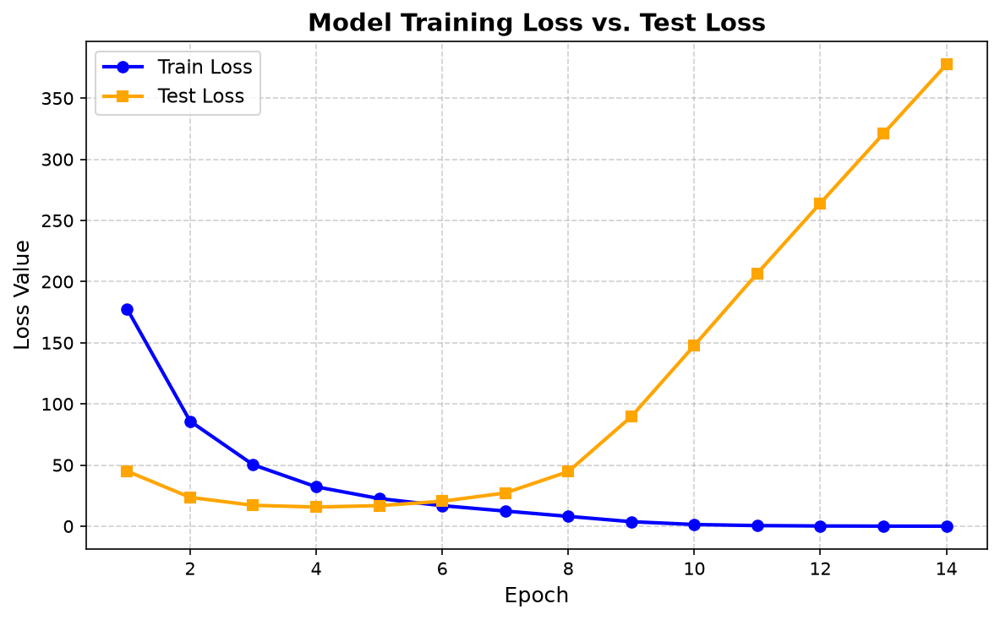

# Лабораторная работа №5. Логистическая регрессия

## 1. Выбранный датасет

Для лабораторной работы выбран встроенный датасет **Breast Cancer Wisconsin (Diagnostic)** из `sklearn.datasets.load_breast_cancer`.

Его характеристики:

* **569** объектов;
* **30** вещественных признаков (радиус, текстура, периметр, площадь, гладкость и т.д.);
* бинарная классификация: злокачественная (`malignant`) и доброкачественная (`benign`) опухоль;
* данные загружаются и подготавливаются в `source/lab5/dataset/utils.py`.

В `utils.py`:

* признаки и ответы разделяются на обучающую и тестовую выборки в пропорции **80/20** с `random_state=42`;
* признаки стандартизируются: `StandardScaler` обучается на обучающей выборке и применяется к тестовой;
* ответы приводятся к виду $\{-1, +1\}$.

---

## 2. Реализация логистической регрессии

Реализация находится в файле [`source/lab5/model/log_reg.py`](source/lab5/model/log_reg.py).

В классе `LogReg` реализованы:

* функция потерь `loss`;
* обучение `train` методом Ньютона–Рафсона с переходом к IRLS;
* предсказание `eval`;
* параметры `h` (шаг), `tol` (допуск остановки) и `max_iteration` (максимальное число итераций).

### 2.1. Математическая модель

Подробный вывод используемых формул также приведён в [`source/lab5/model/README.md`](source/lab5/model/README.md).

### 2.2. Соответствие реализации формулам

В `log_reg.py` выведенным формулам соответствуют следующие элементы:

| В теории | В коде |
|---|---|
| $X$ | `x` |
| $W$ | `self._w` |
| $M_i = Y_i X_i^T W$ | `margin = y * x @ self._w` |
| $\sigma_i$ | `sig = sigmoid(margin)` |
| $L = \sum \log(1 + e^{-M_i})$ | `np.sum(np.log(1 + np.exp(-margin)))` |
| $D$ | веса, вычисляемые из `sig` |
| $\tilde{X}$ | `x_wave = x * np.sqrt((1 - sig) * sig)` |
| $Y^*$ | `y_star = np.sqrt((1 - sig) / sig) * y` |
| $\Delta w$ | `dw = -np.linalg.inv(x_wave.T @ x_wave) @ x_wave.T @ y_star` |
| $w \leftarrow w - h\Delta w$ | `self._w -= self.h * dw` |

Начальное приближение задаётся решением обычного МНК:

$$
w_0 = (X^T X)^{-1} X^T Y
$$

что в коде записано как:

```python
self._w = np.linalg.inv(x.T @ x) @ x.T @ y
```

Критерий остановки — относительное изменение сигмоиды между итерациями:

$$
\frac{1}{\ell}\sum_{i=1}^{\ell}
\left|\frac{\sigma_i^{(t)} - \sigma_i^{(t-1)}}{\sigma_i^{(t)}}\right| < \text{tol}
$$

В основном сценарии используются параметры `h=1`, `tol=1e-4`, `max_iteration=10_000`.

---

## 3. Сравнение с эталонной реализацией

В [`source/lab5/main.py`](source/lab5/main.py) обучаются две модели на одних и тех же данных:

1. Эталонная реализация:

```python
model_sk = LogisticRegression(
    solver="newton-cholesky",  # closest to Newton/IRLS
    C=np.inf,  # no L2 regularization
    tol=1e-4,  # not same as in my implementation
    max_iter=10_000,
    fit_intercept=True,
)
```

2. Собственная `LogReg` с `max_iteration=10_000`, `h=1`, `tol=1e-4`.

Затем сравниваются:

* accuracy на обучающей и тестовой выборках;
* матрицы ошибок (`confusion_matrix`);
* доля совпадающих предсказаний.

### 3.1. Команда запуска

```bash
.venv/bin/python -m lab5.main
```

или

```bash
uv run main
```

### 3.2. Вывод программы

```text
sklearn LogisticRegression
  Train: accuracy: 1.0000
  Test: accuracy: 0.8947
  Test: confusion matrix:
  41 10
   2 61

custom LogReg (Newton-Raphson / IRLS)
  Train: accuracy: 1.0000
  Test: accuracy: 0.8947
  Test: confusion matrix:
  41 10
   2 61

Models prediction match: 100.00%
```

### 3.3. Разбор результатов

Тестовая выборка содержит **114** объектов (20% от 569), обучающая — **455** объектов.

* Обе модели показывают **accuracy 1.0000 на обучающей выборке**, то есть без ошибок классифицируют все **455** объектов.
* На тестовой выборке accuracy обеих моделей равна **0.8947**, то есть правильно классифицировано **102 из 114** объектов.
* Матрицы ошибок совпадают:

  $$
  \begin{pmatrix}
  41 & 10\\
  2 & 61
  \end{pmatrix}
  $$

* Доля совпадающих предсказаний — **100.00%**: модели предсказывают одинаково для всех **114** тестовых объектов. Это подтверждает, что собственная IRLS-реализация при выбранной конфигурации `sklearn` даёт ту же разделяющую границу.

### 3.4. Кривые потерь



На графике видно, что **train loss** монотонно уменьшается и к концу обучения стремится к нулю. **Test loss** сначала также снижается, но примерно после 6-й итерации начинает резко расти.

Причина **переобучения** — отсутствие регуляризации (`C=np.inf`)

### 3.5. Почему реализации эквивалентны

* `sklearn` с `solver="newton-cholesky"` также использует метод Ньютона с матрицей Гессиана, что идейно совпадает с IRLS;
* `C=np.inf` отключает $L_2$-регуляризацию, поэтому обе модели минимизируют один и тот же log-loss;
* обе модели обучаются на одних и тех же стандартизированных данных;

Поэтому, несмотря на возможные различия в коэффициентах из-за разных критериев остановки, обе реализации дают одинаковые предсказания на тестовой выборке — **100.00% совпадений**.

---

## 4. Вывод

В ходе лабораторной работы:

1. **выбран датасет** Breast Cancer Wisconsin для бинарной классификации;
2. **реализована логистическая регрессия** в `source/lab5/model/log_reg.py` на основе метода Ньютона–Рафсона и его сведения к IRLS;
3. **проведено сравнение с эталонной реализацией** `sklearn.linear_model.LogisticRegression`: accuracy и матрицы ошибок совпали, доля совпадающих предсказаний составила **100.00%**;
4. **подготовлен отчёт** с описанием датасета, математического вывода, реализации и результатов экспериментов.
