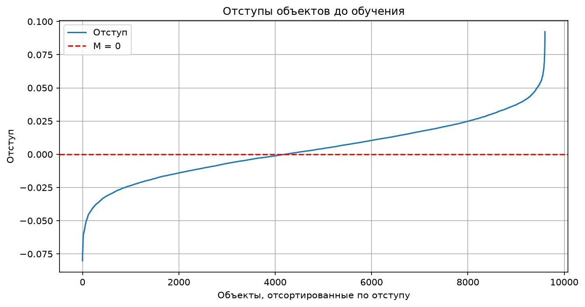
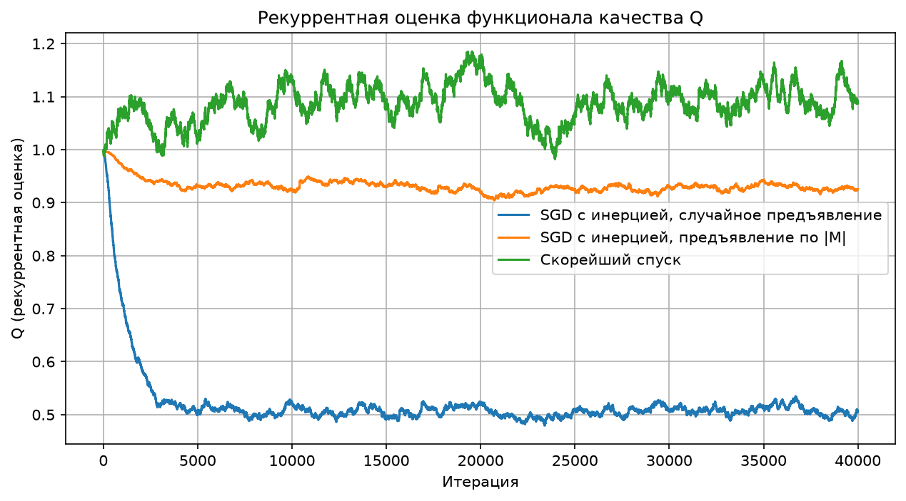
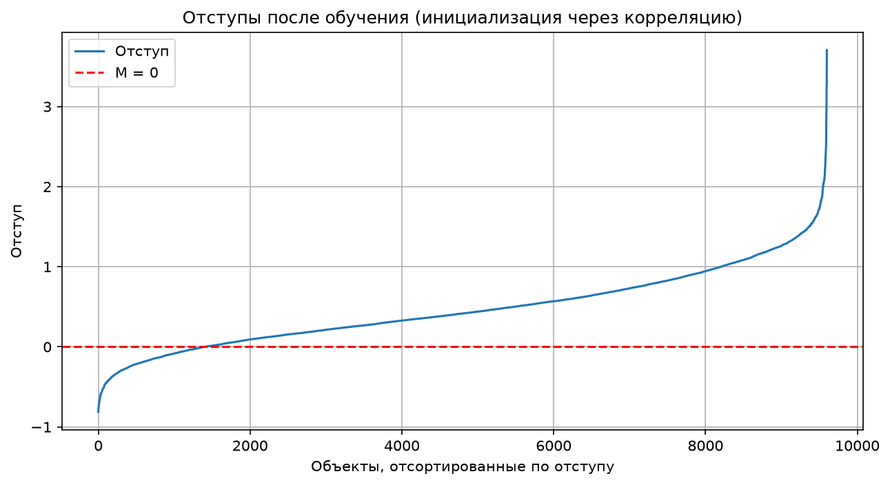
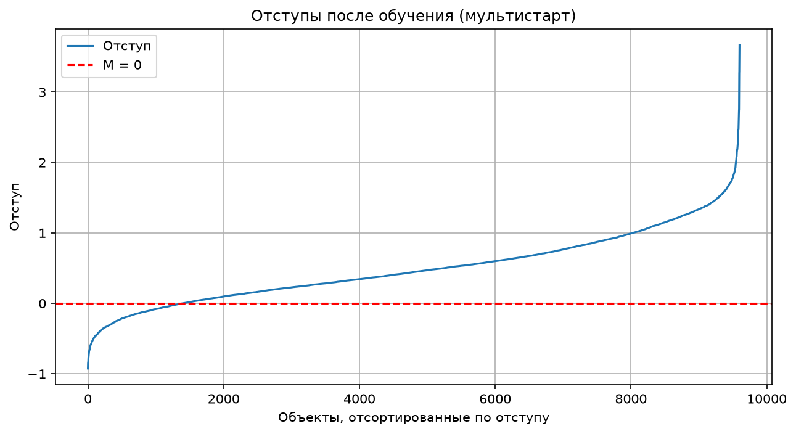
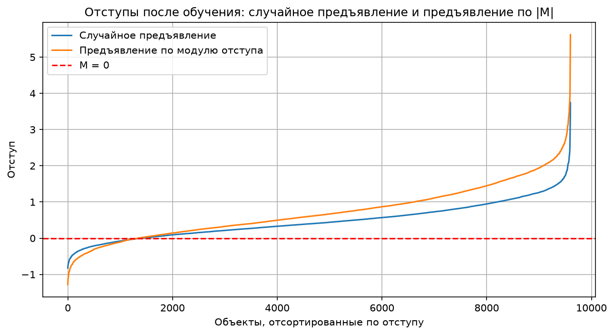
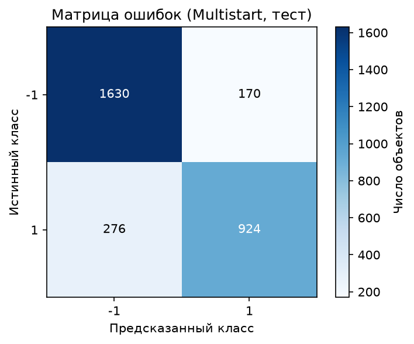
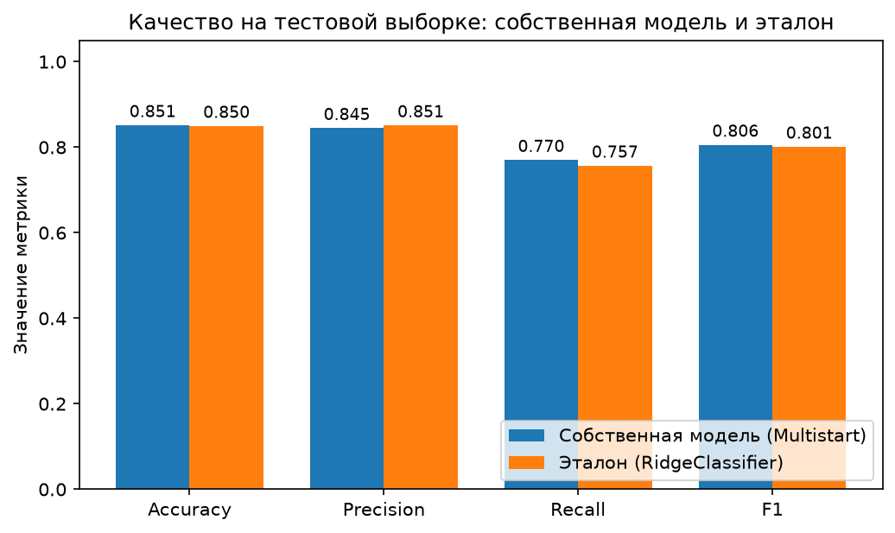

# Лабораторная работа №1. Линейная классификация

## 1. Датасет

Для задачи классификации я выбрала датасет про риск диабета. Целевая переменная — `diabetes_risk`.

**Признаки датасета:**

- `patient_id` — уникальный идентификатор пациента (исключён из признаков модели)
- `age` — возраст пациента
- `gender` — пол пациента
- `city` — город проживания
- `bmi` — индекс массы тела
- `family_history_diabetes` — наличие диабета в семейном анамнезе
- `physical_activity_level` — уровень физической активности
- `diet_type` — тип питания
- `smoking_status` — статус курения
- `alcohol_consumption` — уровень потребления алкоголя
- `hours_sleep_per_night` — количество часов сна за ночь
- `stress_level` — уровень стресса
- `fasting_blood_sugar` — уровень глюкозы натощак
- `hba1c_level` — уровень гликированного гемоглобина
- `blood_pressure_systolic` — систолическое давление
- `blood_pressure_diastolic` — диастолическое давление
- `waist_circumference_cm` — окружность талии
- `income_bracket` — категория дохода.

### Подготовка данных

Пропущенные значения есть в `smoking_status` (472), `alcohol_consumption` (3788) и `income_bracket` (463). Так как эти признаки категориальные, пропуски заполняются модой, вычисленной по обучающей выборке. Числовые признаки стандартизуются (среднее и стандартное отклонение считаются только по обучающей выборке, а затем применяются к валидационной и тестовой), чтобы признаки были одного масштаба. Категориальные признаки преобразуются с помощью `pd.get_dummies`, а столбцы тестовой выборки приводятся к тем же названиям и порядку, что и в обучающей.

В исходных данных три категории риска: `Low` (9000 объектов), `Moderate` (3750) и `High` (2250). Я преобразовала задачу в бинарную классификацию: `Low` → `-1`, `Moderate` и `High` → `+1`. Получилось 9000 объектов класса `-1` (60 %) и 6000 объектов класса `+1` (40 %), выборки разделялись с сохранением этой пропорции (`stratify`).

Всего 15 000 объектов. Сначала выделено **3 000 объектов для тестирования**, оставшиеся 12 000 разделены на **9 600 для обучения и 2 400 для валидации** (разбиение делается до заполнения пропусков и стандартизации). 
 Валидационная выборка нужна, чтобы выбирать лучшую собственную модель не по обучающей выборке, на которой модели обучались. После кодирования и добавления константного признака получилось по **41 столбцу** в каждой выборке.

### Обучаемый порог активации (bias)

```math
a(x) = \mathrm{sign}\left(\sum_{j=1}^{n} w_j f_j(x) - w_0\right)
```

## 2. Вычисление отступа объекта

Дискриминантная функция с порогом:

$$
g(x_i, w) = \sum_{j=1}^{n} w_j f_j(x_i) - w_0.
$$

Отступ объекта:

$$
M_i = y_i g(x_i,w).
$$

Если `Mᵢ < 0`, объект классифицирован неправильно; если `Mᵢ > 0`, правильно. Чем ближе отступ к нулю, тем ближе объект находится к разделяющей границе.

<p align="center">
  
</p>

На графике отступы отсортированы по возрастанию. До обучения используется случайная инициализация весов (малые значения из диапазона `±1/(2n)`), поэтому все отступы лежат около нуля: от **−0,0801 до 0,0923**, среднее **0,0036**, при этом `|Mᵢ| < 0,1` у **100 %** объектов. Отрицательные отступы (ошибочная классификация) имеют **43,76 %** объектов, то есть до обучения классификатор почти не лучше случайного.

## 3. Функция потерь, градиент и рекуррентная оценка качества

Я использовала квадратичную функцию потерь:

$$
L_i(w) = (1 - M_i)^2 = (1 - y_i g(x_i,w))^2.
$$

Её градиент по **всем** обучаемым коэффициентам, включая порог `w₀`, можно компактно записать через дополненный вектор признаков $\tilde x_i = (x_i, -1)$:

$$
\nabla_{\tilde w} L_i = -2(1-M_i)y_i\tilde x_i,
\qquad \tilde w = (w_1,\ldots,w_n,w_0).
$$

В `gradient_loss()` результатом является вектор изменений всех весов.

Рекуррентная оценка качества нужна, чтобы не пересчитывать среднюю ошибку по всей обучающей выборке на каждом шаге SGD:

$$
Q_t = \lambda \xi_t + (1-\lambda)Q_{t-1},
$$

где `ξₜ` — потеря на текущем объекте, а `λ` коэффициент забывания предыдущих значений.

Обучение выполняется стохастическим градиентным спуском с инерцией:

$$
v := \gamma v + (1-\gamma)\nabla \widetilde L_i(\tilde w),
\qquad
\tilde w := \tilde w - h v,
$$

где `γ` определяет, насколько сильно учитываются предыдущие градиенты (усреднение примерно по последним `1/(1−γ)` итерациям).

<p align="center">
  
</p>

При случайном предъявлении `Q` быстро снижается и примерно с 3 000-й итерации колеблется около **0,5**, что совпадает со средней потерей на обучающей выборке. При предъявлении по модулю отступа `Q` держится около **0,93**: оценка считается по предъявляемым объектам, а это в основном пограничные объекты с `Mᵢ ≈ 0`, у которых потеря близка к 1. Поэтому в этом режиме `Q` не является оценкой средней потери по всей выборке. У скорейшего спуска `Q` не уменьшается и сильно колеблется (около 1,0–1,2).

## 4. L2-регуляризация

L2-регуляризация уменьшает влияние слишком больших весов:

$$
\widetilde L_i(\tilde w) = L_i(\tilde w) + \frac{\tau}{2}\sum_{j=1}^{n}w_j^2.
$$

При этом **порог `w₀` не регуляризуется**: в коде штраф считается по `w[:-1]`, а последняя компонента градиента регуляризации равна нулю. Регуляризация (`τ = 10⁻³`) применяется во всех вариантах обучения, включая скорейший спуск.

## 5. Скорейший градиентный спуск

В `SGD_steepest()` применяется оптимальный шаг для квадратичной потери **одного выбранного объекта**:

$$
h_i^* = \frac{1}{2\|\tilde x_i\|^2}.
$$

Здесь $\tilde x_i$ включает константный признак `-1`. Эта формула выводится для пообъектной квадратичной потери без L2-штрафа и соответствует градиенту $-2(1-M_i)y_i\tilde x_i$.

## 6. Предъявление объектов по модулю отступа

Реализована функция `choose_by_margin()`: чем меньше `|Mᵢ|`, тем выше вероятность предъявления объекта. Веса выбора и вероятности рассчитываются так:

$$
s_i = \frac{1}{|M_i|+\varepsilon},
\qquad
p_i = \frac{s_i}{\sum_{j=1}^{\ell}s_j}.
$$

Здесь $\varepsilon$ предотвращает деление на ноль. Использовалось очень малое значение $\varepsilon = 10^{-8}$, из-за чего вероятность может концентрироваться на отдельных объектах с почти нулевым отступом. Вероятности пересчитываются по всей обучающей выборке на каждом шаге, поэтому этот режим работает заметно медленнее случайного предъявления.

Концентрация действительно есть: для итоговых весов один объект выбирается с вероятностью **2,79 %**, а 10 самых частых объектов вместе **11,92 %**, хотя при равномерном выборе из 9 600 объектов было бы около 0,01 % и 0,1 %. Вторая причина более высокой средней квадратичной потери видна на графике в разделе 7: у этого режима отступы правильно классифицированных объектов заметно больше (до 5,6 против 3,8), а квадратичная функция $(1-M)^2$ штрафует и за $M > 1$. Поэтому потеря может расти даже при той же или лучшей доле правильных ответов.

## 7. Обучение моделей

Обучение выполнено методом SGD с инерцией (`γ = 0,9`), шагом `h = 10⁻³`, `λ = 0,001`, `τ = 10⁻³` и максимумом 40 000 итераций, с корреляционной инициализацией, мультистартом (5 запусков), случайным предъявлением и предъявлением по модулю отступа. Сходимость проверяется раз в 200 итераций: сравниваются `w` и `Q` с их значениями 200 итераций назад (`eps = 10⁻⁶`). Во всех запусках критерий не сработал, и обучение дошло до лимита в **40 000 итераций**. Во всех вариантах, включая скорейший спуск, обучается коэффициент порога `w₀`.

### Инициализация через корреляцию

Для инициализации используется формула `wⱼ = ⟨y, fⱼ⟩ / ⟨fⱼ, fⱼ⟩`. После дополнения матрицы признаков она применяется и к константному столбцу.

Начальные веса находятся в диапазоне от **−0,3564 до 0,6418**, норма вектора весов равна **1,5580**. Начальные отступы находятся в диапазоне **от −3,8384 до 8,7083**. 

<p align="center">
  
</p>

После обучения SGD доля объектов с отрицательным отступом на обучающей выборке составляет **14,64 %**, ошибка на обучающей выборке равна **0,5074**. Качество на тесте: Accuracy **0,8480**, Precision **0,8292**, Recall **0,7808**, F1 **0,8043**. Матрица ошибок:

```text
[[1607  193]
 [ 263  937]]
```

### Случайная инициализация через мультистарт

Модель обучалась 5 раз с разными случайными начальными весами и разными последовательностями предъявления объектов. Лучший запуск выбирался по наименьшему значению функции потерь с L2-штрафом на обучающей выборке.

<p align="center">
  
</p>

Лучшей собственной моделью по ошибке на **валидационной** выборке остался **мультистарт**. Ошибка на обучающей выборке составила **0,5012**, на валидационной **0,5130**. Доля объектов с отрицательным отступом на обучающей выборке **14,45 %**. 

На тесте: Accuracy **0,8513**, Precision **0,8446**, Recall **0,7700**, F1 **0,8056**. Матрица ошибок:

```text
[[1630  170]
 [ 276  924]]
```

Это означает, что из 1200 объектов положительного класса модель правильно определила 924, а 276 ошибочно отнесла к отрицательному классу.

### Случайное предъявление и предъявление по модулю отступа

<p align="center">
  
</p>

Результаты последнего запуска (обе модели стартуют с одинаковых начальных весов):

| Метрика | Случайное предъявление | По модулю отступа |
|---|---:|---:|
| Accuracy | 0,8463 | **0,8510** |
| Precision | **0,8284** | 0,8193 |
| Recall | 0,7767 | **0,8050** |
| F1 | 0,8017 | **0,8121** |
| Ошибка на обучении | **0,5059** | 0,6160 |
| Ошибка на валидации | **0,5143** | 0,6558 |

При предъявлении по модулю отступа модель находит больше объектов положительного класса: число ложноотрицательных уменьшилось с **268 до 234**, но число ложноположительных выросло с **193 до 213**. Благодаря этому Accuracy выросла с 0,8463 до 0,8510, Recall  с 0,7767 до 0,8050, F1 с 0,8017 до 0,8121, а Precision немного снизилась (с 0,8284 до 0,8193).

При этом средняя квадратичная потеря у режима по модулю отступа заметно выше (0,6160 против 0,5059 на обучении). Это значит, что по доле правильных ответов модель не хуже, но отступы объектов получаются менее «аккуратными» с точки зрения минимизируемой функции. Разница в метриках небольшая (около 0,5 процентного пункта по Accuracy) и получена в одном запуске, поэтому делать вывод о стабильном преимуществе одного из способов предъявления по этому эксперименту нельзя.

## 8. Сравнение качества всех собственных моделей

| Модель | Accuracy | Precision | Recall | F1 | Ошибка на обучении | Ошибка на валидации |
|---|---:|---:|---:|---:|---:|---:|
| Корреляционная инициализация | 0,8480 | 0,8292 | 0,7808 | 0,8043 | 0,5074 | 0,5171 |
| Мультистарт | **0,8513** | **0,8446** | 0,7700 | 0,8056 | **0,5012** | **0,5130** |
| Случайное предъявление | 0,8463 | 0,8284 | 0,7767 | 0,8017 | 0,5059 | 0,5143 |
| По модулю отступа | 0,8510 | 0,8193 | **0,8050** | **0,8121** | 0,6160 | 0,6558 |
| Скорейший спуск | 0,7797 | 0,6926 | 0,8075 | 0,7457 | 1,0532 | 1,1445 |

Лучшей собственной моделью выбран мультистарт, так как у него наименьшая ошибка на валидационной выборке (выбор делается по ошибке, а не по тестовым метрикам). У него же наибольшие Accuracy и Precision на тесте. По Recall и F1 немного выше предъявление по модулю отступа, а по Accuracy оно почти не отличается от мультистарта (0,8510 против 0,8513, то есть 1 объект из 3 000).

Скорейший спуск оказался заметно хуже остальных: Accuracy **0,7797**, Precision **0,6926** при высокой Recall **0,8075**, то есть модель часто относит объекты к положительному классу (430 ложноположительных против 170–213 у остальных моделей). Матрица ошибок скорейшего спуска:

```text
[[1370  430]
 [ 231  969]]
```

Ошибка на обучении у него также самая большая (1,0532). Вероятная причина шаг `1/(2‖x‖²)` пересчитывается на каждом объекте и делает $M_i = 1$ ровно на текущем объекте, не учитывая L2-штраф и остальные объекты, из-за чего траектория остаётся шумной (это видно и по графику `Q` в разделе 3). 

Обученные пороги активации `w₀`:

| Модель | w₀ |
|---|---:|
| Корреляционная инициализация | 0,049232 |
| Мультистарт | 0,209488 |
| Случайное предъявление | 0,187660 |
| По модулю отступа | 0,254385 |
| Скорейший спуск | 0,207593 |

Разные значения `w₀` показывают, что порог участвует в обучении, а не остаётся фиксированным.

## 9. Сравнение с эталонной реализацией

Для сравнения используется `RidgeClassifier` из scikit-learn на той же обучающей и тестовой выборке.

| Метрика | Лучшая собственная модель (мультистарт) | Эталонная модель |
|---|---:|---:|
| Accuracy | **0,8513** | 0,8497 |
| Precision | 0,8446 | **0,8510** |
| Recall | **0,7700** | 0,7567 |
| F1 | **0,8056** | 0,8011 |

Собственная модель и эталон показали практически одинаковое качество. Мультистарт чуть лучше по Accuracy (на **0,0017**, то есть 0,17 процентного пункта), Recall (на **0,0133**, примерно 1,33 процентного пункта) и F1 (на 0,0045), эталон чуть лучше по Precision (на 0,0064). Такие различия малы (на 3000 тестовых объектов Accuracy отличается примерно на 5 объектов), поэтому можно сказать, что собственная реализация достигла уровня эталона, но не превзошла его однозначно.

В текущем коде эталон обучается с `alpha=0`, а мультистарт с L2-регуляризацией (`τ = 10⁻³`). Поэтому это сравнение качества полученных моделей, но не полностью контролируемое сравнение одинаковых целевых функций. `RidgeClassifier` минимизирует **сумму** квадратов ошибок плюс $\alpha\|w\|^2$, а в собственной реализации используется **среднее** плюс $\frac{\tau}{2}\|w\|^2$, поэтому регуляризации того же масштаба соответствует $\alpha = \tau\ell/2 = 4{,}8$. Дополнительная проверка с этим значением дала Accuracy **0,8490** и F1 **0,8002**, то есть почти те же метрики: на этих данных такая слабая регуляризация на результат практически не влияет.

<table>
  <tr>
    <td align="center">
      <br>
      <sub>Матрица ошибок лучшей собственной модели</sub>
    </td>
    <td align="center">
      <br>
      <sub>Сравнение метрик с эталоном</sub>
    </td>
  </tr>
</table>

## 10. Вывод

Лучшей собственной моделью по ошибке на валидационной выборке остался **мультистарт**: Accuracy **0,8513**, Precision **0,8446**, Recall **0,7700**, F1 **0,8056**. Эталонная модель показала Accuracy **0,8497** и F1 **0,8011**, то есть собственная реализация достигла уровня эталона.

Корреляционная инициализация, случайное предъявление и мультистарт дали близкие результаты (Accuracy 0,8463–0,8513). Предъявление по модулю отступа дало лучшие Recall (0,8050) и F1 (0,8121) на тесте при почти той же Accuracy (0,8510), но у него заметно выше квадратичная ошибка на обучении (0,6160), а разница в метриках небольшая. Скорейший спуск оказался самым слабым вариантом: Accuracy 0,7797, ошибка обучения 1,0532.

### Вывод по данным

Линейный классификатор достигает Accuracy около 0,85, а эталонный `RidgeClassifier` показывает почти тот же результат. Это говорит о том, что класс «повышенный риск» в значительной степени отделяется от класса «низкий риск» линейной границей по имеющимся признакам. Даст ли более сложная модель заметный прирост, в этой работе не проверялось.

Наибольшие по модулю веса лучшей модели (числовые признаки стандартизованы, поэтому их веса сравнимы):

| Признак | Вес |
|---|---:|
| `hba1c_level` | 0,319 |
| `fasting_blood_sugar` | 0,284 |
| `family_history_diabetes` (Yes) | 0,174 |
| `age` | 0,156 |
| `bmi` | 0,100 |


Положительный вес означает, что рост признака повышает оценку принадлежности к классу повышенного риска. Самый сильный вклад дают уровень гликированного гемоглобина и глюкозы натощак, затем идут семейный анамнез, возраст и индекс массы тела. Давление, окружность талии, часы сна и уровень стресса получили веса, близкие к нулю (по модулю не более 0,03), то есть в данной модели почти не влияют на предсказание. Веса признаков `city_*` небольшие (по модулю не больше 0,09, от −0,087 до +0,058, разных знаков) и не дают оснований для содержательных выводов. 

Веса показывают вклад признаков в линейную модель, а не причинно-следственную связь. Кроме того, веса бинарных (one-hot) признаков нельзя напрямую сравнивать с весами стандартизованных числовых признаков, так как у них разный масштаб.


Модель находит не всех пациентов с повышенным риском: Recall лучшей модели равен 0,77, то есть 276 из 1200 таких пациентов (около 23 %) отнесены к низкому риску. Для медицинской задачи пропуск больного обычно дороже ложной тревоги, поэтому на практике порог классификации стоило бы сместить в сторону большей полноты (уменьшить `w₀`). Режим предъявления по модулю отступа даёт более высокий Recall (0,8050), но не за счёт порога (его `w₀` даже больше), а за счёт других весов признаков.