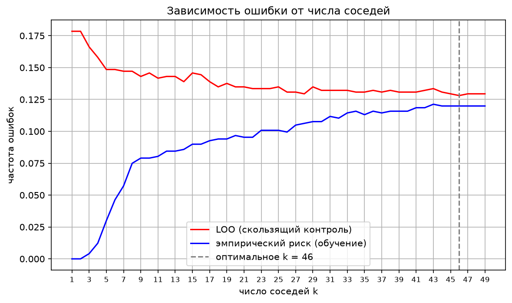
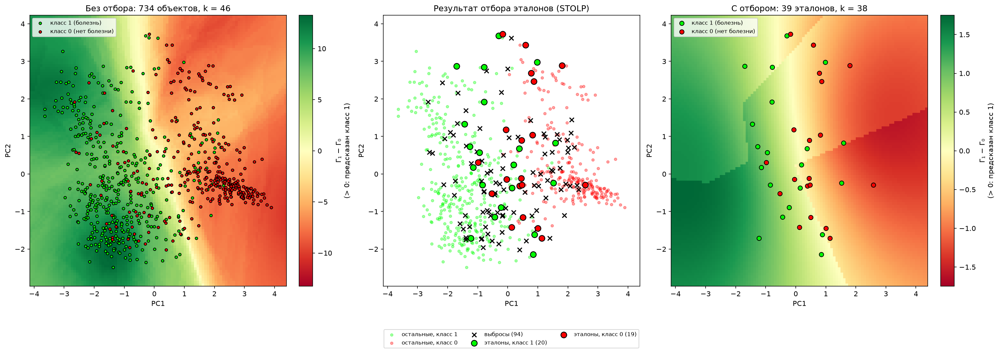
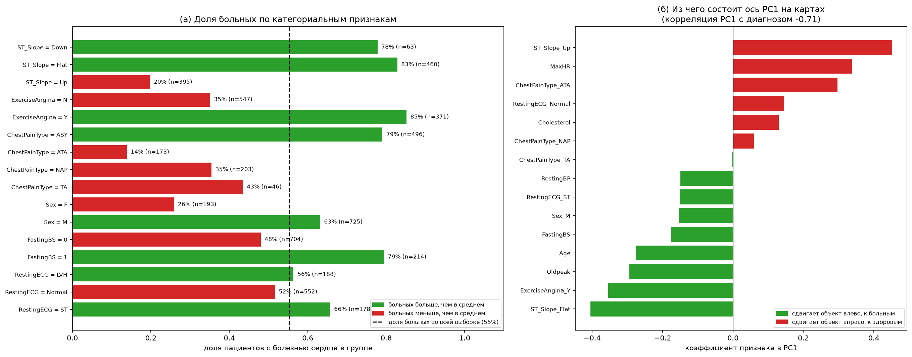
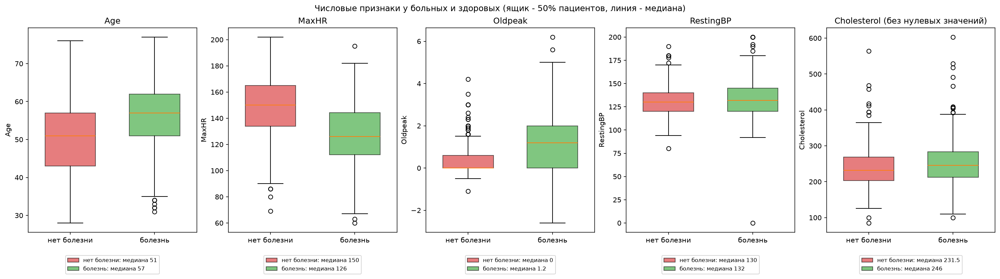
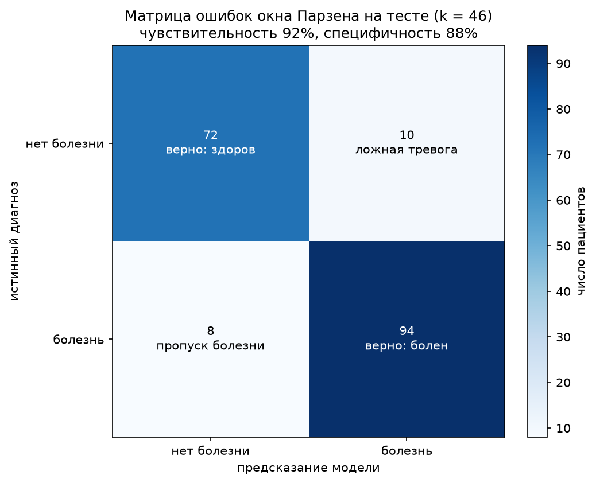

# Лабораторная работа №2. Метрическая классификация

В рамках лабораторной работы предстоит реализовать алгоритм классификации KNN с методом окна Парзена переменной ширины, подобрать параметр k методом скользящего контроля, сравнить реализацию с эталонной из sklearn, а затем реализовать отбор эталонов (STOLP) и сравнить качество с отбором и без него.

Датасет Heart Failure Prediction с Kaggle: 918 пациентов, бинарная цель `HeartDisease` (1 это болезнь сердца, 0 это нет).Категориальные признаки закодированы one-hot, в итоге получилось 15 числовых признаков. Выборка разбита на обучающую (734 объекта) и тестовую (184 объекта) части в пропорции 80/20 со стратификацией. Признаки стандартизованы, обучался только на обучающей части.

**Важно:**
Гипотеза компактности (для классификации):
- Близкие объекты, как правило, лежат в одном классе.

Сначала рассмотрим, из чего состоит алгоритм KNN с методом окна Парзена переменной ширины.

1) В качестве расстояния я взяла метрику Минковского, потому что это универсальная формула, в которой параметр p задаётся вручную. В работе p = 2 (евклидова метрика), веса признаков $w_j = 1$, так как признаки уже приведены к одному масштабу стандартизацией.

$$
\rho(x, x_i) = \left( \sum_{j=1}^{n} w_j |x^j - x_i^j|^p \right)^{1/p}
$$

Существует понятие *метрического классификатора* — он относит объект x к тому классу, для которого суммарный вес ближайших обучающих объектов $\Gamma_y(x)$ максимален. Здесь $x^{(i)}$ — i-й сосед объекта x, $y^{(i)}$ — его класс, $w(i, x)$ — вес i-го соседа.

$$
a(x; X^\ell) = \arg\max_{y \in Y} \underbrace{\sum_{i=1}^{\ell} [y^{(i)} = y] \, w(i, x)}_{\Gamma_y(x)}
$$

2) Далее выберем `Ядро` — я взяла гауссово, потому что оно плавно убывает.
Ядро K отвечает за форму окна: оно задаёт правило, по которому расстояние до соседа превращается в вес его голоса. Выбор ядра влияет на то, насколько сильно ближайшие соседи доминируют над более далёкими.
В качестве ядра взято гауссово ядро. Оно гладкое, и вес соседа плавно уменьшается с расстоянием: от $K(0) = 1$ до $K(1) = e^{-2} \approx 0.14$ на границе окна.

$$
K(r) = e^{-2r^2}
$$

3) По заданию надо реализовать алгоритм парзеновского окна переменной ширины. Ширина окна равна расстоянию до $(k+1)$-го соседа, а голосуют только $k$ ближайших соседей:

$$
a(x; X^\ell, k) = \arg\max_{y \in Y} \; \Gamma_y(x),
\qquad
\Gamma_y(x) = \sum_{i=1}^{k} [y^{(i)} = y] \; K\!\left( \frac{\rho(x, x^{(i)})}{h(x)} \right),
\qquad
h(x) = \rho\bigl(x, x^{(k+1)}\bigr)
$$

Гауссово ядро нигде не обращается в ноль, поэтому ограничение суммы $k$ соседями в коде сделано явно: соседи начиная с $(k+1)$-го получают вес 0.

**Как выбрать k:**
$$
\mathrm{LOO}(k) = \frac{1}{\ell} \sum_{i=1}^{\ell}
\Bigl[ a\bigl(x_i;\, X^\ell \setminus \{x_i\},\, k\bigr) \ne y_i \Bigr],
\qquad
k^* = \arg\min_k \mathrm{LOO}(k)
$$

Объект $x_i$ здесь исключается из обучающей выборки, а потом классифицируется по оставшимся.

4) Оценим качество при одном заданном k: вернём долю ошибок скользящего контроля.

На практике оптимальное значение параметра k определяют по критерию скользящего контроля с исключением объектов по одному (leave-one-out, LOO). 

$$
\mathrm{LOO}(k, X^\ell) = \sum_{i=1}^{\ell} \Bigl[ a\bigl(x_i;\, X^\ell \setminus \{x_i\},\, k\bigr) \ne y_i \Bigr] \to \min_k .
$$

Далее выберем лучшее **k**. Оптимальное k подбирается полным перебором: для каждого k от 1 до 49 считается LOO-ошибка, и выбирается k с наименьшей ошибкой.

Таким образом, лучшее k по LOO — **46**, LOO-ошибка **0.1281** (94 ошибки на 734 объектах). Каждый объект по очереди убирается из выборки, классифицируется по оставшимся, и считается доля ошибок.

На графике красная кривая (LOO) быстро падает при k от 1 до 5, а начиная с k ≈ 18 выходит около 0.13. Поэтому качество слабо зависит от k в широком диапазоне. Синяя кривая это эмпирический риск на обучающей выборке без исключения объекта: объект считается соседом самого себя, поэтому при малых k ошибка близка к нулю. Для выбора k эта оценка не годится.

5) В качестве отбора эталонов я взяла алгоритм STOLP. Эталоны — это объекты обучающей выборки, на которых держится классификация остальных. Алгоритм выбирает небольшое подмножество $\Omega \subseteq X^\ell$ так, чтобы классификатор по нему работал почти так же хорошо, как по всей выборке, и при этом отбрасывает выбросы.

**Идея.** Для каждого объекта вычисляется отступ это мера того, насколько уверенно классификатор относит его к собственному классу. Для окна Парзена переменной ширины

$$
\Gamma_c(x) = \sum_{i=1}^{k} [y^{(i)} = c]\, K\!\left(\frac{\rho(x, x^{(i)})}{h(x)}\right), \qquad h(x) = \rho\bigl(x, x^{(k+1)}\bigr),
$$

а отступ объекта $(x, y)$ равен:

$$
M(x) = \Gamma_{y}(x) - \max_{c \ne y} \Gamma_c(x).
$$

Если $M(x) > 0$, объект классифицируется правильно, и чем больше значение, тем он типичнее для своего класса. Если $M(x) < 0$, классификатор ошибается. Большие отрицательные значения означают, что объект окружён объектами чужого класса. Для $k = 46$ отступ лежит в пределах от $-46$ до $46$, на обучающей выборке примерно от $-20$ до $21$.

**Шаги алгоритма**:

1. Для каждого объекта вычисляется отступ относительно всех остальных объектов выборки (сам объект исключается, как при скользящем контроле).
2. Удаляются выбросы - объекты с $M(x_i) < \delta$. Они не могут стать эталонами.
3. В $\Omega$ включается по одному самому надёжному объекту каждого класса с наибольшим отступом.
4. Считаются отступы $M(x, \Omega)$ относительно текущего набора эталонов и находится множество ошибок $E = \{x \notin \Omega : M(x, \Omega) < 0\}$. Если $|E| < \ell_0$, алгоритм останавливается. Иначе в $\Omega$ добавляется объект из $E$ с наименьшим отступом, то есть тот, который классифицируется хуже всех, и шаг 4 повторяется.

**Параметры.** $\delta$ задаёт, насколько сильно ошибочный объект должен быть окружён чужим классом, чтобы считаться выбросом, а $\ell_0$ — допустимое число ошибок, то есть степень сжатия: чем больше $\ell_0$, тем меньше эталонов. В работе $\delta = 0$ и $\ell_0 = 10$.

После отбора классификатор по эталонам использует то же k, с которым STOLP строил $\Omega$, но не больше $|\Omega| - 1$ (чтобы существовал $(k+1)$-й сосед). Именно для этого классификатора алгоритм гарантирует малое число ошибок. Подбирать k заново по LOO внутри самих эталонов нельзя: на маленьком наборе LOO выбирает k, почти равное числу эталонов, и классификатор вырождается. Качество сравнивается с классификатором по полной выборке.

Все три графика построены в проекции на первые две главные компоненты (они объясняют около 34% дисперсии). Цвет фона на левом и правом графиках перевес $\Gamma_1 - \Gamma_0$ (шкала справа): зелёный модель предсказывает класс 1, красный класс 0, светлая полоса — граница.

На левом графике показана работа окна Парзена (k = 46) на всей обучающей выборке из 734 объектов. Зелёные и красные точки — это два класса, а цвет фона показывает, какой класс модель предсказывает в каждой области плоскости. Зелёные объекты сосредоточены в левой части, красные в правой, а в центре классы заметно перемешаны. При k = 46 граница получается гладкой: это широкая переходная полоса, которая не подстраивается под отдельные точки.

На среднем графике показан результат отбора эталонов алгоритмом STOLP. Крестиками отмечены 94 выброса, то есть объекты, на которых алгоритм ошибается (с $\delta = 0$ это ровно ошибки LOO при k = 46). Они лежат в зоне пересечения классов. Крупными кружками выделены 39 эталонов (20 класса 1 и 19 класса 0), которые оставлены в выборке. Они расположены главным образом в зоне пересечения классов, рядом с границей, поскольку именно эти объекты несут больше всего информации о ней. Бледные мелкие точки — это остальные объекты, которые не нужны, так как их хорошо «представляют» ближайшие эталоны.

На правом графике показан классификатор, обученный только на 39 эталонах, k = 38. Граница сохранила положение: слева область зелёного класса, справа красного. Но из-за малого числа эталонов она стала угловатой, кусочной. Таким образом, выборка сжата примерно до 5.3% от исходного размера, а разделение классов сохранилось. Платой за это служит потеря локальных деталей границы.

### Результаты сравнения

| Показатель | Без отбора эталонов | После STOLP |
|---|---:|---:|
| Собственная реализация Парзена (Accuracy) | 0.9022 | 0.8967 |
| sklearn KNN (Accuracy) | 0.9130 | 0.6141 |
| k | 46 | 38 |
| Размер обучающей выборки | 734 | 39 |

Для полной обучающей выборки оптимальное значение параметра **k = 46** было определено методом скользящего контроля Leave-One-Out (LOO). Минимальная LOO-ошибка составила **0.1281**.

После применения алгоритма STOLP количество обучающих объектов сократилось с 734 до 39, то есть на **94.7%**. При этом было обнаружено 94 выброса. Для сокращённой выборки используется **k = 38** (то же k, ограниченное числом эталонов).

### Анализ результатов

**Сравнение с sklearn.** На полной обучающей выборке `sklearn KNN` показал немного более высокую точность, чем метод окна Парзена (0.9130 против 0.9022). Разница составила 1.09 процентного пункта, это 2 объекта из 184. При размере теста 184 стандартная ошибка точности около 2.2 п.п., поэтому на одном разбиении методы неразличимы. После отбора эталонов окно Парзена оказалось намного точнее (0.8967 против 0.6141), разница составила 28.26 процентного пункта. Следует учитывать, что сравниваемые реализации используют разные способы взвешивания соседей, поэтому их результаты не обязаны совпадать: `KNeighborsClassifier` даёт всем k соседям одинаковый вес, а окно Парзена это вес, убывающий с расстоянием.

**Влияние отбора эталонов.** После применения STOLP точность собственной реализации снизилась с 90.22% до 89.67%, то есть на 0.54 процентного пункта (1 объект). У sklearn KNN точность снизилась с 91.30% до 61.41%, то есть на 29.89 процентного пункта. Причина в том, что при k = 38 и 39 эталонах голосуют почти все эталоны с одинаковым весом. Окно Парзена в той же ситуации работает, потому что ближние эталоны весят в несколько раз больше дальних. Это показывает, что эталоны STOLP отбираются под конкретный алгоритм окно Парзена с тем же k.

### Что результаты говорят о болезни сердца

Сам KNN не показывает, какие признаки важны, поэтому для интерпретации построены простые описательные графики по всему датасету (918 пациентов) и таблица ошибок модели на тесте.

**(а) Доля больных по категориальным признакам.** Для каждой группы показано, какая часть пациентов больна (пунктир 55% по всей выборке). Сильнее всего с болезнью связаны признаки нагрузочного теста и ЭКГ:
- наклон сегмента ST при нагрузке (`ST_Slope`): при плоском наклоне больны 83% пациентов, при восходящем 20%;
- стенокардия при нагрузке (`ExerciseAngina`): 85% больных среди тех, у кого она есть, и 35% среди остальных;
- тип боли в груди: при бессимптомном типе (ASY) больны 79%, при атипичной стенокардии (ATA) 14%;
- среди мужчин больны 63%, среди женщин 26%; при повышенном сахаре натощак (`FastingBS = 1`) 79%.

**(б) Из чего состоит ось PC1.** На картах STOLP больные находятся слева, здоровые — справа. Это объясняется составом первой главной компоненты: её сильнее всего сдвигают влево (к больным) плоский наклон ST, стенокардия при нагрузке, `Oldpeak` и возраст, а вправо (к здоровым) — восходящий наклон ST, высокий максимальный пульс и атипичная боль. Корреляция PC1 с диагнозом равна −0.71, поэтому даже двумерная проекция хорошо разделяет классы.

Больные в среднем старше (медиана 57 лет против 51), у них ниже максимальный пульс при нагрузке (126 против 150) и выше депрессия сегмента ST (`Oldpeak` 1.2 против 0). Давление в покое почти не отличается (132 против 130): сердце на нагрузке говорит о болезни больше, чем показатели в покое.

**Холестерин.** Если считать по всем данным, у больных средний холестерин *ниже*, чем у здоровых (176 против 227), что противоречит медицине. Причина — 172 нулевых значения, то есть скрытые пропуски: среди этих пациентов больны 88%. Без нулей картина правильная: у больных холестерин немного выше (медиана 246 против 231.5). Это пример того, как без проверки данных можно сделать ложный вывод.

**Какие ошибки делает модель.** Окно Парзена на тесте нашло 94 из 102 больных (**чувствительность 92%**, 8 больных пропущено) и верно определило 72 из 82 здоровых (**специфичность 88%**, 10 ложных тревог). Для медицины пропуск больного обычно опаснее ложной тревоги, поэтому такая модель подходит скорее для скрининга (отбора на дообследование), чем для постановки диагноза.

**Связь с отбором эталонов.** STOLP оставил 39 «типичных» пациентов, и по ним модель работает почти так же, как по всей выборке. Значит, картина болезни в данных довольно однородна. При этом 94 пациента (13%) оказались выбросами по этим 11 показателям их нельзя отличить от пациентов противоположного класса. Отсюда потолок точности около 87–90%: чтобы его превзойти, нужны другие данные (анамнез, анализы), а не другой алгоритм.

