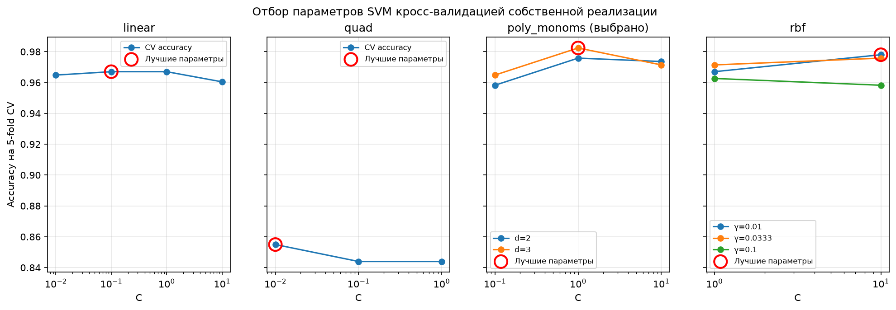
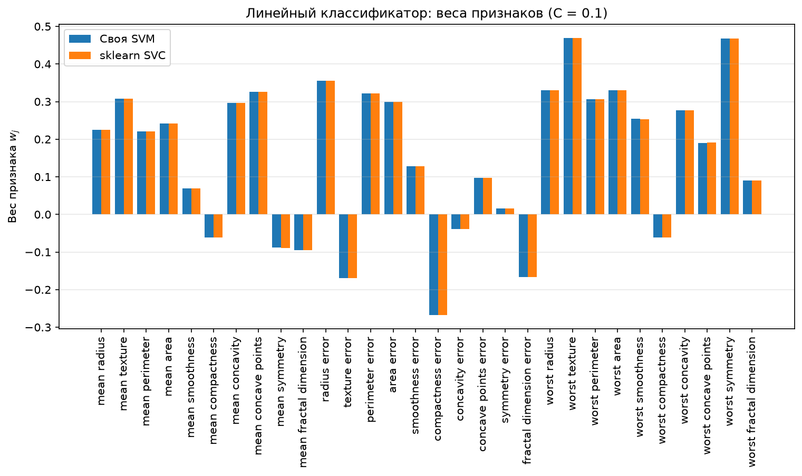
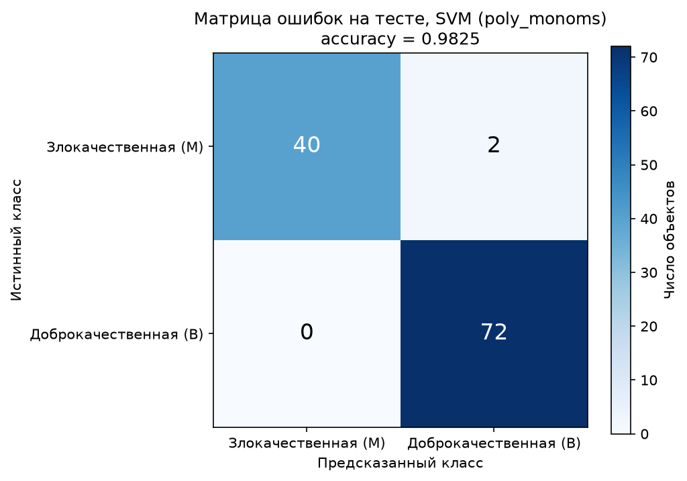
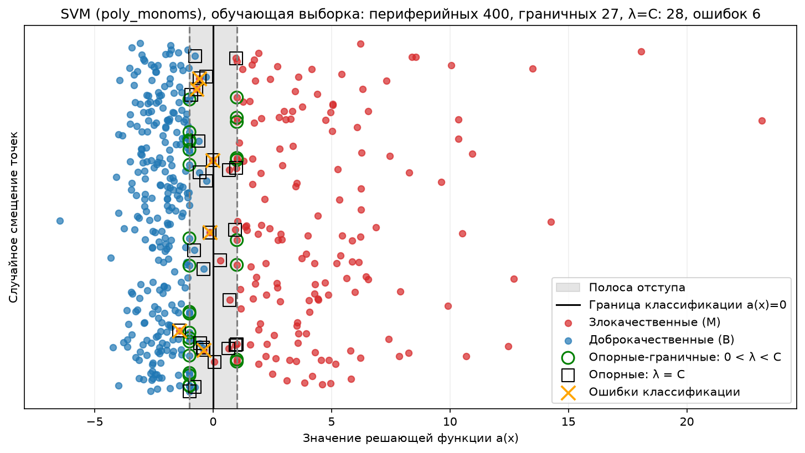
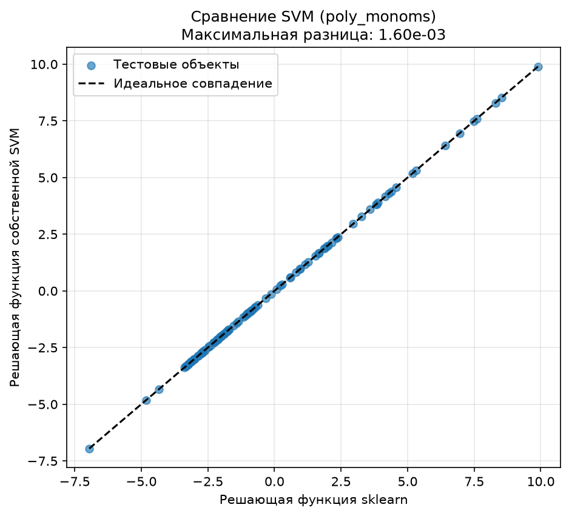
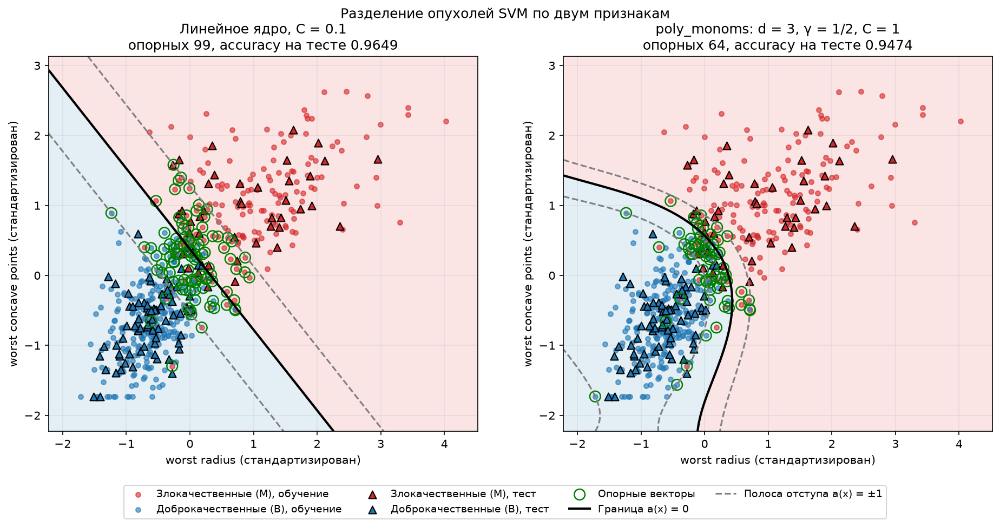

## Лабораторная работа №3. SVM

В рамках лабораторной работы предстоит реализовать SVM и сравнить с эталонной реализацией алгоритма.

## Датасет

Я использую датасет **Breast Cancer Wisconsin (Diagnostic)** (рак молочной железы). Нужно по снимку клеток опухоли предсказать, злокачественная она или доброкачественная. Всего объектов 569, из них злокачественных (malignant) 212 и доброкачественных (benign) 357. Признаков: 30, все числовые. Они получены по оцифрованному изображению тонкоигольной аспирационной биопсии (FNA) и описывают ядра клеток. Для каждой из 10 характеристик ядра (радиус, текстура, периметр, площадь, гладкость, компактность, вогнутость, число вогнутых точек, симметрия, фрактальная размерность).

## Ядра

Я задаю четыре функции ядер: линейное, квадратичное, полиномиальное со свободным членом (`poly_monoms`) и RBF.

**Ядро** — симметричная функция $K(x,x')$, у которой матрица $\bigl(K(x_i,x_j)\bigr)$ неотрицательно определена для любой конечной выборки $x_1,\dots,x_n$.

**Ядро** - функция $K: X\times X\to\mathbb R$, для которой существует отображение $\psi: X\to H$ в гильбертово пространство $H$ такое, что $K(x,x')=\langle\psi(x),\psi(x')\rangle$.

- Линейное ядро (Linear) — разделяет объекты разных классов с помощью прямой линии (в двумерном пространстве) или гиперплоскости (в многомерном пространстве). Применяется, когда данные линейно разделимы или близки к этому.

- Квадратичное ядро (Polynomial, degree=2) — позволяет разделять объекты с помощью нелинейной границы второго порядка (например, параболы, эллипса или гиперболы). Учитывает квадраты признаков и их попарные взаимодействия.

- Гауссово ядро (RBF) — измеряет сходство двух объектов в зависимости от расстояния между ними. Позволяет строить сложные нелинейные границы и применяется, когда классы имеют сложную форму распределения.

1) Формула для линейного ядра: 

$$
K(\mathbf{x}, \mathbf{y}) = \mathbf{x}^{\top}\mathbf{y}
$$

2) Формула для квадратичного ядра

$$
K(\mathbf{x}, \mathbf{y}) = (\mathbf{x}^{\top}\mathbf{y})^2
$$

3) Формула для RBF

$$
K(\mathbf{x}, \mathbf{y}) = \exp\left(-\gamma \|\mathbf{x} - \mathbf{y}\|^2\right)
$$

4) Формула для полиномиального ядра со свободным членом (`poly_monoms`). Оно содержит мономы всех степеней от $0$ до $d$, а не только степени $d$, как квадратичное:

$$
K(\mathbf{x}, \mathbf{y}) = (\gamma\,\mathbf{x}^{\top}\mathbf{y} + 1)^d
$$

Далее был посчитан Q по формуле:

$$
Q_{ij}=y_i\,y_j\,K(x_i,x_j),\qquad i,j=1,\dots,\ell .
$$

В матричной форме это $Q=(yy^{\top})\odot K$, где $K_{ij}=K(x_i,x_j)$ матрица Грама, а $\odot$ означает поэлементное умножение.

Нужна она для того, чтобы записать двойную сумму из двойственной задачи одним выражением.

## Двойственная задача

Задача ищет $w,\,w_0,\,\xi$:

$$
\frac12\langle w,w\rangle+C\sum_i\xi_i\to\min,\qquad y_i(\langle w,x_i\rangle-w_0)\ge1-\xi_i,\quad \xi_i\ge0 .
$$

Каждому ограничению ставят множитель Лагранжа ($\lambda_i$ и $\eta_i$) и составляют функцию Лагранжа. Условие седловой точки (производные равны нулю) даёт

$$
w=\sum_i\lambda_iy_ix_i,\qquad \sum_i\lambda_iy_i=0,\qquad \lambda_i+\eta_i=C .
$$

Если подставить это обратно, переменные $w,\,w_0,\,\xi$ пропадают, и остаётся задача только относительно $\lambda$. Это и есть двойственная задача:

$$
-\mathcal L(\lambda)=-\sum_{i}\lambda_i+\frac12\sum_{i}\sum_{j}\lambda_i\lambda_j\,y_iy_j\,K(x_i,x_j)\;\to\;\min_\lambda,$$
$$\sum_i\lambda_iy_i=0,\qquad 0\le\lambda_i\le C .
$$

Двойственная задача: вместо поиска w, w0, xi ищем множители Лагранжа lam_i.
Минимизируем 0.5 * lam^T Q lam - sum(lam) при sum(lam_i * y_i) = 0 и 0 <= lam_i <= C

## Функция порог W0

Из условия $0<\lambda_i<C$ следует, что объект лежит ровно на границе полосы, то есть $y_i(\langle w,x_i\rangle-w_0)=1$. Значит:

$$
w_0=\langle w,x_i\rangle-y_i .
$$

Вектора $w$ в явном виде у нас нет, но он выражается через $\lambda$ (с ядром вместо скалярного произведения):

$$
\langle w,x_i\rangle=\sum_{j}\lambda_jy_jK(x_j,x_i).
$$

## Классификатор и трюк с ядром

Объект $x_i$ называется опорным, если $\lambda_i\ne0$. Классификатор:

$$
a(x)=\mathrm{sign}\left(\sum_i \lambda_i y_i K(x,x_i)-w_0\right)
$$

В двойственной задаче и в классификаторе объекты входят только через скалярные произведения, поэтому скалярное произведение $\langle x,x'\rangle$ заменяется ядром $K(x,x')=\langle\psi(x),\psi(x')\rangle$, а само отображение $\psi$ вычислять не нужно. В коде ядро используется при построении $K$ и $Q$, при вычислении $w_0$ и при предсказании.

## Линейный классификатор

Для линейного ядра $K(x,x')=\langle x,x'\rangle$ вектор весов можно восстановить в явном виде (функция `compute_w`):

$$
w=\sum_i\lambda_iy_ix_i,\qquad a(x)=\mathrm{sign}\left(\langle w,x\rangle-w_0\right).
$$

Предсказание по этой формуле делает функция `predict_linear`. Полученный $w$ я сравниваю с `coef_` из `sklearn.svm.SVC(kernel="linear")`.

## Подбор параметров

Параметры подбираются 5-fold кросс-валидацией (`StratifiedKFold`, `random_state=42`) собственной реализации SVM (функция `cross_val_accuracy`) по сетке:

| Ядро        | Сетка |
|-------------|-------|
| linear      | $C\in\{0.01, 0.1, 1, 10\}$ |
| quad        | $C\in\{0.01, 0.1, 1\}$ |
| poly_monoms | $d\in\{2, 3\},\ \gamma=1/30,\ C\in\{0.1, 1, 10\}$ |
| rbf         | $\gamma\in\{0.01, 1/30, 0.1\},\ C\in\{1, 10\}$ |

$\gamma=1/30$ выбрана, потому что в датасете 30 признаков. Эталонная модель `sklearn.svm.SVC` обучается с теми же ядром и параметрами. Полный запуск занимает около 6–7 минут.

## Результаты

| Ядро        | CV accuracy | Тест (своя) | Тест (sklearn) | Опорных (своя / sklearn) | Параметры |
|-------------|:-----------:|:-----------:|:--------------:|:------------------------:|-----------|
| linear      | 0.9670 | 0.9825 | 0.9825 | 52 / 52   | $C=0.1$ |
| quad        | 0.8549 | 0.8333 | 0.8333 | 203 / 196 | $C=0.01$ |
| poly_monoms | **0.9824** | 0.9825 | 0.9825 | 55 / 55 | $d=3,\ \gamma=1/30,\ C=1$ |
| rbf         | 0.9780 | 0.9825 | 0.9825 | 56 / 56   | $\gamma=0.01,\ C=10$ |

Квадратичное ядро без свободного члена работает заметно хуже остальных: в нём есть только мономы второй степени, а линейных слагаемых нет.

### Отбор параметров

На графике точность на кросс-валидации для каждой точки сетки, красным кружком отмечены лучшие параметры каждого ядра. У линейного ядра точность почти не зависит от $C$ (0.960–0.967). У `poly_monoms` степень $d=3$ лучше, чем $d=2$, а максимум достигается при $C=1$: при $C=10$ модель начинает переобучаться. У RBF слишком большое $\gamma=0.1$ даёт худший результат, лучший получается при $\gamma=0.01$, $C=10$. Квадратичное ядро везде остаётся около 0.85. В итоге выбрано ядро `poly_monoms` с лучшим значением CV 0.9824.

### Линейный классификатор

| Метрика | Своя реализация | sklearn |
|---------|:---------------:|:-------:|
| Точность на тесте | 0.9825 | 0.9825 |
| $w_0$ | 0.1980 | 0.1982 |
| Относительная разница $\lVert w-w_{sk}\rVert/\lVert w_{sk}\rVert$ | $3.5\cdot10^{-4}$ | — |

Веса своей реализации и sklearn на графике совпадают. Наибольший вклад в сторону злокачественного класса дают `worst texture`, `worst symmetry`, `radius error`, `worst radius` и `worst area`.

### Выбранное ядро

Лучшее значение на кросс-валидации дало ядро **`poly_monoms`**, его я и выбрала:

$$
K(\mathbf{x}, \mathbf{y}) = \left(\tfrac{1}{30}\,\mathbf{x}^{\top}\mathbf{y} + 1\right)^3,\qquad C = 1
$$

(в `sklearn.svm.SVC` это `kernel="poly", degree=3, gamma=1/30, coef0=1.0, C=1`).

- точность на обучении: 0.9868
- точность на тесте:    0.9825

| Метрика                                   | Своя реализация | sklearn |
|-------------------------------------------|:---------------:|:-------:|
| Точность на тесте                         |     0.9825      |  0.9825 |
| Число опорных векторов                    |       55        |   55    |
| $w_0$                                     |     0.3261      |  0.3262 |
| Доля совпавших предсказаний               |     1.0000      |    —    |
| Средняя разница решающих функций $\lvert a_{own}-a_{sk}\rvert$ | $2.26\cdot10^{-4}$ | — |
| Максимальная разница решающих функций     | $1.60\cdot10^{-3}$ |  —  |

### Результат классификации опухолей на тесте

Из 42 злокачественных опухолей в тестовой выборке модель правильно распознала 40, а 2 ошибочно отнесла к доброкачественным. Все 72 доброкачественные классифицированы верно. Значит, все ошибки модели это пропуски злокачественных опухолей (ложноотрицательные), а для медицинской задачи это самый опасный вид ошибки. Ложных тревог нет.

### Разберем результаты разделения объектов на графике для обучающей выборки

По графику я вижу, что модель достаточно хорошо разделяет два класса: большинство объектов расположено по правильную сторону границы классификации. При этом доброкачественные объекты сгруппированы более плотно, а злокачественные имеют значительно больший разброс значений решающей функции.

Основные сложности возникают вблизи разделяющей границы, где распределения классов частично пересекаются. Именно в этой области сосредоточены опорные векторы и ошибки классификации.
Всего на обучающей выборке модель допустила 6 ошибок (из 455 объектов: 400 периферийных, 27 опорных-граничных и 28 опорных с $\lambda = C$), но наличие объектов внутри полосы отступа показывает, что модель не может обеспечить достаточно большой отступ для всех наблюдений.

### Выводы

По графику - результаты моей реализации SVM с полиномиальным ядром (poly_monoms) практически полностью совпадают с результатами sklearn. Все точки расположены вдоль линии идеального совпадения, а максимальная разница между значениями решающих функций на тестовой выборке составляет всего $1.60\cdot10^{-3}$ (средняя $2.26\cdot10^{-4}$), предсказанные классы совпадают у всех 114 тестовых объектов.

### Разделяющая граница на двух признаках

В 30-мерном пространстве границу нарисовать нельзя, поэтому для наглядности я отдельно обучила свою SVM только на двух признаках: `worst radius` и `worst concave points`. Взяты те же $C$ и степень, что выбраны выше. Для `poly_monoms` взято $\gamma=1/2$ по тому же правилу $1/\text{число признаков}$.

Злокачественные опухоли находятся в области больших значений радиуса и числа вогнутых точек, доброкачественные в левом нижнем углу. Линейное ядро делит их прямой (99 опорных векторов, точность на тесте 0.9649), `poly_monoms` строит изогнутую границу (64 опорных, 0.9474). Опорные векторы, как и положено, лежат вдоль границы и внутри полосы отступа. На всех 30 признаках точность выше (0.9825): двух признаков для полного разделения не хватает.

Это говорит о том, что моя реализация SVM работает корректно и даёт результаты, очень близкие к библиотечной реализации. Небольшие расхождения могут быть связаны с численной точностью вычислений и особенностями алгоритмов оптимизации.