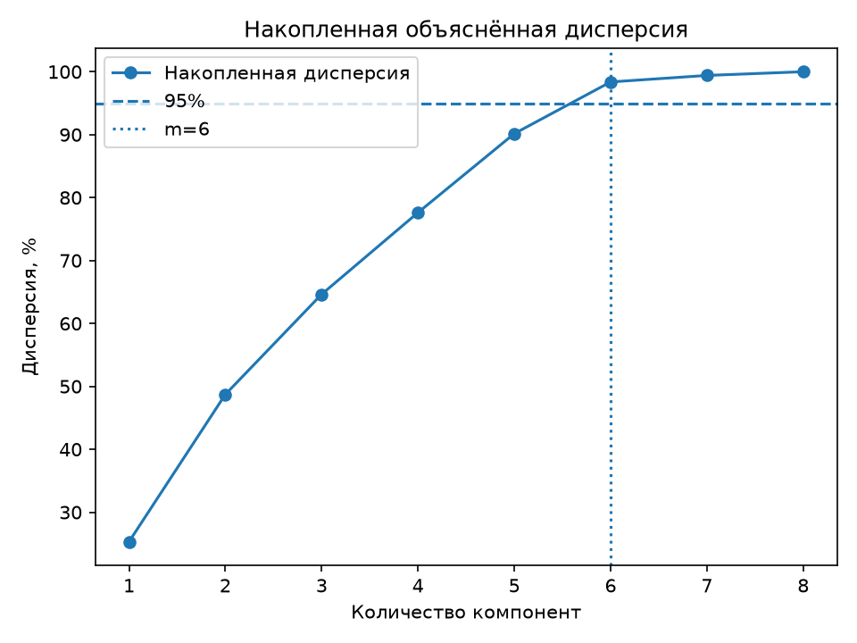

# Лабораторная работа №4

## PCA через сингулярное разложение

### Цель работы

Реализовать метод главных компонент (PCA) с помощью сингулярного разложения, определить эффективную размерность выборки и сравнить собственную реализацию с эталонной реализацией из `sklearn`.

### Датасет

В работе используется датасет **fetch_california_housing** из библиотеки `sklearn.datasets` - содержит данные о недвижимости в штате Калифорнии. Перед началом работы я разделила данные на обучающую и тестовую выборк, стандартизировала признаки с помощью Standart scaler.

### Работа алгоритма 

Переходим к работе самого алгоритма. Для начала я центрировала данные, хотя я уже делала преобразование данных с помощью standart scaler, я решила использовать все таки вутри алгоритма среднее. Далее я использую сингулярное разложение центрированной матрицы F = V·D·Uᵀ, σ (сингулярные значения) и U (матрица главных направлений). Сингулярные значения нужны, чтобы посчитать дисперсию вдоль компоненты λⱼ = σⱼ², по ним я нахожу долю объясненной и накопленной дисперсии главной компоненты. Затем эффективную размерность m, то есть
минимальное число компонент, при котором потеря дисперсии не превышает ε = 5%.

Несколько определений: 

- Объяснённая дисперсия j-й главной компоненты это доля общего разброса данных, которая приходится
на эту компоненту: λⱼ / Σλ. 
- Накопленная объяснённая дисперсия показывает, какую долю разброса
сохраняют первые m компонент вместе.

Что же у меня получилось..?

---

### Результаты

Описывая результат, я буду сопровождать его графиками. 
Первый график показывает сингулярные значения σⱼ центрированной матрицы данных, упорядоченные
по убыванию.

Чем больше σⱼ, тем больше разброса данных лежит вдоль j-й главной компоненты (дисперсия λⱼ = σⱼ²).
На графике видно, что первые шесть значений убывают плавно, то есть
каждая из этих компонент несёт заметную часть информации. После шестой компоненты наблюдается
резкий спад. Вдоль этих двух направлений данные почти не меняются, поэтому
они практически не содержат информации, и ими можно пожертвовать при сжатии. 

Далее рассмотрим долю объясненной дисперсии каждой компоненты:

Наибольший разброс данных несут 1 и 2 главные компоненты.
Меньше всего начиная от 6.

Следующий график также очень интересен и это **накопленная объясненная дисперсия**:

Горизонтальная пунктирная линия соответствует порогу 95%.
Пять компонент объясняют около 90% дисперсии, что недостаточно, а шесть компонент уже около 98%, поэтому эффективная размерность выбрана равной m = 6 (вертикальная линия). Оставшиеся две
компоненты добавляют лишь около 2% информации, поэтому их можно отбросить: размерность данных
сокращается с 8 до 6 при потере менее 5% дисперсии.

**Ошибка восстановления PCA**

По графику заметно, что при использовании 5 главных компонент теряется около 10% дисперсии, а при использовании 6 компонент ошибка восстановления уменьшается примерно до 1,63%. Таким образом, 6 компонент достаточно, чтобы сохранить более 98% дисперсии исходных данных. Если же использовать 7 или 8 компонент, ошибка продолжает уменьшаться, а при 8 компонентах данные восстанавливаются практически без потерь.

**Коэффициенты главных компонент**

На графике коэффициент главных компонент показаны вклад каждого исходного признака
в каждую компоненту. Первая компонента в основном определяется географическими признаками
(Latitude, Longitude), вторая связана с числом комнат и спален, третья с численностью населения,
четвёртая почти целиком соответствует доходу MedInc, пятая средней заселённостью AveOccup.

Далее я рассмотрела как с моими данными будет работать гребневая регрессия и лассов регрессия.

<table>
  <tr>
    <td align="center">
       
      <em>Рис. 7. Ridge: коэффициенты в зависимости от τ</em>
    </td>
    <td align="center">
       
      <em>Рис. 8. Lasso: коэффициенты в зависимости от α</em>
    </td>
  </tr>
</table>

На графике Ridge видно, что при увеличении параметра tau коэффициенты модели постепенно уменьшаются по абсолютной величине. Наиболее выраженные коэффициенты наблюдаются у медианного дохода (MedInc), а также географических признаков Latitude и Longitude. Регуляризация ограничивает их величину, что может повысить устойчивость модели при наличии коррелированных признаков.

На графике Lasso видно, что при увеличении параметра alpha некоторые коэффициенты становятся равными нулю. Это позволяет модели автоматически исключать часть исходных признаков, сохраняя только признаки с ненулевыми коэффициентами при выбранной силе регуляризации.

Рассмотрим, как Lasso постепенно исключает признаки из модели регрессии при увеличении параметра регуляризации (alpha):

При небольших значениях **alpha** модель использует все восемь исходных признаков. По мере увеличения параметра регуляризации чсло ненулевых коэффициентов постепенно уменьшается, поскольку Lasso обнуляет некоторые из них.

***Важный график***

По этому графику заметно, что при использовании первых трёх главных компонент ошибка достаточно высокая, но при добавлении четвёртой компоненты она резко уменьшается. При этом я определила эффективную размерность как 6 компонент, поскольку они сохраняют не менее 95% дисперсии исходных данных. Однако, если добавляем 7 и 8 компоненты, ошибка продолжает уменьшаться, то есть качество предсказания становится лучше. Это связано с тем, что PCA не учитывает целевую переменную при выборе главных компонент, поэтому даже компоненты с небольшой объяснённой дисперсией могут содержать важную информацию для предсказания. Кроме того, ошибки на обучающей и тестовой выборках достаточно близки, поэтому можно сказать, что выраженного переобучения по этому графику не наблюдается.

----

### Выводы

В результате получилось, что эффективная размерность равна 6 компонентам и сохраняется 98,3748% дисперсии исходных данных. Таким образом, получилось сократить количество признаков с 8 до 6, потеряв только около 1,63% дисперсии.

Я сверила  PCA с эталонной реализацией из sklearn. Все проверки показали True: совпали сингулярные значения, доли объяснённой дисперсии, собственные значения ковариационной матрицы, подпространства главных компонент и восстановленные данные. Кроме того, были подтверждены ортонормированность матрицы U, ортогональность главных компонент и теоретическая формула ошибки восстановления. Это позволяет сделать вывод, что собственная реализация PCA работает корректно и эквивалентна эталонной.

Для оценки влияния снижения размерности и регуляризации на качество предсказания стоимости жилья были сравнены четыре модели:

- МНК через SVD: RMSE = 0,7456.

- Ridge через SVD: RMSE = 0,7523.

- Lasso: RMSE = 0,7404.

- PCA + МНК: RMSE = 0,8194.

Наименьшую ошибку на тестовой выборке показала Lasso-регрессия (RMSE = 0,7404). Можно заметить, что она немного лучше обычного МНК, хотя разница между ними небольшая. В данном эксперименте использование L1-регуляризации показало более точные предсказания.

Ridge-регрессия показала немного худший результат по сравнению с МНК (RMSE = 0,7523). Это может быть связано с выбранным параметром регуляризации tau=1000, потому что я не подбирала его.

Наибольшая ошибка получилась у модели PCA + МНК (RMSE = 0,8194). Хотя сохранилась более 98% дисперсии исходных данных, уменьшение размерности с 8 до 6 компонент привело к ухудшению качества предсказания. Это связано с тем, что PCA не учитывает целевую переменную при выборе главных компонент, поэтому даже компоненты с небольшой объяснённой дисперсией могут содержать полезную информацию для регрессии.

Вывод: PCA  сократил размерность данных практически без потери дисперсии, но это не привело к улучшению качества предсказания. В  задаче использование всех 8 компонент оказалось более эффективным для линейной регрессии, а среди рассмотренных моделей наименьшую ошибку показала Lasso. 

Также ошибка восстановления собственной реализации PCA через SVD практически полностью совпадает с ошибкой эталонной реализации из sklearn при любом количестве главных компонент. При использовании 6 компонент ошибка составляет около 1,63%, что соответствует сохранению 98,37% дисперсии исходных данных.

Больше всего дисперсии потеряли признаки, отвечающие за среднее количество комнат (3,37%), среднее количество спален (3,05%), географическую долготу (3,01%) и широту (2,93%). При этом такие признаки, как численность населения, среднее количество жителей на домохозяйство и возраст домов, практически полностью сохранили свою дисперсию.
Также я посмотрела, какие признаки сильнее всего участвуют в формировании отброшенных компонент PC7 и PC8. Оказалось, что для PC7 наибольшие по модулю коэффициенты имеют среднее количество комнат и спален, а для PC8 географическая широта и долгота.

Получается, что при сокращении размерности мы потеряли часть информации, связанной с количеством комнат, спален и географическим расположением жилья. Однако важно учитывать, что PCA не удаляет сами признаки, а преобразует их в новые компоненты.

Если посмотреть на качество регрессии, то после PCA ошибка увеличилась с 0,7456 до 0,8194. Это говорит о том, что отброшенные компоненты, несмотря на небольшую долю дисперсии, могли содержать информацию, важную для предсказания стоимости жилья.
