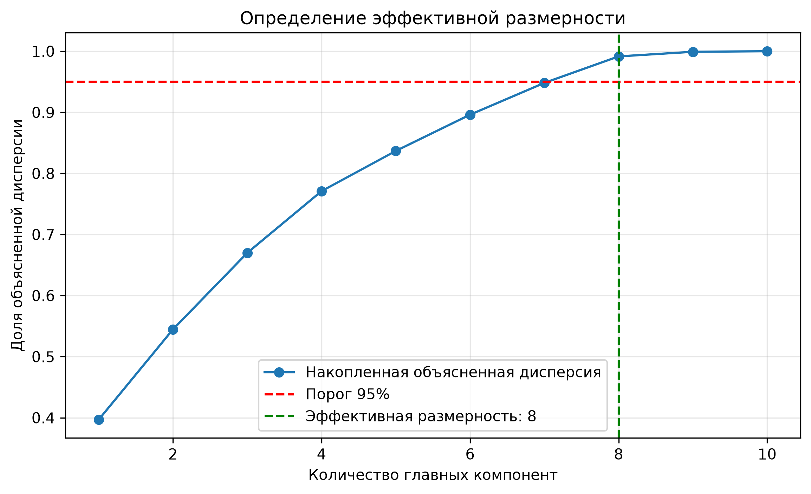
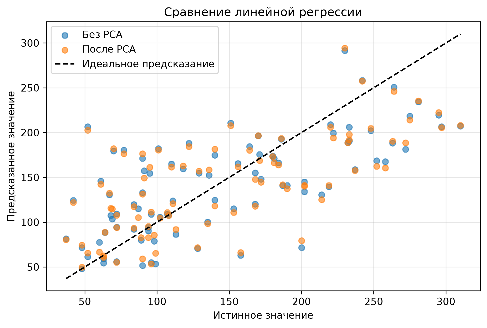

# Лабораторная работа №4

## PCA через сингулярное разложение

### Цель работы

Реализовать метод главных компонент (PCA) с помощью сингулярного разложения, определить эффективную размерность выборки и сравнить собственную реализацию с эталонной реализацией из `sklearn`.

---

## 1. Датасет

В работе используется датасет **Diabetes** из библиотеки `sklearn.datasets`.

- Количество объектов: 442
- Количество признаков: 10
- Тип задачи: регрессия

---

## 2. Ход работы

В рамках лабораторной работы было выполнено:

1. загружен датасет для задачи линейной регрессии;
2. реализован алгоритм PCA через сингулярное разложение (SVD);
3. вычислена доля объяснённой дисперсии;
4. определена эффективная размерность выборки;
5. проведено сравнение собственной реализации с `sklearn.decomposition.PCA`;
6. построена линейная регрессия на исходных признаках и после PCA.

---

## 3. Определение эффективной размерности

Эффективная размерность определялась как минимальное число главных компонент, сохраняющее не менее 95% дисперсии.

### Результат:
- Эффективная размерность: **8**
- Сохранённая дисперсия: **0.9915**

### График накопленной объяснённой дисперсии

По графику видно, что первые 8 главных компонент сохраняют более 95% общей дисперсии, поэтому исходную размерность можно уменьшить с 10 до 8.

---

## 4. Сравнение с эталонной реализацией

Собственная реализация PCA сравнивалась с `sklearn.PCA`.

Сравнивались:
- собственные значения;
- доля объяснённой дисперсии;
- проекции объектов на главные компоненты.

При сравнении учитывалось, что знаки главных компонент могут отличаться.

---

## 5. Применение PCA к задаче линейной регрессии

Была обучена линейная регрессия:
- на исходных стандартизованных признаках;
- на признаках после уменьшения размерности методом PCA.

### Сравнение результатов

| Модель | MSE | R² |
|---|---:|---:|
| Линейная регрессия без PCA | вписать после запуска | вписать после запуска |
| Линейная регрессия после PCA | вписать после запуска | вписать после запуска |

### График сравнения предсказаний

---

## 6. Выводы

В ходе работы был реализован метод PCA через SVD без использования готовой реализации алгоритма.

Основные результаты:
1. Для датасета Diabetes эффективная размерность составила **8**.
2. Первые 8 главных компонент сохраняют примерно **99.15%** дисперсии.
3. Собственная реализация PCA эквивалентна эталонной реализации из `sklearn`.
4. Метод PCA позволяет уменьшить размерность признакового пространства почти без потери информации.
5. После уменьшения размерности можно оценить, как это влияет на качество линейной регрессии.

---