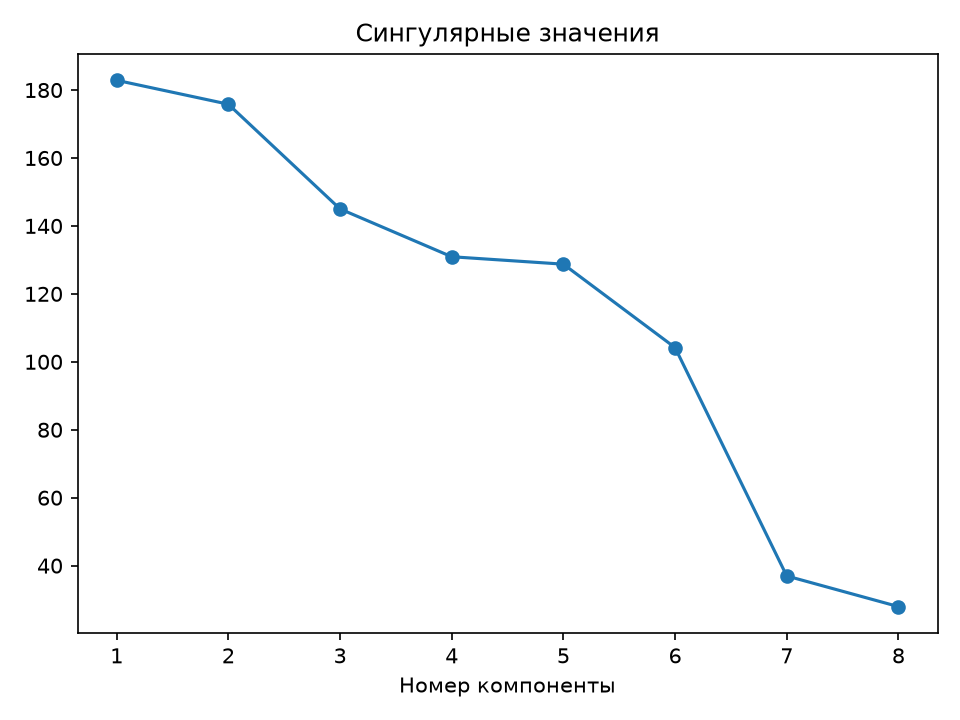
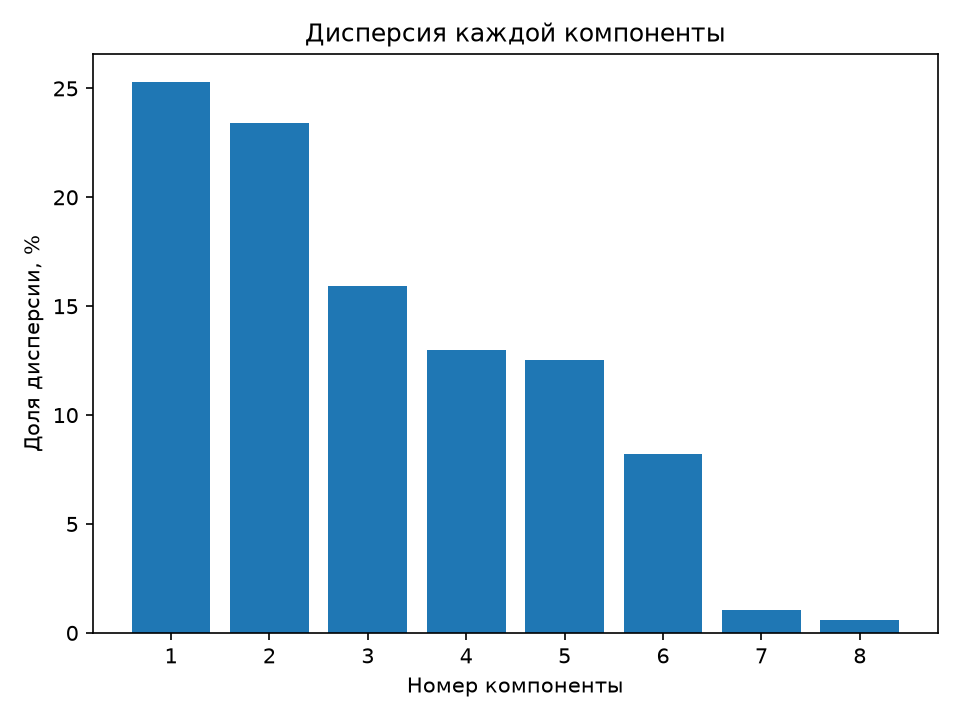
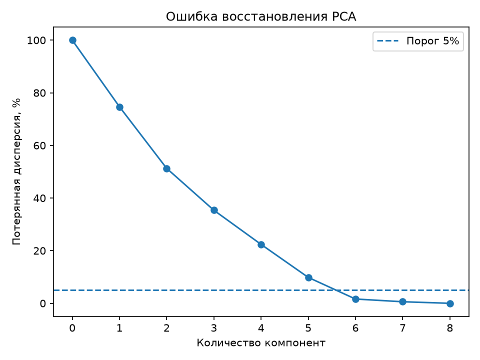
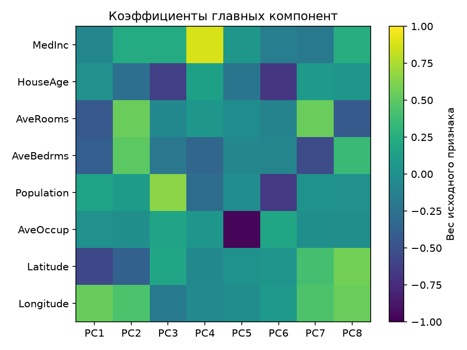
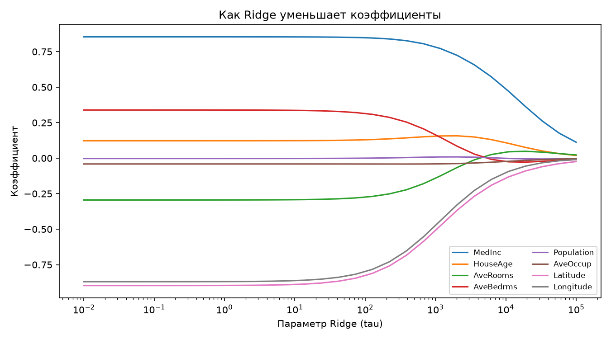
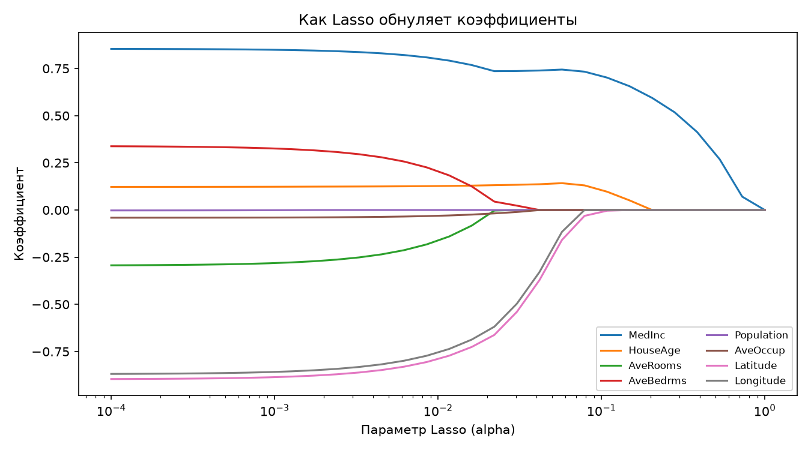
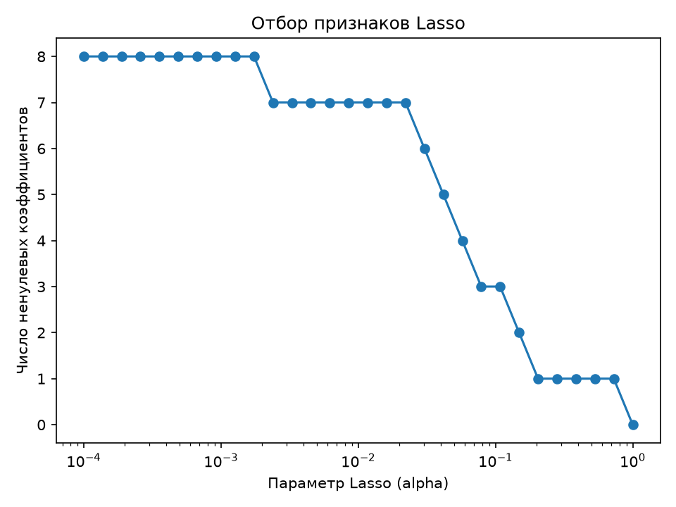
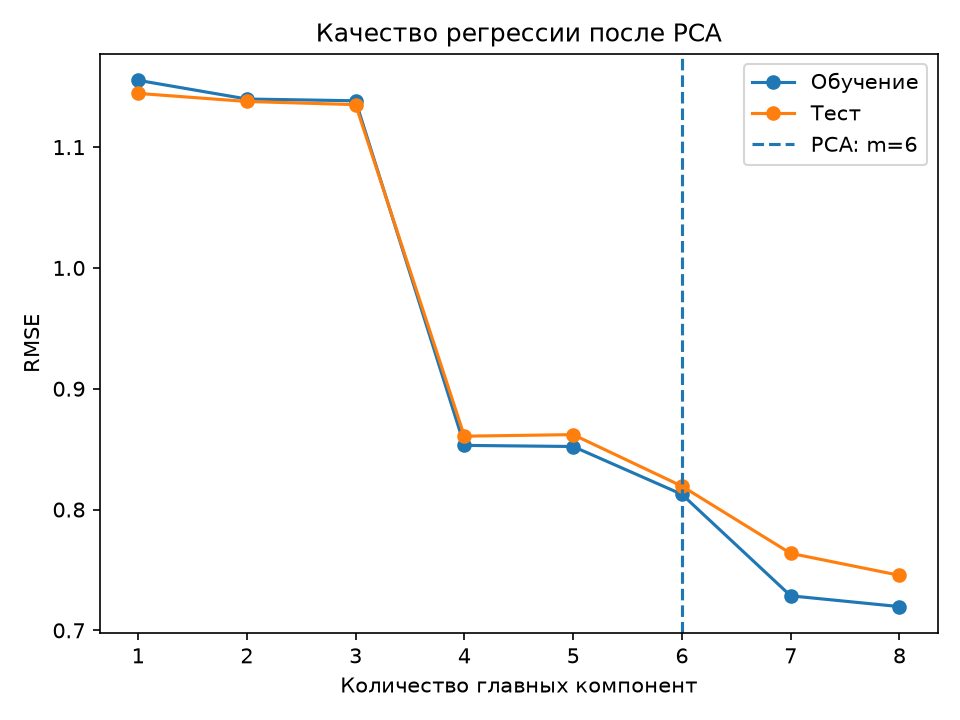
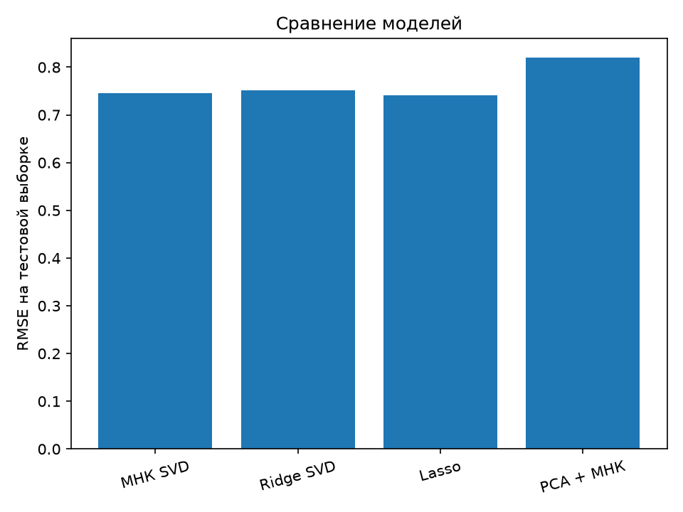

# Лабораторная работа №4

## PCA через сингулярное разложение

### Цель работы

Реализовать метод главных компонент (PCA) с помощью сингулярного разложения, определить эффективную размерность выборки и сравнить собственную реализацию с эталонной реализацией из `sklearn`.

---

### 1. Датасет

В работе используется датасет **fetch_california_housing** из библиотеки `sklearn.datasets` - содержит данные о недвижимости в штате Калифорнии. Перед началом работы я разделила данные на обучающую и тестовую выборк, стандартизировала признаки с помощью Standart scaler.

---

### Работа алгоритма 

Переходим к работе самого алгоритма. Для начала я центрировала данные, хотя я уже делала преобразование данных с помощью standart scaler, я решила использовать все таки вутри алгоритма среднее. Далее я использую сингулярное разложение центрированной матрицы F = V·D·Uᵀ, σ (сингулярные значения) и U (матрица главных направлений). Сингулярные значения нужны, чтобы посчитать дисперсию вдоль компоненты λⱼ = σⱼ², по ним я нахожу долю объясненной и накопленной дисперсии главной компоненты. Затем эффективную размерность m, то есть
минимальное число компонент, при котором потеря дисперсии не превышает ε = 5%.

Несколько определений: 

Объяснённая дисперсия j-й главной компоненты это доля общего разброса данных, которая приходится
на эту компоненту: λⱼ / Σλ. Накопленная объяснённая дисперсия показывает, какую долю разброса
сохраняют первые m компонент вместе.

Что же у меня получилось..?

---

### Результаты

Описывая результат, я буду сопровождать его графиками.

Первый график показывает сингулярные значения σⱼ центрированной матрицы данных, упорядоченные
по убыванию. Чем больше σⱼ, тем больше разброса данных лежит вдоль j-й главной компоненты
(дисперсия λⱼ = σⱼ²).
На графике видно, что первые шесть значений убывают плавно, то есть
каждая из этих компонент несёт заметную часть информации. После шестой компоненты наблюдается
резкий спад. Вдоль этих двух направлений данные почти не меняются, поэтому
они практически не содержат информации, и ими можно пожертвовать при сжатии. 

Далее рассмотрим долю объясненной дисперсии каждой компоненты:

Наибольший разброс данных несут 1 и 2 главные компоненты.
Меньше всего начиная от 6.

Следующий график также очень интересен и это **накопленная объясненная дисперсия**:

Горизонтальная пунктирная линия соответствует порогу 95%.
Пять компонент объясняют около 90% дисперсии, что недостаточно, а шесть компонент уже около 98%, поэтому эффективная размерность выбрана равной m = 6 (вертикальная линия). Оставшиеся две
компоненты добавляют лишь около 2% информации, поэтому их можно отбросить: размерность данных
сокращается с 8 до 6 при потере менее 5% дисперсии.

**Ошибка восстановления PCA**

Получается, что 5 компонентов дает потерю около 10 процентов, а вот уже 6 компонентов около 2. Если использовать 7 и 8, то данные начинают восстанавливаться.

На графике коэффициент главных компонент показаны вклад каждого исходного признака
в каждую компоненту. Первая компонента в основном определяется географическими признаками
(Latitude, Longitude), вторая связана с числом комнат и спален, третья с численностью населения,
четвёртая почти целиком соответствует доходу MedInc, пятая средней заселённостью AveOccup.

Далее я рассмотрела как с моими данными будет работать гребневая регрессия и лассов регрессия.

<table>
  <tr>
    <td align="center">
       
      <em>Рис. 7. Ridge: коэффициенты в зависимости от τ</em>
    </td>
    <td align="center">
       
      <em>Рис. 8. Lasso: коэффициенты в зависимости от α</em>
    </td>
  </tr>
</table>

На графике Ridge видно, что при увеличении параметра (\tau) коэффициенты модели постепенно уменьшаются по абсолютной величине. Наиболее выраженные коэффициенты наблюдаются у медианного дохода (MedInc), а также географических признаков Latitude и Longitude. Регуляризация ограничивает их величину, что может повысить устойчивость модели при наличии коррелированных признаков.

На графике Lasso видно, что при увеличении параметра (\alpha) некоторые коэффициенты становятся равными нулю. Это позволяет модели автоматически исключать часть исходных признаков, сохраняя только признаки с ненулевыми коэффициентами при выбранной силе регуляризации.

Рассмотрим, как Lasso постепенно исключает признаки из модели регрессии при увеличении параметра регуляризации \(\alpha\):

При небольших значениях (\alpha) модель использует все восемь исходных признаков. По мере увеличения параметра регуляризации число ненулевых коэффициентов постепенно уменьшается, поскольку Lasso обнуляет некоторые из них.

***Важный график***

По этому графики заметно вот что, хоть у нас и сокращается размерность признаков и как будто ошибка должна уменьшаться, но если мы добавляем 7 и 8 признаки, то качество начинает расти. PCA не учитывает целевую переменную при выборе направлений, поэтому даже компоненты с небольшой объяснённой дисперсией могут содержать информацию, важную для предсказания. 
Кроме того, близость ошибок на обучающей и тестовой выборках указывает на отсутствие выраженного разрыва между качеством обучения и обобщения в данном эксперименте.

----

### Выводы

Для оценки влияния снижения размерности и регуляризации на качество предсказания стоимости жилья были сравнены четыре модели:

МНК через SVD: RMSE = 0,7456.

Ridge через SVD: RMSE = 0,7523.

Lasso: RMSE = 0,7404.

PCA + МНК: RMSE = 0,8194.

Наименьшую ошибку на тестовой выборке показала Lasso-регрессия (RMSE = 0,7404). (L_1)-штраф позволил получить немного более точные предсказания по сравнению с обычным МНК.

Ridge-регрессия показала RMSE = 0,7523, что немного выше результата МНК. Это может быть связано с выбранной силой регуляризации (\tau=1000), которая не подбиралась как оптимальная.

Наибольшая ошибка получена для PCA + МНК (RMSE = 0,8194). Несмотря на сохранение более 95% дисперсии исходных признаков, уменьшение размерности с 8 до 6 компонент привело к ухудшению качества предсказания. Это объясняется тем, что PCA выбирает направления максимальной дисперсии без учёта целевой переменной, поэтому отброшенные компоненты могут содержать полезную для регрессии информацию.

