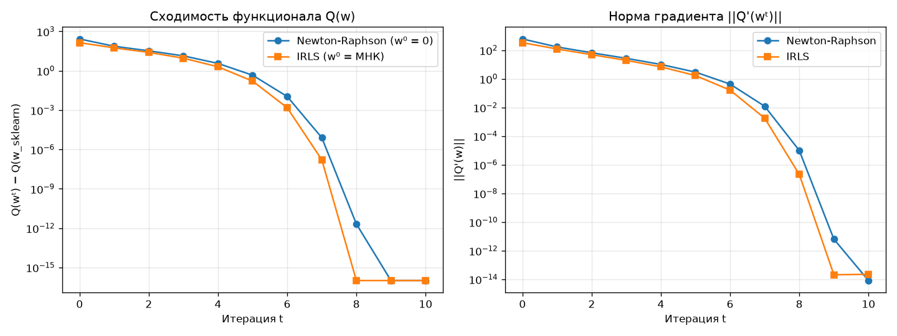
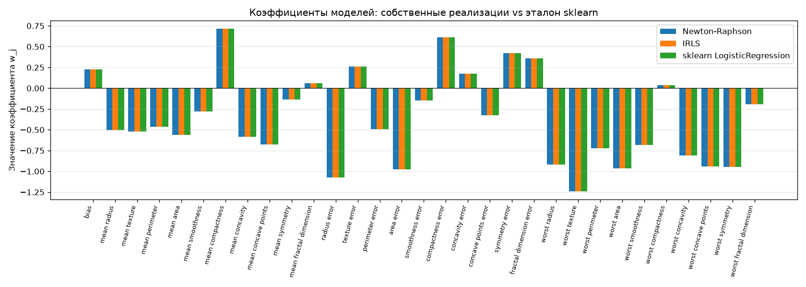
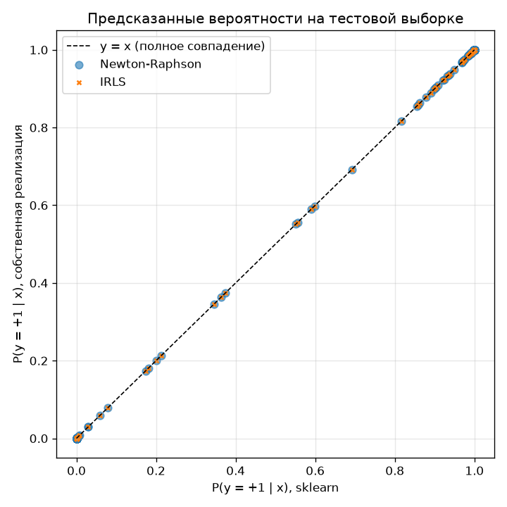
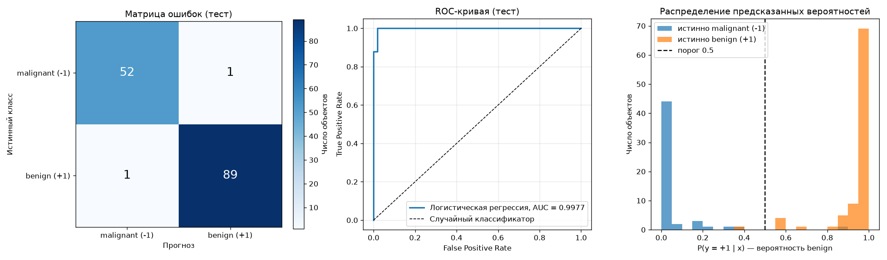
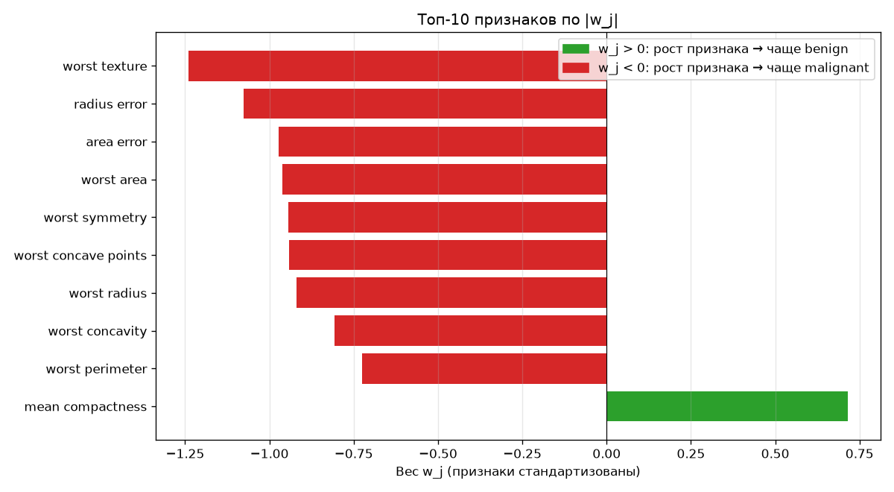

# Лабораторная работа 5. Логистическая регрессия: Ньютон–Рафсон и IRLS

Необходимо реализовать логистическую регрессию методом Ньютона–Рафсона и методом IRLS.

### Запуск

```bash
pip3 install -r requirements.txt
cd source
python main.py
```

### Датасет

**Breast Cancer Wisconsin** (`sklearn.datasets.load_breast_cancer`): 569 объектов, 30 числовых признаков (характеристики клеточных ядер), два класса: злокачественная (`-1`) и доброкачественная (`+1`) опухоль. Подготовка проводилась следующим образом: метки переведены из `{0, 1}` в `{-1, +1}`, признаки стандартизованы по статистикам обучающей выборки, добавлен константный признак `f₀(x) = 1`, вес `w₀` при нём свободный член.

### Теория 

Модель: `a(x, w) = sign(wᵀx)`, отступ `Mᵢ = yᵢ wᵀxᵢ`, `σᵢ = σ(Mᵢ)` — вероятность правильной классификации.

Минимизируется log-loss с L2-регуляризатором:

```
Q(w) = Σᵢ ln(1 + exp(−yᵢ wᵀxᵢ)) + λ/2 · ||w||²  →  min_w
```

Регуляризатор (λ = 1) нужен, потому что на почти линейно разделимых данных без него минимум не достигается:
веса растут до бесконечности. Кроме того, sklearn по умолчанию тоже использует L2, поэтому так сравнение честное.

**Градиент и гессиан**:

```
∂Q/∂wⱼ      = −Σᵢ (1 − σᵢ) yᵢ fⱼ(xᵢ) + λwⱼ
∂²Q/∂wⱼ∂wₖ  =  Σᵢ (1 − σᵢ) σᵢ fⱼ(xᵢ) fₖ(xᵢ) + λ[j = k]      ⇔   Q'' = Fᵀ D F + λI,  D = diag((1 − σᵢ)σᵢ)
```

**Метод Ньютона–Рафсона:** `wᵗ⁺¹ = wᵗ − hₜ (Q''(wᵗ))⁻¹ Q'(wᵗ)`, `w⁰ = 0`, `hₜ = 1`.
Гессиан явно не обращается - решается линейная система `Q'' δ = Q'`.

**IRLS**: на каждой итерации решается взвешенная задача МНК

```
γᵢ = √((1 − σᵢ)σᵢ),   F̃ = diag(γ) F,   ỹᵢ = yᵢ √((1 − σᵢ)/σᵢ)
w := w + hₜ (F̃ᵀF̃ + λI)⁻¹ (F̃ᵀỹ − λw)
```

Нулевое приближение это ридж МНК, остановка, когда `{σᵢ}` почти перестали меняться.

**Почему методы эквивалентны.** `F̃ᵀF̃ = FᵀDF` — это гессиан, а
`F̃ᵀỹ = Σᵢ γᵢ yᵢ √((1−σᵢ)/σᵢ) xᵢ = Σᵢ (1 − σᵢ) yᵢ xᵢ = −Q'`. Значит, шаг IRLS в точности совпадает
с шагом Ньютона–Рафсона: нелинейная задача сводится к серии взвешенных линейных регрессий,
где больший вес получают объекты у границы классов (наиболее трудные).

**Эталон.** `sklearn.linear_model.LogisticRegression(C=1/λ, fit_intercept=False, solver="lbfgs")`.
sklearn минимизирует `C·Σ log-loss + ½||w||²` — это тот же функционал, умноженный на `C`, поэтому минимум один и тот же.
`fit_intercept=False`, потому что столбец единиц уже есть в `F` и регуляризуется весь вектор `w`, как у нас.

### Результаты

| Метод | Итераций | Q(w) train | ‖Q'(w)‖ | max\|w − w_sklearn\| | Accuracy test | ROC-AUC test | LogLoss test |
|---|---|---|---|---|---|---|---|
| Newton–Raphson | 10 | 29.0492 | 7.4·10⁻¹⁵ | 8.2·10⁻⁷ | 0.9860 | 0.9977 | 0.0681 |
| IRLS | 10 | 29.0492 | 2.2·10⁻¹⁴ | 8.2·10⁻⁷ | 0.9860 | 0.9977 | 0.0681 |
| sklearn (lbfgs) | 47 | 29.0492 | 7.3·10⁻⁶ | 0 | 0.9860 | 0.9977 | 0.0681 |

Дополнительно на тестовой выборке:
- максимальное расхождение вероятностей `P(y=+1|x)` с sklearn **2.7·10⁻⁷** у обоих методов
- предсказанные классы совпадают с sklearn на **100 %** объектов.

По качеству классификации собственные реализации и эталон эквивалентны: метрики на тесте совпадают полностью, так как все методы находят один и тот же минимум функционала. Ньютон–Рафсон и IRLS сходятся быстрее (10 итераций против 47 у lbfgs) и находят минимум точнее (‖Q’‖ ≈ 10⁻¹⁴ против 7·10⁻⁶), потому что используют вторые производные. Но каждая их итерация требует решения линейной системы размера n×n, поэтому при большом числе признаков методы второго порядка становятся дороже, чем lbfgs.

### Сходимость



Оба метода сходятся за 8–10 итераций, после 5-й итерации видна квадратичная скорость сходимости,
характерная для метода Ньютона: число верных знаков примерно удваивается на каждом шаге.
IRLS стартует с решения МНК, которое ближе к оптимуму, чем `w⁰ = 0`, поэтому его кривая лежит чуть ниже.

### Коэффициенты



Столбцы трёх моделей для каждого признака совпадают визуально; численно расхождение не больше 8.2·10⁻⁷.

### Вероятности на тесте



Все точки лежат на прямой `y = x`.

### Результаты классификации на датасете Breast Cancer

Ниже — качество самой модели на тестовой выборке (143 опухоли: 53 malignant, 90 benign).
Приведены результаты Newton–Raphson; у IRLS и sklearn они те же, поскольку веса совпадают.

| Класс | Precision | Recall | F1 | Объектов |
|---|---|---|---|---|
| malignant (−1) | 0.981 | 0.981 | 0.981 | 53 |
| benign (+1) | 0.989 | 0.989 | 0.989 | 90 |
| **accuracy** | | | **0.986** | 143 |

ROC-AUC = 0.9977.



**Матрица ошибок.** Из 143 объектов ошибочно классифицированы только 2:
- одна злокачественная опухоль принята за доброкачественную, `P(benign) = 0.89`. Это самая опасная ошибка
  (ложноотрицательный диагноз), и модель в ней достаточно уверена;
- одна доброкачественная принята за злокачественную, `P(benign) = 0.37`.

**ROC-кривая** почти касается левого верхнего угла. Значит, классы хорошо разделяются линейной границей
и порог можно сдвигать без заметной потери качества.

**Распределение вероятностей.** Большинство объектов получают вероятность, близкую к 0 или 1, то есть модель уверена.
Неуверенная зона 0.2–0.8 содержит лишь около 10 объектов, и именно в ней (и около неё) находятся ошибки.
Для медицинской задачи разумно сдвинуть порог вверх, например до 0.9. Тогда recall класса malignant
вырастет ценой нескольких лишних ложных тревог: лучше лишний раз отправить пациента на биопсию, чем пропустить рак.

### Какие признаки важнее всего

Признаки стандартизованы, поэтому модули весов `|wⱼ|` можно сравнивать между собой.
Величина `exp(wⱼ)` показывает, во сколько раз меняются шансы `P(benign)/P(malignant)`
при росте признака на одно стандартное отклонение.



| Признак | wⱼ | exp(wⱼ) |
|---|---|---|
| worst texture | −1.24 | 0.29 |
| radius error | −1.08 | 0.34 |
| area error | −0.97 | 0.38 |
| worst area | −0.96 | 0.38 |
| worst symmetry | −0.94 | 0.39 |
| worst concave points | −0.94 | 0.39 |
| worst radius | −0.92 | 0.40 |
| worst concavity | −0.81 | 0.45 |
| worst perimeter | −0.72 | 0.48 |
| mean compactness | +0.71 | 2.04 |

Интерпретация:
- почти у всех важных признаков вес отрицательный: чем крупнее, неоднороднее и «изрезаннее» ядра клеток,
  тем выше вероятность злокачественной опухоли. Это согласуется с медицинским смыслом признаков.
  Например, рост `worst texture` на 1 std уменьшает шансы доброкачественности примерно в 3.5 раза;
- среди лидеров преобладают признаки группы `worst` — худшие значения по снимку, то есть важны самые аномальные клетки;
- положительный вес у `mean compactness` не стоит трактовать буквально. Признаки сильно коррелированы
  (radius, perimeter и area почти линейно зависимы), и модель частично «перераспределяет» вклад между ними.
  Это известная особенность линейных моделей при мультиколлинеарности, которую L2-регуляризатор лишь смягчает.

