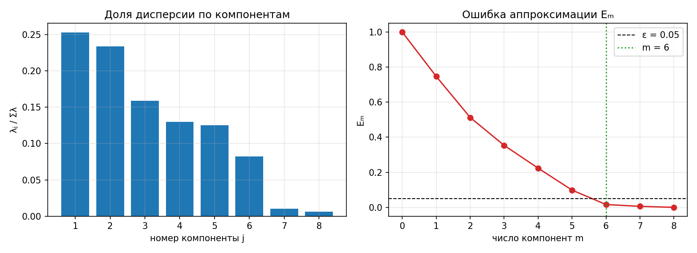
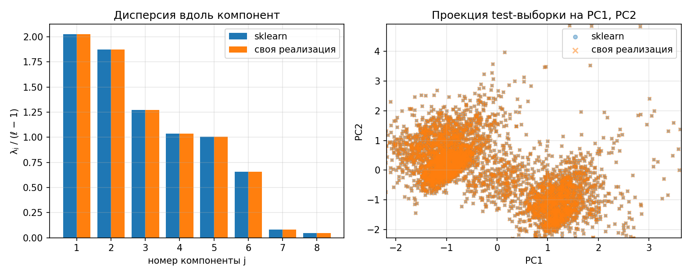
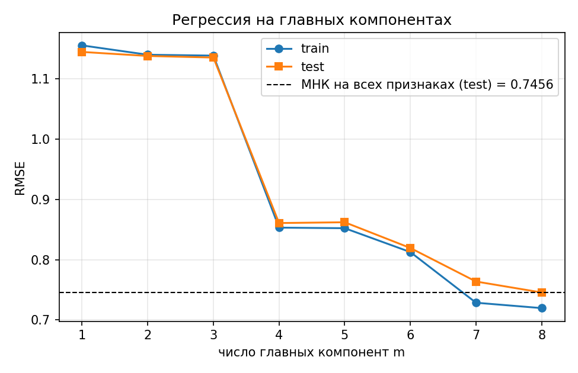

## 1. Датасет

California Housing (`sklearn.datasets.fetch_california_housing`): 20 640 объектов (кварталы Калифорнии), 8 числовых признаков, целевая переменная — медианная стоимость дома (в сотнях тысяч долларов). Это задача линейной регрессии. Признаки: `MedInc`, `HouseAge`, `AveRooms`, `AveBedrms`, `Population`, `AveOccup`, `Latitude`, `Longitude`.

Датасет выбран потому, что признаки в нём заметно коррелируют (мультиколлинеарность, слайды 9–10): `Latitude` и `Longitude` (r = −0.92), `AveRooms` и `AveBedrms` (r = +0.84). Выборка делится на обучающую и тестовую (80/20, `random_state=42`): 16 512 объектов в train, 4 128 в test. Признаки стандартизуются по обучающей выборке — без этого PCA определялся бы признаками с наибольшим масштабом (`Population`).

```python
def load_data():
    data = fetch_california_housing()
    X, y = data.data, data.target                                # y - медианная стоимость дома, 100 000 $
    X_train, X_test, y_train, y_test = train_test_split(X, y, test_size=0.2, random_state=RANDOM_STATE)
    scaler = StandardScaler().fit(X_train)
    return scaler.transform(X_train), scaler.transform(X_test), y_train, y_test, data.feature_names
```

Число обусловленности матрицы FᵀF на стандартизованных данных (слайд 9): μ(FᵀF) = λmax / λmin = 42.8. Это умеренная мультиколлинеарность: МНК решается устойчиво, но две пары признаков избыточны, и PCA должен это показать.

## 2. PCA через сингулярное разложение

Матрица «объекты–признаки» F размера ℓ × n центрируется по столбцам, затем раскладывается в сингулярное разложение (слайды 7, 22):

F = V D Uᵀ,  D = diag(√λ₁, …, √λₙ),  λ₁ ≥ … ≥ λₙ

Столбцы U — собственные векторы FᵀF, λⱼ — её собственные значения. По основной теореме PCA (слайд 21) минимум ‖GUᵀ − F‖² при m ≤ rk F достигается, когда столбцы U — собственные векторы, соответствующие m наибольшим λ, а новые признаки G = FU. Поэтому отдельно решать оптимизационную задачу не нужно: достаточно один раз вычислить SVD.

- новые признаки: G = FU (`transform`),
- восстановление: F̂ = GUᵀ (`inverse_transform`),
- новые признаки некоррелированы: GᵀG = Λ (слайд 22).

SVD определено с точностью до знака каждой пары (uⱼ, vⱼ). Чтобы результат был воспроизводимым, знак выбирается так, чтобы наибольший по модулю элемент uⱼ был положительным (то же соглашение, что у `svd_flip` в sklearn).

```python
class PCA:
    def fit(self, F):
        self.mean = F.mean(axis=0)
        Fc = F - self.mean
        V, d, Ut = np.linalg.svd(Fc, full_matrices=False)       # F = V D U^T
        sign = np.sign(Ut[np.arange(len(d)), np.abs(Ut).argmax(axis=1)])
        Ut, V = Ut * sign[:, None], V * sign
        ...
        self.eigvals = d ** 2                                   # lambda_j, по убыванию
        self.components_ = Ut[:m]                               # m x n, строки - u_j^T
        return self

    def transform(self, F):
        return (F - self.mean) @ self.components_.T             # G = F U

    def inverse_transform(self, G):
        return G @ self.components_ + self.mean                 # F_hat = G U^T
```

## 3. Эффективная размерность выборки

Эффективная размерность (слайд 23) — наименьшее целое m, при котором относительная ошибка аппроксимации не превышает ε:

Eₘ = ‖GUᵀ − F‖² / ‖F‖² = (λₘ₊₁ + … + λₙ) / (λ₁ + … + λₙ) ≤ ε

```python
def error(self, m):
    return self.eigvals[m:].sum() / self.eigvals.sum()

def effective_dim(self, eps):
    return next(m for m in range(1, self.n + 1) if self.error(m) <= eps)
```

Результат на обучающей выборке:

| m | λₘ | доля дисперсии | накопленная доля | Eₘ |
|---|---:|---:|---:|---:|
| 1 | 33438.55 | 0.2531 | 0.2531 | 0.7469 |
| 2 | 30914.67 | 0.2340 | 0.4872 | 0.5128 |
| 3 | 21025.95 | 0.1592 | 0.6463 | 0.3537 |
| 4 | 17141.96 | 0.1298 | 0.7761 | 0.2239 |
| 5 | 16574.36 | 0.1255 | 0.9016 | 0.0984 |
| 6 | 10853.69 | 0.0822 | 0.9837 | 0.0163 |
| 7 | 1366.09 | 0.0103 | 0.9941 | 0.0059 |
| 8 | 780.74 | 0.0059 | 1.0000 | 0.0000 |



При ε = 0.05 эффективная размерность m = 6 (E₅ = 0.098 > 0.05 ≥ E₆ = 0.016). Критерий «крутого склона» даёт тот же ответ: отношение Eₘ₋₁/Eₘ максимально при m = 6 (E₅/E₆ = 6.06). Собственные значения λ₇ и λ₈ в 8–14 раз меньше λ₆ — эти два направления соответствуют почти-линейным зависимостям внутри двух коррелированных пар. Веса компонент 7 и 8 по этим признакам: (`AveRooms`, `AveBedrms`) = (+0.55, −0.54) и (−0.44, +0.35), то есть разность `AveRooms` и `AveBedrms`; (`Latitude`, `Longitude`) = (+0.41, +0.44) и (+0.57, +0.54), то есть их сумма (признаки коррелируют отрицательно, поэтому сумма почти не меняется). Размерность снижается с 8 до 6, при этом сохраняется 98.4 % дисперсии.

Отметим, что до λ₆ спектр убывает плавно (25 % → 8 %), поэтому в данных нет сильного сжатия: в 8 признаках лишь два «лишних» направления. Это свойство датасета, а не реализации.

## 4. Эквивалентность с эталонной реализацией

Эталон — `sklearn.decomposition.PCA(svd_solver="full")`. Сравнение на тех же обучающих данных, значения (G, восстановление) считаются на тестовой выборке:

| Величина | Макс. расхождение |
|---|---:|
| дисперсии λⱼ / (ℓ − 1) vs `explained_variance_` | 0 |
| компоненты uⱼ (со знаком) | 0 |
| компоненты uⱼ (с точностью до знака) | 0 |
| новые признаки G, test | 3.6·10⁻¹⁵ |
| восстановление F̂ при m = 6, test | 1.4·10⁻¹⁴ |
| восстановление F̂ при m = 8, test | 3.6·10⁻¹⁵ |
| Eₘ при m = 6 (своя / sklearn) | 0.016252 / 0.016252 |

Расхождения порядка 10⁻¹⁵ — это ошибка округления double, то есть реализации эквивалентны. Знаки компонент совпали, так как используется то же соглашение о знаке, что в sklearn; сравнение с точностью до знака даёт тот же нулевой результат.



Слева — дисперсии компонент у двух реализаций (столбцы совпадают), справа — проекция test-выборки на первые две компоненты (точки и крестики совпадают; по осям обрезаны 0.5 % выбросов только для читаемости графика).

## 5. Линейная регрессия на главных компонентах

PCA — задача без учителя (слайд 19), но результат можно применить к регрессии (слайд 24). Заменим F на приближение G Uᵀ и решим МНК относительно β = Uᵀα:

β* = D⁻¹Vᵀy,  α* = U D⁻¹ Vᵀ y = Σⱼ₌₁ᵐ (1/√λⱼ) uⱼ (vⱼᵀy)

Сумма берётся по m слагаемым вместо n. Реализация `PCRegression` использует эту формулу напрямую; для проверки она сравнивается с `make_pipeline(PCA(m), LinearRegression())` из sklearn.

```python
class PCRegression:
    def fit(self, F, y):
        self.mean, self.y_mean = F.mean(axis=0), y.mean()
        V, d, Ut = np.linalg.svd(F - self.mean, full_matrices=False)
        m = self.m
        self.alpha = Ut[:m].T @ ((V[:, :m].T @ (y - self.y_mean)) / d[:m])   # alpha = sum_j u_j (v_j^T y) / sqrt(lambda_j)
        return self

    def predict(self, F):
        return (F - self.mean) @ self.alpha + self.y_mean
```

| m | RMSE train | RMSE test | R² test | max \|pred_own − pred_sklearn\| | ‖α‖ |
|--:|---:|---:|---:|---:|---:|
| 1 | 1.1553 | 1.1445 | 0.0004 | 4.4·10⁻¹⁶ | 0.0316 |
| 2 | 1.1398 | 1.1378 | 0.0121 | 1.2·10⁻¹⁴ | 0.1413 |
| 3 | 1.1384 | 1.1352 | 0.0166 | 2.1·10⁻¹⁴ | 0.1504 |
| 4 | 0.8531 | 0.8607 | 0.4346 | 3.9·10⁻¹⁴ | 0.7548 |
| 5 | 0.8522 | 0.8620 | 0.4329 | 5.5·10⁻¹⁴ | 0.7559 |
| 6 | 0.8126 | 0.8194 | 0.4877 | 5.1·10⁻¹⁴ | 0.8196 |
| 7 | 0.7286 | 0.7638 | 0.5549 | 5.3·10⁻¹⁴ | 1.4954 |
| 8 | 0.7197 | 0.7456 | 0.5758 | 9.4·10⁻¹⁴ | 1.5842 |

МНК на всех 8 признаках: RMSE train = 0.7197, RMSE test = 0.7456, R² test = 0.5758, ‖α‖ = 1.5842. При m = n регрессия на компонентах совпадает с обычным МНК — это тождество, что подтверждает корректность формулы.



Предсказания своей и sklearn-реализации совпадают при каждом m (расхождение ≤ 10⁻¹³).

Важное наблюдение: **эффективная размерность по дисперсии не равна «достаточной» размерности для регрессии**. При m = 6 PCA сохраняет 98 % дисперсии признаков, но R² на test падает с 0.576 до 0.488; заметное падение ошибки даёт и m = 7. Причина: PCA не использует y, и самые малые компоненты (λ₇, λ₈) оказываются информативными для цены — они содержат сумму `Latitude` + `Longitude` и разность `AveRooms` − `AveBedrms`. Вероятное объяснение (в работе не проверялось): сумма координат — это положение поперёк побережья, идущего с северо-запада на юго-восток, то есть примерно расстояние до океана, а оно сильно влияет на цену. Поэтому в данной задаче сокращение размерности не улучшает качество регрессии, а лишь уменьшает ‖α‖ и сжимает пространство признаков; переобучения у МНК здесь нет (RMSE train и test близки), так как n ≪ ℓ.

## 6. Запуск

```bash
cd lab4/source
python main.py
```

Графики сохраняются в `output/`, полный вывод — в `output/run.log`. Зависимости: NumPy, pandas, scikit-learn, Matplotlib.

## 7. Выводы

1. PCA реализован через SVD центрированной матрицы признаков: компоненты — правые сингулярные векторы, λⱼ = dⱼ², новые признаки G = FU.
2. Эффективная размерность выборки при ε = 0.05 равна 6 из 8 (сохраняется 98.4 % дисперсии); критерий крутого склона даёт то же значение. Два отброшенных направления отражают коллинеарность пар `Latitude`/`Longitude` и `AveRooms`/`AveBedrms`.
3. Реализация эквивалентна `sklearn.decomposition.PCA`: собственные значения, компоненты, новые признаки и восстановление совпадают с точностью до 10⁻¹⁴.
4. Регрессия на m главных компонентах (слайд 24) совпадает с `Pipeline(PCA, LinearRegression)` и при m = n — с обычным МНК. Выбор m по доле дисперсии для регрессии не оптимален, так как PCA не учитывает целевую переменную.
