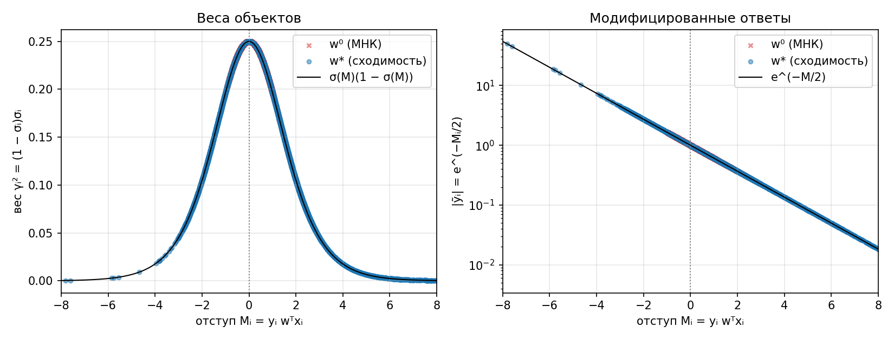
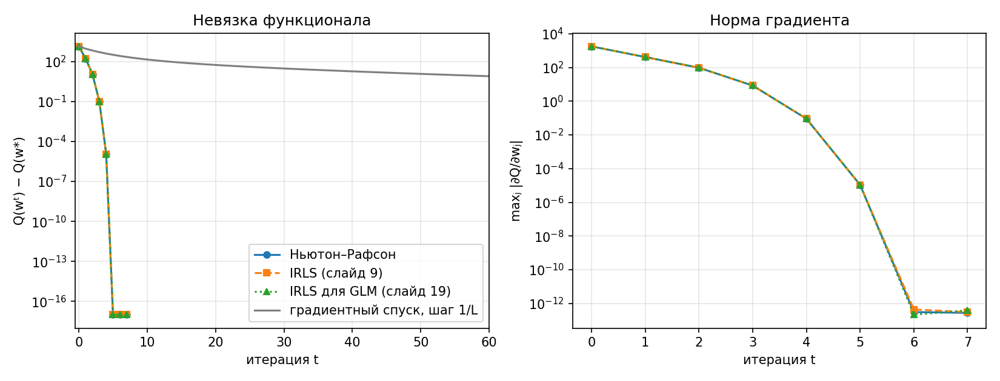
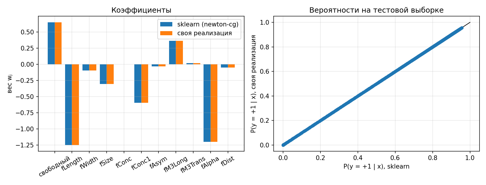
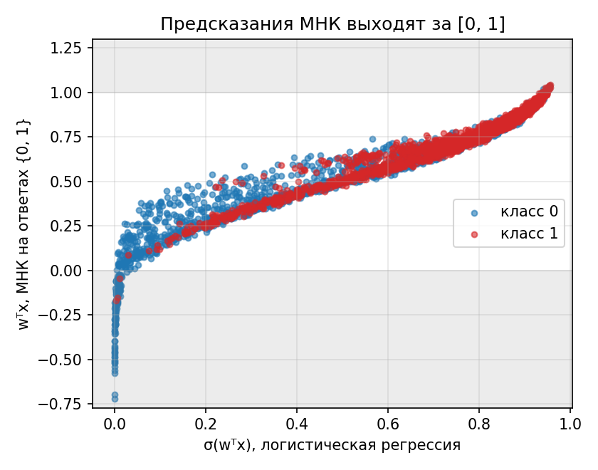
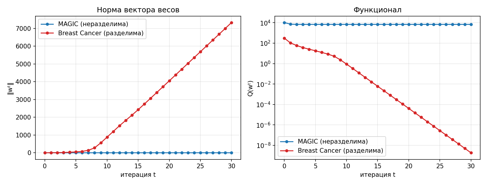

## 1. Датасет

MAGIC Gamma Telescope (OpenML `MagicTelescope`, версия 1, `sklearn.datasets.fetch_openml`; исходные данные — UCI): 19 020 событий регистрации атмосферных ливней, 10 числовых признаков, без пропусков. Класс `g` (гамма-квант, 12 332 события, 64.8 %) или `h` (адрон — фон, 6 688 событий). Это задача бинарной классификации; положительный класс (+1) — гамма-квант. Данные получены моделированием методом Монте-Карло. Признаки — параметры эллипса, которым аппроксимируется изображение ливня в телескопе: `fLength` и `fWidth` (большая и малая оси), `fSize` (десятичный логарифм суммарной яркости), `fConc` и `fConc1` (доли яркости в двух самых ярких и в самом ярком пикселе), `fAsym` (расстояние от самого яркого пикселя до центра, спроектированное на большую ось), `fM3Long` и `fM3Trans` (кубический корень третьего момента вдоль большой и малой оси), `fAlpha` (угол между большой осью и направлением на источник), `fDist` (расстояние от источника до центра эллипса).

Датасет выбран по трём причинам. Во-первых, классы на нём **линейно не разделимы**: у нерегуляризованной логистической регрессии есть конечный оптимум, и его можно сравнивать с эталоном (на разделимой выборке — Breast Cancer, как в lab2/lab3 — оптимума нет, см. раздел 11). Во-вторых, выборка большая: в тесте 3 804 объекта, один объект меняет accuracy на 0.026 п.п. В-третьих, признаки имеют разный масштаб и тяжёлые хвосты (`fAsym` от −458 до 575, `fConc` от 0.01 до 0.89), поэтому стандартизация здесь содержательна. Строк-дубликатов в данных 115 из 19 020 (0.6 %), они не удалялись.

Выборка делится стратифицированно (80/20, `random_state=42`): 15 216 объектов в train и 3 804 в test; доля положительного класса 0.648 в обеих частях. Признаки стандартизуются по train. К матрице признаков добавляется столбец из единиц — свободный член, как ещё один признак (в `w` он идёт нулевым элементом, всего p = 11 весов).

```python
def load_data():
    data = fetch_openml("MagicTelescope", version=1, as_frame=True, parser="auto")  # MAGIC Gamma Telescope
    X = data.data
    names = [c.rstrip(":") for c in X.columns]                     # в OpenML имена признаков заканчиваются двоеточием
    y01 = (data.target.astype(str) == "g").values.astype(int)      # 1 - гамма-квант, 0 - адрон (фон)
    X_train, X_test, y_train, y_test = train_test_split(
        X.values.astype(float), y01, test_size=0.2, random_state=RANDOM_STATE, stratify=y01)
    scaler = StandardScaler().fit(X_train)
    return scaler.transform(X_train), scaler.transform(X_test), y_train, y_test, names
```

Метки для метода Ньютона и IRLS берутся из {−1, +1} (слайды 6–9), для IRLS в обозначениях GLM — из {0, 1} (слайды 18–20).

## 2. Функционал, градиент и гессиан

Отступ Mᵢ = yᵢ wᵀxᵢ. Аппроксимация эмпирического риска логарифмической функцией потерь (слайд 6):

Q(w) = Σᵢ ln(1 + e^(−Mᵢ)),  σ(z) = 1 / (1 + e^(−z)).

Так как ∂ ln(1 + e^(−M)) / ∂M = −(1 − σ(M)), а ∂Mᵢ/∂wⱼ = yᵢ fⱼ(xᵢ), то (слайд 7), при σᵢ = σ(Mᵢ):

- градиент: ∂Q/∂wⱼ = −Σᵢ (1 − σᵢ) yᵢ fⱼ(xᵢ),
- гессиан: ∂²Q/∂wⱼ∂wₖ = Σᵢ (1 − σᵢ) σᵢ fⱼ(xᵢ) fₖ(xᵢ), то есть Q″ = FᵀDF, D = diag((1 − σᵢ)σᵢ).

Матрица D неотрицательна, поэтому Q″ положительно полуопределена, а Q выпукла: локальных минимумов, кроме глобального, нет.

```python
def gradient(F, y, w):
    sigma = sigmoid(margins(F, y, w))
    return -F.T @ ((1 - sigma) * y)                    # dQ/dw_j = -sum (1 - sigma_i) y_i f_j(x_i)

def hessian(F, y, w):
    sigma = sigmoid(margins(F, y, w))
    return F.T @ (((1 - sigma) * sigma)[:, None] * F)  # d2Q/dw_j dw_k = sum (1 - sigma_i) sigma_i f_j f_k = F^T D F
```

`sigmoid` записана через `tanh` (0.5·(1 + tanh(z/2))): это то же самое число, но `exp` не переполняется при больших |z|. Функционал считается через `np.logaddexp(0, -M)` по той же причине.

## 3. Метод Ньютона–Рафсона

Шаг (слайд 7): w := w − h (Q″(w))⁻¹ Q′(w), h = 1. Систему Q″d = Q′ решаем `np.linalg.solve`, гессиан не обращается.

```python
def newton_raphson(F, y, w0, step=1.0, tol=1e-12, max_iter=100):
    def direction(w):
        return -np.linalg.solve(hessian(F, y, w), gradient(F, y, w))
    return _run(F, y, w0, direction, step, tol, max_iter)
```

Общий цикл `_run` одинаков для всех методов: `w := w + h·direction(w)`, после каждого шага сохраняются w, Q(w), ‖Q′‖∞. Критерий остановки — со слайда 9 (шаг 9): остановиться, когда σᵢ почти не меняются, `max |σᵢᵗ − σᵢᵗ⁻¹| < 10⁻¹²`. Это одинаковый критерий для всех трёх методов, поэтому число итераций сравнимо.

## 4. IRLS

Шаг Ньютона записывается как задача взвешенного МНК (слайды 8–9). С F̃ = diag(γ) F, γᵢ = √((1 − σᵢ)σᵢ), ỹᵢ = yᵢ √((1 − σᵢ)/σᵢ):

F̃ᵀF̃ = FᵀDF = Q″,  F̃ᵀỹ = Σᵢ (1 − σᵢ) yᵢ fⱼ(xᵢ) = −Q′,

поэтому (F̃ᵀF̃)⁻¹F̃ᵀỹ = −(Q″)⁻¹Q′, то есть ровно шаг Ньютона. (На слайде 8 правая часть записана сокращённо; полностью это Fᵀ D (yᵢ/σᵢ) = Fᵀ((1 − σᵢ)yᵢ).) Нулевое приближение — обычный МНК w⁰ = (FᵀF)⁻¹Fᵀy (слайд 9, шаг 1).

```python
def irls(F, y, w0, step=1.0, tol=1e-12, max_iter=100):
    def direction(w):
        M = margins(F, y, w)
        sigma = sigmoid(M)
        gamma = np.sqrt((1 - sigma) * sigma)             # веса объектов
        y_tilde = y * np.exp(-M / 2)                     # = y_i sqrt((1 - sigma_i) / sigma_i), без деления на sigma_i
        return np.linalg.lstsq(gamma[:, None] * F, y_tilde, rcond=None)[0]  # взвешенный МНК, F~^T F~ не строится
    return _run(F, y, w0, direction, step, tol, max_iter)
```

`np.linalg.lstsq` решает ‖F̃δ − ỹ‖² → min через SVD, поэтому матрица F̃ᵀF̃ даже не формируется (а её число обусловленности было бы квадратом числа обусловленности F̃).

Смысл весов (слайд 8). Вес γᵢ² = (1 − σᵢ)σᵢ зависит только от отступа и максимален (0.25) при Mᵢ = 0, то есть у объектов на границе; у уверенно классифицированных объектов вес мал. Модифицированный ответ |ỹᵢ| = e^(−Mᵢ/2) растёт для объектов, на которых модель ошибается. На обучающей выборке при w*: вес от 0.25 (при M = 0) до 2.9·10⁻⁵, средний вес правильно классифицированных объектов 0.135, неправильно — 0.189; максимум |ỹ| вырос с 2.62 при w⁰ (МНК) до 49.7 при w*. Веса пересчитываются на каждой итерации, потому что отступы меняются вместе с w.



Точки лежат на теоретических кривых σ(M)(1 − σ(M)) и e^(−M/2) (правый график — в логарифмической шкале, поэтому экспонента — прямая), потому что оба значения — функции одного только отступа. Красные крестики (w⁰) и синие точки (w*) отличаются тем, какие отступы получили объекты.

## 5. IRLS как GLM

Те же вычисления в обозначениях обобщённой линейной модели (слайды 13–20). Для распределения Бернулли, yᵢ ∈ {0, 1}: θᵢ = ln(μᵢ/(1 − μᵢ)) = wᵀxᵢ, c(θ) = ln(1 + e^θ), c′(θ) = σ(θ) = μ, c″(θ) = σ(θ)(1 − σ(θ)), φ = 1. Тогда γᵢ = √c″(θᵢ), ỹᵢ = (yᵢ − c′(θᵢ)) / (φᵢγᵢ) (слайд 19), и F̃ᵀỹ = Σᵢ (yᵢ − μᵢ) fⱼ(xᵢ): это градиент логарифма правдоподобия, он совпадает с −Q′ (при yᵢ = 1 величина 1 − σ(Mᵢ) равна yᵢ − μᵢ, при yᵢ = 0 с учётом знака метки — тоже).

```python
def irls_glm(F, y01, w0, step=1.0, tol=1e-12, max_iter=100):
    y = 2 * y01 - 1  # _run считает критерий остановки по отступам, поэтому ему нужны метки в {-1, +1}

    def direction(w):
        mu = sigmoid(F @ w)                              # c'(theta_i) = E y_i
        gamma = np.sqrt(np.maximum(mu * (1 - mu), 1e-300))  # sqrt(c''(theta_i) / phi_i); пол - на случай насыщения mu = 1
        y_tilde = (y01 - mu) / gamma                     # (y_i - c'(theta_i)) / (phi_i gamma_i)
        return np.linalg.lstsq(gamma[:, None] * F, y_tilde, rcond=None)[0]
    return _run(F, y, w0, direction, step, tol, max_iter)
```

## 6. Три метода делают один шаг

Результат (w⁰ = МНК):

| Метод | Итераций | Q(w*) | max\|∂Q/∂w\| |
|---|--:|---:|---:|
| Ньютон–Рафсон | 7 | 6926.0469916071 | 2.8·10⁻¹³ |
| IRLS (слайд 9) | 7 | 6926.0469916071 | 3.1·10⁻¹³ |
| IRLS для GLM (слайд 19) | 7 | 6926.0469916071 | 3.8·10⁻¹³ |

Траектории совпадают не только в конце, но и на каждой итерации: max по t и j |wⱼᵗ(Ньютон) − wⱼᵗ(IRLS)| = 4.7·10⁻¹⁵, для IRLS-GLM — 5.0·10⁻¹⁵. Это ошибка округления double, то есть IRLS не «похож» на метод Ньютона, а делает тот же шаг, только вычисленный другим способом. Число итераций не зависит от начальной точки: при w⁰ = 0 тоже 7 для всех трёх методов.

## 7. Скорость сходимости

Норма градиента у метода Ньютона по итерациям: 1.8·10³, 4.2·10², 97, 8.5, 9.2·10⁻², 1.1·10⁻⁵, 3.1·10⁻¹³. Сходимость квадратичная: на шагах 3→4 и 4→5 отношение eₜ₊₁/eₜ² одно и то же, ≈ 1.3·10⁻³, где eₜ — норма градиента; последнее значение 3·10⁻¹³ — уже точность double при масштабе Q ≈ 7·10³. Невязка Q(wᵗ) − Q(w*) падает 1.4·10³, 1.7·10², 11, 0.10, 1.1·10⁻⁵, 0. IRLS идёт по той же траектории.

Для контраста — обычный градиентный спуск (без гессиана) с шагом 1/L, L = λmax(FᵀF)/4 (так как Q″ ≤ FᵀF/4, такой шаг гарантирует убывание Q). Его сходимость линейная и медленная: Q − Q* = 1.4·10² после 10 итераций, 12 после 50, 0.24 после 200 и 1.2·10⁻³ после 1000. Невязки 10⁻¹⁰ за 1000 итераций градиентный спуск не достиг, а метод Ньютона достигает её за 5. Итерация Ньютона дороже (решение системы p × p, p = 11, плюс построение FᵀDF за O(ℓp²)), но эта разница несопоставима с разницей в числе итераций.



Линии трёх методов на обоих графиках сливаются — это то же равенство траекторий, что и в разделе 6.

## 8. Эквивалентность с эталонной реализацией

Эталон — `sklearn.linear_model.LogisticRegression`. По умолчанию он обучается **с L2-регуляризацией** (C = 1), поэтому для сравнения с нерегуляризованным Q(w) нужно `penalty=None`; свободный член sklearn не регуляризует и хранит отдельно, у нас он — нулевой вес. Расхождение на тестовой выборке:

| solver | max\|w_own − w_sk\| | max\|p_own − p_sk\| | accuracy | log-loss | AUC |
|---|---:|---:|---:|---:|---:|
| `newton-cg`, `tol=1e-12` | 4.2·10⁻¹⁵ | 8.3·10⁻¹⁵ | 0.7834 / 0.7834 | 0.4663 / 0.4663 | 0.8312 / 0.8312 |
| `lbfgs`, `tol=1e-12` | 5.7·10⁻⁷ | 2.1·10⁻⁷ | 0.7834 / 0.7834 | 0.4663 / 0.4663 | 0.8312 / 0.8312 |
| по умолчанию (L2, C = 1) | 5.1·10⁻³ | 2.0·10⁻³ | | | |

В столбцах метрик — sklearn / своя реализация. Реализации эквивалентны: веса совпадают до 10⁻¹⁵ (машинная точность) при `newton-cg`, который сам является методом типа Ньютона. Расхождение 6·10⁻⁷ с `lbfgs` — это, вероятно, точность его остановки (квазиньютоновский метод без точного гессиана); в работе это не проверялось. Третья строка показывает, что ответ отличается, если не отключить регуляризацию: это не ошибка реализации, а другая задача (при 15 216 объектах слагаемое L2 мало по сравнению с Q, поэтому различие небольшое, но на 12 порядков больше погрешности округления).



## 9. Интерпретация на данных

Линейная комбинация θ = wᵀx — это логит: ln(P(y=1|x) / P(y=0|x)) (слайд 21). Поэтому при росте признака на одно стандартное отклонение шанс P/(1 − P) умножается на e^w. Положительный класс — гамма-квант. Стандартные ошибки — из гессиана в оптимуме: SE = √diag((Q″)⁻¹) (информационная матрица Фишера).

| признак | wⱼ | SE | z | отношение шансов e^wⱼ |
|---|---:|---:|---:|---:|
| свободный | +0.652 | 0.022 | +29.39 | 1.920 |
| `fLength` | −1.250 | 0.050 | −25.06 | 0.286 |
| `fWidth` | −0.093 | 0.050 | −1.85 | 0.911 |
| `fSize` | −0.304 | 0.051 | −5.97 | 0.738 |
| `fConc` | +0.001 | 0.107 | +0.01 | 1.001 |
| `fConc1` | −0.595 | 0.094 | −6.35 | 0.552 |
| `fAsym` | −0.032 | 0.029 | −1.12 | 0.968 |
| `fM3Long` | +0.364 | 0.030 | +11.96 | 1.438 |
| `fM3Trans` | +0.021 | 0.027 | +0.78 | 1.021 |
| `fAlpha` | −1.198 | 0.025 | −47.96 | 0.302 |
| `fDist` | −0.049 | 0.025 | −1.95 | 0.952 |

- Сильнее всех влияют `fAlpha` (z = −48) и `fLength` (z = −25): рост любого из них на 1 СКО умножает шанс «гамма-квант» примерно на 0.30 и 0.29, то есть уменьшает его более чем в 3 раза. Для `fAlpha` это согласуется с описанием признака: у гамма-квантов ось ливня направлена на источник, поэтому малый угол — признак гамма (физическое объяснение взято из описания данных, в работе не проверялось).
- `fM3Long` повышает шанс (×1.44 на +1 СКО, z = 12); `fConc1` (×0.55, z = −6.4) и `fSize` (×0.74, z = −6.0) понижают.
- Для `fWidth`, `fConc`, `fAsym`, `fM3Trans` и `fDist` |z| < 2: при остальных признаках на фиксированном уровне данные не дают оснований считать эти веса ненулевыми.
- Свободный член +0.652: для «среднего» объекта (все стандартизованные признаки равны 0) шанс 1.92, то есть P = σ(0.652) ≈ 0.66; доля гамма-квантов в обучающей выборке 0.648.
- Это ассоциации в данной выборке, а не причинные эффекты.

Качество на тестовой выборке: accuracy 0.7834 (константный классификатор по большинству даёт 0.6483), log-loss 0.4663, AUC 0.8312. На обучающей: accuracy 0.7930, log-loss 0.4552, AUC 0.8416. Разрыв между train и test мал (1.0 п.п. по accuracy), чего и следовало ожидать от модели с 11 весами на 15 216 объектах. Стандартная ошибка accuracy на тесте около 0.7 п.п. Кросс-валидация в работе не проводилась.

## 10. Почему не МНК на ответах {0, 1}

МНК эквивалентен максимуму правдоподобия при гауссовском шуме (слайд 12), а для бернуллиевского ответа шум не гауссовский, и его дисперсия μ(1 − μ) зависит от самого объекта. Проверка: линейная регрессия на y ∈ {0, 1} с теми же признаками даёт на тесте accuracy 0.7742 и AUC 0.8304 — чуть хуже, чем у логистической (0.7834 и 0.8312), то есть как ранжирующая оценка она работает. Но как оценка вероятности — нет: для 3.6 % тестовых объектов «вероятность» вне [0, 1] (от −0.72 до 1.04).



Логистическая регрессия выходит из модели Бернулли (раздел 5) и гарантирует P ∈ (0, 1), потому что σ — функция связи.

## 11. Разделимая выборка (доп. вопрос 16)

Если классы линейно разделимы, у нерегуляризованного Q(w) нет конечного минимума: Q → 0 при ‖w‖ → ∞ вдоль разделяющего направления. На Breast Cancer (вариант `sklearn.datasets.load_breast_cancer`, тот же набор 569 × 30, что в lab2/lab3; train 455 объектов, стратифицированное деление 80/20, `random_state=42`), где разделяющая гиперплоскость существует (accuracy на train достигает 1.0), метод Ньютона из w = 0 даёт: Q = 105.5 при t = 1, 18.2 при t = 5, 1.9·10⁻⁹ при t = 30; ‖wᵗ‖ = 5.7, 52.4, 881.3, 4052.3, 7333.0 при t = 1, 5, 10, 20, 30, то есть он растёт без остановки. На MAGIC ‖wᵗ‖ уже при t = 10 равна 2.0041 и не меняется до t = 30.



На практике это лечат регуляризацией (L2 делает Q″ + τI положительно определённой и возвращает конечный оптимум) или остановкой по числу итераций.

## 12. Запуск

```bash
cd lab5/source
python main.py
```

Графики сохраняются в `output/`, полный вывод — в `output/run.log`. При первом запуске датасет скачивается с OpenML и кэшируется в `~/scikit_learn_data`. Зависимости: NumPy, pandas, scikit-learn, Matplotlib.

## 13. Ответы на вопросы для сдачи

1. **Зачем логистическая регрессия.** Для бинарной классификации; «регрессия», потому что модель оценивает вероятность P(y = 1 | x) как непрерывную функцию σ(wᵀx), а класс получается порогом (слайд 28: «не регрессия, а классификация»).
2. **Линейная комбинация, сигмоида, логит.** θ = wᵀx — логит, ln(P/(1 − P)); P = σ(θ). Логит — функция связи g(μ) = ln(μ/(1 − μ)), σ — обратная к ней (слайды 20–21).
3. **Log-loss из Бернулли.** p(yᵢ|xᵢ) = σ(ỹᵢ xᵢᵀw), ỹ ∈ {−1, +1}. Максимум Σ ln p ⇔ минимум Σ ln(1 + e^(−Mᵢ)) (слайд 20).
4. **МНК для классификации.** Классификатор получить можно (раздел 10: accuracy 0.77, AUC 0.83), но это ММП при гауссовском шуме, а у бернуллиевского ответа шум негауссовский; предсказания не вероятности (3.6 % вне [0, 1]).
5. **Ньютон–Рафсон.** Использует кривизну: направление −(Q″)⁻¹Q′ (раздел 3); градиентный спуск использует только Q′. Вблизи минимума Ньютон сходится квадратично (раздел 7: 5 итераций до невязки 10⁻¹⁰, градиентный спуск не достиг её за 1000).
6. **IRLS.** Шаг Ньютона = решение взвешенного МНК ‖F̃δ − ỹ‖² → min; веса и ответы зависят от w, поэтому задача решается заново на каждой итерации (раздел 4).
7. **Веса IRLS.** γᵢ² = (1 − σᵢ)σᵢ: максимум у границы; после каждой итерации пересчитываются σᵢ, γᵢ и ỹᵢ (раздел 4).
8. **Связь Ньютона и IRLS.** Направление одно и то же (разделы 4 и 6: расхождение траекторий 5·10⁻¹⁵).
9. **GLM.** Три компонента: распределение ответа из экспоненциального семейства, линейный предиктор θ = xᵀα, функция связи g = [c′]⁻¹ (слайд 13).
10. **Функции связи.** Нормальное — тождественная (θ = μ); Бернулли — логит ln(μ/(1 − μ)); Пуассон — логарифм ln μ (слайды 14–15).
11. **Бернулли, биномиальное, Пуассон.** Бернулли — один исход «да/нет» (наше событие — гамма-квант или нет). Биномиальное — число успехов из nᵢ испытаний (сколько из nᵢ зарегистрированных в сеансе событий оказались гамма-квантами). Пуассон — число событий без верхней границы (число срабатываний телескопа за единицу времени).
14. **Линейная регрессия тоже GLM.** Нормальное распределение, c(θ) = θ²/2, φ = σ², связь тождественная (слайд 14); логистическая — Бернулли с логитом (разделы 5, 10).
15. **GLM и GAM.** В GLM предиктор линейный по признакам, нелинейность только в функции связи; в GAM каждый признак проходит через свою обучаемую функцию φⱼ(fⱼ) (сплайны, ядерное сглаживание), настройка — backfitting (слайды 10–11). В работе GAM не реализовывался.
16. **Разделимая выборка.** Оптимума нет: ‖w‖ → ∞, Q → 0 (раздел 11).
17. **Квантильные и робастные потери.** Квантильные — когда ошибки в разные стороны стоят по-разному (слайды 23–24); робастные (модуль, Мешалкина, Хьюбер) — когда есть выбросы по yᵢ, которые квадрат ошибки чрезмерно усиливает (слайды 22, 25–27). В работе не реализовывались.

## 14. Выводы

1. Логистическая регрессия реализована тремя способами: метод Ньютона–Рафсона, IRLS (слайд 9) и IRLS в обозначениях GLM (слайд 19). Все три делают один и тот же шаг: траектории совпадают с точностью до 10⁻¹⁵, на MAGIC нужно 7 итераций (5 до невязки 10⁻¹⁰).
2. Сходимость квадратична; обычный градиентный спуск за 1000 итераций не достигает невязки 10⁻¹⁰.
3. Реализация эквивалентна `sklearn.linear_model.LogisticRegression(penalty=None)`: веса совпадают до 4·10⁻¹⁵ (`newton-cg`), вероятности и метрики на тесте — тоже. Настройки sklearn по умолчанию (L2, C = 1) дают другой ответ.
4. На MAGIC решающие признаки — `fAlpha` и `fLength` (шанс «гамма-квант» ×0.30 и ×0.29 на +1 СКО); test accuracy 0.783, AUC 0.831 на 3 804 объектах.
5. МНК на {0, 1} ранжирует почти так же, но не даёт вероятностей; на линейно разделимой выборке нерегуляризованная модель не имеет конечного оптимума.
