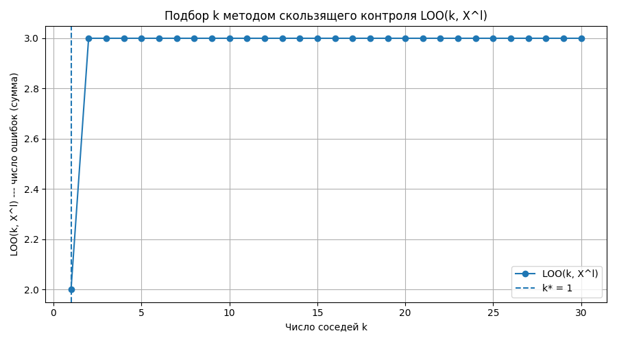
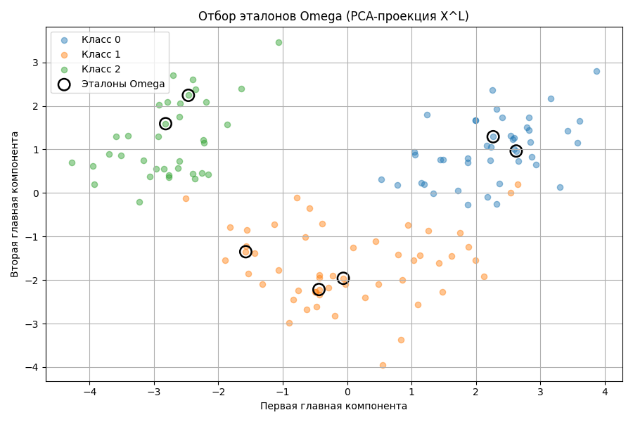
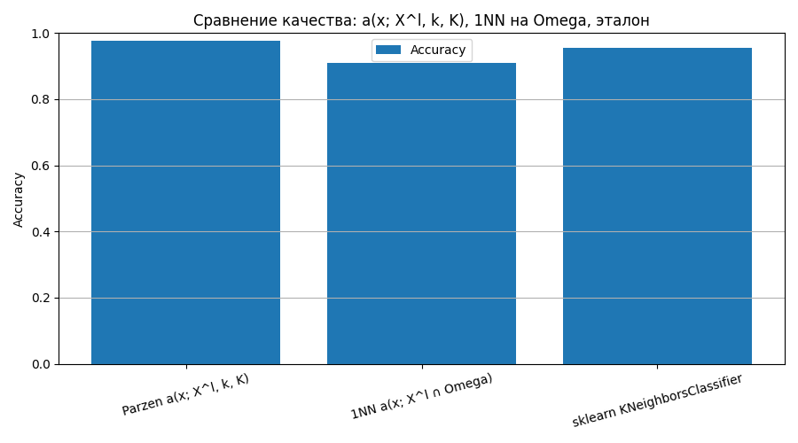

# Лабораторная работа №2. Метрическая классификация

## Цель работы

Реализовать метрический алгоритм классификации KNN с методом окна Парзена
переменной ширины, подобрать параметр `k` методом скользящего контроля `LOO`,
сравнить собственную реализацию с эталонной реализацией из `sklearn`, а также
реализовать жадный отбор эталонных объектов `Omega`.

Используются обозначения лекции по метрическим методам (1-в-1 с лекцией):

```text
X — объекты, Y — ответы;
X^l = (x_i, y_i)_{i=1}^l — обучающая выборка;
X^L = X^l ⊔ X^k — выборка, разбитая на обучение X^l и контроль X^k;
x = (x^1, …, x^n) — вектор признаков объекта x (ВЕРХНИЕ индексы признаков);
x_i = (x^1_i, …, x^n_i) — вектор признаков объекта x_i;
rho(x, x^{(1)}) ≤ rho(x, x^{(2)}) ≤ … ≤ rho(x, x^{(l)}) — ранжировка соседей;
x^{(i)} — i-й сосед объекта x, y^{(i)} — ответ на i-м соседе;
Gamma_y(x) — мера голосов соседей в пользу класса y;
w(i, x) — вес i-го соседа (степень близости к x), не возрастает по i;
k — число соседей / длина контроля (по контексту);
h — ширина окна; K — ядро; w_i — вес, зависящий только от номера соседа;
Omega ⊆ X^L — множество эталонов (в коде — множество индексов).
```

Основная гипотеза метрических методов классификации — **гипотеза
компактности**:

```text
близкие объекты, как правило, лежат в одном классе.
```

## Структура проекта

```text
lab2/
├── README.md
├── loo_risk.png
├── prototypes.png
├── quality_comparison.png
└── source/
    ├── knn.py
    ├── main.py
    ├── plots.py
    ├── prototype_selection.py
    └── test_lecture.py
```

Назначение файлов:

- `source/main.py` — основной сценарий лабораторной работы;
- `source/knn.py` — `rho`, ядра `K` (`Pi`, `T`, `E`, `Q`, `G`), `Gamma_y`,
  классификатор `a(x; X^l, k, K)`, `LOO(k, X^l)`, подбор `k`;
- `source/prototype_selection.py` — профиль `Pi(m, Omega)`, `CCV(Omega)`,
  жадный отбор `Omega`;
- `source/test_lecture.py` — проверка тождеств лекции
  (`CCV = LOO` при `k = 1`, профильная формула против прямого перебора);
- `source/plots.py` — построение графиков;
- `loo_risk.png` — график `LOO(k, X^l)` по `k`;
- `prototypes.png` — визуализация выбранных эталонов `Omega`;
- `quality_comparison.png` — сравнение качества классификаторов.

## Запуск

Запуск выполняется из директории `source`:

```bash
python main.py
```

Проверка тождеств лекции:

```bash
python test_lecture.py
```

Датасет загружается через `sklearn.datasets.load_wine`, поэтому данные не
хранятся в репозитории. `sklearn` используется только как эталон
(`KNeighborsClassifier`, разбиение, метрики, `StandardScaler`, `PCA` для
визуализации); собственный KNN, окно Парзена, `LOO`, `CCV` и отбор `Omega`
реализованы вручную.

## Датасет

Использован датасет **Wine recognition**.

Объекты `x_i ∈ X` — результаты химического анализа вина. Ответы:

```text
Y = {0, 1, 2}.
```

Решается задача многоклассовой классификации на 3 класса. В датасете 13
количественных признаков. Перед применением метрического алгоритма признаки
стандартизируются:

```text
x'^j = (x^j − mean_j) / std_j.
```

Это важно для метрических методов: расстояние зависит от масштаба признаков,
без нормировки признаки с большими численными значениями доминируют в метрике.

Выборка делится на обучающую и тестовую (стратифицированно по классам):

```text
l = |X^l| = 133;
тестовая выборка: 45 объектов.
```

В терминах лекции `X^L` отождествлено с обучающей выборкой (`L = 133`):
тестовая выборка отложена и в `CCV` не участвует.

## Метрика

Используется метрика Минковского с весами признаков:

```text
rho(x, x_i) = (Σ_{j=1}^{n} w_j |x^j − x^j_i|^p)^{1/p}.
```

Веса `w_j` в лекции обучаемые и играют две роли: нормировка (приведение к
общему масштабу) и задание степени важности признаков. Здесь обучение весов не
требовалось: нормировка выполнена стандартизацией, поэтому принято
`w_j = 1`, `p = 2` (обычная евклидова метрика). В коде — `rho(x, x_i, w, p)`.

Для произвольного объекта `x` объекты обучающей выборки ранжируются:

```text
rho(x, x^{(1)}) ≤ rho(x, x^{(2)}) ≤ … ≤ rho(x, x^{(l)}).
```

## Обобщённый метрический классификатор

```text
a(x; X^l) = argmax_{y ∈ Y} Gamma_y(x),
Gamma_y(x) = Σ_{i=1}^{l} [y^{(i)} = y] · w(i, x).
```

Здесь `Gamma_y(x)` — мера «голосов» соседей в пользу класса `y`, `w(i, x)` —
вес `i`-го соседа, невозрастающий по `i`. Объект относится к классу с
максимальной мерой голосов (при равенстве побеждает меньший класс).
В коде — `Gamma_y(x, X_l, y, k, K)`, `a(x, X_l, y, k, K)`.

Частные случаи весов из лекции:

```text
w(i, x) = [i ≤ 1] — метод ближайшего соседа;
w(i, x) = [i ≤ k] — метод k ближайших соседей;
w(i, x) = [i ≤ k] w_i — метод k взвешенных соседей
    (w_i зависит только от номера соседа, например w_i = q^i).
```

## Окно Парзена переменной ширины

Чтобы вес зависел не от номера соседа, а от расстояния до него:

```text
w(i, x) = K(rho(x, x^{(i)}) / h),
```

где `h` — ширина окна, `K(r)` — ядро, невозрастающее и положительное на
`[0, 1]`. Метод окна фиксированной ширины:

```text
a(x; X^l, h, K) = argmax_{y ∈ Y} Σ_{i=1}^{l} [y_i = y] · K(rho(x, x_i) / h).
```

Метод окна переменной ширины (`h(x) = rho(x, x^{(k+1)})`):

```text
a(x; X^l, k, K) = argmax_{y ∈ Y} Σ_{i=1}^{l} [y_i = y] · K(rho(x, x_i) / rho(x, x^{(k+1)})).
```

Важно: сумма здесь НЕранжированная — суммирование идёт по всем объектам
выборки, ранжировка используется только для ширины `h(x)`. В коде мера
голосов считается именно так (`Gamma_y_from_distances`).

Используемые ядра `K(r)` из лекции (в коде — `Pi`, `T`, `E`, `Q`, `G`):

```text
Π(r) = [|r| ≤ 1] — прямоугольное;
T(r) = (1 − |r|) [|r| ≤ 1] — треугольное;
E(r) = (1 − r^2) [|r| ≤ 1] — квадратичное (Епанечникова);
Q(r) = (1 − r^2)^2 [|r| ≤ 1] — квартическое;
G(r) = exp(−2 r^2) — гауссовское.
```

В работе используется гауссовское ядро `K = G`:

```text
G(r) = exp(−2 r^2).
```

Для бинарного случая лекция записывает классификатор через разность мер
голосов: `a(x) = sign(Gamma_{+1}(x) − Gamma_{−1}(x))`; здесь задача
трёхклассовая, поэтому используется общий `argmax`.

## Подбор параметра k методом LOO

```text
LOO(k, X^l) = Σ_{i=1}^{l} [a(x_i; X^l \ {x_i}, k) ≠ y_i] → min_k.
```

`LOO` — СУММА ошибок (без `1/l`); классификатор `a(…; k)` принимает параметр
`k`. Каждый объект по очереди исключается из выборки, классифицируется по
оставшимся, ошибки суммируются. В коде — `LOO(k, X_l, y, K)`,
подбор — `select_k_by_LOO`.

Перебирались значения:

```text
k = 1, 2, …, 30.
```

Лучшее значение:

```text
k* = 1, LOO(1, X^l) = 2.
```

### График LOO



Минимум достигается при `k* = 1`; это значение используется далее.

## Эталонная реализация

Для сравнения используется только эталон:

```python
sklearn.neighbors.KNeighborsClassifier
```

с тем же числом соседей `k* = 1`.

## Полный скользящий контроль CCV и профиль компактности

Полный скользящий контроль (усреднение по всем `C^L_l` разбиениям
`X^L = X^l ⊔ X^k` частоты ошибок на контроле):

```text
CCV(X^L) = 1/C^L_l Σ_{X^L = X^l ⊔ X^k} 1/k Σ_{x_i ∈ X^k} [a(x_i; X^l) ≠ y_i].
```

Замечание лекции: при `k = 1` имеем `CCV(X^L) = LOO(X^L) / L`
(`LOO` — сумма, `CCV` — частота).

Профиль компактности выборки `X^L` — доля объектов `x_i`, у которых `m`-й
сосед `x^{(m)}_i` лежит в другом классе:

```text
Π(m) = 1/L Σ_{i=1}^{L} [y_i ≠ y^{(m)}_i], m = 1, …, L − 1,
```

где `x^{(m)}_i` — `m`-й сосед объекта `x_i` среди `X^L`,
`y^{(m)}_i` — ответ на нём.

Теорема (точное выражение `CCV` для метода `1NN`):

```text
CCV(X^L) = Σ_{m=1}^{k} Π(m) · C(L−1−m, l−1) / C(L−1, l).
```

`CCV` тем меньше, чем чаще близкие объекты лежат в одном классе. Следствия
для малых `k` (проверены тестом `test_lecture.py`):

```text
k = 1: CCV = Π(1) = LOO / L;
k = 2: CCV = Π(1) · l/(l+1) + Π(2) · 1/(l+1);
k = 3: CCV = Π(1) · l/(l+2) + Π(2) · 2l/((l+1)(l+2)) + Π(3) · 2/((l+1)(l+2)).
```

Вывод лекции: `CCV` слабо зависит от длины контроля `k`.

Проверка (`source/test_lecture.py`, все тождества выполнены):

```text
k=1: CCV(Omega=X^L) * L = 3.000000 == LOO-1NN = 3
k=2: CCV по профилю = 0.428571 == прямой перебор = 0.428571
k=3: CCV по профилю = 0.470238 == прямой перебор = 0.470238
формулы слайда при k=2, k=3 сошлись с CCV(Omega)
```

Здесь прямой перебор — явное усреднение по всем `C^L_l` разбиениям на
синтетической выборке (`L = 8`).

## Отбор эталонных объектов

`a(x; X^l ∩ Omega)` — классификатор `1NN`, использующий в качестве соседей
только объекты из `Omega ⊆ X^L`. Профиль компактности относительно `Omega`:

```text
Π(m, Omega) = 1/L Σ_{i=1}^{L} [y_i ≠ y^{(m|Omega)}_i], m = 1, …, |Omega|,
```

где `x^{(m|Omega)}_i` — `m`-й сосед объекта `x_i` из множества `Omega`
(сам объект исключается). Теорема лекции:

```text
CCV(Omega) = Σ_{m=1}^{k} Π(m, Omega) · C(L−1−m, l−1) / C(L−1, l).
```

`CCV(Omega)` вычисляется строго по этой формуле — через профиль и
комбинаторные коэффициенты (`Pi`, `CCV` в `prototype_selection.py`).
Вклад объекта `T(x_i, Omega)` — внутренняя сумма по `m` для данного `x_i`.

Жадная стратегия добавления эталонов из лекции:

```text
Omega := {по одному объекту каждого класса};
повторять
    найти x ∈ X^L \ Omega: CCV(Omega ∪ {x}) → min;
    Omega := Omega ∪ {x};
пока CCV уменьшается.
```

Начальное приближение в лекции не конкретизировано («по одному объекту
каждого класса»); здесь представитель класса — ближайший к центроиду своего
класса объект (детерминированный выбор, зафиксирован в `initial_Omega`).
Отбор производился при `X^L := X^l` (`L = 133`), `l = L − 1`, `k = 1`;
при `k = 1` формула даёт `CCV(Omega) = Π(1, Omega)`.

Результат отбора:

```text
|Omega| = 7 из L = 133 (|Omega| / L = 0.05263157894736842).
```

Профиль компактности относительно выбранного `Omega`:

```text
Π(1, Omega) = 0/133 = 0.0;
Π(2, Omega) = 21/133 ≈ 0.157895;
Π(3, Omega) = 82/133 ≈ 0.616541;
Π(4, Omega) = 126/133 ≈ 0.947368;
Π(5, Omega) = 125/133 ≈ 0.939850.
```

Значения `CCV(Omega)` при разных длинах контроля (слабая зависимость от `k`,
как и утверждает лекция):

```text
CCV(Omega) = 0.0 при l = 132, k = 1;
CCV(Omega) ≈ 0.00119617 при l = 131, k = 2;
CCV(Omega) ≈ 0.00244539 при l = 130, k = 3.
```

### Визуализация эталонов

Обучающая выборка проецируется на две главные компоненты; окружностями
отмечены выбранные эталоны `Omega`.



## Сравнение качества

Качество оценивается на тестовой выборке по метрикам `Accuracy`,
`Precision macro`, `Recall macro`, `F1 macro` (macro-усреднение — из-за
многоклассовой постановки).

Результаты последнего запуска:

| Модель | Accuracy | Precision macro | Recall macro | F1 macro |
|---|---:|---:|---:|---:|
| Parzen a(x; X^l, k, K) | 0.977778 | 0.974359 | 0.981481 | 0.977143 |
| 1NN a(x; X^l ∩ Omega) | 0.911111 | 0.923747 | 0.907407 | 0.911827 |
| sklearn KNeighborsClassifier | 0.955556 | 0.953526 | 0.962963 | 0.956306 |

### График сравнения качества



## Анализ результатов

Собственная реализация окна Парзена `a(x; X^l, k, K)` показала качество выше
эталонного `KNeighborsClassifier`:

```text
0.977778 против 0.955556 по Accuracy,
```

так как учитываются не только номера соседей, но и расстояния через ядро:

```text
G(r) = exp(−2 r^2).
```

После отбора эталонов классификатор `1NN` использует только 7 объектов из
133 (`CCV(Omega) = 0.0` при `k = 1`), но качество на тесте ниже
(`Accuracy = 0.911111`). Это ожидаемый компромисс: критерий `CCV(Omega)`
минимизируется на обучающей выборке, хранимое множество резко уменьшается, а
на независимом тесте качество может снизиться. При этом `CCV(Omega)` почти не
растёт с длиной контроля (`0 → 0.0012 → 0.0024` при `k = 1, 2, 3`),
что согласуется с выводом лекции о слабой зависимости `CCV` от `k`.

## Соответствие пунктам задания

| Пункт задания | Реализация |
|---|---|
| Выбрать датасет для классификации | Wine recognition dataset |
| Реализовать KNN с окном Парзена переменной ширины | `ParzenKNN`, `a(x; X^l, k, K)` |
| Использовать гауссово ядро | `G(r) = exp(−2r^2)` |
| Подобрать `k` методом LOO | `select_k_by_LOO`, `LOO(k, X^l)` |
| Построить график эмпирического риска для разных `k` | `loo_risk.png` |
| Сравнить с эталонной реализацией KNN | `sklearn KNeighborsClassifier` (только эталон) |
| Реализовать алгоритм отбора эталонов | `select_Omega`, жадное добавление по `CCV(Omega ∪ {x}) → min` |
| Подготовить визуализацию отбора эталонов | `prototypes.png` |
| Сравнить KNN с отбором эталонов и без него | итоговая таблица и `quality_comparison.png` |
| Подготовить отчет | данный `README.md` |

## Вывод

Реализован метрический классификатор лекции:

```text
a(x; X^l, k, K) = argmax_{y ∈ Y} Gamma_y(x),
Gamma_y(x) = Σ_{i=1}^{l} [y_i = y] · K(rho(x, x_i) / rho(x, x^{(k+1)})),
rho(x, x_i) = (Σ_j w_j |x^j − x^j_i|^p)^{1/p}, w_j = 1, p = 2.
```

Подбор дал `k* = 1`, `LOO(1, X^l) = 2`. Точность окна Парзена на тесте —
`0.977778`. Жадный отбор по критерию `CCV(Omega ∪ {x}) → min` оставил
`|Omega| = 7` эталонов из `133` (`CCV(Omega) = 0.0`); `1NN` на эталонах дал
`Accuracy = 0.911111`.

## Примечание об отступлениях от лекции

Единственные технические (не содержательные) отступления: `X^L`
отождествлено с обучающей выборкой (тест отложен и в `CCV` не участвует);
при делении `rho(x, x_i) / h` принято числовое соглашение `0/0 = 0`
(в данных не встречается); правило выбора начального `Omega` («ближайший к
центроиду класса») зафиксировано, так как лекция его не конкретизирует.
Ветки голосования при `h ≈ 0` из прежней версии убрана — её нет в лекции.
