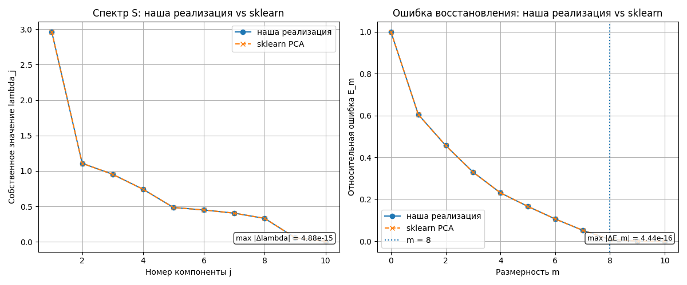

# Лабораторная работа №4. PCA

## Структура проекта

```text
lab4/
├── README.md
├── scree.png
├── projection.png
├── reconstruction.png
├── comparison.png
└── source/
    ├── pca.py
    ├── main.py
    └── plots.py
```

Назначение файлов:

- `source/main.py` — основной сценарий лабораторной работы;
- `source/pca.py` — реализация `PCA` через сингулярное разложение, центрирование, `S`, `E_m`, `Q_tau`, `beta` (слайд 24);
- `source/plots.py` — построение графиков;
- `scree.png` — спектр `lambda_j` и относительная ошибка `E_m`;
- `projection.png` — проекция выборки на два первых столбца `G`;
- `reconstruction.png` — ошибка `E_m` в зависимости от размерности `m`;
- `comparison.png` — сравнение спектра и `E_m` с эталонным `sklearn.decomposition.PCA`.

## Запуск

Запуск выполняется из директории `source`:

```bash
MPLBACKEND=Agg python3 main.py
```

Датасет загружается через `sklearn.datasets.load_diabetes`.

## Датасет

Объекты `x_i` — пациенты. Ответ `y_i in R` — количественный показатель прогрессирования диабета через год после обследования.

```text
F: l x n = 331 x 10 (обучение);
F': k x n = 111 x 10 (контроль).
```

Признаки `f_j : X -> D_j`:

| Признак | Описание |
|---|---|
| `age` | возраст |
| `sex` | пол |
| `bmi` | индекс массы тела |
| `bp` | артериальное давление |
| `s1` | уровень холестерина |
| `s2` | уровень липопротеинов низкой плотности |
| `s3` | уровень липопротеинов высокой плотности |
| `s4` | соотношение холестерина |
| `s5` | уровень триглицеридов |
| `s6` | уровень глюкозы |

## Центрирование данных

Перед PCA признаки центрируются по обучающей выборке:

```text
mu = (1/l) * sum_i F_raw[i, :],
F = F_raw - 1 mu^T,
F' = F'_raw - 1 mu^T.
```

Среднее `mu` вычисляется только по обучению и затем применяется к контролю, поэтому утечки из контрольной выборки нет. Ответ также центрируется:

```text
ybar = (1/l) * sum_i y_raw[i],
y = y_raw - ybar,
y' = y'_raw - ybar.
```

Полученные средние:

```text
mu = [ 1.01523468e-03  2.83420346e-04  2.32536802e-03  1.29485008e-03
       5.59402305e-04  4.79872588e-05 -5.94854447e-04  8.62619379e-04
       1.73777684e-03  3.25211819e-03];
ybar = 154.34441087613294.
```

Контроль центрирования:

```text
макс. |среднее по столбцам F| после центрирования = 2.364674418008264e-17;
макс. |среднее y| после центрирования = 1.030394299591686e-14.
```

Датасет `diabetes` уже стандартизован, поэтому его средние близки к нулю и центрирование почти не меняет спектр. Тем не менее оно обязательно для канонического PCA и для корректного сравнения с `sklearn`, который центрирует данные внутри.

## PCA через сингулярное разложение

Главные компоненты получаются из центрированной матрицы `F`:

```text
F = V D U^T,  S = F^T F,  G = F U,  Fhat = G U^T.
```

`numpy.linalg.svd` возвращает `(U_svd, s, Vh)` с `F = U_svd diag(s) Vh`, поэтому отображение на лекционные обозначения (см. `lecture_svd` в `source/pca.py`):

```text
V = U_svd,  D = diag(s),  U = Vh^T,  lambda_j = s_j^2.
```

Собственные значения `lambda` матрицы `S = F^T F` на центрированной обучающей выборке:

```text
[2.96138238 1.10725387 0.95266702 0.74184609 0.48462408 0.44920643
 0.40432394 0.33043391 0.0582002  0.0071537 ].
```

Для сравнения спектр без центрирования:

```text
[2.96601173 1.10761915 0.95409381 0.74222774 0.48463234 0.44968899
 0.40455291 0.33058998 0.05820098 0.00715463].
```

Сингулярные числа `D` (диагональ, `sqrt(lambda_j)`):

```text
[1.72086675 1.05226131 0.97604663 0.86130488 0.69614947 0.67022864
 0.63586472 0.57483381 0.24124717 0.08457955].
```

Норма матрицы:

```text
||F||^2 = tr S = 7.497091630049979.
```

Ключевой фрагмент (`source/pca.py`):

```python
F, mu = center(F_raw)
Fc, _ = center(Fc_raw, mu)

U_svd, s, Vh = np.linalg.svd(F, full_matrices=False)
V = U_svd
U = Vh.T
lam = s ** 2
G = F @ U[:, :m]
Fhat = G @ U[:, :m].T
```

## Эффективная размерность выборки

По лекции упорядочиваем `lambda_1 >= ... >= lambda_n >= 0` и выбираем наименьшее `m` с

```text
E_m = ||G U^T - F||^2 / ||F||^2
    = (lambda_{m+1} + ... + lambda_n)/(lambda_1 + ... + lambda_n) <= eps,
```

плюс критерий «крутого склона»: `E_{m-1} >> E_m`.

Относительные ошибки для центрированных данных:

```text
E_0 = 1.0;
E_1 = 0.6049958407010456;
E_2 = 0.457304719046078;
E_3 = 0.3302331733828306;
E_4 = 0.2312819898701402;
E_5 = 0.16664037837018772;
E_6 = 0.10672295221539163;
E_7 = 0.052792179741560204;
E_8 = 0.008717233473730261;
E_9 = 0.0009541967154749147;
E_10 = 0.0.
```

При `eps = 0.05` наименьшее подходящее `m = 8`: `E_8 = 0.008717 <= 0.05`, а `E_7 = 0.052792` порога не проходит. Крутой склон подтверждается: `E_7 / E_8 = 6.06`, то есть `E_7 >> E_8`.

### График спектра и E_m


### Проекция на главные признаки


Первые два столбца `G = F U` несут непрерывную зависимость ответа от положения точек, что подтверждает информативность сжатого представления для регрессии.

## Сравнение с эталонным PCA

Эталонная реализация:

```python
from sklearn.decomposition import PCA

ref = PCA(n_components=n, svd_solver="full").fit(F_raw)
```

`sklearn` центрирует данные внутри себя, поэтому `ref.mean_` совпадает с нашим `mu`, а собственные значения связаны с `ref.explained_variance_`:

```text
lambda_j = ref.explained_variance_[j] * (l - 1).
```

Собственные векторы SVD определены с точностью до знака, поэтому перед сравнением столбцы `U` согласуются с `ref.components_.T`:

```python
signs = np.sign(np.sum(U * U_ref, axis=0))
U_aligned = U * signs
G_ref = ref.transform(F_raw) * signs
```

Результаты сравнения:

| Что сравнивается | Метрика | Значение |
|---|---|---:|
| Средние | `max abs(mu - ref.mean_)` | 0.0 |
| Спектр | `max abs(lambda - lambda_ref)` | 4.884981308350689e-15 |
| Спектр | `max относительное отклонение lambda` | 5.3348498478357754e-15 |
| Сингулярные числа | `max abs(d - ref.singular_values_)` | 7.771561172376096e-16 |
| Доля объяснённой дисперсии | `max abs(lambda/sum(lambda) - ref.explained_variance_ratio_)` | 2.220446049250313e-16 |
| Ошибка `E_m` | `max abs(E_m - E_m^ref)` | 4.440892098500626e-16 |
| Главные направления | `max abs(U - U_ref)` после согласования знаков | 6.6058269965196814e-15 |
| Проекция | `max abs(G - G_ref)` | 1.033895191682177e-15 |
| Проекция контроля | `max abs(G' - G'_ref)` с `mu` обучения | 9.402201239794294e-16 |
| Восстановление, все `n` компонент | `max abs(Fhat_full + mu - ref.inverse_transform(...))` | 2.498001805406602e-16 |
| Восстановление, `m = 8` компонент | `max abs(Fhat_m + mu - ref_m.inverse_transform(...))` | 2.498001805406602e-16 |

Доли объяснённой дисперсии (наша реализация и `sklearn` совпадают):

```text
[0.39500416 0.14769112 0.12707155 0.09895118 0.06464161 0.05991743
 0.05393077 0.04407495 0.00776304 0.0009542 ].
```



Все величины совпадают с эталоном с точностью порядка `1e-15`, то есть на уровне ошибок округления. Это подтверждает корректность собственной реализации: центрирование, SVD, спектр, главные направления, проекция и восстановление.

## Проверка тождеств лекции

```text
макс. отклонение lambda (eig(S) vs SVD) = 3.1086244689504383e-15;
отклонение U^T U от I = 1.887379141862766e-15;
отклонение V^T V от I = 1.3322676295501878e-15;
макс. внедиагональный элемент G^T G = 8.98586760555986e-16;
макс. отклонение diag(G^T G) от lambda_1..lambda_m = 3.552713678800501e-15.
```

Все тождества (`G^T G = Lambda` диагональна, `E_m` через хвост `lambda`, совпадение `lambda` с `eig(S)`) выполнены.

## Ошибка восстановления

Абсолютная ошибка — квадрат нормы (сумма, без усреднения):

```text
||G U^T - F||^2 = 0.06535389811309483,
хвост lambda_9 + lambda_10 = 0.06535389811309464,
```

совпадение подтверждает теорему лекции (`||G U^T - F||^2 = lambda_{m+1} + ... + lambda_n`).


## Регрессия

Данные центрированы, поэтому свободный член восстанавливается как `ybar`. Гребневая регрессия (`tau = 1/sigma`, взято `tau = 1.0` при `sigma = 1`):

```text
Q_tau(alpha) = ||F alpha - y||^2 + tau ||alpha||^2,
alpha*_tau = (F^T F + tau I)^{-1} F^T y.
```

```python
alpha_star = ridge_alpha_star(F, y, tau)
```

Результаты при `tau = 1.0`:

```text
alpha*_tau = [ 50.55201232 -67.7222237  278.30122846 197.62263845  -6.24583645
  -26.22672623 -151.39433086 120.3233589  215.85446319 101.75577423];
Q_tau(alpha*_tau) на обучении = 1364557.458682448;
Q(alpha*_tau, X^k) = ||F' alpha*_tau - y'||^2 на контроле = 344707.40825578046;
||alpha*_tau||^2 = 218720.27914577.
```

Проверка формулы через SVD (`alpha*_tau = U (D^2 + tau I)^{-1} D V^T y`): отклонение от прямого решения `4.831690603168681e-13`.

Регрессия на сжатых признаках (слайд 24): `||G beta - y||^2 -> min`, `beta = U^T alpha`, `alpha = U beta`:

```text
beta* = [443.00589824 -305.28848162 325.75965233 516.0736636    9.77402483
  302.34260067 101.42282957  20.60393058];
Q на обучении (сжатая, m = 8) = 972307.8026199983;
Q на контроле (сжатая, m = 8) = 315886.07261010085;
отклонение beta = U^T alpha: 3.979039320256561e-13.
```

| Модель | Q на обучении | Q на контроле `||F' alpha - y'||^2` |
|---|---:|---:|
| Гребневая (`tau = 1.0`), все 10 признаков | 1364557.458682 (`Q_tau`) | 344707.408256 |
| МНК на `m = 8` сжатых (`G beta`) | 972307.802620 | 315886.072610 |

## Анализ результатов

Эффективная размерность `m = 8`: наименьшее `m` с `E_m <= 0.05`, склон `E_7 / E_8 = 6.06`. Последние два собственных значения (`0.0582002`, `0.0071537`) малы, но строго положительны.

Центрирование почти не изменило спектр, потому что датасет `diabetes` уже стандартизован: `lambda_1` уменьшилось с `2.9660` до `2.9614`, а норма `||F||^2` — с `7.5048` до `7.4971`. При этом центрированная постановка совпадает с эталонным `sklearn PCA` и даёт корректный свободный член `ybar` в регрессии.

Собственная реализация совпала с `sklearn` по спектру, сингулярным числам, главным направлениям, проекции, долям дисперсии и восстановлению с точностью `~1e-15` (см. `comparison.png`).

Сжатие `10 -> 8` сохраняет почти всю норму (`E_8 = 0.0087`). На контроле сжатая регрессия даёт `Q = 315886.07`, что немного лучше полной гребневой (`344707.41`), при этом использует на два признака меньше.

## Соответствие пунктам задания

| Пункт задания | Реализация |
|---|---|
| Выбрать датасет для линейной регрессии | Diabetes dataset |
| Реализовать PCA через сингулярное разложение | `lecture_svd`, `F = V D U^T`, `G = F U`, `Fhat = G U^T` |
| Центрировать данные | `center` в `source/pca.py`, `mu` по обучению, `ybar` |
| Определить эффективную размерность выборки | `E_m <= eps` + крутой склон, `m = 8`, `scree.png` |
| Показать эквивалентность с эталонной реализацией | `sklearn.decomposition.PCA`, таблица отклонений `~1e-15`, `comparison.png` |
| Визуализировать проекцию и ошибку восстановления | `projection.png`, `reconstruction.png` |
| Сравнить регрессию на полных и сжатых признаках | таблица `Q` выше (`Q_tau`, слайд 24) |
| Подготовить отчет | данный `README.md` |

## Вывод

В работе реализован метод главных компонент строго по лекции с предварительным центрированием:

```text
F = V D U^T,  S = F^T F,  G = F U,  Fhat = G U^T,
E_m = (lambda_{m+1} + ... + lambda_n)/(lambda_1 + ... + lambda_n).
```

Эффективной размерностью выборки выбрано:

```text
m = 8 (E_8 = 0.008717 <= eps = 0.05, E_7 / E_8 = 6.06).
```

Собственная реализация совпала с эталонным `sklearn PCA` с точностью `~1e-15` по всем сравниваемым величинам. Гребневое решение посчитано по формуле лекции `alpha*_tau = (F^T F + tau I)^{-1} F^T y` при `tau = 1.0`: `Q_tau = 1364557.458682` на обучении, `Q = 344707.408256` на контроле. Регрессия на сжатых (`m = 8`, слайд 24): `Q = 315886.072610` на контроле. Отступлений от лекции нет.
