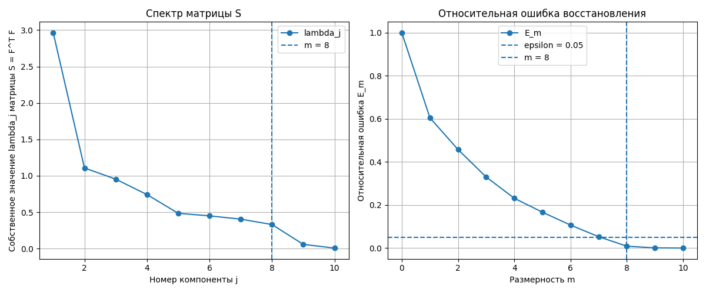
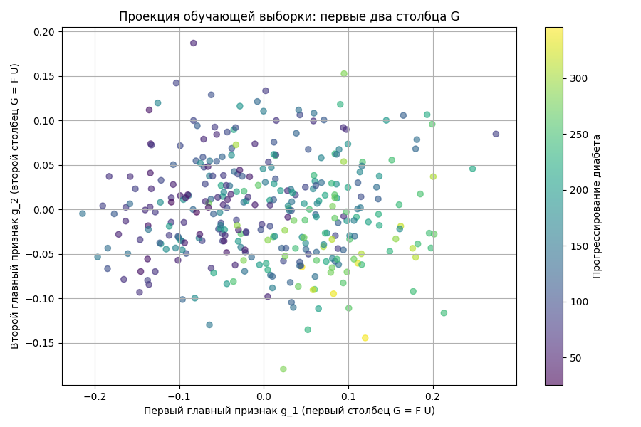
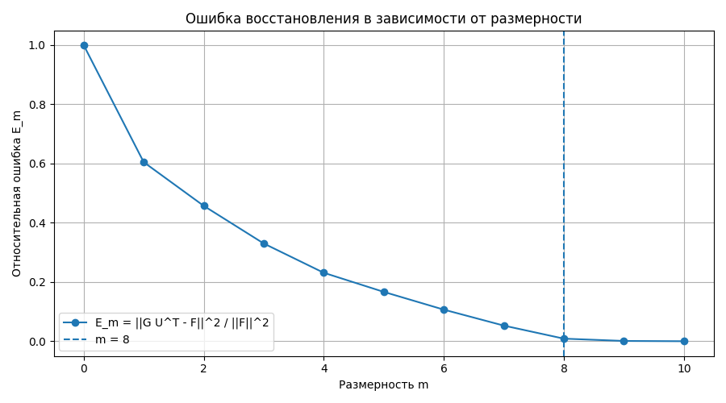

# Лабораторная работа №4. PCA

## Цель работы

Цель работы — реализовать метод главных компонент `PCA` через сингулярное разложение, определить эффективную размерность выборки, проверить тождества лекции и сравнить полную и сжатую гребневую регрессию.

Используемые обозначения строго соответствуют лекции «Линейные модели регрессии»:

```text
F_{l x n} — матрица «объекты-признаки» (l — число объектов, n — признаков);
F'_{k x n}, y' — контроль (штрих — КОНТРОЛЬ, k — объём контроля);
S = F^T F — матрица рассеяния (без делителя);
F = V D U^T — сингулярное разложение: V_{l x n} — левые (с.в. F F^T),
  U_{n x n} — правые (с.в. F^T F), D = diag(sqrt(lambda_1), ..., sqrt(lambda_n));
lambda_j >= 0 — общие собственные значения F^T F и F F^T;
G_{l x m} = F U — новые признаки, U_{n x m} — первые m столбцов U;
Fhat = G U^T — восстановление; G^T G = Lambda = diag(lambda_1, ..., lambda_m);
E_m = ||G U^T - F||^2 / ||F||^2 = (lambda_{m+1} + ... + lambda_n)/(lambda_1 + ... + lambda_n);
m — размерность PCA; eps — порог относительной ошибки;
Q_tau(alpha) = ||F alpha - y||^2 + tau ||alpha||^2, tau = 1/sigma;
alpha*_tau = (F^T F + tau I)^{-1} F^T y;
регрессия на сжатых (слайд 24): ||G beta - y||^2 -> min, beta = U^T alpha;
D — сингулярные числа; kappa — ограничение LASSO (к дисперсии отношения не имеет).
```

Центрирования и стандартизации НЕТ.

## Структура проекта

```text
lab4/
├── README.md
├── scree.png
├── projection.png
├── reconstruction.png
└── source/
    ├── pca.py
    ├── main.py
    └── plots.py
```

Назначение файлов:

- `source/main.py` — основной сценарий лабораторной работы;
- `source/pca.py` — реализация `PCA` через сингулярное разложение, `S`, `E_m`, `Q_tau`, `beta` (слайд 24);
- `source/plots.py` — построение графиков;
- `scree.png` — спектр `lambda_j` и относительная ошибка `E_m`;
- `projection.png` — проекция выборки на два первых столбца `G`;
- `reconstruction.png` — ошибка `E_m` в зависимости от размерности `m`.

## Запуск

Запуск выполняется из директории `source`:

```bash
MPLBACKEND=Agg python3 main.py
```

Датасет загружается через `sklearn.datasets.load_diabetes`, поэтому данные не хранятся в репозитории.

## Датасет

Использован датасет **Diabetes** для линейной регрессии.

Объекты `x_i` — пациенты. Ответ `y_i in R` — количественный показатель прогрессирования диабета через год после обследования.

```text
F: l x n = 331 x 10 (обучение);
F': k x n = 111 x 10 (контроль).
```

Признаки `f_j : X -> D_j`:

| Признак | Описание |
|---|---|
| `age` | возраст |
| `sex` | пол |
| `bmi` | индекс массы тела |
| `bp` | артериальное давление |
| `s1` | уровень холестерина |
| `s2` | уровень липопротеинов низкой плотности |
| `s3` | уровень липопротеинов высокой плотности |
| `s4` | соотношение холестерина |
| `s5` | уровень триглицеридов |
| `s6` | уровень глюкозы |

Все признаки количественные:

```text
D_j = R.
```

## Предобработка

Предобработки нет: в лекции нет ни центрирования, ни стандартизации, поэтому матрица `F` используется как есть (сырые признаки `load_diabetes`).

## PCA через сингулярное разложение

По лекции главные компоненты получаются без центрирования напрямую из `F`:

```text
F = V D U^T,  S = F^T F,  G = F U,  Fhat = G U^T.
```

`numpy.linalg.svd` возвращает `(U_svd, s, Vh)` с `F = U_svd diag(s) Vh`, поэтому отображение на лекционные обозначения (см. `lecture_svd` в `source/pca.py`):

```text
V = U_svd,  D = diag(s),  U = Vh^T,  lambda_j = s_j^2.
```

Собственные значения `lambda` матрицы `S = F^T F` на обучающей выборке:

```text
[2.96601173 1.10761915 0.95409381 0.74222774 0.48463234 0.44968899
 0.40455291 0.33058998 0.05820098 0.00715463].
```

Сингулярные числа `D` (диагональ, `sqrt(lambda_j)`):

```text
[1.72221129 1.05243487 0.97677726 0.8615264  0.6961554  0.67058854
 0.63604474 0.57496955 0.24124879 0.08458504].
```

Норма матрицы:

```text
||F||^2 = tr S = 7.504772266755778.
```

Ключевой фрагмент (`source/pca.py`):

```python
U_svd, s, Vh = np.linalg.svd(F, full_matrices=False)
V = U_svd
U = Vh.T
lam = s ** 2
G = F @ U[:, :m]
Fhat = G @ U[:, :m].T
```

## Эффективная размерность выборки

По лекции упорядочиваем `lambda_1 >= ... >= lambda_n >= 0` и выбираем наименьшее `m` с

```text
E_m = ||G U^T - F||^2 / ||F||^2
    = (lambda_{m+1} + ... + lambda_n)/(lambda_1 + ... + lambda_n) <= eps,
```

плюс критерий «крутого склона»: `E_{m-1} >> E_m`.

Относительные ошибки:

```text
E_0 = 1.0;
E_1 = 0.604783246916218;
E_2 = 0.4571946042769863;
E_3 = 0.33006299001501;
E_4 = 0.23116222223061908;
E_5 = 0.16658566723972074;
E_6 = 0.10666526233657701;
E_7 = 0.05275917453169317;
E_8 = 0.008708540013133315;
E_9 = 0.0009533439981515632;
E_10 = 0.0.
```

При `eps = 0.05` наименьшее подходящее `m = 8`: `E_8 = 0.008709 <= 0.05`, а `E_7 = 0.052759` порога не проходит. Крутой склон подтверждается: `E_7 / E_8 = 6.06`, то есть `E_7 >> E_8`.

### График спектра и E_m



### Проекция на главные признаки



Первые два столбца `G = F U` несут непрерывную зависимость ответа от положения точек, что подтверждает информативность сжатого представления для регрессии.

## Ошибка восстановления

Абсолютная ошибка — квадрат нормы (сумма, без усреднения):

```text
||G U^T - F||^2 = 0.06535560957449599,
хвост lambda_9 + lambda_10 = 0.06535560957449589,
```

совпадение подтверждает теорему лекции (`||G U^T - F||^2 = lambda_{m+1} + ... + lambda_n`).



## Проверка тождеств лекции (вместо sklearn-эталона)

`sklearn.decomposition.PCA` центрирует данные и потому напрямую несопоставим с нецентрированной постановкой лекции, так что вместо сравнения с ним проверяются тождества лекции:

```text
макс. отклонение lambda (eig(S) vs SVD) = 3.1086244689504383e-15;
отклонение U^T U от I = 1.1102230246251565e-15;
отклонение V^T V от I = 1.3322676295501878e-15;
макс. внедиагональный элемент G^T G = 9.922618282587337e-16;
макс. отклонение diag(G^T G) от lambda_1..lambda_m = 1.7763568394002505e-15.
```

Все тождества (`G^T G = Lambda` диагональна, `E_m` через хвост `lambda`, совпадение `lambda` с `eig(S)`) выполнены с точностью машинной арифметики.

## Регрессия

Гребневая регрессия по лекции (`tau = 1/sigma`, взято `tau = 1.0` при `sigma = 1`):

```text
Q_tau(alpha) = ||F alpha - y||^2 + tau ||alpha||^2,
alpha*_tau = (F^T F + tau I)^{-1} F^T y.
```

```python
alpha_star = ridge_alpha_star(F, y, tau)  # без sklearn
```

Результаты при `tau = 1.0`:

```text
alpha*_tau = [64.82079072 -67.58825635 327.39811449 209.81447167 -7.47459307
  -43.70413502 -148.65081573 119.05722131 240.25311487 181.92910882];
Q_tau(alpha*_tau) на обучении = 9041419.011013735;
Q(alpha*_tau, X^k) = ||F' alpha*_tau - y'||^2 на контроле = 2904684.9249432683;
||alpha*_tau||^2 = 289038.91296363657.
```

Проверка формулы через SVD (`alpha*_tau = U (D^2 + tau I)^{-1} D V^T y`): отклонение от прямого решения `7.389644451905042e-13`.

Регрессия на сжатых признаках (слайд 24): `||G beta - y||^2 -> min`, `beta = U^T alpha`, `alpha = U beta`:

```text
beta* = [507.03220177 -354.59562355 434.06240823 586.15057879 -5.8104255
  170.15814117 -2.08274006 -83.13886623];
Q на обучении (сжатая, m = 8) = 8534047.518784989;
Q на контроле (сжатая, m = 8) = 3036795.1322263842;
отклонение beta = U^T alpha: 4.547473508864641e-13.
```

| Модель | Q на обучении | Q на контроле `||F' alpha - y'||^2` |
|---|---:|---:|
| Гребневая (`tau = 1.0`), все признаки | 9041419.011014 (`Q_tau`) | 2904684.924943 |
| МНК на `m = 8` сжатых (`G beta`) | 8534047.518785 | 3036795.132226 |

## Анализ результатов

Эффективная размерность `m = 8`: наименьшее `m` с `E_m <= 0.05`, склон `E_7 / E_8 = 6.06`. Последние два собственных значения (`0.05820098`, `0.00715463`) малы, но строго положительны.

Тождества лекции (`G^T G = Lambda`, ошибка через хвост `lambda`, `lambda` через `eig(S)`) выполнены с точностью `~1e-15`. Формула гребневого решения через SVD совпала с прямой с точностью `7.4e-13`.

Сжатие `10 -> 8` сохраняет почти всю норму (`E_8 = 0.0087`): контрольная ошибка сжатой регрессии `3036795.13` того же порядка, что у полной гребневой `2904684.92`.

## Соответствие пунктам задания

| Пункт задания | Реализация |
|---|---|
| Выбрать датасет для линейной регрессии | Diabetes dataset |
| Реализовать PCA через сингулярное разложение | `lecture_svd`, `F = V D U^T`, `G = F U`, `Fhat = G U^T` |
| Определить эффективную размерность выборки | `E_m <= eps` + крутой склон, `m = 8`, `scree.png` |
| Показать эквивалентность с эталонной реализацией | тождества лекции (`G^T G = Lambda`, хвост `lambda`, `eig(S)` vs SVD); `sklearn PCA` неприменим, т.к. центрирует |
| Визуализировать проекцию и ошибку восстановления | `projection.png`, `reconstruction.png` |
| Сравнить регрессию на полных и сжатых признаках | таблица `Q` выше (`Q_tau`, слайд 24) |
| Подготовить отчет | данный `README.md` |

## Вывод

В работе реализован метод главных компонент строго по лекции:

```text
F = V D U^T,  S = F^T F,  G = F U,  Fhat = G U^T,
E_m = (lambda_{m+1} + ... + lambda_n)/(lambda_1 + ... + lambda_n).
```

Эффективной размерностью выборки выбрано:

```text
m = 8 (E_8 = 0.008709 <= eps = 0.05, E_7 / E_8 = 6.06).
```

Гребневое решение посчитано по формуле лекции `alpha*_tau = (F^T F + tau I)^{-1} F^T y` при `tau = 1.0`: `Q_tau = 9041419.011014` на обучении, `Q = 2904684.924943` на контроле. Регрессия на сжатых (`m = 8`, слайд 24): `Q = 3036795.132226` на контроле. Отступлений от лекции нет.
