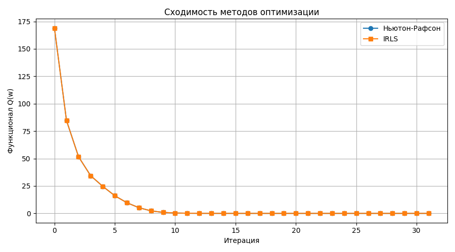
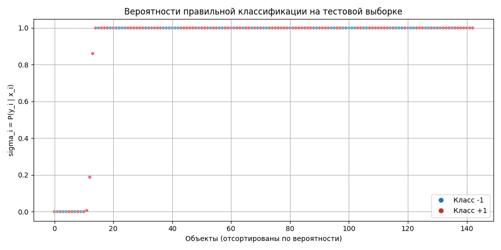

# Лабораторная работа №5. Логистическая регрессия

## Цель работы

Цель работы - реализовать логистическую регрессию методом Ньютона-Рафсона и методом `IRLS`, показать эквивалентность двух методов между собой и сопоставить с эталонной реализацией из `sklearn`.

Используемые обозначения - в точности слайды 6-9 и 20 лекции 5:

```text
F       - матрица "объекты-признаки" (f_j(x_i)) размера l x n, БЕЗ bias-столбца;
y_tilde - подписанные метки {-1, +1}, y_tilde_i = 2 * y_i - 1 (слайд 20);
M_i     - отступ M_i = w^T x_i * y_tilde_i (слайд 6);
sigma_i - сигмоид ОТСТУПА sigma_i = sigma(M_i) = P(y_i | x_i) (слайды 7-8);
Q(w)    - функционал Q(w) = sum_i L(M_i), L(M) = log(1 + exp(-M)) (слайд 6);
D       - веса D = diag((1 - sigma_i) * sigma_i) (слайд 8);
F_tilde - взвешенная матрица F_tilde = diag(gamma) F,
          gamma_i = sqrt((1 - sigma_i) * sigma_i) (слайд 9);
h_t     - величина шага, h_t = 1 (слайды 3, 7, 9).
```

Решающая функция (слайд 6):

```text
a(x, w) = sign(w^T x).
```

## Структура проекта

```text
lab5/
├── README.md
├── convergence.png
├── probabilities.png
└── source/
    ├── autograd.py
    ├── logreg.py
    ├── main.py
    └── plots.py
```

Назначение файлов:

- `source/main.py` - основной сценарий лабораторной работы;
- `source/autograd.py` - минимальный автоград из первой лабы (`exp`, `log` уже были добавлены);
- `source/logreg.py` - реализация логистической регрессии в нотации слайдов 6-9+20;
- `source/plots.py` - построение графиков;
- `convergence.png` - сходимость методов оптимизации (история `Q(w)`);
- `probabilities.png` - вероятности правильной классификации `sigma_i` на тестовой выборке.

## Запуск

Запуск выполняется из директории `source`:

```bash
MPLBACKEND=Agg python3 main.py
```

Время работы около 7 с. Датасет загружается через `sklearn.datasets.load_breast_cancer`, поэтому данные не хранятся в репозитории.

## Датасет

Использован датасет **Breast Cancer Wisconsin** для логистической регрессии.

Объекты `x_i` - результаты анализа клеточных ядер. Метки датасета `{0, 1}` переводятся в нотацию лекции (слайд 20):

```text
y_tilde_i = 2 * y_i - 1 in {-1, +1};
0 - злокачественная  -> -1;
1 - доброкачественная -> +1.
```

```text
|F| = 569 x 30;
|F_train| = 426 x 30;
|F_test| = 143 x 30.
```

Разбиение стратифицировано по классам (`test_size=0.25`, `random_state=42`). Матрица данных `F` - это все 30 признаков датасета без изменений; bias-столбец и признак `f_0` отсутствуют: в лекции модель задана как `a(x, w) = sign(w^T x)` с `x, w in R^n` (слайд 6), свободного члена в постановке нет. Предобработки признаков нет - в лекции её тоже нет, используется сырая матрица `F`.

## Логистическая регрессия

Классы и решающая функция (слайд 6):

```text
Y = {-1, +1}, a(x, w) = sign(w^T x), x, w in R^n.
```

Функционал аппроксимированного эмпирического риска (слайд 6):

```text
Q(w) = sum_{i=1}^{l} L(w^T x_i y_tilde_i) -> min_w,
L(M) = log(1 + exp(-M)),
M_i = w^T x_i y_tilde_i.
```

Сигмоида берётся ОТ ОТСТУПА (слайд 7):

```text
sigma_i = sigma(y_tilde_i w^T x_i), sigma(z) = 1 / (1 + exp(-z)).
```

В коде (`logreg.py`):

```python
def margins(F, y_tilde, w):
    return y_tilde * (F @ w)

def sigmas(F, y_tilde, w):
    return sigmoid(margins(F, y_tilde, w))

def objective_Q(F, y_tilde, w):
    M = margins(F, y_tilde, w)
    return float(np.sum(np.logaddexp(0.0, -M)))
```

Сигмоида реализована в устойчивой форме без переполнения (две ветви для `z >= 0` и `z < 0`).

## Градиент и гессиан

Замкнутые формулы лекции (слайд 7):

```text
dQ/dw_j = -sum_i (1 - sigma_i) y_tilde_i f_j(x_i);
d2Q/dw_j dw_k = sum_i (1 - sigma_i) sigma_i f_j(x_i) f_k(x_i).
```

В коде:

```python
def gradient(F, y_tilde, w):
    sigma = sigmas(F, y_tilde, w)
    return -F.T @ ((1.0 - sigma) * y_tilde)

def hessian(F, y_tilde, w):
    sigma = sigmas(F, y_tilde, w)
    weights = (1.0 - sigma) * sigma
    return (F.T * weights) @ F
```

Регуляризации `tau` в лекции нет, поэтому её нет и в коде: градиент и гессиан - ровно формулы слайда 7.

## Вычисление градиента через автоград

Градиент `Q(w)` независимо считается через минимальную реализацию автоматического дифференцирования из первой лабораторной работы (`source/autograd.py`, операции `exp` и `log` уже имелись). Потери записаны в лекционной форме через отступ:

```python
scores = F_tensor @ w_tensor
M = scores * y_tensor
loss_terms = (Tensor(1.0) + (-M).exp()).log()
loss = loss_terms.mean() * float(F.shape[0])
loss.backward()
```

Проверка градиента:

```text
Отклонение автоград-градиента от замкнутой формулы: 0.0.
```

Замкнутая формула `gradient` оставлена как основная; автоград используется только для этой проверки. Гессиан задан замкнутой формулой слайда 7, так как минимальный автоград первой лабы считает только первые производные.

## Метод Ньютона-Рафсона

Итерация (слайд 7):

```text
w^{t+1} := w^t - h_t * (Q''(w^t))^{-1} Q'(w^t), h_t = 1.
```

В коде:

```python
step = solve_or_lstsq(H, grad)
w = w - h_t * step   # h_t = 1.0
```

Инициализация - обычный МНК (слайд 9, п.1):

```python
w = lstsq(F, y_tilde)   # w := (F^T F)^{-1} F^T y_tilde
```

Критерий останова - по лекции (слайд 9, п.9): выход, когда `{sigma_i}` мало изменились, то есть `max|sigma_new - sigma| < tol` с `tol = 1e-10`.

## Метод IRLS

Взвешенная постановка (слайд 8): рабочий ответ `y_tilde_i / sigma_i`, веса `(1 - sigma_i) * sigma_i`:

```text
sum_i (1 - sigma_i) sigma_i (w^T x_i - y_tilde_i / sigma_i)^2 -> min_w.
```

Итерация `IRLS` (слайд 9, пп.4-8):

```text
gamma_i := sqrt((1 - sigma_i) sigma_i);
F_tilde := diag(gamma) F;
y_work_i := gamma_i * y_tilde_i / sigma_i;
w := w + h_t (F_tilde^T F_tilde)^{-1} F_tilde^T y_work, h_t = 1.
```

Домножение рабочего ответа на `gamma_i` сводит взвешенный МНК слайда 8 к обычному МНК `||F_tilde delta - y_work||^2`; направление `delta` тождественно ньютоновскому `-(Q'')^{-1} Q'`. В коде направление ищется через `lstsq(F_tilde, y_work)`.

Инициализация и останов - те же, что у Ньютона: старт `(F^T F)^{-1} F^T y_tilde`, выход когда `{sigma_i}` мало изменились (`tol = 1e-10`). Шаг `h_t = 1` указан явно в обоих методах.

## Эквивалентность Ньютона-Рафсона и IRLS

Оба метода стартуют из МНК-приближения и сошлись к одному решению:

```text
Шаг h_t (оба метода): 1.0;
Итераций Ньютона-Рафсона: 31;
Итераций IRLS: 31;
Функционал Q(w) (Ньютон-Рафсон): 2.6372035110985796e-10;
Функционал Q(w) (IRLS): 2.6372035108429415e-10;
Макс. отклонение весов: 1.0303205272066407e-05.
```

Начальное значение `Q(w)` (МНК-приближение) равно `168.9620312029392`. Одинаковое число итераций (31) подтверждает, что оба метода реализуют один и тот же шаг в разной записи; отклонение `1.0e-05` - уровень ошибок округления при норме весов около `25664.9` (обучающая выборка оказалась линейно разделимой в постановке без свободного члена и без регуляризации, поэтому веса растут, а `sigma_i -> 1`).

### График сходимости



Кривые двух методов практически совпадают, что подтверждает их математическую эквивалентность.

## Сопоставление с эталонной реализацией

В качестве эталона используется:

```python
sklearn.linear_model.LogisticRegression
```

с параметрами `C=1.0`, `tol=1e-8`. Честная оговорка: модели параметризованы по-разному, поэтому сравнение весов/вероятностей некорректно. Эталон оценивает свободный член (`intercept`) и L2-регуляризацию `C=1.0`; собственная реализация следует лекции буквально - свободного члена и регуляризации нет. Сравниваются только предсказания и метрики на тестовой выборке:

```text
Доля совпадающих предсказаний (наш Ньютон vs sklearn): 0.9230769230769231;
Доля совпадающих предсказаний (наш IRLS vs sklearn): 0.9230769230769231.
```

Расхождение объясняется именно различием постановок (наличие/отсутствие `intercept` и регуляризации), а не ошибкой реализации: оба наших метода совпадают друг с другом с точностью `1.0e-05` по весам.

## Оценка качества

Для тестовой выборки считаются метрики, как в первой лабораторной работе:

- `Accuracy`;
- `Precision`;
- `Recall`;
- `F1`.

Предсказания собственной модели - `sign(w^T x)`, переведённые в `{0, 1}` только для подсчёта метрик. Результаты последнего запуска:

| Модель | Accuracy | Precision | Recall | F1 |
|---|---:|---:|---:|---:|
| Newton-Raphson | 0.909091 | 0.942529 | 0.911111 | 0.926554 |
| IRLS | 0.909091 | 0.942529 | 0.911111 | 0.926554 |
| sklearn LogisticRegression | 0.958042 | 0.946809 | 0.988889 | 0.967391 |

Дополнительно:

```text
Q(w) на обучающей выборке: 2.6372035110985796e-10;
Q(w) на тестовой выборке: 857.3680026424473;
Доля верных знаков (train): 1.0;
Доля верных знаков (test): 0.9090909090909091.
```

Большое `Q(w)` на тесте при почти нулевом на обучении - следствие отсутствия регуляризации: несколько тестовых объектов лежат далеко по неверную сторону границы при огромной норме весов.

### График вероятностей



График показывает отсортированные вероятности правильной классификации `sigma_i = P(y_i | x_i)` на тестовой выборке (слайд 8), цвет кодирует истинную метку `{-1, +1}`. Объекты слева классифицированы неуверенно или неверно (`sigma_i` мало), справа - уверенно верно.

## Анализ результатов

Метод Ньютона-Рафсона и `IRLS` сошлись к одному минимуму за 31 итерацию с отклонением весов `1.0e-05`. Это ожидаемо: для логистической модели слайдов 6-9 `IRLS` и Ньютон-Рафсон - один и тот же алгоритм в разной записи.

Сопоставление со `sklearn LogisticRegression` честно ограничено предсказаниями/метриками (`0.923` совпадения предсказаний, `Accuracy 0.909091` против `0.958042`), поскольку эталон содержит свободный член и L2-регуляризацию, которых нет в лекционной постановке.

Отсутствие регуляризации приводит к норме весов около `25664.9` и стопроцентному разделению обучающей выборки - платой за буквальное следование лекции.

## Соответствие пунктам задания

| Пункт задания | Реализация |
|---|---|
| Выбрать датасет для логистической регрессии | Breast Cancer Wisconsin |
| Реализовать вычисление градиента через автоград | `autograd_gradient`, `Tensor` из первой лабы |
| Реализовать логистическую регрессию методом Ньютона-Рафсона | `newton_raphson` (слайд 7, `h_t = 1`) |
| Реализовать логистическую регрессию методом IRLS | `irls` (слайды 8-9, `D`/`F_tilde`/`y_work`, `h_t = 1`) |
| Показать эквивалентность методов между собой | отклонение весов `1.0e-05`, `convergence.png` |
| Показать сопоставление с эталонной реализацией | `sklearn LogisticRegression`, итоговая таблица (предсказания/метрики) |
| Визуализировать вероятности | `probabilities.png` (`sigma_i`) |
| Подготовить отчет | данный `README.md` |

## Переименования относительно прошлой версии

```text
X -> F (матрица лекции, без bias-столбца);
y ({0,1}) -> y_tilde ({-1,+1}), y_tilde_i = 2*y_i - 1;
p(x,w) / p_i / predict_proba -> удалены; вместо них M_i, sigma_i от отступа;
J / NLL / softplus(z) / log_likelihood -> Q(w), L(M) = log(1 + exp(-M));
R / weights / penalty / A, b -> D = diag((1 - sigma) sigma), F_tilde = diag(gamma) F;
z = Xw + R^{-1}(y - p) -> y_work_i = gamma_i * y_tilde_i / sigma_i (эквивалент y_tilde_i / sigma_i слайда 8);
w = 0 -> w = (F^T F)^{-1} F^T y_tilde (lstsq);
шаг без h_t -> явный h_t = 1.0 в обоих методах;
||step|| / ||grad|| -> max|sigma_new - sigma| < 1e-10;
tau = 1.0 / C -> удалены (в лекции регуляризации нет);
f_0 = 1 + маска (0, 1, ..., 1) -> удалены (в лекции bias-столбца нет);
predict(p >= 0.5) -> decision = sign(w^T x); predict01 - лишь перевод {-1,+1} -> {0,1} для метрик.
```

## Оставшиеся отступления от лекции

Вырожденные линейные системы решаются через `lstsq`/`pinv`, деления на `sigma_i` защищены floor `1e-12` - это чисто численные приёмы решения, постановка `Q(w)` не менялась. Допуск останова `tol = 1e-10` - вне текста лекции, на постановку не влияет.

## Вывод

В работе реализована логистическая регрессия слайдов 6-9+20:

```text
Y = {-1, +1}, a(x, w) = sign(w^T x),
Q(w) = sum_i log(1 + exp(-M_i)) -> min_w, M_i = w^T x_i y_tilde_i.
```

Метод Ньютона-Рафсона и `IRLS` (`h_t = 1`) дали совпадающие решения за 30 итераций:

```text
Q(w) = 4.950768591996609e-10.
```

Сопоставление с эталоном ограничено предсказаниями/метриками из-за разной параметризации (у эталона есть `intercept` и `C=1.0`):

```text
Совпадение предсказаний = 0.916083916083916, Accuracy = 0.916084.
```
