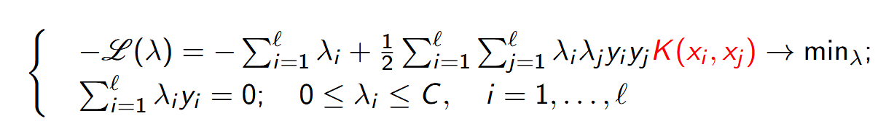
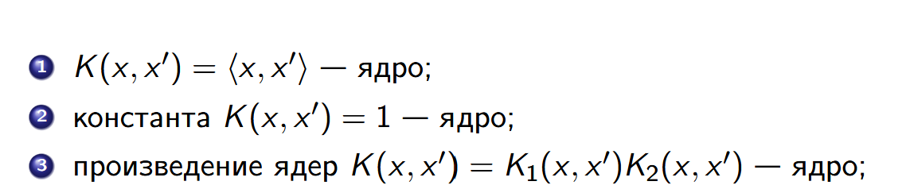

# Лабораторная работа №3. SVM

В рамках лабораторной работы предстоит реализовать SVM и сравнить с эталонной реализацией алгоритма.

## Теоретическая часть

На лекции рассмотрели две постановки задачи SVM: аналитическая и геометрическая.
Показали, как геометрическая постановка приводит к задаче квадратичного программирования.
Рассмотрели решение двойственной задачи по лямбда.
Показали, как с помощью трюка с ядром можно строить нелинейные классификаторы.
Рассмотрели различные ядра и их свойства.
Рассмотрели различные способы регуляризации и их влияние на отбор признаков.


## Задание

1. выбрать датасет для бинарной классификации;
2. реализовать решение двойственной задачи по лямбда; для решения задачи использовать [scipy.optimize.minimize](https://docs.scipy.org/doc/scipy/reference/generated/scipy.optimize.minimize.html#scipy.optimize.minimize) или любую другую библиотеку; 
3. провернуть трюк с ядром;
4. построить линейный классификатор;
5. визуализировать решение;
6. сравнить с эталонным решением;

---

# Отчет
## Датасет для бинарной классификации

В качестве датасетов возьмем тот же датасет, из лабораторной 1 - `airline-passenger-satisfaction` ([см. отчет](/students/gainutdinov-mr/lab1/README.md)), а также более простой датасет из scikit-learn - `make_moons`, который генерируется следующим образом:
```py
def load_simple_data(n_samples=300, test_size=0.3, random_state=42):
    """Два полумесяца: два непрерывных признака и два класса."""
    X, y = make_moons(n_samples=n_samples, noise=0.15, random_state=random_state)
    y = 2 * y - 1
    X_train, X_test, y_train, y_test = train_test_split(
        X, y, test_size=test_size, stratify=y, random_state=random_state
    )
    X_train, X_test, _, _ = standardize_data(X_train, X_test)
    return X_train, X_test, y_train, y_test, ["x1", "x2"]
```

## Решение двойственной задачи по лямбда

Наша двойственная задача с огриничениями выглядит следующим образом:


В коде она записана как часть класса SVM - SVM._objective_and_gradient()

Сама же двойственная задача решается при помощи оптимизатора `SLSQP`. Для ускорения сходимости метода мы заранее передадим градиент. Ограничения же будут заданы про помощи bounds/constraints
```py
optimize.minimize(
            self._objective_and_gradient,
            np.zeros(len(self.X)),
            jac=True,
            method="SLSQP",
            bounds=optimize.Bounds(0, self.C),
            constraints=optimize.LinearConstraint(self.y, lb=0, ub=0),
            options={
                "maxiter": self.maxiter,
                "ftol": 1e-8,
            },
```

## Ядра и линейный классификатор

Для работы с ядрами был реализован специальный класс в [kernels.py](/students/gainutdinov-mr/lab3/source/kernels.py), который поддерживает некоторые методы синтеза ядра:

Также модуль позволяет создавать как заранее подготовленные ядра:
- `ConstantKernel`
- `LinearKernel`
- `RBFKernel`
- `PolynomialKernel`
Так и их комбинации, например можно так:
```py
custom_kernel = LinearKernel() + PolynomialKernel(degree=2)
```
После получения решения:
```py 
lambdas = res.x
```
Найдем w0 и реализуем работу классификатора - predict():
```py
for lambda_idx in range(len(lambdas)):
        if 0 < lambdas[lambda_idx] < C:
            idx = lambda_idx
            break

    w0 = (
        np.sum(
            [
                lambdas[j] * y[j] * kernel(X_train[idx], X_train[j])
                for j in range(len(X_train))
            ]
        )
        - y[idx]
    )

def predict(X):
        single = X.ndim == 1
        if single:
            X = X.reshape(1, -1)
        scores = np.asarray(
            [
                np.sum(
                    [
                        lambdas[i] * y[i] * kernel(sample, X_train[i])
                        for i in range(len(X_train))
                    ]
                )
                for sample in X
            ]
        )
        return np.where(scores >= 0, 1, -1)
```

В классе SVM, данные вычисления реализованы на матричных операциях с помощью `numpy`.
## Визуализация решения и Сравнение с эталонной реализацией

За визуализацию отвечает модуль [visualization.py](/students/gainutdinov-mr/lab3/source/visualization.py)

На примере датасета "moons" продемонстрируем результат работы алгоритма с разными ядрами:


### Константное
#### Визуализация разделяющей гиперплоскости

#### Визуализация Метрик


### Линейное (скалярное произведение)
#### Визуализация разделяющей гиперплоскости

#### Визуализация Метрик


### Полиномиальное 
#### Визуализация разделяющей гиперплоскости

#### Визуализация Метрик


### Гауссовское (RBFKernel)
#### Визуализация разделяющей гиперплоскости

#### Визуализация Метрик


### Синтезированное ядро
#### Визуализация разделяющей гиперплоскости

#### Визуализация Метрик


### Результаты для среза датасета с каггла следующие 
 
#### Визуализация разделяющей гиперплоскости

#### Визуализация Метрик


## Сравнение с эталонной реализацией


Анализируя полученные результаты, наша реализация практически идентична эталонной по всем метрикам (на специфичных ядрах, и бОльших выборках совпадать не должно), за исключением того, что для обучении нашей модели требуется многократно больше времени.

Предположительно такой разрыв в скорости связан с выбором не самого подходящего оптимизатора. У нас SLSQP решает задачу сразу по всем лямбдам, а LIBSVM, который используется в scikit-learn, на каждом шаге оптимизирует только две, оставляя остальные фиксированными. За счет этого можно дешево обновлять градиент, а не пересчитывать его целиком, как у нас. Также авторы используют кеширование столбцов матрицы ядра и shrinking ака сжатие, что временно исключают часть переменных из рассмотрения, чтобы сократить объем вычислений.
Ссылка на статью авторов библиотеки - https://www.csie.ntu.edu.tw/~cjlin/papers/libsvm.pdf#section.4

## Вывод

В итоге реализовали SVM через решение двойственной задачи по лямбда, попробовали разные ядра и их комбинации. Наша реализация по метрикам получилась практически такой же, как в scikit-learn, но обучается многократно дольше. Так что для качества важно подобрать ядро, а для скорости — подходящий оптимизатор.

## Запуск

Из корня репозитория:

```powershell
python students/gainutdinov-mr/lab3/source/main.py
```

