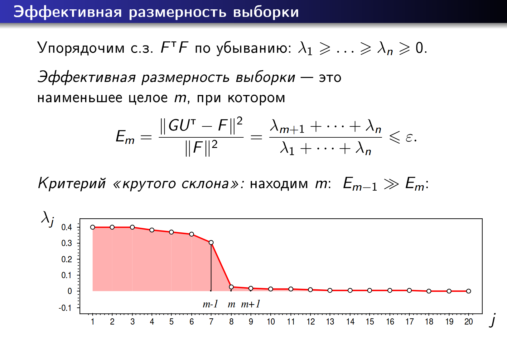
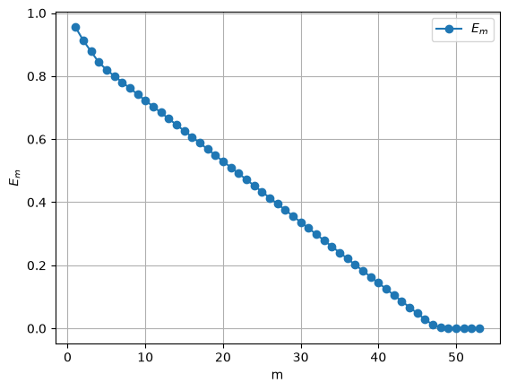
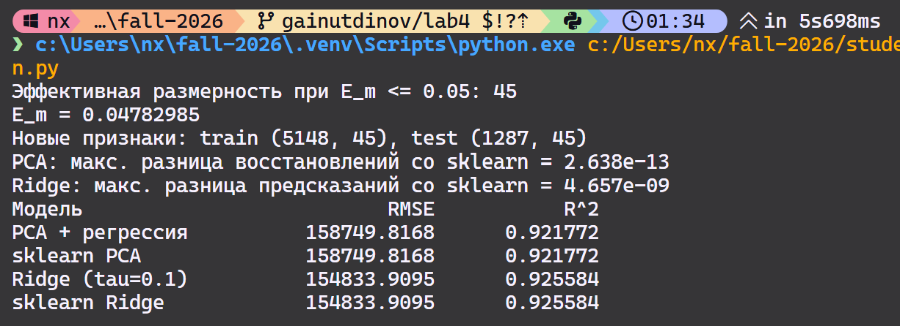
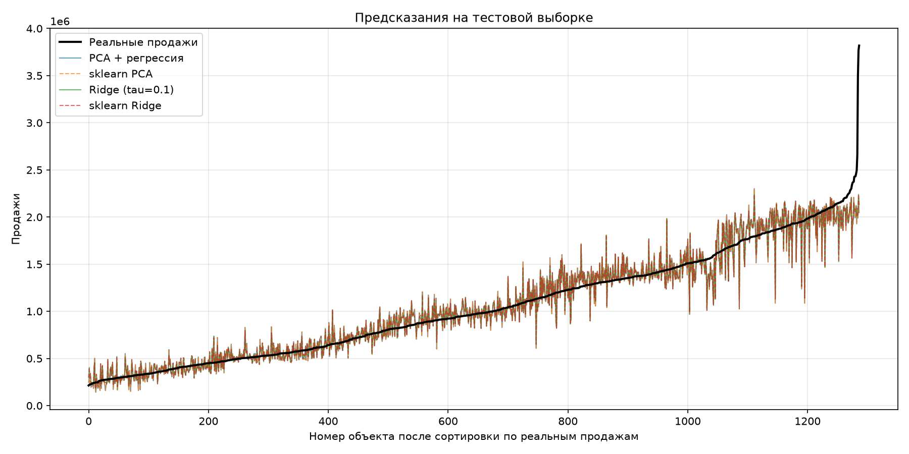

# Лабораторная работа №4. PCA

В рамках лабораторной работы предстоит реализовать PCA и сравнить с эталонной реализацией алгоритма.

## Теоретическая часть
На лекции рассмотрели многомерную линейную регрессию. 
Показали, как с помощью сингулярного разложения можно решать задачи линейной регрессии с L2 регуляризацией (гребневая регрессия). 
Рассмотрели методы подбора параметра регуляризации. 
Разобрали PCA, показали как PCA связано с сингулярным разложением и как его можно использовать для снижения размерности данных.

## Задание

1. выбрать датасет для линейной регрессии;
2. реализовать PCA через сингулярное разложение;
3. определить эффективную размерность выборки;
4. показать эквивалентность с эталонной реализацией;
5. подготовить отчет.

---

# Отчет
## Датасет для линейной регрессии
Для работы был подготовлен датасет [продаж walmart](https://www.kaggle.com/datasets/mikhail1681/walmart-sales)

в модуле [`data.py`](/students/gainutdinov-mr/lab4/source/data.py)

`Weekly_Sales` - Наш таргет

Остальные - признаки.

Скажу только вот еще одно, для работы с признаком `Stores` пришлось использовать OneHotEncoding, без этого признака модель плохо угадывала тенденцию кривой (R^2) 

## Реализация PCA через сингулярное разложение
Оно реализовано в классе PCA - [pca.py](/students/gainutdinov-mr/lab4/source/pca.py)
```py
def fit(self, X):
    """Выполняем SVD и сохраняем направления преобразования."""
    F = X
    self.V, self.D, U_T = np.linalg.svd(F, full_matrices=False)
    self.U = U_T.T

    m = len(self.D) if self.n_components is None else self.n_components
    self.U_effective = self.U[:, :m]
    self.V_effective = self.V[:, :m]
    self.L = np.diag(self.D[:m] ** 2)  # L = G.T @ G
    return self
```

## Эффективная размерность выборки

Для автономности алгоритма, был специально задан порог, ниже которого отсекались слишком маленькие собственные значения F.T@F.


Сама реализация находится в `PCA.calculate_em`

```py
def calculate_em(self):
        """Ошибки E_m для m от 1 до len(D), включая последний ноль."""
        eigs_full_sum = np.sum(self.D**2)
        Ems = []
        for m in range(1, len(self.D) + 1):
            Em = np.sum(self.D[m:] ** 2) / eigs_full_sum
            Ems.append(Em)
        return np.array(Ems)
```
Из-за OneHotEncoding эффективная размерность оказалась около 45:

## Сравнение с эталонной реализацией
Сравнение реализовано в `main.py` - compare_models

Результаты не разочаровывающие - наша реализация практически совпадает с эталонной (Также для сравнения был реализован ridgeRegression):


Тем не менее посмотрим на результат регресии на одной картинке:



## Вывод

Своя PCA дала практически тот же результат, что и sklearn. Ridge оказалась чуть точнее. Без признака `Store` модели предсказывали около среднего, после OneHotEncoding R^2 вырос с 0.03 до 0.92. Но добавление Store также значительно увеличило число признаков.

## Запуск

Из корня репозитория:

```powershell
python students/gainutdinov-mr/lab4/source/main.py
```

