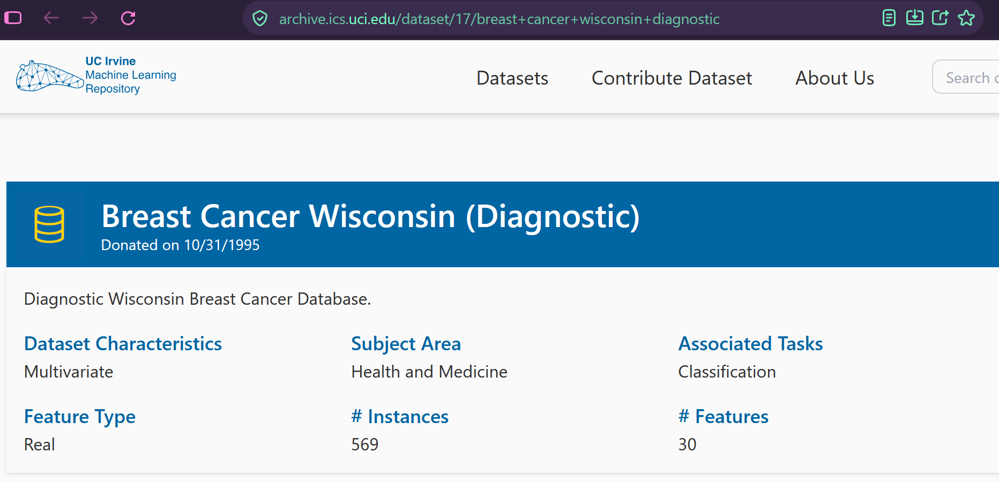
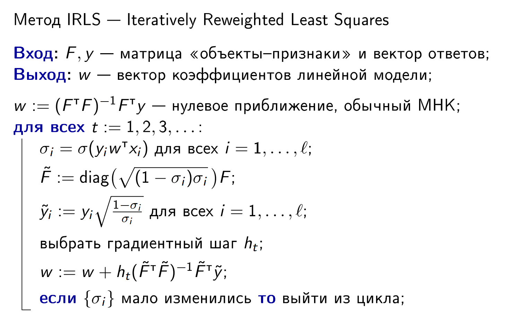
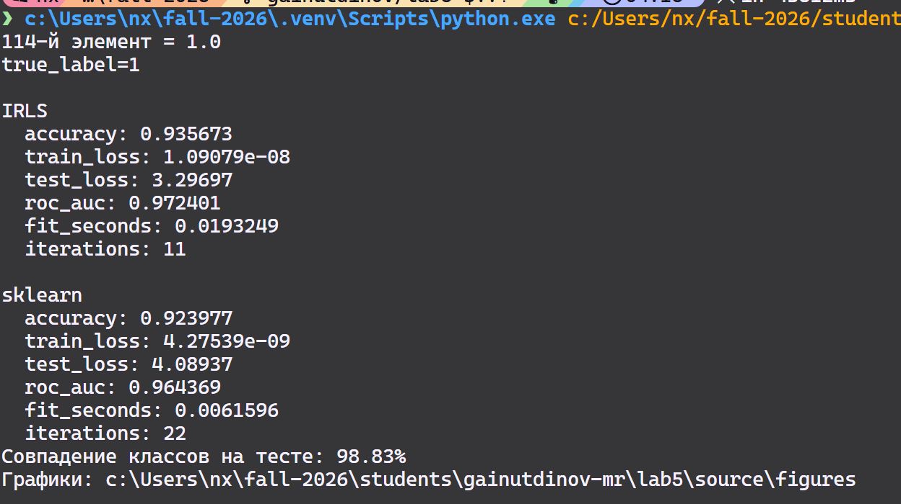
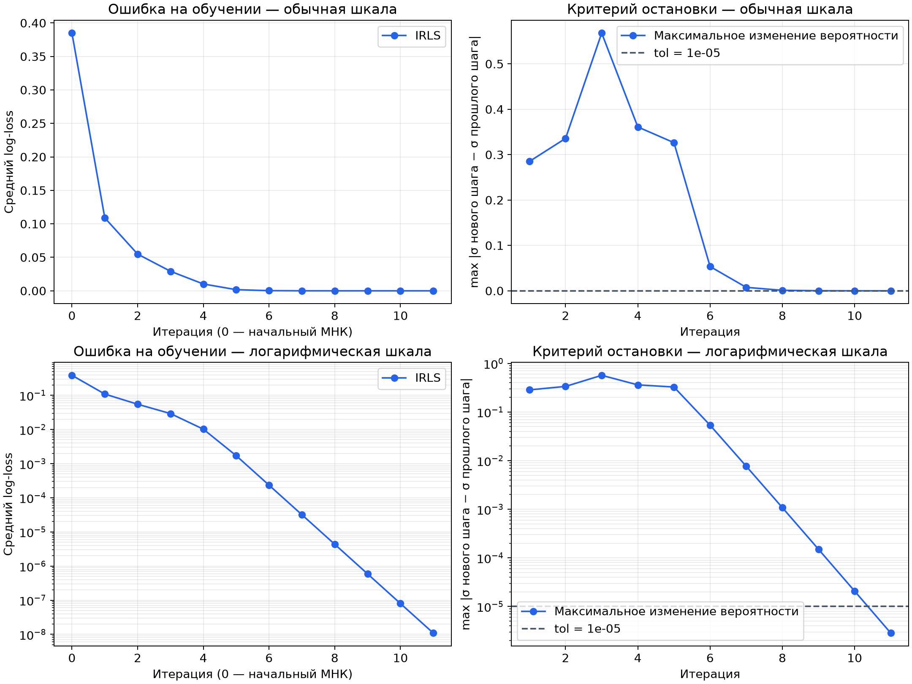
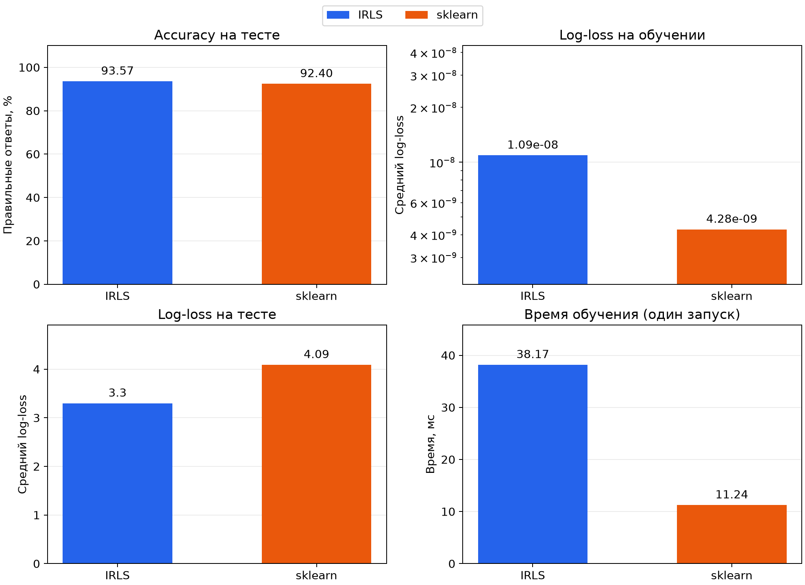
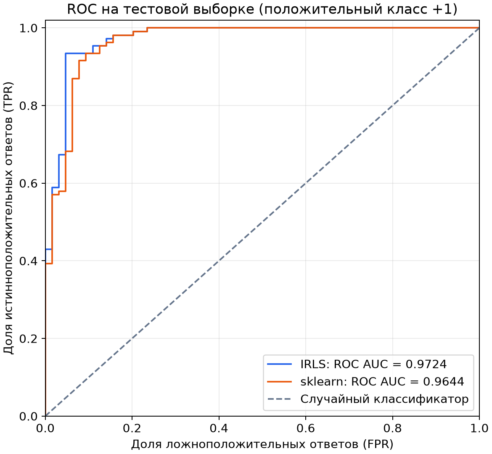

# Лабораторная работа №5. Логистическая регрессия

В рамках лабораторной работы предстоит реализовать логистическую регрессию и сравнить с эталонной реализацией алгоритма.

## Теоретическая часть
На лекции рассмотрели многомерную нелинейную регрессию. 
Свели задачу многомерной нелинейной регрессии к итерационному процессу IRLS. 
Рассмотрели решение задачи логистической регрессии с помощью метода Ньютона-Рафсона и IRLS. 
С другой стороны показали, как вероятностная постановка задачи классификации приводит к логистической регрессии. 

## Задание

1. выбрать датасет для логистической регрессии;
2. реализовать логистическую регрессию с помощью метода Ньютона-Рафсона и IRLS;
3. показать эквивалентность с эталонной реализацией;
4. подготовить отчет.

---

# Отчет

## Датасет

[Wisconsin Breast Cancer](https://archive.ics.uci.edu/dataset/17/breast+cancer+wisconsin+diagnostic) из `sklearn.datasets`



Работа с датасетом представлена в модуле [data.py](students\gainutdinov-mr\lab5\source\data.py)
Там же приводится преобразования `y` от {0;1} к {-1;+1}

## Реализация логистической регрессии
IRLS был напрямую взят с лекции:



Функция `irls` находится в `source/main.py`
  
- Начальные коэффициенты вычисляются обычным МНК через `np.linalg.pinv(F) @ y`.
- На каждой итерации пересчитываются вероятности правильного класса
`sigmas = sigmoid(y * (F @ w))`, веса `sqrt(sigmas * (1 - sigmas))`
- и модифицированные ответы `y * sqrt((1 - sigmas) / sigmas)`.


- Остановка происходит, когда максимальное изменение вероятности между
двумя итерациями не превышает `1e-5`, либо после 1000 итераций. В обоих случаях возвращается последнее приближение.
- Опциональный список `history` хранит начальную ошибку,
ошибки после каждого шага и максимальные изменения вероятностей.

###  Метрики 
`logistic_loss` вычисляет средний log-loss через
`logaddexp(0, -y * scores)`. 
> Функция `logaddexp(a, b)` равна `log(exp(a) + exp(b))`, но позволяет избежать переполнения экспоненты.


## Сравнение с эталонной реализацией

Возьмем за эталон 
`sklearn.linear_model.LogisticRegression`:
- `solver="newton-cholesky"`,
- `C=np.inf`,
- `fit_intercept=False`,
- `tol=1e-8`,
- `max_iter=1000`.

Регуляризация отключена. Обе реализации получают одинаковые
стандартизованные признаки, метки.

Правда `tol` имеет разный смысл, например, IRLS проверяет изменение вероятностей,
а `sklearn` использует собственный критерий решателя - солвера.

Обучение обеих моделей, вычисление метрик и их вывод находятся
в функции `compare_models`

`main` загружает данные и запускает сравнение
и построение графиков.

Результат на фиксированном разбиении:



Предсказанные классы совпали на 98.83% тестовых объектов. Наш метод немного обгоняет в accuracy, да и сходится в 2 раза быстрее. Однако это удтверждение верно лишь тогда, когда в качестве солвера был использован newton-cholesky 


Приведем рисунки времени обучения измеряемых через `perf_counter` отдельно от загрузки
данных и построения графиков. Для IRLS замер включает сбор истории.
График показывает один запуск. он не доказывает преимущество по скорости.

### Графики
Сходимость IRLS



Сравнение качества и времени обучения



ROC двух реализаций



## Вывод

IRLS сводит шаг Ньютона-Рафсона к взвешенному МНК. Наш метод немного
обогнал sklearn по accuracy, а классы совпали на 98.83% тестовых объектов.
Различия связаны с разделимостью данных и разными условиями остановки.

На выбранном разбиении увеличение шага до 2 сократило число итераций и улучшило тестовые метрики относительно шага 1. Это экспериментальный результат для данного разбиения.

## Запуск

Из корня репозитория:

```powershell
python students/gainutdinov-mr/lab5/source/main.py
```

Скрипт выводит число итераций, время обучения, log-loss, accuracy,
ROC AUC обеих реализаций и долю совпавших предсказаний. Три графика
сохраняются в `source/figures/`; графические окна не открываются.

## Структура

- source/main.py — реализация IRLS и запуск экспериментов.
- source/data.py — загрузка и подготовка данных.
- source/visualization.py — построение графиков.
- source/figures/ — графики экспериментов.
- source/report-images/ — иллюстрации отчета.

