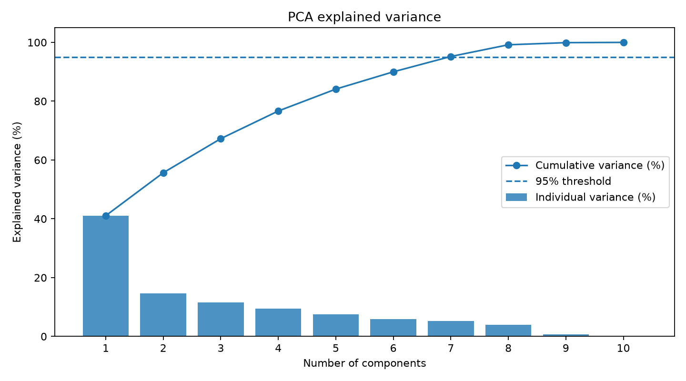
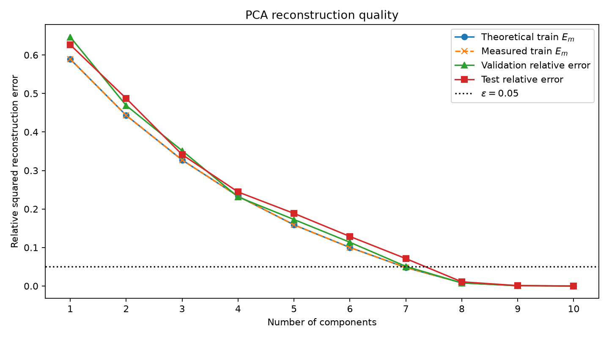
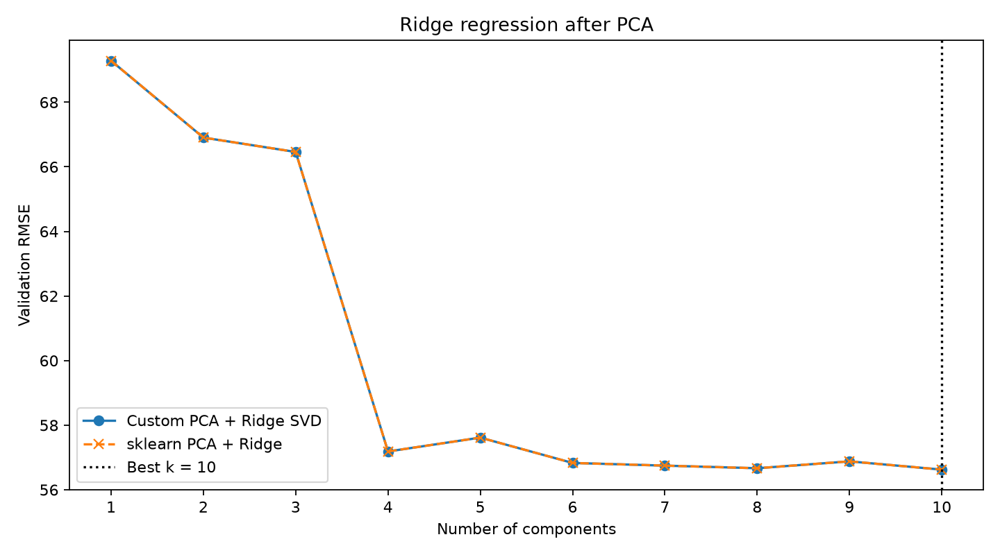
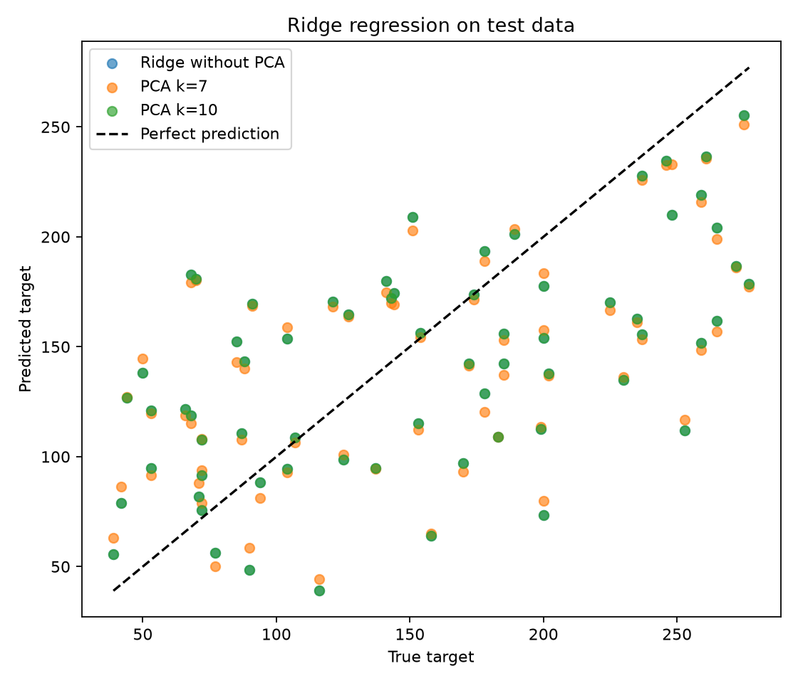
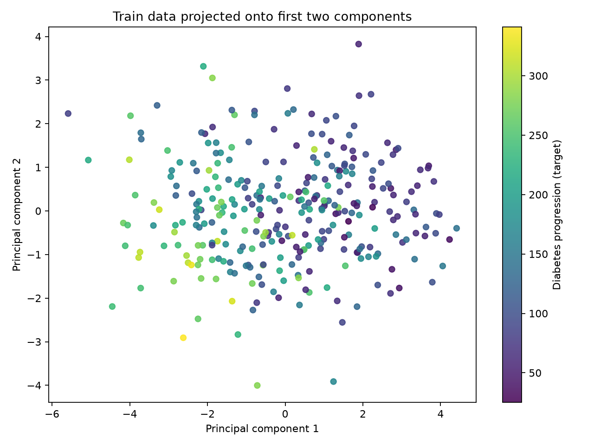

# Лабораторная работа №4. PCA

## Цель работы

Реализовать метод главных компонент (Principal Component Analysis, PCA) через сингулярное разложение матрицы признаков (SVD), определить эффективную размерность выборки по ошибке восстановления, сравнить собственную реализацию с `sklearn.decomposition.PCA` и исследовать влияние количества главных компонент на качество Ridge-регрессии.

## Датасет

Для экспериментов используется **Diabetes Regression** — набор данных, представленный в [Kaggle-ноутбуке Linear Regression on the Diabetes Dataset](https://www.kaggle.com/code/meet3010/linear-regression-on-the-diabetes-dataset). 

Датасет содержит **442 объекта**, **10 числовых признаков** и один целевой столбец `target`.

| Признак | Описание |
|---|---|
| `age` | возраст пациента |
| `sex` | пол пациента (численно закодирован) |
| `bmi` | индекс массы тела |
| `bp` | среднее артериальное давление |
| `s1` | общий холестерин сыворотки крови |
| `s2` | липопротеины низкой плотности |
| `s3` | липопротеины высокой плотности |
| `s4` | отношение общего холестерина к ЛПВП |
| `s5` | логарифм концентрации триглицеридов в сыворотке крови |
| `s6` | уровень глюкозы крови |
| `target` | количественный показатель прогрессирования заболевания |

Пропущенных значений в используемой выборке нет. В версии `load_diabetes` признаки уже представлены в масштабированном виде, поэтому отрицательные значения в `age`, `bmi` и других столбцах не означают отрицательный возраст или отрицательный индекс массы тела.

При первом запуске `load_dataset()` создаёт `source/result/data/diabetes_regression.csv`: если локальных данных нет, предпринимается попытка скачать исходные файлы из репозитория `scikit-learn`, а при недоступности сети используется встроенный `load_diabetes`. При повторном запуске данные читаются из сохранённого CSV.

### Предобработка

Данные разделяются на три непересекающиеся выборки с `random_state=42`:

- **Train** — 310 объектов (70%);
- **Validation** — 66 объектов (15%);
- **Test** — 66 объектов (15%).

Признаки дополнительно стандартизируются с помощью z-score:

$$
z_{ij}=\frac{x_{ij}-\mu_j}{\sigma_j},
$$

где $\mu_j$ и $\sigma_j$ — среднее и стандартное отклонение $j$-го признака, вычисленные **только на обучающей выборке**. Тот же `StandardScaler` применяется к validation и test без повторного обучения, что предотвращает утечку данных.

## Метод главных компонент (PCA)

PCA — метод уменьшения размерности без учителя. Он заменяет исходные $d$ признаков новыми $k$ ортогональными направлениями, которые последовательно объясняют максимальную возможную дисперсию обучающей выборки.

Матрица исходных признаков имеет размерность

$$
X\in\mathbb{R}^{n\times d},\qquad k\leq d.
$$

Цель PCA — найти низкоранговое приближение $\hat X$ с минимальной суммой квадратов ошибок:

$$
\min_{W_k}\|X-\hat X\|_F^2,\qquad
\hat X=(X-\mu)W_k^TW_k+\mu,
$$

где строки $W_k\in\mathbb{R}^{k\times d}$ являются ортонормированными главными компонентами:

$$
W_kW_k^T=I_k.
$$

Вычисление не использует целевую переменную $y$, поэтому направление максимальной дисперсии не обязано быть самым информативным для регрессии.

## PCA через сингулярное разложение

### 1. Центрирование признаков

Сначала из каждого столбца вычитается среднее значение:

$$
X_c=X-\mathbf{1}\mu^T,
$$

где $\mu\in\mathbb{R}^{d}$ — вектор средних по обучающей выборке.

### 2. Сингулярное разложение

Для центрированной матрицы выполняется SVD:

$$
\boxed{X_c=U\Sigma V^T},
$$

где $U$ — матрица левых сингулярных векторов, $V$ — матрица правых сингулярных векторов, а $\Sigma=\operatorname{diag}(\sigma_1,\ldots,\sigma_r)$ содержит сингулярные значения по убыванию.

В реализации используется:

Главные компоненты — первые $k$ строк $V^T$:

$$
W_k=V_{[:,1:k]}^T.
$$

Это собственные векторы ковариационной матрицы, поскольку

$$
X_c^TX_c=V\Sigma^2V^T.
$$

### 3. Объяснённая дисперсия

Дисперсия $j$-й главной компоненты вычисляется по сингулярному значению:

$$
\lambda_j=\frac{\sigma_j^2}{n-1}.
$$

Доля объяснённой дисперсии:

$$
r_j=\frac{\lambda_j}{\sum_{i=1}^{r}\lambda_i},
$$

а накопленная доля первых $k$ компонент:

$$
R_k=\sum_{j=1}^{k}r_j.
$$

Значения рассчитываются методами `PCACustom.fit()` и сохраняются в `pca_spectrum.csv`.

### 4. Преобразование и восстановление

Для перехода от $d$ исходных признаков к $k$ главным компонентам:

$$
\boxed{Z=(X-\mu)W_k^T},\qquad Z\in\mathbb{R}^{n\times k}.
$$

Обратное преобразование восстанавливает приближённые исходные данные:

$$
\boxed{\hat X=ZW_k+\mu}.
$$

Если $k=d$ и исходная матрица имеет полный ранг, восстановление точно с точностью до вычислительной погрешности. При $k<d$ часть вариации теряется.

## Эффективная размерность выборки

Согласно критерию из лекции, эффективная размерность — это **минимальное количество главных компонент**, при котором относительная квадратичная ошибка восстановления не превышает $\varepsilon$:

$$
\boxed{
E_k=\frac{\|X-\hat X\|_F^2}{\|X-\mu\|_F^2}
=\frac{\sum_{j=k+1}^{r}\lambda_j}{\sum_{j=1}^{r}\lambda_j}
=1-R_k\leq\varepsilon
}.
$$

Здесь $\|\cdot\|_F$ — норма Фробениуса. В программе теоретическая ошибка $E_k$ сверяется с фактической ошибкой восстановления обучающей выборки. Для validation и test рассчитываются отдельные ошибки с тем же средним вектором, полученным на train.

В экспериментах используется $\varepsilon=0.05$, то есть требуется сохранить не менее **95% дисперсии**.

| Число компонент $k$ | Накопленная дисперсия | Ошибка $E_k$ |
|---:|---:|---:|
| 1 | 41.07% | 0.58931 |
| 2 | 55.67% | 0.44329 |
| 3 | 67.26% | 0.32736 |
| 4 | 76.67% | 0.23333 |
| 5 | 84.11% | 0.15887 |
| 6 | 89.99% | 0.10006 |
| **7** | **95.21%** | **0.04793** |
| 8 | 99.19% | 0.00814 |
| 9 | 99.91% | 0.00090 |
| 10 | 100.00% | 0.00000 |

При $k=6$ условие ещё не выполняется, а при $k=7$:

$$
E_7=1-0.952068\approx0.04793<0.05.
$$

Следовательно, **эффективная размерность равна 7**, что позволяет сократить число признаков с 10 до 7 (на 30%) с сохранением около 95.21% дисперсии.

### Дисперсия главных компонент

На графике представлены доли дисперсии отдельных компонент и накопленная доля. Горизонтальная пунктирная линия соответствует уровню 95%. Начиная с седьмой компоненты заданный порог достигается.

### Ошибка восстановления

По мере увеличения $k$ ошибка восстановления уменьшается. Теоретическая и измеренная ошибки на train совпадают с точностью до вычислительных погрешностей. Ошибки validation и test могут отличаться, поскольку PCA обучается только на train.

## Сравнение собственной PCA с sklearn

Для проверки используется `sklearn.decomposition.PCA(n_components=k, svd_solver="full")`. Сравнение выполняется для всех $k=1,\ldots,10$.

Проверяются средние значения, сингулярные значения, объяснённая дисперсия, проекции, восстановленные данные и проекционные матрицы. Основная метрика расхождения:

$$
\Delta_{\max}(A,B)=\max_{i,j}|A_{ij}-B_{ij}|.
$$

Правый сингулярный вектор определён с точностью до знака: $w$ и $-w$ задают одно и то же направление. Поэтому перед сравнением компонент выполняется коррекция знака:

$$
s_i=\begin{cases}
+1,& \langle w_i,w_i^{ref}\rangle\geq0,\\
-1,& \langle w_i,w_i^{ref}\rangle<0.
\end{cases}
$$

Дополнительно сравниваются матрицы ортогональной проекции:

$$
P=W_k^TW_k,\qquad P_{ref}=W_{ref}^TW_{ref},
$$

которые не зависят от изменения знаков базисных векторов.

При полном числе компонент получены максимальные абсолютные расхождения порядка $10^{-14}$ и меньше (точное значение может зависеть от источника CSV и численных библиотек). Например, при запуске с исходными файлами из репозитория `scikit-learn`:

| Показатель сравнения | Максимальная разность |
|---|---:|
| Сингулярные значения | $2.132\cdot10^{-14}$ |
| Объяснённая дисперсия | $4.441\cdot10^{-15}$ |
| Доля объяснённой дисперсии | $2.220\cdot10^{-16}$ |
| Компоненты после согласования знаков | $3.358\cdot10^{-15}$ |
| Проекции после согласования знаков | $2.087\cdot10^{-14}$ |
| Проекционные матрицы | $9.733\cdot10^{-16}$ |
| Восстановленные данные | $5.773\cdot10^{-15}$ |

Таким образом, **реализация `PCACustom` численно эквивалентна `sklearn.PCA`** на используемом датасете.

## Применение PCA к линейной регрессии

Для исследования влияния снижения размерности реализована **Ridge-регрессия через SVD**. Несмотря на название `LinearRegressionSVD`, класс из `regression.py` решает именно регуляризованную задачу Ridge при $\alpha>0$:

$$
\boxed{\min_{w,b}\left(\|Xw+b\mathbf{1}-y\|_2^2+\alpha\|w\|_2^2\right)}.
$$

После центрирования $X_c=X-\mu_X$ и $y_c=y-\mu_y$ аналитическое решение имеет вид

$$
w=(X_c^TX_c+\alpha I)^{-1}X_c^Ty_c.
$$

Если $X_c=U\Sigma V^T$, то можно не формировать и не обращать матрицу $X_c^TX_c$:

$$
\boxed{
w=V\operatorname{diag}\left(\frac{\sigma_i}{\sigma_i^2+\alpha}\right)U^Ty_c
}.
$$

Спектральный множитель $\sigma_i/(\sigma_i^2+\alpha)$ уменьшает вклад соответствующего сингулярного направления и повышает устойчивость модели к мультиколлинеарности. Свободный член не регуляризуется:

$$
b=\mu_y-\mu_X^Tw,\qquad \hat y=Xw+b.
$$

В работе используется **$\alpha=0.5$**, а эталонной моделью выступает `sklearn.linear_model.Ridge(alpha=0.5, solver="svd")`. Регрессия обучается на $Z_k$, то есть на первых $k$ PCA-компонентах, при $k$ от 1 до 10.

## Метрики качества регрессии

Для сравнения используются следующие метрики.

**Средняя абсолютная ошибка (MAE):**

$$
MAE=\frac{1}{n}\sum_{i=1}^{n}|y_i-\hat y_i|.
$$

**Среднеквадратичная ошибка (MSE):**

$$
MSE=\frac{1}{n}\sum_{i=1}^{n}(y_i-\hat y_i)^2.
$$

**Корень из среднеквадратичной ошибки (RMSE):**

$$
RMSE=\sqrt{\frac{1}{n}\sum_{i=1}^{n}(y_i-\hat y_i)^2}.
$$

**Коэффициент детерминации ($R^2$):**

$$
R^2=1-\frac{\sum_{i=1}^{n}(y_i-\hat y_i)^2}{\sum_{i=1}^{n}(y_i-\bar y)^2}.
$$

Для MAE, MSE и RMSE меньшие значения соответствуют лучшему качеству; для $R^2$ — большие.

## Результаты экспериментов

### Выбор числа компонент по validation

Регрессия обучалась отдельно для каждого $k$ на обучающей выборке, затем качество измерялось на validation. Результаты собственной и эталонной моделей совпали:

| Компонент $k$ | Validation RMSE (Custom) | Validation RMSE (sklearn) |
|---:|---:|---:|
| 1 | 69.2847 | 69.2847 |
| 2 | 66.9061 | 66.9061 |
| 3 | 66.4606 | 66.4606 |
| 4 | 57.1861 | 57.1861 |
| 5 | 57.6152 | 57.6152 |
| 6 | 56.8307 | 56.8307 |
| 7 | 56.7477 | 56.7477 |
| 8 | 56.6669 | 56.6669 |
| 9 | 56.8801 | 56.8801 |
| **10** | **56.6241** | **56.6241** |

Минимальная validation RMSE достигается при **$k_{best}=10$**, тогда как эффективная размерность по дисперсии равна **$k_{eff}=7$**. Это разные критерии: PCA максимизирует сохранённую дисперсию признаков, а validation RMSE измеряет качество предсказания $y$.

На графике кривые собственной модели и `sklearn` практически полностью совпадают. После четырёх компонент RMSE резко уменьшается, а далее изменения становятся небольшими.

### Сравнение моделей на test

На тестовой выборке сравниваются базовая Ridge-регрессия без PCA, регрессия на эффективном числе компонент $k=7$ и регрессия при лучшем по validation числе компонент $k=10$.

| Модель | Компонент | Test MAE | Test RMSE | Test $R^2$ |
|---|---:|---:|---:|---:|
| Custom Ridge без PCA | 10 | 50.4028 | 60.5671 | 0.2998 |
| **Custom PCA + Ridge** | **7** | **50.2937** | **60.2863** | **0.3063** |
| Custom PCA + Ridge | 10 | 50.4028 | 60.5671 | 0.2998 |

Снижение размерности с 10 до 7 в данном разбиении позволило сохранить почти всю дисперсию и получить близкое качество регрессии. Небольшое преимущество по test RMSE у $k=7$ не следует считать доказательством универсального улучшения: тестовая выборка содержит только 66 объектов.

При сохранении всех десяти компонент Ridge-регрессия математически эквивалентна Ridge без PCA: полное ортогональное преобразование сохраняет евклидову норму коэффициентов и не изменяет значение L2-штрафа.

Пунктирная линия соответствует идеальному предсказанию $\hat y=y$. Разброс точек относительно линии показывает ошибку регрессии. Предсказания модели с 7 компонентами близки к базовой модели.

### Двумерная визуализация PCA

Обучающие объекты представлены координатами первых двух главных компонент, цвет соответствует непрерывному значению `target`. Первые две компоненты объясняют около **55.67%** дисперсии, поэтому этот график используется для визуализации распределения объектов, а не для оценки качества регрессии.

## Итог

В ходе лабораторной работы:

1. выбран датасет Diabetes Regression с 442 наблюдениями;
2. выполнены разделение выборки и стандартизация;
3. реализован PCA через сингулярное разложение;
4. реализованы вычисление объяснённой дисперсии, проекция и восстановление признаков;
5. определена **эффективная размерность $k=7$** при $\varepsilon=0.05$;
6. показано, что 7 компонент сохраняют **95.21%** дисперсии;
7. подтверждена численная эквивалентность `PCACustom` и `sklearn.PCA` с расхождениями порядка $10^{-14}$ и меньше;
8. исследовано влияние количества компонент на качество Ridge-регрессии;
9. установлено, что минимальная validation RMSE достигается при $k=10$, а вариант $k=7$ обеспечивает сопоставимое качество при сниженной размерности;
10. результаты всех экспериментов сохранены в CSV, построены пять графиков.

