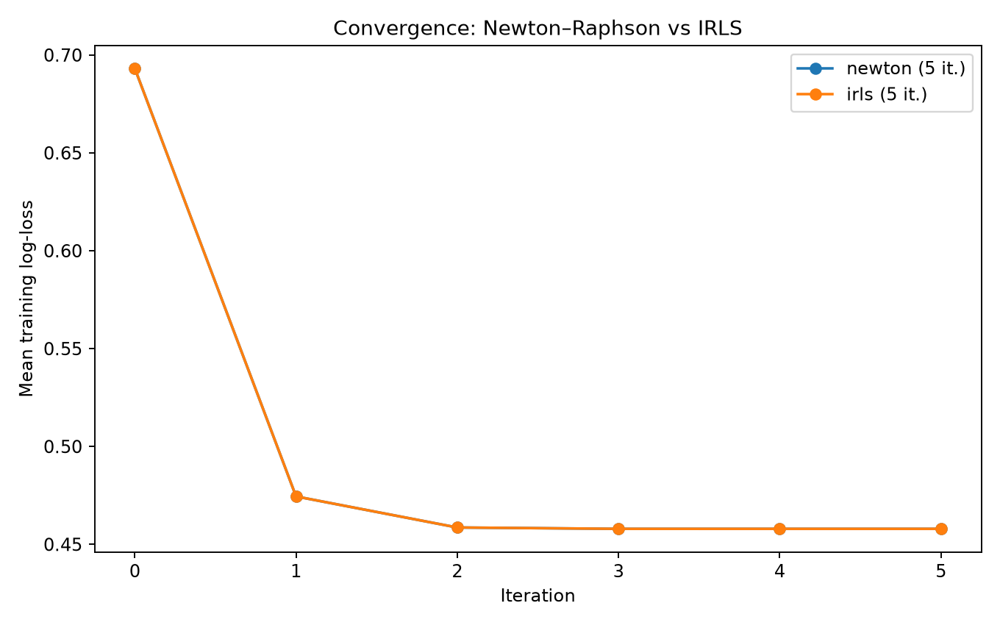
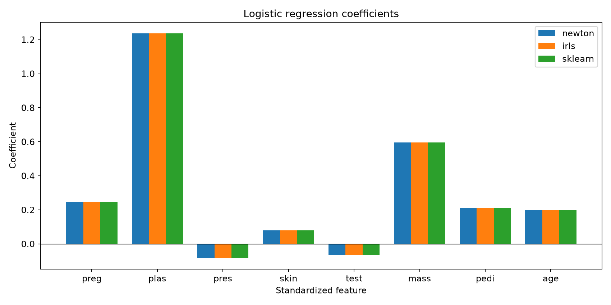
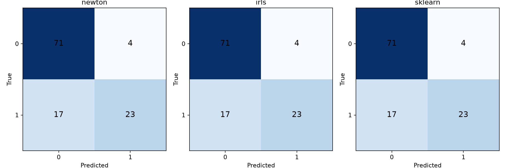
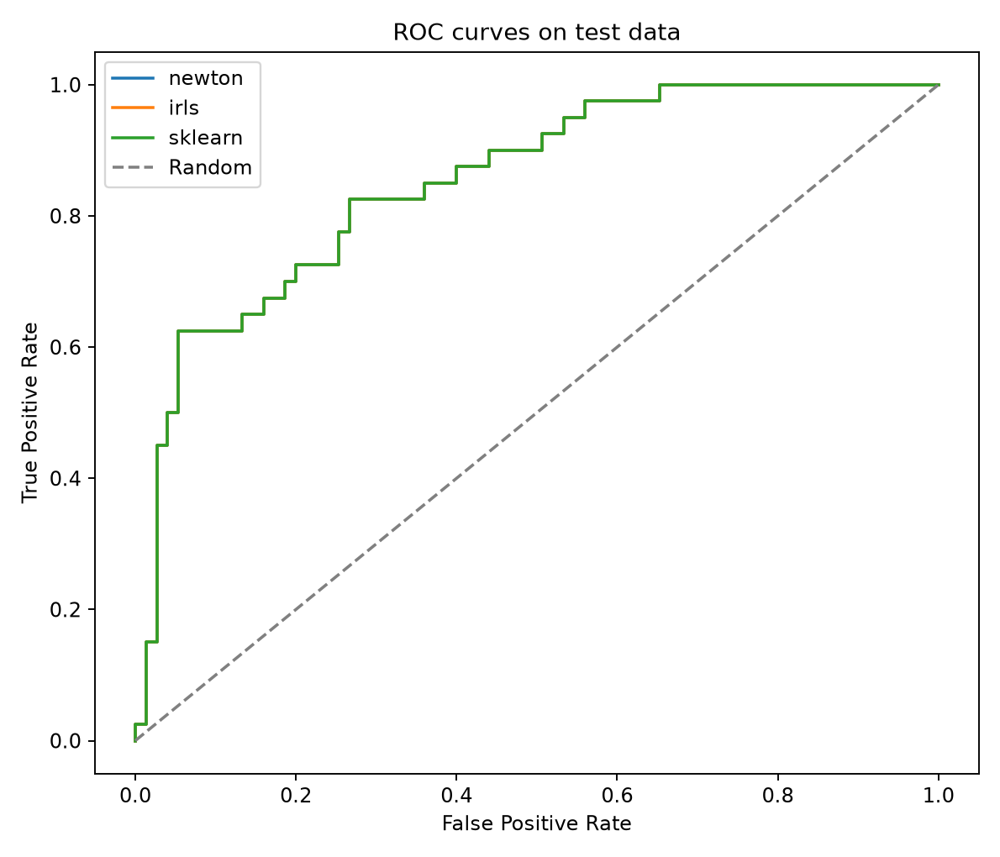
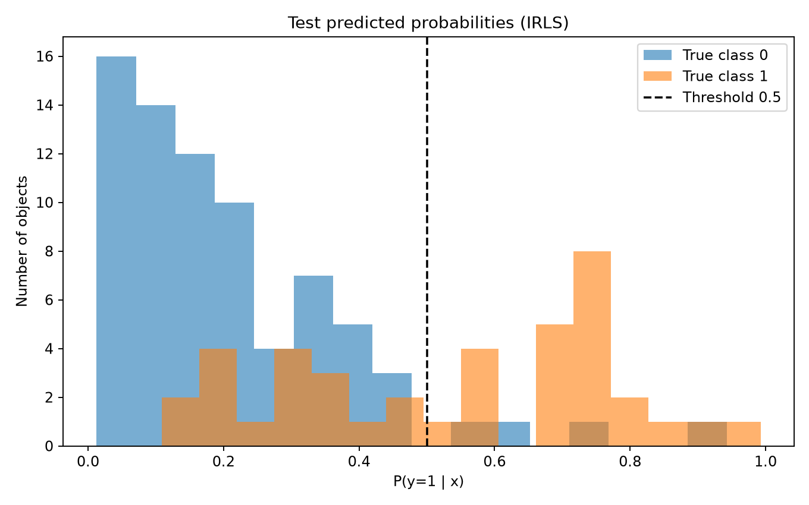
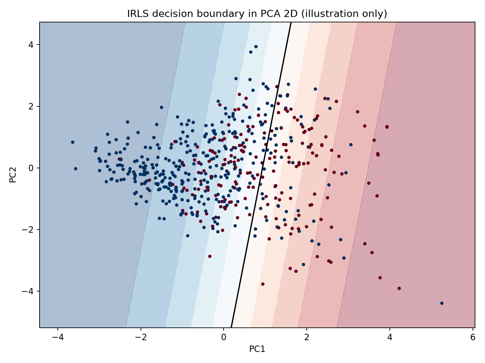

# Лабораторная работа №5. Логистическая регрессия

## Цель работы

Реализовать логистическую регрессию для бинарной классификации двумя методами — **Ньютона–Рафсона (Newton–Raphson)** и **итеративно перевзвешенных наименьших квадратов (IRLS, Iteratively Reweighted Least Squares)**. Исследовать сходимость обоих методов, показать их математическую и численную эквивалентность, сравнить собственные реализации с `sklearn.linear_model.LogisticRegression` и оценить качество классификации.

## Датасет

Для экспериментов используется [Pima Indians Diabetes](https://www.kaggle.com/datasets/kumargh/pimaindiansdiabetescsv) — набор данных для **бинарной классификации**, содержащий **768 объектов**, **8 числовых признаков** и целевой столбец `class`.

| Признак | Описание |
|---|---|
| `preg` | Количество беременностей |
| `plas` | Концентрация глюкозы в плазме крови |
| `pres` | Диастолическое артериальное давление |
| `skin` | Толщина кожной складки трицепса |
| `test` | Уровень инсулина |
| `mass` | Индекс массы тела (BMI) |
| `pedi` | Показатель наследственной предрасположенности к диабету |
| `age` | Возраст |
| `class` | Целевой класс: `0` — отрицательный результат, `1` — положительный результат |

Распределение целевой переменной:

- Класс `0` — **500 объектов** (65,10%).
- Класс `1` — **268 объектов** (34,90%).

Следовательно, классы умеренно несбалансированы. При оценке модели помимо Accuracy необходимо учитывать Precision, Recall, F1 и ROC-AUC.

Загрузка выполняется функцией `load_dataset()` из `dataset.py` через `kagglehub.dataset_download("kumargh/pimaindiansdiabetescsv", ...)`. Данные сохраняются в `source/result/data`.

### Обработка пропущенных значений

В пяти признаках нулевые значения рассматриваются как отсутствующие измерения:

| Признак | Количество нулей | Медиана на train |
|---|---:|---:|
| `plas` | 5 | 118.0 |
| `pres` | 35 | 72.0 |
| `skin` | 227 | 29.0 |
| `test` | 374 | 125.0 |
| `mass` | 11 | 32.0 |

Медианы рассчитываются **только по обучающей выборке**, причём при их вычислении нули исключаются:

$$
m_j=\operatorname{median}\{x_{ij}:x_{ij}\ne0,\;i\in\mathrm{train}\}.
$$

Затем нулевые значения этих признаков заменяются соответствующими медианами на train, validation и test. В `preg` нуль допустим и не заменяется.

### Разделение и стандартизация

Используется стратифицированное разбиение при `random_state=42`:

- **Train** — 538 объектов (примерно 70%).
- **Validation** — 115 объектов (примерно 15%).
- **Test** — 115 объектов (примерно 15%).

После заполнения пропусков применяется стандартизация методом z-score:

$$
z_{ij}=\frac{x_{ij}-\mu_j}{\sigma_j},
$$

где $\mu_j$ и $\sigma_j$ — среднее и стандартное отклонение признака, вычисленные **исключительно на train**. Полученные значения используются для преобразования validation и test без повторного обучения `StandardScaler`.

Таким образом, предварительная обработка не использует информацию о валидационных и тестовых объектах при вычислении параметров преобразования.

## Логистическая регрессия

Логистическая регрессия используется для предсказания **вероятности принадлежности объекта положительному классу**. Несмотря на слово «регрессия», в данной работе решается задача бинарной классификации.

Линейный предиктор имеет вид:

$$
\eta_i=\beta_0+\sum_{j=1}^{d}\beta_jx_{ij}=\tilde x_i^T\beta,
$$

где $\beta_0$ — свободный коэффициент, $d=8$ — число признаков, а $\tilde x_i=(1,x_{i1},\ldots,x_{id})^T$ — вектор признаков с добавленной единицей.

В матричной форме:

$$
\eta=F\beta,\qquad F=[\mathbf 1\;X],\qquad F\in\mathbb R^{n\times(d+1)}.
$$

Для получения вероятности используется сигмоидная функция:

$$
\boxed{p_i=P(y_i=1\mid x_i)=\sigma(\eta_i)=\frac{1}{1+e^{-\eta_i}}}.
$$

Связь линейного предиктора с вероятностью выражается через **логит** — логарифм отношения шансов:

$$
\boxed{\ln\frac{p_i}{1-p_i}=\tilde x_i^T\beta}.
$$

Предсказание класса при пороге $\tau=0.5$:

$$
\hat y_i=\begin{cases}
1,&p_i\ge\tau,\\
0,&p_i<\tau.
\end{cases}
$$

В реализации для вычисления сигмоиды применяется `scipy.special.expit()`, а столбец единиц формируется в `LogisticRegressionBase._matrix()`.

## Вероятностная постановка и функция потерь

Для бинарной целевой переменной принимается распределение Бернулли:

$$
y_i\mid x_i\sim\operatorname{Bernoulli}(p_i),\qquad y_i\in\{0,1\}.
$$

Вероятность наблюдения одного ответа:

$$
P(y_i\mid x_i,\beta)=p_i^{y_i}(1-p_i)^{1-y_i}.
$$

Для независимых наблюдений правдоподобие:

$$
\mathcal L(\beta)=\prod_{i=1}^{n}p_i^{y_i}(1-p_i)^{1-y_i}.
$$

Максимизация логарифма правдоподобия эквивалентна минимизации **Log-Loss (Binary Cross-Entropy)**:

$$
\boxed{L_{\mathrm{log}}(\beta)=-\frac1n\sum_{i=1}^{n}\left[y_i\ln p_i+(1-y_i)\ln(1-p_i)\right]}.
$$

При подстановке $p_i=\sigma(\eta_i)$ получается численно удобная форма:

$$
L_{\mathrm{log}}(\beta)=\frac1n\sum_{i=1}^{n}\left[\ln(1+e^{\eta_i})-y_i\eta_i\right].
$$

В классе `LogisticRegressionBase` предусмотрена также L2-регуляризация:

$$
\boxed{L(\beta)=L_{\mathrm{log}}(\beta)+\frac{\alpha}{2}\sum_{j=1}^{d}\beta_j^2}.
$$

Свободный коэффициент $\beta_0$ не регуляризуется. Для этого `_penalty()` возвращает вектор $(0,\alpha,\ldots,\alpha)$.

В коде функция потерь рассчитывается выражением `np.mean(np.logaddexp(0.0, eta) - y * eta)` с добавлением квадратичного штрафа. `np.logaddexp()` позволяет вычислять $\ln(1+e^{\eta})$ устойчивее, чем прямое возведение экспоненты.

**В представленном эксперименте $\alpha=0$, то есть регуляризация отключена** для прямого сравнения максимального правдоподобия с `sklearn`.

## Градиент и гессиан

Обозначим $p=\sigma(F\beta)$ и матрицу регуляризации:

$$
D=\operatorname{diag}(0,\alpha,\ldots,\alpha).
$$

Градиент функции потерь:

$$
\boxed{\nabla L(\beta)=\frac1nF^T(p-y)+D\beta}.
$$

Поэлементно для $j\ge1$:

$$
\frac{\partial L}{\partial\beta_j}=\frac1n\sum_{i=1}^{n}(p_i-y_i)x_{ij}+\alpha\beta_j.
$$

Вторая производная логистической функции приводит к весам:

$$
w_i=p_i(1-p_i).
$$

Если $W=\operatorname{diag}(w_1,\ldots,w_n)$, то гессиан равен:

$$
\boxed{H(\beta)=\nabla^2 L(\beta)=\frac1nF^TWF+D}.
$$

Градиент указывает направление изменения функции потерь; гессиан учитывает её локальную кривизну. При полной столбцовой ранговости $F$ и вероятностях строго между нулём и единицей гессиан без регуляризации положительно определён.

## Метод Ньютона–Рафсона

На каждой итерации метод Ньютона–Рафсона строит квадратичное приближение функции потерь и вычисляет направление минимизации:

$$
H(\beta^{(t)})\,\Delta\beta^{(t)}=-\nabla L(\beta^{(t)}).
$$

После этого коэффициенты обновляются:

$$
\boxed{\beta^{(t+1)}=\beta^{(t)}+h_t\Delta\beta^{(t)}}.
$$

При $h_t=1$ получается полный шаг Ньютона. В коде `LogisticRegressionNewton._direction()` выполняются:

1. Расчёт вероятностей $p=\sigma(F\beta)$.
2. Расчёт весов $w_i=p_i(1-p_i)$.
3. Формирование гессиана $H=F^TWF/n+D$.
4. Вычисление градиента $g=\nabla L(\beta)$.
5. Решение системы $H\Delta\beta=-g$ через `np.linalg.solve()`.

Явное обращение гессиана не используется. При невозможности обычного решения `_solve()` применяет `np.linalg.lstsq()`.

## IRLS — итеративно перевзвешенный МНК

IRLS (Iteratively Reweighted Least Squares) сводит оптимизацию логистической регрессии к последовательности **взвешенных линейных задач наименьших квадратов**.

На итерации $t$ сначала вычисляются:

$$
\eta^{(t)}=F\beta^{(t)},\qquad p_i^{(t)}=\sigma(\eta_i^{(t)}),
$$

а затем веса объектов:

$$
\boxed{w_i^{(t)}=p_i^{(t)}(1-p_i^{(t)})}.
$$

Рабочий отклик (working response) определяется формулой:

$$
\boxed{z_i^{(t)}=\eta_i^{(t)}+\frac{y_i-p_i^{(t)}}{w_i^{(t)}}}.
$$

Обновлённые коэффициенты находятся как решение задачи взвешенного МНК с L2-штрафом:

$$
\boxed{\beta_{\mathrm{WLS}}=\arg\min_{b}\left[\frac{1}{2n}\sum_{i=1}^{n}w_i^{(t)}(z_i^{(t)}-\tilde x_i^Tb)^2+\frac12b^TDb\right]}.
$$

Нормальная система для этой задачи:

$$
\left(\frac1nF^TWF+D\right)\beta_{\mathrm{WLS}}=\frac1nF^TWz.
$$

Для устойчивого вычисления используются взвешенные матрицы:

$$
\tilde F=W^{1/2}F,\qquad \tilde z=W^{1/2}z.
$$

В `LogisticRegressionIRLS._direction()` вычисляется новая оценка $\beta_{\mathrm{WLS}}$, а функция возвращает направление:

$$
\Delta\beta=\beta_{\mathrm{WLS}}-\beta^{(t)}.
$$

В реализации веса ограничиваются снизу величиной $10^{-12}$, чтобы предотвратить деление на ноль при экстремальных значениях вероятностей.

## Эквивалентность Ньютона–Рафсона и IRLS

Без активного ограничения весов подставим рабочий отклик в правую часть нормальной системы:

$$
F^TWz=F^TW\left(F\beta+W^{-1}(y-p)\right)
=F^TWF\beta+F^T(y-p).
$$

С учётом регуляризации:

$$
\begin{aligned}
\beta_{\mathrm{WLS}}-\beta
&=\left(\frac1nF^TWF+D\right)^{-1}\left[\frac1nF^T(y-p)-D\beta\right]\\
&=-H^{-1}\nabla L(\beta).
\end{aligned}
$$

Следовательно,

$$
\boxed{\Delta\beta_{\mathrm{IRLS}}=\Delta\beta_{\mathrm{Newton}}}.
$$

**Это два представления одного и того же направления оптимизации:** метод Ньютона непосредственно использует градиент и гессиан, а IRLS решает взвешенную задачу МНК. Численные результаты могут немного различаться при сильной вырожденности, конечной точности вычислений или активном ограничении весов.

## Общий алгоритм обучения `fit()`

Оба класса наследуются от `LogisticRegressionBase`, в котором сосредоточен общий итерационный процесс.

1. Создаётся матрица $F=[\mathbf1\;X]$; все параметры инициализируются нулями: $\beta^{(0)}=0$.
2. Вычисляются функция потерь и градиент. Проверяется критерий сходимости $\|\nabla L(\beta)\|_{\infty}<\mathrm{tol}$.
3. Дочерний класс рассчитывает направление $\Delta\beta$ методом Ньютона или IRLS.
4. Выполняется **Backtracking Line Search**: сначала пробуется $h=1$, затем при необходимости $h\leftarrow h/2$, пока функция потерь не станет не больше предыдущего значения с малым численным допуском.
5. Принимается новое значение $\beta\leftarrow\beta+h\Delta\beta$, сохраняются история потерь, норма градиента и длина шага.
6. Обучение завершается при выполнении критерия сходимости, достижении `max_iter` либо невозможности подобрать приемлемый шаг до `min_step`.

Для функции `fit()` используются `tol=10^{-9}` и `max_iter=100`. История обучения сохраняется в `optimization_history.csv`.

В реализации используется backtracking по условию невозрастания потерь, **не условие Армихо**.

## Сравнение с эталонной реализацией

Эталоном выступает `sklearn.linear_model.LogisticRegression` с решателем `newton-cholesky`. Для честного сравнения используются одинаковые стандартизированные признаки и отсутствие регуляризации ($\alpha=0$). Сравниваются коэффициенты, вероятности, предсказанные классы и метрики качества.

Матрица $F$ с учётом intercept имеет размерность $538\times9$ и **полный столбцовый ранг 9**.

Результаты численного сравнения:

| Проверка | Максимальное расхождение |
|---|---:|
| Newton и IRLS: коэффициенты | $3.469\cdot10^{-16}$ |
| Newton и IRLS: вероятности на train | $3.886\cdot10^{-16}$ |
| Newton и IRLS: вероятности на test | $3.331\cdot10^{-16}$ |
| Newton и sklearn: коэффициенты | $1.563\cdot10^{-10}$ |
| Newton и sklearn: вероятности на train | $5.014\cdot10^{-11}$ |
| Newton и sklearn: вероятности на test | $5.654\cdot10^{-11}$ |
| Несовпадения предсказанных классов на test | **0** |

Полученные значения подтверждают **численную эквивалентность** собственных методов друг другу и эталонной реализации `sklearn` на рассматриваемой выборке.

### Сходимость методов

Оба метода сошлись за **5 итераций**. Значения функции потерь практически совпадают на каждом шаге:

| Итерация | Train Log-Loss | Норма градиента $\|g\|_2$ | Принятый шаг |
|---:|---:|---:|---:|
| 0 | 0.69314718 | $4.053\cdot10^{-1}$ | — |
| 1 | 0.47447685 | $7.946\cdot10^{-2}$ | 1.0 |
| 2 | 0.45860805 | $1.424\cdot10^{-2}$ | 1.0 |
| 3 | 0.45791798 | $7.688\cdot10^{-4}$ | 1.0 |
| 4 | 0.45791585 | $2.556\cdot10^{-6}$ | 1.0 |
| 5 | **0.45791585** | $2.822\cdot10^{-11}$ | 1.0 |

Начальное значение $\ln2\approx0.693147$ получается из $\beta^{(0)}=0$, когда модель предсказывает каждому объекту вероятность $0.5$. Градиент быстро уменьшается, что демонстрирует успешную сходимость второго порядка.

*Рисунок 1 — изменение функции потерь на обучающей выборке. Кривые Ньютона–Рафсона и IRLS полностью накладываются друг на друга.*

### Сравнение коэффициентов

Значения коэффициентов собственной логистической регрессии (для стандартизированных признаков):

| Признак | Коэффициент $\beta_j$ |
|---|---:|
| `intercept` | -0.868284 |
| `preg` | 0.245720 |
| `plas` | **1.237133** |
| `pres` | -0.081479 |
| `skin` | 0.079503 |
| `test` | -0.064342 |
| `mass` | **0.595427** |
| `pedi` | 0.212359 |
| `age` | 0.197030 |

Наибольшие положительные коэффициенты имеют `plas` и `mass`. Коэффициенты относятся к **стандартизированным признакам**, поэтому изменение признака на одно стандартное отклонение при прочих равных изменяет логарифм отношения шансов на величину $\beta_j$:

$$
\operatorname{OR}_j=e^{\beta_j}.
$$

Например, для `plas`:

$$
\operatorname{OR}_{plas}=e^{1.237133}\approx3.45.
$$

Это отношение шансов, **не множитель изменения самой вероятности**. Интерпретация коэффициентов не является доказательством причинно-следственной связи, особенно при коррелированных медицинских показателях.

*Рисунок 2 — сопоставление коэффициентов Newton, IRLS и sklearn. Для каждого признака столбцы практически совпадают.*

## Метрики классификации

Для оценки используются Accuracy, Precision, Recall, F1-score, ROC-AUC и Log-Loss.

Обозначения: $TP$ — истинноположительные, $TN$ — истинноотрицательные, $FP$ — ложноположительные, $FN$ — ложноотрицательные ответы.

**Accuracy:**

$$
\operatorname{Accuracy}=\frac{TP+TN}{TP+TN+FP+FN}.
$$

**Precision:**

$$
\operatorname{Precision}=\frac{TP}{TP+FP}.
$$

**Recall:**

$$
\operatorname{Recall}=\frac{TP}{TP+FN}.
$$

**F1-score:**

$$
F_1=\frac{2\operatorname{Precision}\operatorname{Recall}}{\operatorname{Precision}+\operatorname{Recall}}.
$$

**ROC-AUC** оценивает способность модели ранжировать положительные объекты выше отрицательных для разных порогов. В собственной реализации `metrics.py` эта метрика вычисляется через ранги предсказанных оценок с учётом связок (ties).

**Log-Loss** оценивает качество предсказанных вероятностей, а не только классов; его формула приведена выше.

## Результаты экспериментов

### Сравнение на train, validation и test

Для Newton, IRLS и sklearn получены одинаковые значения классификационных метрик при пороге $\tau=0.5$:

| Выборка | Accuracy | Precision | Recall | F1 | ROC-AUC | Log-Loss |
|---|---:|---:|---:|---:|---:|---:|
| Train | 0.77695 | 0.73288 | 0.56915 | 0.64072 | 0.84857 | 0.45792 |
| Validation | 0.71304 | 0.59459 | 0.55000 | 0.57143 | 0.78900 | 0.52216 |
| **Test** | **0.81739** | **0.85185** | **0.57500** | **0.68657** | **0.85233** | **0.45063** |

На test Accuracy составила **81,74%**, а ROC-AUC — **0.85233**. При этом Recall равен **0.575**, то есть модель выявила только 57,5% объектов положительного класса при стандартном пороге.

Разница между validation и test в данном запуске может объясняться конкретным разбиением ограниченной выборки; по одному разбиению нельзя делать вывод о гарантированном качестве модели на новых данных.

### Матрица ошибок

Для всех трёх моделей на тестовой выборке получена одинаковая матрица:

$$
\boxed{\begin{pmatrix}TN&FP\\FN&TP\end{pmatrix}=\begin{pmatrix}71&4\\17&23\end{pmatrix}}.
$$

Следовательно:

- $TN=71$: правильно определены 71 отрицательный объект;
- $FP=4$: 4 отрицательных объекта ошибочно признаны положительными;
- $FN=17$: пропущены 17 положительных объектов;
- $TP=23$: правильно определены 23 положительных объекта.

Отсюда:

$$
\operatorname{Accuracy}=\frac{71+23}{115}\approx0.8174,
$$

$$
\operatorname{Precision}=\frac{23}{23+4}\approx0.8519,
$$

$$
\operatorname{Recall}=\frac{23}{23+17}=0.575.
$$

*Рисунок 3 — матрицы ошибок Newton, IRLS и sklearn на тестовой выборке. Они полностью идентичны.*

Небольшое число ложноположительных ответов даёт высокую Precision, но 17 ложноотрицательных ответов показывают ограничение модели при выбранном пороге. Это **не указывает на ошибку реализации**, поскольку эталонная модель предсказывает те же классы.

### ROC-кривые

ROC-кривая строится по значениям TPR и FPR при разных порогах:

$$
TPR=\frac{TP}{TP+FN},\qquad FPR=\frac{FP}{FP+TN}.
$$

*Рисунок 4 — ROC-кривые трёх моделей. Линии совпадают, а площадь под кривой на test равна $0.85233$.*

Значение ROC-AUC выше 0.5 показывает, что модель ранжирует объекты по вероятности лучше случайного угадывания. Эта метрика не зависит от фиксированного порога классификации.

### Распределение предсказанных вероятностей

*Рисунок 5 — распределение $P(y=1\mid x)$ для объектов двух истинных классов. Пунктир показывает порог $0.5$.*

На графике видна область перекрытия распределений. Некоторые объекты положительного класса получают вероятность ниже 0.5 и классифицируются как отрицательные. Изменение порога может повысить Recall за счёт роста числа ложноположительных ответов; выбирать новый порог следует на validation, а не на test.

### Двумерная визуализация через PCA

Для визуализации исходные восемь стандартизированных признаков проецируются в двумерное пространство первых двух главных компонент:

$$
X\in\mathbb R^{n\times8}\;\longrightarrow\;Z\in\mathbb R^{n\times2}.
$$

Затем функция `plot_pca_2d_boundary()` **отдельно обучает** `LogisticRegressionIRLS` на двумерных данных $Z$ и строит уровни вероятности, включая границу $P(y=1\mid z)=0.5$.

*Рисунок 6 — иллюстративная двумерная граница IRLS в пространстве PCA. Видно перекрытие объектов двух классов.*

**Важно:** это граница вспомогательной модели на двух PCA-компонентах, а **не проекция точной границы основной модели**, обученной на всех восьми признаках. Все приведённые метрики вычислены на исходных восьми стандартизированных признаках, без PCA.

## Итог

В ходе лабораторной работы:

1. Выбран датасет Pima Indians Diabetes с 768 объектами, 8 признаками и бинарной целевой переменной.
2. Реализованы разбиение данных, заполнение некорректных нулевых значений медианами и стандартизация без утечки данных.
3. Реализована логистическая регрессия через максимум правдоподобия модели Бернулли и минимизацию Log-Loss.
4. Аналитически вычислены градиент и гессиан функции потерь с возможностью L2-регуляризации.
5. Реализован метод **Ньютона–Рафсона** для непосредственного вычисления шага через гессиан.
6. Реализован **IRLS**, сводящий каждую итерацию к взвешенному методу наименьших квадратов.
7. Показана математическая эквивалентность шагов Newton и IRLS.
8. Оба собственных метода достигли сходимости за **5 итераций** с одинаковым Log-Loss $0.45791585$ на train.
9. Подтверждено практически полное численное совпадение коэффициентов и вероятностей с `sklearn.LogisticRegression` (максимальная разность коэффициентов $1.563\cdot10^{-10}$).
10. На test получены **Accuracy = 0.81739**, **Precision = 0.85185**, **Recall = 0.57500**, **F1 = 0.68657**, **ROC-AUC = 0.85233**.
11. Построены и сохранены шесть графиков: сходимость, коэффициенты, confusion matrices, ROC-кривые, распределения вероятностей и двумерная визуализация PCA.

**Основной результат:** собственные реализации логистической регрессии методами Ньютона–Рафсона и IRLS практически полностью воспроизводят эталонную `sklearn.LogisticRegression`. Различия качества классификации связаны преимущественно с данными, линейной формой границы и выбором порога, а не с отличиями реализованных методов оптимизации.
