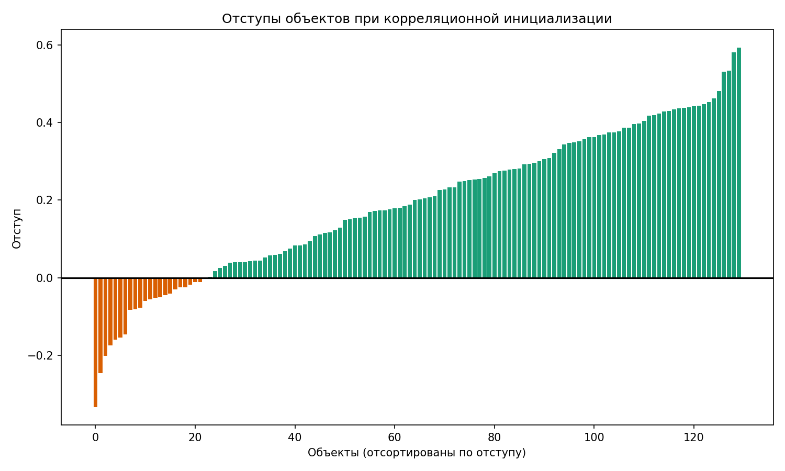
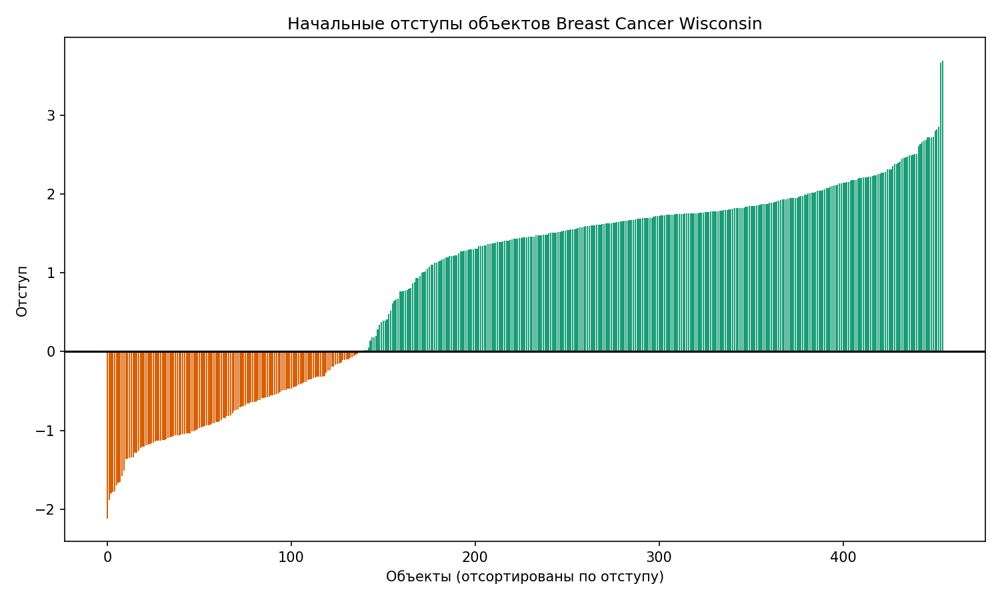
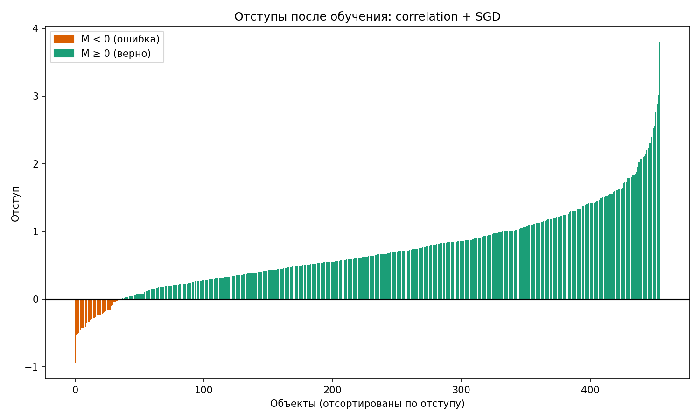

# Лабораторная работа №1. Линейная классификация

## 1. Выбор и подготовка данных

### 1.1. Первый вариант: Wine Dataset

Для первого эксперимента я взял Wine Dataset из `sklearn.datasets.load_wine()`. В исходном датасете 178 объектов, 13 числовых признаков и 3 класса вина. Признаки — это результаты химического анализа: содержание алкоголя, яблочной кислоты, магния, фенолов, флаваноидов, интенсивность цвета и другие характеристики.

Так как в этой лабораторной используется бинарный отступ объекта

$
M_i = y_i \langle w, x_i \rangle,
$

я оставил только два класса: `0` и `1`. После этого осталось 130 объектов. Для удобства формул классы были перекодированы:

```text
0 -> -1
1 -> +1
```

Сначала я просто загрузил данные и попробовал построить начальные веса с помощью корреляционной инициализации ([initialize_by_correlation](source/algorithms.py#L103)). Для каждого признака использовалась оценка

$
w_j = \frac{y^T X_j}{X_j^T X_j}.
$

После этого для каждого объекта вычислялся отступ:

```python
M = y * np.dot(X, w)
```

На этом промежуточном этапе получилось следующее:

```text
количество объектов: 130
минимальный отступ: -0.3332
максимальный отступ: 0.5932
положительный отступ: 107 объектов
отрицательный отступ: 23 объекта
```

Знак отступа показывает, верен ли ответ, а модуль характеризует уверенность классификатора. Отрицательный отступ означает ошибку.
На графике отступов объекты отсортированы по значению `M_i`. Горизонтальная линия соответствует границе `M_i = 0`: выше неё находятся объекты с положительным отступом, ниже — объекты с отрицательным.



При начальных весах 107 из 130 объектов уже имеют положительный отступ, то есть начальная accuracy составляет примерно 82.3%. Это означает, что корреляционная инициализация сразу задаёт неплохое направление разделяющей границы, но без обучения остаются 23 ошибки. Обучение нужно, чтобы скорректировать веса и уменьшить число отрицательных отступов.

### 1.2. Промежуточные результаты и причины смены датасета

Далее в код были добавлены вычисление градиента, SGD с инерцией, L2-регуляризация и разные способы предъявления объектов. На выбранном тестовом разбиении Wine все рассмотренные варианты дали accuracy, precision, recall и F1, равные 1.0.

| model | accuracy | precision | recall | f1 |
| --- | --- | --- | --- | --- |
| correlation + SGD | 1.0 | 1.0 | 1.0 | 1.0 |
| multistart + SGD | 1.0 | 1.0 | 1.0 | 1.0 |
| random init + random | 1.0 | 1.0 | 1.0 | 1.0 |
| random init + margin | 1.0 | 1.0 | 1.0 | 1.0 |
| steepest descent | 1.0 | 1.0 | 1.0 | 1.0 |
| RidgeClassifier | 1.0 | 1.0 | 1.0 | 1.0 |

По этим метрикам различия между вариантами обучения не проявились, поэтому для дальнейшего сравнения я выбрал более крупный бинарный датасет Breast Cancer Wisconsin.

### 1.3. Итоговый датасет: Breast Cancer Wisconsin

Breast Cancer Wisconsin из `sklearn.datasets`: 569 объектов, 30 числовых признаков и 2 класса — злокачественная и доброкачественная опухоль.

Метки перекодированы в формат $y \in \{-1, +1\}$. Подготовка данных: стратифицированное разбиение 80/20 (455 объектов на обучение, 114 на тест), добавление константного признака $x_0 = 1$ под свободный член.

## 2. Вычисление отступа объекта

Для объекта $x_i$ отступ вычисляется по формуле

$$M_i = y_i \langle w, x_i \rangle.$$

В коде это реализовано в функции [calculate_margin](source/algorithms.py#L4):

```python
def calculate_margin(X, y, w):
    return y * np.dot(X, w)
```

Для корреляционной инициализации на обучающей выборке получилось 318 положительных и 137 отрицательных отступов. Начальная accuracy составляет примерно 69.9%. Отрицательные отступы соответствуют объектам, которые начальная граница классифицирует неверно.



На графике объекты отсортированы по отступу: слева находятся ошибки, справа — объекты, для которых начальная классификация верна.

После обучения отступы смещаются в положительную область:



После обучения модели `correlation + SGD` число отрицательных отступов на обучающей выборке уменьшилось со 137 до 36, а accuracy выросла с 69.9% до 92.1%.


## 3. Функция потерь и её градиент

Для обучения используется квадратичная функция потерь:

$$L(M_i) = (1 - M_i)^2.$$

Минимум достигается при $M_i = 1$. Функция штрафует ошибки ($M_i < 0$), пограничные ответы ($M_i = 0$) и верные ответы с отступом, отличным от единицы. Штраф за $M_i > 1$ — свойство выбранной функции потерь: любой положительный отступ означает правильную классификацию.

Для одного объекта $M_i = y_i\langle x_i, w\rangle$, поэтому $\nabla_w M_i = y_i x_i$. По правилу производной сложной функции градиент потери по весам равен:

$$\nabla_w L = L'(M_i)\nabla_w M_i = -2(1 - M_i)y_i x_i.$$

Формула реализована в функции [calculate_gradient(x, y, margin)](source/algorithms.py#L21) в [algorithms.py](source/algorithms.py).

## 4. Рекуррентная оценка функционала качества

Чтобы следить за обучением без пересчёта средней потери по всей выборке на каждом шаге, используется сглаженная рекуррентная оценка:

$$Q_t = \lambda L_i + (1 - \lambda)Q_{t-1}, \qquad L_i = (1 - M_i)^2.$$

Здесь $t$ — номер шага, $L_i$ — потеря выбранного объекта до обновления весов, $Q_{t-1}$ — предыдущая оценка, а $\lambda$ — вес новой потери. В реализации $\lambda = 0.1$, чем больше $\lambda$, тем быстрее оценка реагирует на изменения, но тем сильнее колеблется.

Начальное $Q_0$ вычисляется как средняя потеря на 10 случайных обучающих объектах. Обновление оценки реализовано в функции [train_classifier](source/algorithms.py#L25), значения сохраняются в `Q_history`.

## 5. Стохастический градиентный спуск с инерцией (SGD + momentum)

В SGD на каждом шаге выбирается один обучающий объект и вычисляется градиент его потери. При случайном предъявлении объекты выбираются равновероятно с возвращением: один объект может встретиться несколько раз.

Инерция (momentum) сглаживает последовательность градиентов. Без учёта регуляризации обновление имеет вид:

$$v_t = \gamma v_{t-1} + (1 - \gamma)\nabla_w L_i, \qquad w_{t+1} = w_t - h v_t.$$

Здесь $v_t$ — сглаженный градиент, $v_0 = 0$, $\gamma$ — коэффициент инерции, $h$ — шаг обучения. Используется $\gamma = 0.9$. При $\gamma = 0$ получается обычный SGD. Сглаживание уменьшает влияние отдельных градиентов, но не гарантирует улучшения качества.

Алгоритм реализован в [train_classifier](source/algorithms.py#L25): $h = 10^{-7}$, $\gamma = 0.9$, максимум 10 000 итераций. Досрочная остановка происходит, если одновременно $\|w_{t+1} - w_t\| < 10^{-8}$ и $|Q_t - Q_{t-1}| < 10^{-8}$.

## 6. L2-регуляризация

L2-регуляризация добавляет к потере штраф за большие веса:

$$\widetilde L_i = L_i + \frac{\tau}{2}\sum_{j\ne 0}w_j^2.$$

Здесь $\tau$ — коэффициент регуляризации. Свободный член $w_0$, соответствующий константному признаку, в штраф не входит. Регуляризация делает большие веса более дорогими и может уменьшить переобучение.

Производная штрафа $\frac{\tau}{2}w_j^2$ равна $\tau w_j$, поэтому для $j\ne 0$:

$$\frac{\partial\widetilde L_i}{\partial w_j} = \frac{\partial L_i}{\partial w_j} + \tau w_j.$$

В обычном SGD это даёт уменьшение веса на множитель $1-h\tau$. В реализации с инерцией такое уменьшение применяется отдельно от сглаживания градиента потери:

$$v_t = \gamma v_{t-1} + (1-\gamma)\nabla_w L_i, \qquad w_j^{t+1} = (1-h\tau)w_j^t - h v_{t,j}, \quad j\ne 0.$$

Свободный член обновляется без множителя $1-h\tau$. В [train_classifier](source/algorithms.py#L25) используется $\tau = 0.001$

## 7. Скорейший градиентный спуск (Steepest descent)

Вместо постоянного шага выбирается шаг $h^*$, минимизирующий потерю выбранного объекта вдоль направления антиградиента:

$$h^* = \arg\min_{h\ge 0} L_i(w-h\nabla_w L_i).$$

Для нашей потери $L_i=(1-M_i)^2$ после такого шага отступ равен $M_i' = M_i + 2h(1-M_i)\|x_i\|^2$. Поэтому:

$$L_i(w-h\nabla_w L_i) = (1-M_i)^2\bigl(1-2h\|x_i\|^2\bigr)^2.$$

Потеря неотрицательна, поэтому ноль — её минимально возможное значение. Чтобы его достичь, достаточно обнулить вторую скобку, получим оптимальный шаг:

$$h^* = \frac{1}{2\|x_i\|^2}, \qquad w := w-h^*\nabla_w L_i.$$

Метод реализован отдельно в [train_steepest](source/algorithms.py#L62), без инерции и L2-регуляризации.

## 8. Предъявление объектов по модулю отступа

При равномерном случайном предъявлении все объекты выбираются с одинаковой вероятностью. В альтернативном варианте чаще выбираются пограничные объекты с малым $|M_i|$, для которых классификатор менее уверен в ответе.

Для этого каждому объекту задаётся вес $s_i$, который затем нормируется в вероятность $p_i$:

$$s_i = \frac{1}{|M_i|+\varepsilon}, \qquad p_i = \frac{s_i}{\sum_j s_j}.$$

Чем меньше модуль отступа, тем выше вероятность выбора. Нормировка обеспечивает $\sum_i p_i=1$, а $\varepsilon=10^{-8}$ предотвращает деление на ноль.

Выбор реализован в [choose_by_margin](source/algorithms.py#L96). В [train_classifier](source/algorithms.py#L46) отступы пересчитываются перед каждым выбором, объекты выбираются с возвращением.

## 9. Обучение линейного классификатора

Для всех экспериментов использовалось одно и то же разбиение Breast Cancer Wisconsin:
455 объектов для обучения и 114 для тестирования. Метки классов имеют вид
$y \in \{-1,+1\}$, в признаки добавлен свободный член.

Основной классификатор обучается SGD с инерцией и L2-регуляризацией.
На каждой итерации выбирается один объект, вычисляется его градиент и обновляются веса.
Максимальное число итераций — 10 000.

### 9.1. Корреляционная инициализация

[Начальные веса вычисляются](source/algorithms.py#L103) отдельно для каждого признака:

$$
w_j^{(0)} =
\frac{\langle y,f_j\rangle}
     {\langle f_j,f_j\rangle},
$$

где $f_j$ — значения $j$-го признака на обучающей выборке.

После инициализации классификатор [обучается SGD со случайным предъявлением объектов](source/main.py#L31).

### 9.2. Случайная инициализация и мультистарт

При [случайной инициализации](source/algorithms.py#L112) начальные веса выбираются из распределения

$$
w_j^{(0)}
\sim
U\left(-\frac{1}{2n},\frac{1}{2n}\right),
$$

где $n$ — число весов.

Для [мультистарта](source/main.py#L35) выполняется 10 независимых запусков из разных начальных точек.
После каждого запуска на всей обучающей выборке вычисляется средняя квадратичная потеря

$$
L_{\text{train}}
=
\frac{1}{\ell}
\sum_{i=1}^{\ell}(1-M_i)^2.
$$

В качестве результата мультистарта выбирается модель с минимальным
$L_{\text{train}}$.

### 9.3. Случайное предъявление и предъявление по модулю отступа

Для [сравнения](source/main.py#L49) использовались одинаковые случайные начальные веса.

При [случайном предъявлении](source/algorithms.py#L92) каждый объект выбирается с одинаковой вероятностью.

При [предъявлении по модулю отступа](source/algorithms.py#L96) сначала вычисляются текущие отступы всех объектов,
после чего вероятность выбора задаётся через

$$
s_i = \frac{1}{|M_i|+\varepsilon},
\qquad
p_i = \frac{s_i}{\sum_j s_j}.
$$

Таким образом, чаще предъявляются объекты с малым $|M_i|$, то есть находящиеся ближе
к разделяющей границе.

Отдельно был [запущен](source/main.py#L63) [скорейший градиентный спуск](source/algorithms.py#L62) из пункта 7.
Он не использует momentum и L2-регуляризацию.

## 10. Оценка качества классификации

Качество оценивалось на отложенной тестовой выборке из 114 объектов.
Положительный класс $+1$ соответствует доброкачественной опухоли.

Использовались метрики accuracy, precision, recall и F1:

| Метод | Accuracy | Precision | Recall | F1 |
| --- | ---: | ---: | ---: | ---: |
| correlation + SGD | 0.8684 | **0.8904** | 0.9028 | 0.8966 |
| multistart + SGD | 0.8158 | 0.7742 | 1.0000 | 0.8727 |
| random init + random | 0.7982 | 0.7634 | 0.9861 | 0.8606 |
| **random init + margin** | **0.8684** | 0.8608 | **0.9444** | **0.9007** |
| steepest descent | 0.7281 | 0.6990 | 1.0000 | 0.8229 |

Лучший F1 среди собственных реализаций получил вариант со случайной инициализацией
и предъявлением объектов по модулю отступа — $0.9007$.

Корреляционная инициализация дала ту же accuracy $0.8684$, но немного меньший F1.
Предъявление по модулю отступа также оказалось лучше случайного предъявления при
одинаковой случайной инициализации.

Скорейший спуск показал худшую accuracy. При этом recall равен 1.0, а precision
заметно ниже, то есть модель чаще относит объекты к положительному классу.

## 11. Сравнение с эталонной реализацией

В качестве эталона использовался `RidgeClassifier` из scikit-learn.

Для меток $y_i\in\{-1,+1\}$ квадратичная функция потерь нашего классификатора
может быть записана как

$$
(1-y_i\langle w,x_i\rangle)^2
=
(y_i-\langle w,x_i\rangle)^2.
$$

Поэтому `RidgeClassifier` является близким по постановке линейным классификатором:
он также использует квадратичное приближение и L2-регуляризацию, но оптимизирует
веса библиотечными средствами, а не реализованным SGD.

| Модель | Accuracy | Precision | Recall | F1 |
| --- | ---: | ---: | ---: | ---: |
| random init + margin | 0.8684 | 0.8608 | 0.9444 | 0.9007 |
| RidgeClassifier | **0.9298** | **0.9103** | **0.9861** | **0.9467** |

Эталонная реализация показала более высокое качество по всем четырём метрикам.
