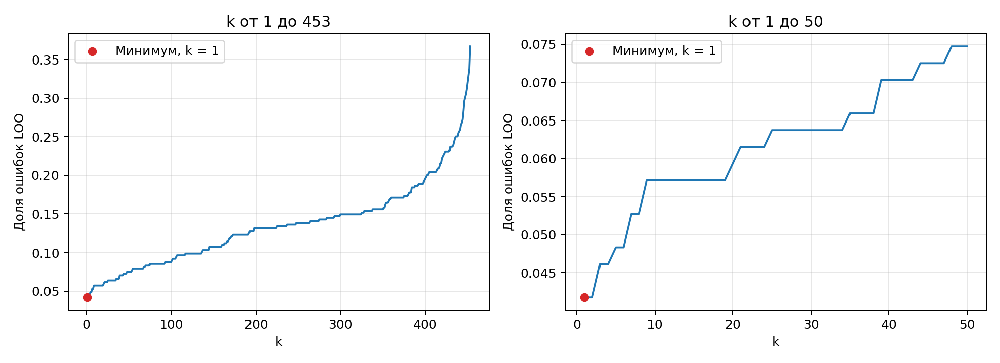

# Лабораторная работа №2. Метрическая классификация

## 1. Выбор и подготовка данных

Breast Cancer Wisconsin из `sklearn.datasets`: 569 объектов, 30 числовых признаков и 2 класса — злокачественная и доброкачественная опухоль.

Метки перекодированы в формат $y \in \{-1, +1\}$: `-1` — злокачественная опухоль, `+1` — доброкачественная. Разбиение стратифицированное, 80/20: 455 объектов на обучение и 114 на тест.

Признаки стандартизированы по среднему и стандартному отклонению обучающей выборки, чтобы различие масштабов не определяло расстояния между объектами.

$$x'_j = \frac{x_j - \mu_j}{\sigma_j}.$$

## 2. KNN с методом окна Парзена переменной ширины

Сначала реализован обычный KNN с евклидовым расстоянием: ответ определяется большинством меток среди `k` ближайших соседей. Затем равные голоса заменены весами, зависящими от расстояния.

В окне Парзена переменной ширины расстояние до $(k+1)$-го соседа задает ширину окна:

$$h(x) = \rho\bigl(x, x^{(k+1)}\bigr).$$

Взято гауссово ядро:

$$K(r) = \exp(-2r^2).$$

Для каждого класса складываются веса его обучающих объектов:

$$a(x) = \arg\max_{c \in Y}\sum_{i=1}^{\ell}[y_i = c]\,K\!\left(\frac{\rho(x, x_i)}{h(x)}\right).$$

Близкие объекты получают больший вес. В голосовании участвует вся обучающая выборка: у гауссова ядра нет конечной границы, за которой вес становится нулевым. Параметр `k` определяет ширину окна.

Реализация — [predict_parzen](source/algorithms.py).

Для проверки работы использовано `k = 3`. На тестовой выборке получены следующие значения:

| Accuracy | Precision | Recall | F1 |
| ---: | ---: | ---: | ---: |
| 0.9386 | 0.9114 | 1.0000 | 0.9536 |

Precision, recall и F1 рассчитаны для класса `+1`. Верно классифицированы 107 из 114 объектов.

## 3–4. Подбор параметра k методом LOO и обоснование выбора параметров

Каждый объект обучающей выборки классифицируется по остальным. Для каждого `k` вычисляется доля ошибок:

$$LOO(k) = \frac{1}{\ell}\sum_{i=1}^{\ell}\left[a(x_i; X^{\ell}\setminus\{x_i\}, k) \ne y_i\right].$$

В [loo](source/algorithms.py) матрица расстояний вычисляется один раз на стандартизированной обучающей выборке и используется для всех `k`. На диагонали стоит бесконечность, исключающая объект из собственного окружения.

Евклидова метрика выбрана для числовых признаков, приведенных к общему масштабу. Гауссово ядро плавно уменьшает влияние далеких объектов. Ширина окна определяется расстоянием до $(k+1)$-го соседа и меняется в зависимости от плотности объектов.

Проверены все допустимые `k` от 1 до 453.

| k | Ошибок LOO | Доля ошибок |
| ---: | ---: | ---: |
| 1 | 19 | 0.0418 |
| 2 | 19 | 0.0418 |
| 3 | 21 | 0.0462 |
| 10 | 26 | 0.0571 |
| 50 | 34 | 0.0747 |
| 100 | 40 | 0.0879 |
| 453 | 167 | 0.3670 |

При `k = 1` и `k = 2` получен одинаковый минимальный риск, 19 ошибок из 455 (LOO = 0.0418). По LOO на этой выборке предпочтения между ними нет. Для дальнейших экспериментов оставлено `k = 1`. При больших `k` окно расширяется, влияние далеких объектов усиливается, а риск по LOO растет.

После подбора получены следующие результаты на тесте:

| k | Accuracy | Precision | Recall | F1 |
| ---: | ---: | ---: | ---: | ---: |
| 1 | 0.9298 | 0.9000 | 1.0000 | 0.9474 |
