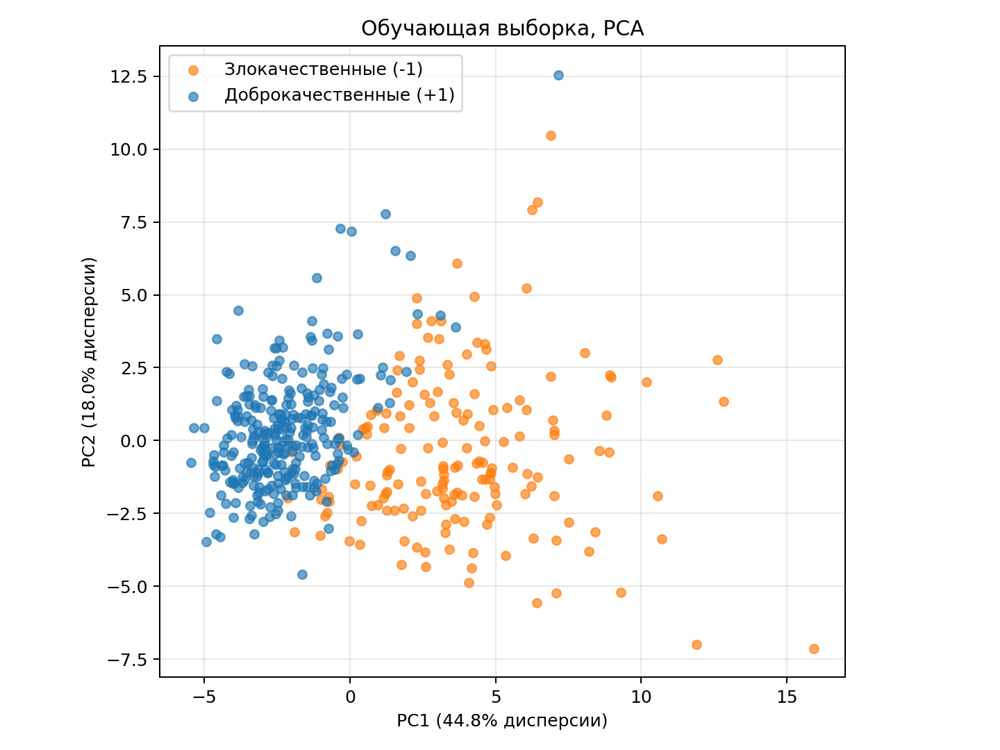
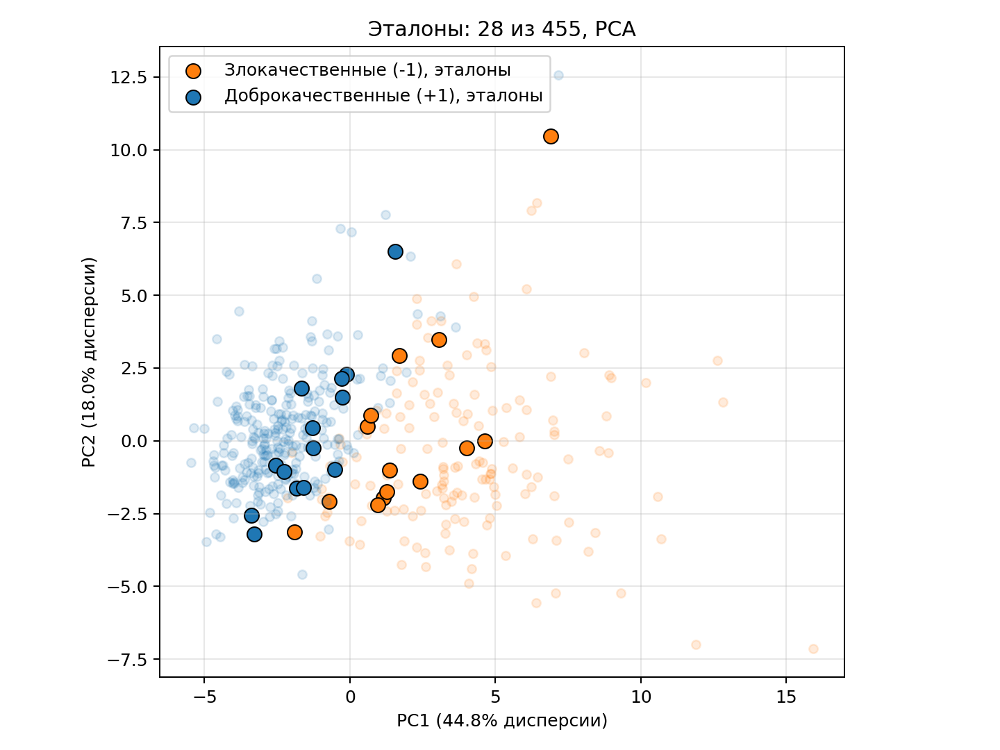
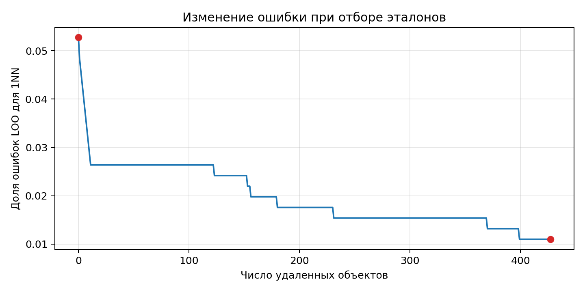

# Лабораторная работа №2. Метрическая классификация

## 1. Выбор и подготовка данных

Breast Cancer Wisconsin из `sklearn.datasets`: 569 объектов, 30 числовых признаков и 2 класса — злокачественная (-1) и доброкачественная (+1) опухоль.

Метки перекодированы в формат $y \in \{-1, +1\}$. Разбиение стратифицированное, 80/20: 455 объектов на обучение и 114 на тест.

Признаки стандартизированы по среднему и стандартному отклонению обучающей выборки, чтобы различие масштабов не определяло расстояния между объектами.

$$x'_j = \frac{x_j - \mu_j}{\sigma_j}.$$

Для визуализации обучающая выборка спроецирована на две главные компоненты (PCA). Каждая компонента — линейная комбинация исходных стандартизированных признаков.



На проекции доброкачественные (+1) объекты образуют более плотную группу, злокачественные (-1) расположены более рассеянно. Области классов частично перекрываются.

## 2. KNN с методом окна Парзена переменной ширины

Сначала реализован обычный KNN с евклидовым расстоянием: ответ определяется большинством меток среди `k` ближайших соседей. Затем равные голоса заменены весами, зависящими от расстояния.

В окне Парзена переменной ширины расстояние до $(k+1)$-го соседа задает ширину окна:

$$h(x) = \rho\bigl(x, x^{(k+1)}\bigr).$$

Взято гауссово ядро:

$$K(r) = \exp(-2r^2).$$

Для каждого класса складываются веса его обучающих объектов:

$$a(x) = \arg\max_{c \in Y}\sum_{i=1}^{\ell}[y_i = c]\,K\!\left(\frac{\rho(x, x_i)}{h(x)}\right).$$

Близкие объекты получают больший вес. В голосовании участвует вся обучающая выборка: у гауссова ядра нет конечной границы, за которой вес становится нулевым. Параметр `k` определяет ширину окна.

Реализация — [predict_parzen](source/algorithms.py).

Для проверки работы использовано `k = 3`. На тестовой выборке получены следующие значения:

| Accuracy | Precision | Recall | F1 |
| ---: | ---: | ---: | ---: |
| 0.9386 | 0.9114 | 1.0000 | 0.9536 |

Precision, recall и F1 рассчитаны для класса `+1`. Верно классифицированы 107 из 114 объектов.

## 3–4. Подбор параметра k методом LOO и обоснование выбора параметров

Каждый объект обучающей выборки классифицируется по остальным. Для каждого `k` вычисляется доля ошибок:

$$LOO(k) = \frac{1}{\ell}\sum_{i=1}^{\ell}\left[a(x_i; X^{\ell}\setminus\{x_i\}, k) \ne y_i\right].$$

В [loo](source/algorithms.py) для каждого проверяемого объекта масштаб признаков рассчитывается по остальным обучающим объектам. Полученная строка расстояний сохраняется и используется для всех `k`. На диагонали матрицы стоит бесконечность, исключающая объект из собственного окружения.

Евклидова метрика выбрана для числовых признаков, приведенных к общему масштабу. Гауссово ядро плавно уменьшает влияние далеких объектов. Ширина окна определяется расстоянием до $(k+1)$-го соседа и меняется в зависимости от плотности объектов.

Проверены все допустимые `k` от 1 до 453.


| k | Ошибок LOO | Доля ошибок |
| ---: | ---: | ---: |
| 1 | 19 | 0.0418 |
| 2 | 19 | 0.0418 |
| 3 | 21 | 0.0462 |
| 10 | 26 | 0.0571 |
| 50 | 34 | 0.0747 |
| 100 | 40 | 0.0879 |
| 453 | 166 | 0.3648 |

При `k = 1` и `k = 2` получен одинаковый минимальный риск, 19 ошибок из 455 (LOO = 0.0418). По LOO на этой выборке предпочтения между ними нет. Для дальнейших экспериментов оставлено `k = 1`. При больших `k` окно расширяется, влияние далеких объектов усиливается, а риск по LOO растет.

После подбора получены следующие результаты на тесте:

| k | Accuracy | Precision | Recall | F1 |
| ---: | ---: | ---: | ---: | ---: |
| 1 | 0.9298 | 0.9000 | 1.0000 | 0.9474 |

## 5. Сравнение с эталонной реализацией KNN

Для сравнения использован `KNeighborsClassifier` из sklearn с `k = 1`, евклидовой метрикой и `weights="uniform"`. Дополнительно проверен собственный KNN с обычным голосованием. Качество оценивается на тестовой выборке из 114 объектов.

| Модель | Accuracy | Precision | Recall | F1 |
| --- | ---: | ---: | ---: | ---: |
| KNN | 0.9649 | 0.9595 | 0.9861 | 0.9726 |
| KNN с окном Парзена | 0.9298 | 0.9000 | 1.0000 | 0.9474 |
| sklearn KNN | 0.9649 | 0.9595 | 0.9861 | 0.9726 |

Предсказания обычного KNN и sklearn совпали для всех 114 объектов. На выбранном тесте обычный KNN оказался точнее окна Парзена. Сравнение проведено при одинаковом `k = 1`.

Recall = 1 у Парзена означает, что правильно распознаны все доброкачественные (+1) объекты. Более низкая precision показывает, что к этому классу также отнесена часть злокачественных (-1) объектов. Рост recall для класса `+1` сопровождается увеличением числа ошибок класса `-1`.

При `k = 1` обычный KNN возвращает класс ближайшего соседа. У Парзена ширина окна определяется вторым соседом, а голоса суммируются по всей обучающей выборке. Несколько менее близких объектов другого класса могут перевесить ближайшего. Доброкачественных (+1) объектов в обучении больше, что может усиливать их суммарное влияние.

## 6. Алгоритм отбора эталонов

В [select_prototypes](source/algorithms.py) реализована жадная стратегия удаления. Начальное множество эталонов содержит всю обучающую выборку. На каждом шаге удаляется объект, без которого ошибка минимальна. Удаление продолжается, пока ошибка не увеличивается.

Для отбора используется 1NN. В качестве CCV взят частный случай с контролем из одного объекта, равный LOO. Каждый обучающий объект классифицируется по ближайшему эталону. Если сам объект входит в набор эталонов, он исключается из своих соседей:

$$Q(\Omega) = \frac{1}{\ell}\sum_{i=1}^{\ell}\left[a_{1NN}(x_i; \Omega\setminus\{x_i\}) \ne y_i\right].$$

Отобрано 28 эталонов из 455, по 14 на класс. Ошибка отбора снизилась с 24 до 5 объектов (с 0.0527 до 0.0110).

## 7. Визуализация результатов работы алгоритма отбора эталонов

На проекции PCA эталоны выделены жирным, неэталонные объекты полупрозрачные.



График показывает изменение ошибки 1NN при последовательном удалении объектов. Горизонтальные участки соответствуют удалениям, которые не меняют число ошибок. Ошибка не растет по условию отбора. Критерий оценивается только на обучающей выборке.



## 8. Сравнение качества KNN с отбором эталонов и без

После отбора эталонов модели повторно проверены на той же тестовой выборке из 114 объектов. Стандартизация и `k = 1` сохранены, число используемых обучающих объектов сокращено с 455 до 28.

| Модель | Объектов | Accuracy | Precision | Recall | F1 |
| --- | ---: | ---: | ---: | ---: | ---: |
| KNN, вся выборка | 455 | 0.9649 | 0.9595 | 0.9861 | 0.9726 |
| KNN, эталоны | 28 | 0.9649 | 0.9722 | 0.9722 | 0.9722 |
| KNN с окном Парзена, вся выборка | 455 | 0.9298 | 0.9000 | 1.0000 | 0.9474 |
| KNN с окном Парзена, эталоны | 28 | 0.9737 | 0.9600 | 1.0000 | 0.9796 |

Предсказания собственного обычного KNN и `sklearn KNN` совпали для всех тестовых объектов как до отбора, так и после.

У обычного KNN accuracy не изменилась, F1 немного снизилась. В обоих случаях допущено 4 ошибки. После отбора число злокачественных (-1) объектов, ошибочно отнесенных к доброкачественным (+1), снизилось с 3 до 2, но число доброкачественных (+1) объектов, ошибочно отнесенных к злокачественным (-1), выросло с 1 до 2. Precision увеличилась, а recall снизился.

Все доброкачественные (+1) объекты в методе Парзена по-прежнему распознаны правильно (recall = 1), но число злокачественных (-1) объектов, ошибочно отнесенных к доброкачественным (+1), снизилось с 8 до 3. Этим объясняется рост precision с 0.9000 до 0.9600.

Число используемых объектов сократилось примерно в 16 раз. На данной тестовой выборке отбор сохранил accuracy обычного KNN и улучшил качество метода Парзена, хотя отбор проводился по ошибке LOO для 1NN, а не по качеству метода Парзена.

Запуск из директории `lab2`:

```sh
pip install -r requirements.txt
python source/main.py
```
