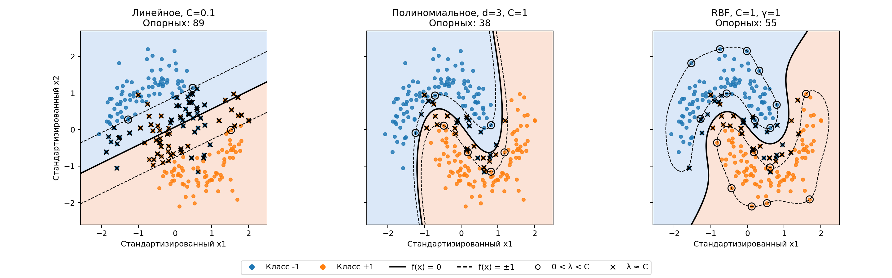

# Лабораторная работа №3. SVM

## 1. Выбор датасета для бинарной классификации

Использован `make_moons` из `sklearn.datasets`. Сгенерированы 300 объектов с двумя числовыми признаками и двумя классами по 150 объектов. Признаки - координаты точек, классы имеют форму двух полумесяцев. Добавлен шум с параметром `noise=0.2`.

Размер выборки выбран для умеренной стоимости решения двойственной задачи. Каждому обучающему объекту соответствует своя переменная $\lambda_i$.

Метки перекодированы в формат $y \in \{-1, +1\}$. Разбиение стратифицированное, 80/20: 240 объектов на обучение и 60 на тест. Признаки стандартизированы по среднему и стандартному отклонению обучающей выборки.

## 2. Решение двойственной задачи по лямбда

В [solve_dual](source/algorithms.py) решается двойственная задача в форме минимизации:

$$f(\lambda)=\frac12\lambda^TQ\lambda-\sum_i\lambda_i\to\min_{\lambda},\qquad Q_{ij}=y_i y_j\langle x_i,x_j\rangle,$$

$$\sum_i\lambda_i y_i=0,\qquad 0\le\lambda_i\le C.$$

Матрица $Q$ симметрична, градиент целевой функции:

$$\nabla f(\lambda)=\frac12(Q+Q^T)\lambda-\mathbf1=Q\lambda-\mathbf1.$$

Решение найдено через `scipy.optimize.minimize` методом SLSQP. Для линейного ядра при подобранном `C = 0.1` значение минимизируемой функции равно $-7.873051$.

## 3. Кернел трик

Ядро $K(x_i,x_j)=\langle\psi(x_i),\psi(x_j)\rangle$ задает скалярное произведение в пространстве преобразованных признаков. Линейной границе в этом пространстве может соответствовать нелинейная граница в исходных координатах, при этом не вычисляя $\psi(x)$ явно.

Матрица двойственной задачи:

$$Q_{ij}=y_i y_j K(x_i,x_j).$$

Для проверки разных предположений о разделяющей поверхности рассмотрим следующие ядра:

- линейное $K(x,z)=\langle x,z\rangle$ - прямая граница
- полиномиальное $K(x,z)=(\langle x,z\rangle+1)^3$ - учет степени и взаимодействия координат
- RBF $K(x,z)=\exp(-\gamma\|x-z\|^2)$, $\gamma=1$ - сходство через растояние между точками

Линейное ядро используется как базовый вариант с прямой границей. Полиномиальное учитывает степени и взаимодействия координат, RBF задает сходство через расстояние между точками. Нелинейные ядра выбраны с учетом изогнутой формы классов `make_moons`.

## 4. Построение линейного классификатора

Для линейного ядра вектор весов восстанавливается из решения двойственной задачи:

$$w=\sum_i\lambda_i y_i x_i.$$

Порог усреднен по граничным опорным векторам, лежащим на краю разделяющей полосы:

$$w_0=\frac1{|B|}\sum_{i\in B}(\langle w,x_i\rangle-y_i),\qquad B=\{i:0<\lambda_i<C\}.$$

Классификатор имеет вид $a(x)=\operatorname{sign}(\langle w,x\rangle-w_0)$. В [build_linear_classifier](source/algorithms.py) используются граничные опорные векторы с учетом численной погрешности.

Если таких векторов нет, допустимый интервал для порога определяется из условий KKT: $M_i\ge1$ при $\lambda_i=0$ и $M_i\le1$ при $\lambda_i=C$. Выбирается середина этого интервала.

При `C = 0.1` получена граница в стандартизированных координатах:

$$0.590462x_1-1.199553x_2+0.084072=0.$$

## 5. Визуализация решения

Цвет фона показывает предсказываемый класс, цвет точек — истинный класс обучающих объектов. Сплошная линия соответствует $f(x)=0$, пунктирные — $f(x)=\pm1$.

Кружками выделены граничные опорные векторы с $0<\lambda_i<C$, крестиками — объекты с $\lambda_i\approx C$. Крестик не обязательно означает ошибку классификации, объект может находиться внутри зазора на правильной стороне границы.

Линейная граница пересекает области обоих классов. Полиномиальная и RBF-границы огибают полумесяцы.

## 6. Сравнение с эталонным решением

Параметры выбраны по средней accuracy на пяти стратифицированных разбиениях обучающей выборки. Перебраны $C\in\{0.1,1,10\}$ для всех ядер и $\gamma\in\{0.1,1,10\}$ для RBF. Стандартизация рассчитывается отдельно внутри каждого разбиения. Тестовая выборка в подборе не участвует. При одинаковой оценке выбраны меньшие $C$ и $\gamma$.

| Ядро | C | $\gamma$ | Средняя accuracy CV |
| --- | ---: | ---: | ---: |
| Линейное | 0.1 | — | 0.8833 |
| Полиномиальное, степень 3 | 1 | — | 0.9417 |
| RBF | 1 | 1 | 0.9458 |

Эталон — `sklearn.svm.SVC`. В каждой паре использованы одинаковые параметры и стандартизированные данные. Для полиномиального ядра заданы `degree=3`, `gamma=1`, `coef0=1`, чтобы получить ту же функцию $(\langle x,z\rangle+1)^3$. Модели обучены на всем train и проверены на 60 тестовых объектах.

| Ядро | Реализация | Accuracy | Precision | Recall | F1 |
| --- | --- | ---: | ---: | ---: | ---: |
| Линейное | Собственная | 0.8333 | 0.8333 | 0.8333 | 0.8333 |
| Линейное | sklearn SVC | 0.8333 | 0.8333 | 0.8333 | 0.8333 |
| Полиномиальное | Собственная | 0.9333 | 0.9062 | 0.9667 | 0.9355 |
| Полиномиальное | sklearn SVC | 0.9333 | 0.9062 | 0.9667 | 0.9355 |
| RBF | Собственная | 0.9333 | 0.9062 | 0.9667 | 0.9355 |
| RBF | sklearn SVC | 0.9333 | 0.9062 | 0.9667 | 0.9355 |

Precision, recall и F1 рассчитаны для класса `+1`. Для каждого ядра предсказания собственной модели и эталона совпали на всех 60 объектах. Число опорных векторов также совпало, максимальное отличие решающих функций на тесте меньше $4\cdot10^{-4}$.

Линейная модель допустила 10 ошибок, каждая из нелинейных — 4. Нелинейные границы лучше соответствуют форме классов на выбранной выборке. Полиномиальное и RBF-ядро дали одинаковые тестовые метрики, несмотря на небольшое различие оценок CV.
