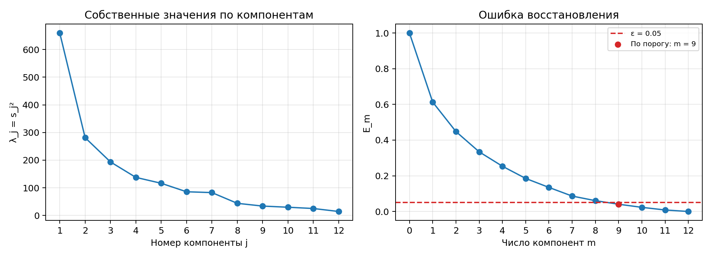

# Лабораторная работа №4. PCA

## 1. Выбор датасета для линейной регрессии

Использован Wine из `sklearn.datasets`. Выборка содержит 178 объектов. В качестве числового ответа выбрано содержание алкоголя (`alcohol`), этот столбец исключен из признаков. Для PCA остаются 12 показателей химического состава вина.

Разбиение 80/20: 142 объекта на обучение и 36 на тест. Признаки стандартизированы по среднему и стандартному отклонению обучающей выборки.

## 2. Реализация PCA через сингулярное разложение

В [fit_pca](source/algorithms.py) центрированная матрица обучающих признаков раскладывается через `np.linalg.svd`:

$$F=X-\mu=VDU^T.$$

Столбцы $U$ задают главные направления. Для снижения размерности сохраняются первые $m$ направлений, соответствующие наибольшим сингулярным числам. Новые признаки и восстановление исходных имеют вид:

$$G=(X-\mu)U_m,\qquad \widehat X=GU_m^T+\mu.$$

Для тестовой выборки используются среднее и направления, рассчитанные по train.

## 3. Определение эффективной размерности выборки

Собственные значения $F^TF$ равны квадратам сингулярных чисел $\lambda_j=s_j^2$ и пропорциональны дисперсии вдоль соответствующих главных направлений. Относительная ошибка восстановления после сохранения первых $m$ компонент равна

$$E_m=\frac{\|\widehat X-X\|_F^2}{\|X-\mu\|_F^2}=\frac{\sum_{j=m+1}^{n}\lambda_j}{\sum_{j=1}^{n}\lambda_j}.$$

Слева показан вклад отдельных компонент, справа — доля потерянной дисперсии после сохранения первых $m$ компонент.

Рассмотрен критерий крутого склона — поиск резкого спада ошибки $E_{m-1}\gg E_m$. На первых компонентах ошибка снижается быстрее, затем график становится более пологим. Четкого излома для выбора размерности не видно, поэтому этот критерий решил не использовать.

Размерность выбрана как минимальное $m$, при котором $E_m\le\varepsilon$. При $\varepsilon=0.05$ получено $m=9$, сохраняется 95.93% дисперсии обучающей выборки. Порог ошибки отмечен пунктиром.

Ошибка восстановления равна 0.0407 на train и 0.0592 на test. Порог ошибки задавался для обучающей выборки.

## 4. Эквивалентность с эталонной реализацией

Эталон — `sklearn.decomposition.PCA` с полным SVD и сохранением 95% дисперсии. Обе реализации обучены на одних данных.

| Показатель | Своя реализация | sklearn PCA |
| --- | ---: | ---: |
| Число компонент | 9 | 9 |
| Ошибка восстановления train | 0.040692 | 0.040692 |
| Ошибка восстановления test | 0.059210 | 0.059210 |

Сингулярные числа сохраненных компонент, новые признаки и восстановленные данные совпали с абсолютным допуском $10^{-10}$. При сравнении новых признаков учтен знак главных направлений, поскольку $u$ и $-u$ задают одну ось.
