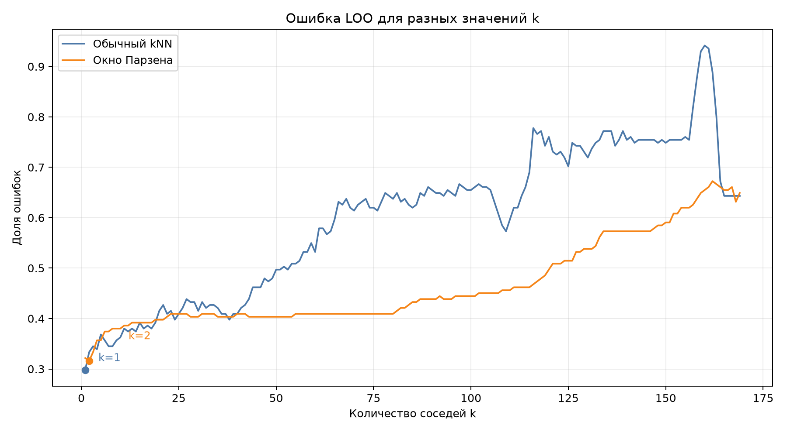
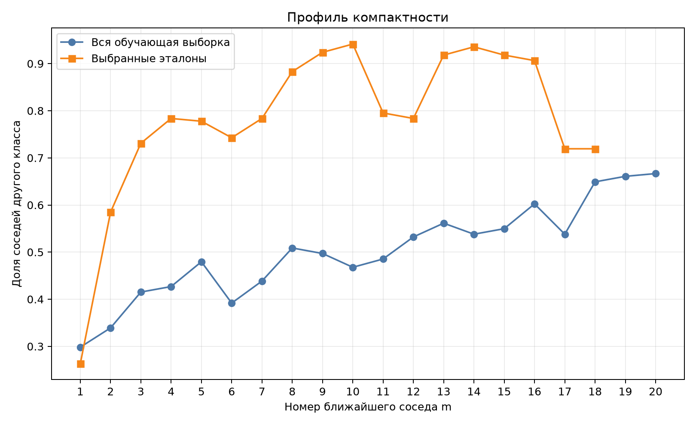
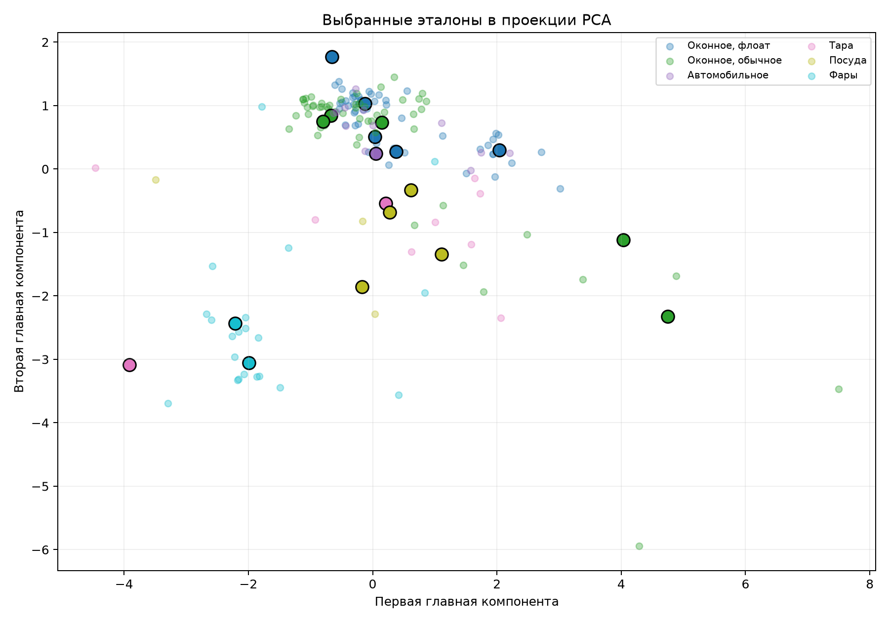
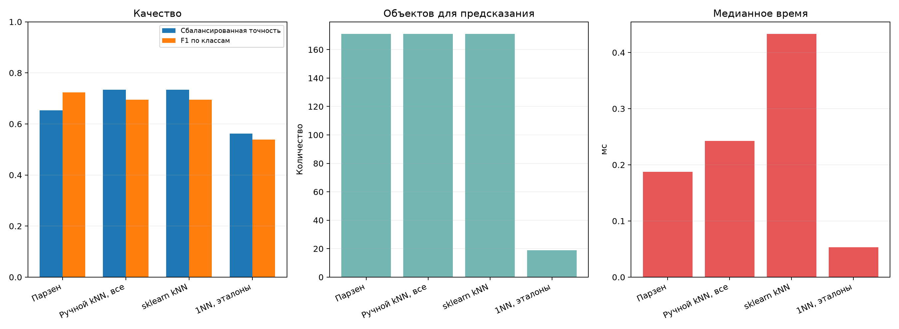

# Лабораторная работа №2. Метрическая классификация

**Студент:** Гребенщиков Д. А.
**Группа:** Р4140
**ИСУ:** 563798

## Цель работы

Реализовать обычный kNN и метод окна Парзена переменной ширины, подобрать количество соседей методом LOO и проверить влияние отбора эталонов на качество и скорость классификации.

## Данные и условия эксперимента

Использован набор [Glass Identification](https://www.kaggle.com/datasets/uciml/glass). Он содержит результаты химического анализа 214 фрагментов стекла. По девяти числовым признакам определяется один из шести типов стекла.

| Признак | Смысл |
|---|---|
| `RI` | коэффициент преломления |
| `Na` | содержание натрия |
| `Mg` | содержание магния |
| `Al` | содержание алюминия |
| `Si` | содержание кремния |
| `K` | содержание калия |
| `Ca` | содержание кальция |
| `Ba` | содержание бария |
| `Fe` | содержание железа |

Зафиксированная версия `uciml/glass/versions/1` скачивается через `kagglehub` и остаётся в системном кэше. Файл данных не хранится в репозитории.

| Тип стекла | Всего | Train | Test |
|---|---:|---:|---:|
| Оконное, флоат-обработка | 70 | 56 | 14 |
| Оконное, обычная обработка | 76 | 61 | 15 |
| Автомобильное | 17 | 14 | 3 |
| Тара | 13 | 10 | 3 |
| Посуда | 9 | 7 | 2 |
| Фары | 29 | 23 | 6 |

Условия эксперимента:

| Параметр | Значение |
|---|---|
| Разбиение | 171 train и 43 test |
| Стратификация | доли классов сохраняются |
| `random_state` | `42` |
| Масштабирование | среднее и отклонение только по train |
| Метрика расстояния | евклидова |
| Ядро Парзена | гауссово |
| Подбор `k` | LOO на train |
| Итоговые метрики | точность, сбалансированная точность, F1 по классам |
| Измерение времени | 5 прогревов, медиана 200 запусков |

Сбалансированная точность и F1 по классам учитывают качество каждого класса отдельно. Это важно, поскольку в самом маленьком классе 9 объектов, а в самом большом 76.

## Расстояние и обычный kNN

kNN относит новый объект к классу его ближайших соседей. Для сравнения объектов используется евклидово расстояние:

```text
distance(x, z) = sqrt(sum((x_j - z_j)^2))
```

`x_j` и `z_j` являются значениями одного признака у двух объектов. Чем меньше расстояние, тем сильнее похож их химический состав.

Признаки имеют разные диапазоны, поэтому перед классификацией они стандартизируются. Среднее и стандартное отклонение вычисляются только по train, чтобы информация из test не участвовала в настройке алгоритма.

Матрица расстояний рассчитывается без цикла по парам объектов:

```python
def pairwise_distances(X: np.ndarray, Z: np.ndarray) -> np.ndarray:
    squared = (
        np.sum(X**2, axis=1)[:, None]
        + np.sum(Z**2, axis=1)[None, :]
        - 2 * X @ Z.T
    )
    return np.sqrt(np.maximum(squared, 0))
```

После сортировки расстояний обычный kNN выбирает первые `k` объектов. Побеждает класс с наибольшим числом соседей.

## Окно Парзена

Обычный kNN даёт соседям одинаковые голоса. Окно Парзена учитывает расстояние: близкий объект получает больший вес, дальний меньший.

В работе используется гауссово ядро:

```text
K(r) = exp(-2 * r^2)
```

`r` является расстоянием, поделённым на ширину окна. При увеличении `r` вес быстро уменьшается.

Ширина окна определяется отдельно для каждого объекта:

```text
h(x) = distance до (k + 1)-го соседа
```

В плотной области ширина получается меньше, в разреженной больше. Параметр `k` задаёт ширину окна, но веса получают все обучающие объекты:

```python
ordered = np.sort(distances, axis=1)
bandwidth = ordered[:, k].copy()

zero_width = bandwidth <= 1e-12
if np.any(zero_width):
    ordered_zero = ordered[zero_width]
    positive = np.where(
        (ordered_zero > 1e-12) & np.isfinite(ordered_zero),
        ordered_zero,
        np.inf,
    )
    first_positive = positive.min(axis=1)
    bandwidth[zero_width] = np.where(np.isfinite(first_positive), first_positive, 1.0)

weights = gaussian_kernel(distances / bandwidth[:, None])
votes = _class_votes(labels, weights, int(labels.max()) + 1)
return votes.argmax(axis=1)
```

Для каждого класса складываются веса его объектов. Ответом становится класс с максимальной суммой. Если несколько объектов полностью совпали и ширина равна нулю, используется первое положительное расстояние.

## Подбор количества соседей

Параметр `k` подбирается методом leave-one-out. Каждый объект по очереди считается проверочным, а остальные используются как его соседи:

```text
LOO(k) = число ошибочных ответов / число объектов
```

В коде объект исключается из собственных соседей с помощью бесконечного расстояния на диагонали:

```python
distances = pairwise_distances(X, X)
np.fill_diagonal(distances, np.inf)

for k in range(1, len(X) - 1):
    prediction = _predict_parzen_from_distances(distances, y, k)
    risks.append(np.mean(prediction != y))
```



Для обычного kNN минимум равен `0.2982` при `k=1`. Для окна Парзена минимум равен `0.3158` при `k=2`. При больших `k` окно расширяется, в голосование сильнее вмешиваются объекты других классов и ошибка растёт.

## Профиль компактности

Профиль компактности показывает, как часто сосед с номером `m` относится к другому классу:

```text
Pi(m) = число объектов, у которых m-й сосед другого класса / число объектов
```

Малое значение `Pi(1)` означает, что ближайшие объекты обычно имеют одинаковый класс. Для полной обучающей выборки `Pi(1)=0.2982`. Следовательно, почти у 30% образцов ближайший сосед относится к другому типу стекла.



Кривая полной выборки постепенно растёт. Это показывает, что дальние соседи хуже соответствуют классу объекта. У выбранных эталонов первое значение ниже, но последующие быстро растут из-за малого числа эталонов и пересечения классов.

## Отбор эталонов

Эталон является объектом, который сохраняется для дальнейшей классификации. Отбор уменьшает объём хранимой выборки и число вычисляемых расстояний.

В качестве критерия используется CCV с длиной контроля `q=1`. В этом случае он равен первому значению профиля компактности:

```text
CCV_q1(prototypes) = Pi_prototypes(1)

Pi_prototypes(1) =
    число ошибок ближайшего эталона
    / число объектов
```

`prototypes` является текущим набором эталонов. Если проверяемый объект уже входит в этот набор, он исключается из собственных соседей. Поэтому критерий показывает ошибку 1NN без самообучения на проверяемом объекте.

Использовано последовательное добавление:

1. Для каждого класса выбирается объект, ближайший к центру класса
2. Проверяется добавление каждого оставшегося объекта
3. Добавляется объект с наибольшим уменьшением `CCV(q=1)`
4. Алгоритм останавливается, когда улучшения больше нет

Ключевой шаг реализован прямым перебором кандидатов:

```python
for candidate in range(len(X)):
    if candidate in prototypes:
        continue
    candidate_error = _calculate_ccv_q1(
        distances,
        y,
        [*prototypes, candidate],
    )
    if candidate_error < best_error - 1e-12:
        best_candidate = candidate
        best_error = candidate_error
```

Начальный набор содержит по одному объекту каждого класса. Для этих шести эталонов `CCV(q=1)` равен `0.5789`. После последовательного добавления осталось 19 эталонов, а критерий снизился до `0.2632`. Для сравнения, у полной обучающей выборки `Pi(1)=0.2982`.



PCA используется только для двумерного изображения. Классификация и отбор выполняются по всем девяти стандартизированным признакам.

## Результаты

| Метод | `k` | Точность | Сбалансированная точность | F1 по классам | Объектов | Время, мс |
|---|---:|---:|---:|---:|---:|---:|
| Окно Парзена | 2 | 0.7442 | 0.6532 | 0.7234 | 171 | 0.1876 |
| Ручной kNN, все объекты | 1 | 0.6977 | 0.7341 | 0.6948 | 171 | 0.2424 |
| `sklearn` kNN | 1 | 0.6977 | 0.7341 | 0.6948 | 171 | 0.4330 |
| 1NN, эталоны | 1 | 0.5581 | 0.5619 | 0.5388 | 19 | 0.0530 |



Ручной kNN и `sklearn` дали одинаковые классы для всех 43 тестовых объектов. Это подтверждает корректность расчёта расстояний и голосования.

На фиксированном разбиении окно Парзена получило наибольшую обычную точность, но обычный kNN лучше распознал малые классы и поэтому получил более высокую сбалансированную точность. Отбор эталонов сократил выборку в 9 раз и ускорил 1NN примерно в 4.6 раза, но сбалансированная точность уменьшилась с `0.7341` до `0.5619`. Жадный критерий улучшил CCV на train, но 19 эталонов оказалось недостаточно для сохранения качества на test.

В test находится только 43 объекта, а в двух малых классах осталось по два и три примера. Поэтому разница метрик относится к этому зафиксированному разбиению и может измениться при другом составе test.

## Ручная реализация

Вручную реализованы:

- евклидова матрица расстояний
- обычное голосование kNN
- гауссово ядро
- окно Парзена переменной ширины
- подбор `k` методом LOO
- профиль компактности
- последовательное добавление эталонов

`sklearn.neighbors.KNeighborsClassifier` используется только как эталон для проверки обычного kNN. PCA применяется только для изображения эталонов.

## Запуск

```bash
python -m venv .venv
source .venv/bin/activate
pip install -r students/grebenshchikov-da/lab2/requirements.txt
python students/grebenshchikov-da/lab2/source/run.py
```

При первом запуске требуется интернет для загрузки датасета. Повторные запуски используют локальный кэш `kagglehub`.

## Вывод

Ручной kNN полностью совпал с `sklearn`, а окно Парзена на фиксированном разбиении получило точность `0.7442`. Отбор оставил 19 эталонов и ускорил предсказание, но снизил качество на test, поскольку небольшое множество эталонов хуже представляет пересекающиеся классы стекла.
