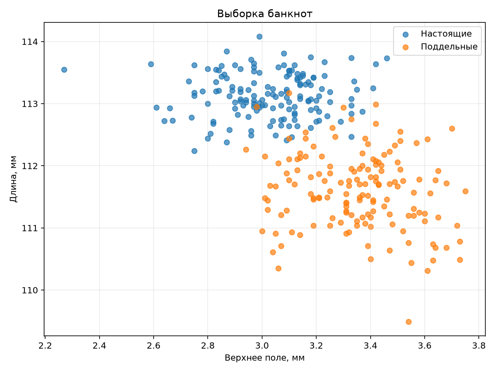
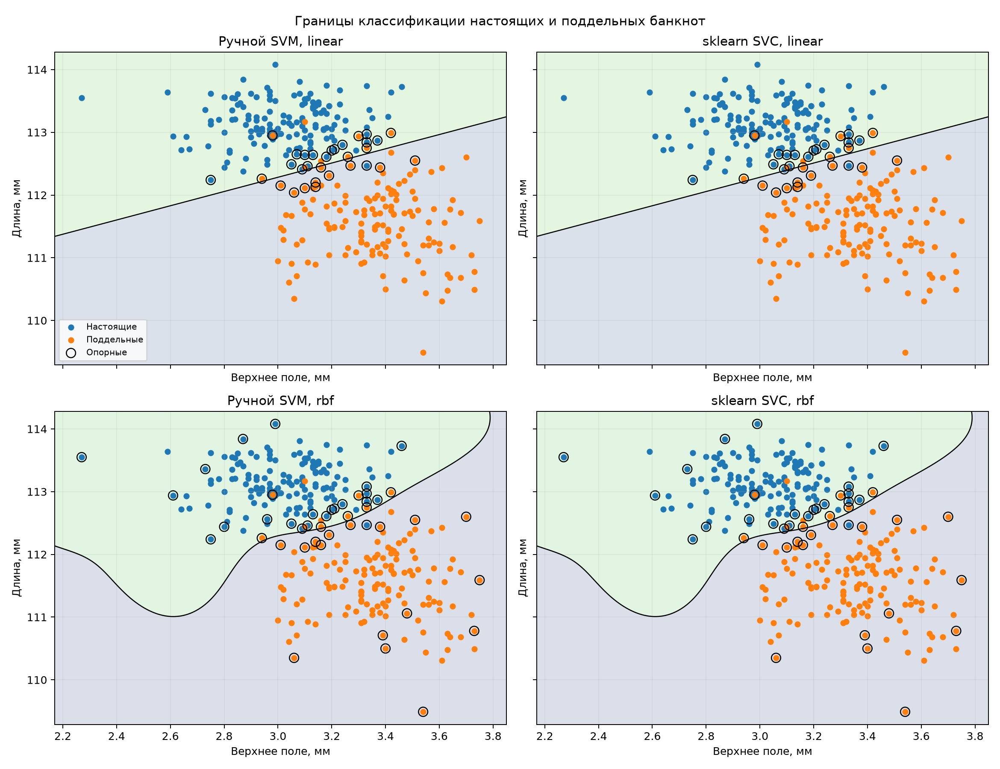

# Лабораторная работа №3. Метод опорных векторов

**Студент:** Гребенщиков Д. А.
**Группа:** Р4140
**ИСУ:** 563798

## Цель работы

Реализовать SVM через двойственную задачу, добавить линейное и RBF-ядро, визуализировать границы классов и сравнить результат с `sklearn.svm.SVC`.

## Данные и условия эксперимента

Использован набор [Fake Bills](https://www.kaggle.com/datasets/alexandrepetit881234/fake-bills) с измерениями настоящих и поддельных банкнот. В исходном файле 1500 объектов: 1000 настоящих и 500 поддельных банкнот.

Для двумерной визуализации выбраны два признака без пропусков. Это позволяет показать границу SVM в исходных измерениях без PCA и других дополнительных преобразований:

| Признак | Смысл |
|---|---|
| `margin_up` | верхнее поле банкноты в миллиметрах |
| `length` | длина банкноты в миллиметрах |

Данные загружаются автоматически через `kagglehub` и сохраняются в его системном кэше. CSV не хранится в репозитории.

Ручная двойственная задача создаёт по одной переменной на каждый обучающий объект. Для предсказуемого времени работы из исходного набора зафиксирована сбалансированная выборка из 300 банкнот. Поэтому полученные метрики относятся к этой выборке, а не к исходному соотношению классов `1000 / 500`.

| Условие | Значение |
|---|---|
| Настоящие и поддельные банкноты | 150 / 150 |
| Train / test | 225 / 75 |
| Разбиение | стратифицированное, `random_state=42` |
| Масштабирование | среднее и стандартное отклонение train |
| Ядра | линейное и RBF |
| Параметр `C` | `1.0` |
| Параметр `gamma` | `1.0` |
| Метрики | accuracy, balanced accuracy, F1 поддельных банкнот |
| Подбор параметров | не выполнялся |
| Число запусков | один фиксированный запуск |

`C=1` выбран как базовая сила штрафа. После стандартизации `gamma=1` задаёт заметное уменьшение сходства объектов уже на расстоянии около одного стандартного отклонения. Параметры не подбирались по test, поскольку эксперимент проверяет совпадение ручной и эталонной реализаций в одинаковых условиях.



Большая длина чаще встречается у настоящих банкнот, а увеличенное верхнее поле характернее для поддельных. Классы пересекаются около общей границы, поэтому часть объектов нельзя разделить без ошибок по двум выбранным признакам.

## Метод опорных векторов

SVM строит границу между классами и старается оставить около неё максимально широкий зазор. Ближайшие к границе объекты называются опорными. Именно они определяют положение границы.

В двойственной задаче для каждого обучающего объекта подбирается коэффициент `alpha`:

```text
objective(alpha) =
    0.5 * sum(alpha_i * alpha_j * y_i * y_j * K(x_i, x_j))
    - sum(alpha_i)

0 <= alpha_i <= C
sum(alpha_i * y_i) = 0
```

`x_i` и `y_i` обозначают признаки и класс объекта. `alpha` является множителем Лагранжа, который также обозначают буквой `lambda`. `K` является ядром, а `C` ограничивает влияние отдельного объекта. Ненулевые `alpha` соответствуют опорным объектам.

Функция и ограничения передаются в `scipy.optimize.minimize`:

```python
def objective(alpha: np.ndarray) -> float:
    return float(0.5 * alpha @ Q @ alpha - np.sum(alpha))

constraint = {
    "type": "eq",
    "fun": lambda alpha: alpha @ y,
    "jac": lambda alpha: y,
}
result = minimize(
    objective,
    np.zeros(len(X)),
    jac=gradient,
    bounds=[(0.0, C)] * len(X),
    constraints=constraint,
    method="SLSQP",
)
```

Полная реализация находится в [`source/svm.py`](source/svm.py).

### Линейное ядро

Линейное ядро вычисляет скалярное произведение двух объектов:

```text
K(x, z) = x @ z
```

После оптимизации коэффициентов линейный классификатор можно записать через вектор весов:

```text
w = sum(alpha_i * y_i * x_i)
f(x) = x @ w + b
```

Класс определяется знаком `f(x)`. Неотрицательное значение соответствует настоящей банкноте, отрицательное значение соответствует поддельной.

```python
coefficients = alpha[support_mask] * y[support_mask]
weights = X[support_mask].T @ coefficients

return X @ model["weights"] + model["bias"]
```

### RBF-ядро

Ядерный трюк заменяет скалярное произведение функцией ядра. Благодаря этому SVM может построить нелинейную границу без явного создания новых признаков. В работе используется RBF-ядро:

```text
K(x, z) = exp(-gamma * ||x - z||^2)
```

Чем ближе два объекта, тем ближе значение ядра к единице. Для удалённых объектов значение приближается к нулю.

```python
distances = (
    np.sum(X**2, axis=1)[:, None]
    + np.sum(Z**2, axis=1)[None, :]
    - 2 * X @ Z.T
)
return np.exp(-gamma * np.maximum(distances, 0))
```

Предсказание строится только по опорным объектам:

```text
f(x) = sum(alpha_i * y_i * K(x_i, x)) + b
```

## Результаты

Ручная и эталонная модели обучались на одинаковых стандартизированных данных с одинаковыми `C` и `gamma`.

| Ядро | Реализация | Accuracy | Balanced accuracy | F1 поддельных | Опорных объектов |
|---|---|---:|---:|---:|---:|
| Линейное | ручная | 0.9600 | 0.9605 | 0.9589 | 31 |
| Линейное | `sklearn` | 0.9600 | 0.9605 | 0.9589 | 31 |
| RBF | ручная | 0.9600 | 0.9605 | 0.9589 | 45 |
| RBF | `sklearn` | 0.9600 | 0.9605 | 0.9589 | 45 |

Для обоих ядер предсказания ручной реализации и `sklearn` совпали на всех 75 тестовых объектах. Максимальная разница значений решающей функции составила `9.3e-6` для линейного ядра и `7.2e-6` для RBF. Численная ошибка ограничения `sum(alpha_i * y_i) = 0` составила около `2.5e-12`.



Граница строится по непрерывному значению `f(x)`, линия соответствует уровню `f(x) = 0`. Линейные границы ручного SVM и `sklearn` визуально совпадают. RBF использует больше опорных объектов, но на зафиксированной тестовой выборке это не изменило итоговые метрики.

## Ручная реализация

Вручную реализованы:

- линейное и RBF-ядро
- двойственная целевая функция и её градиент
- ограничения на коэффициенты `alpha`
- поиск опорных объектов
- расчёт свободного коэффициента
- линейный вектор весов
- решающая функция и получение класса

`sklearn.svm.SVC` используется только как эталон для проверки.

## Запуск

```bash
python -m venv .venv
source .venv/bin/activate
pip install -r students/grebenshchikov-da/lab3/requirements.txt
python students/grebenshchikov-da/lab3/source/run.py
```

При первом запуске требуется подключение к интернету. Датасет автоматически загружается из Kaggle, после чего используется локальная кэшированная копия.

## Вывод

Ручной SVM для обоих ядер дал те же классы и количество опорных объектов, что и `sklearn`, при разнице `f(x)` не более `1e-5`. RBF-ядро построило более сложную границу, но на выбранных признаках не улучшило balanced accuracy относительно линейного ядра.
