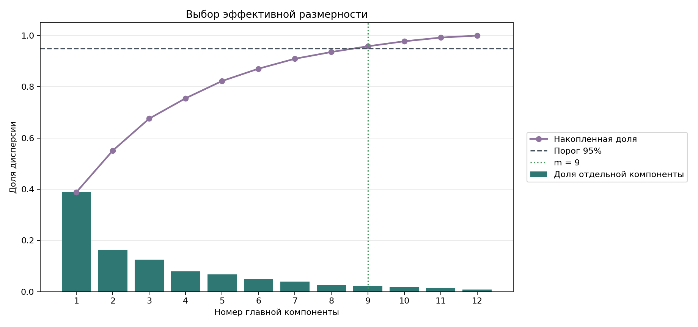
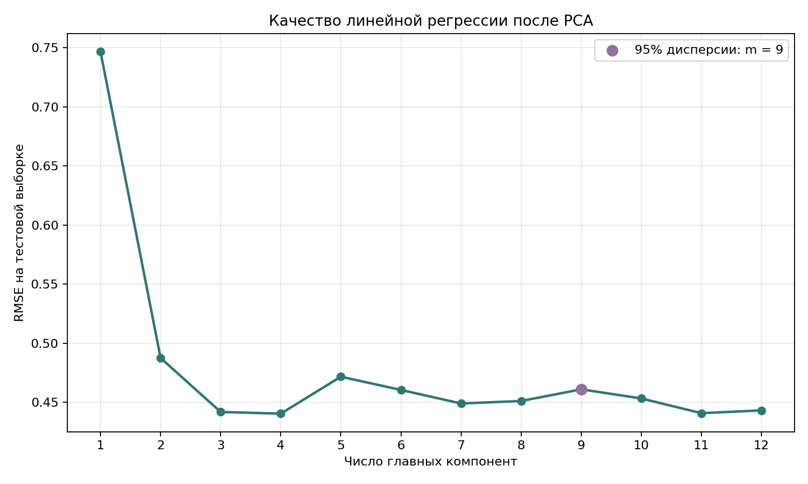

# Лабораторная работа №4. Метод главных компонент

**Студент:** Гребенщиков Д. А.  
**Группа:** Р4140  
**ИСУ:** 563798

## Цель работы

Реализовать метод главных компонент через сингулярное разложение, определить
эффективную размерность данных и проверить результат сравнением с
`sklearn.decomposition.PCA`.

## Данные и условия эксперимента

Использован встроенный набор `load_wine` из `sklearn`. Он содержит результаты
химического анализа 178 образцов вина и 13 числовых показателей. Для задачи
регрессии показатель `alcohol` выбран целевой переменной, остальные 12
показателей используются как признаки. Исходный класс вина в работе не
используется.

| Условие | Значение |
|---|---:|
| Обучающая выборка | 133 объекта |
| Тестовая выборка | 45 объектов |
| Фиксация разбиения | `random_state=42` |
| Порог сохранённой дисперсии | 95% |
| Эталон | `sklearn.decomposition.PCA` |
| Метрики регрессии | RMSE и R2 |

Среднее и стандартное отклонение рассчитаны только по обучающей выборке. Этими
же значениями стандартизована тестовая часть, поэтому информация из неё не
влияет на подготовку модели.

## Ход работы

1. Подготовить признаки и разделить данные.
2. Построить главные компоненты через SVD.
3. Выбрать минимальное число компонент для сохранения 95% дисперсии.
4. Проверить восстановление и ортогональность компонент.
5. Сравнить собственный PCA с реализацией из `sklearn`.
6. Оценить линейную регрессию при разном числе компонент.

## PCA и ручная реализация

PCA заменяет исходные признаки новыми координатами. Первая компонента описывает
наибольший разброс данных. Каждая следующая компонента описывает оставшийся
разброс и перпендикулярна предыдущим.

Сначала признаки центрируются:

```text
X_centered = X - mean
```

`X` содержит объекты, `mean` содержит среднее каждого признака. Центрирование
переносит облако объектов в начало координат.

Затем выполняется сингулярное разложение:

```text
X_centered = U @ diag(s) @ V.T
```

`s` содержит сингулярные числа. Строки `V.T` задают направления главных
компонент и уже расположены от наиболее значимой к наименее значимой.

Дисперсия компонент рассчитывается так:

```text
variance_j = s_j^2 / (n - 1)
variance_ratio_j = variance_j / sum(variance)
```

`n` является числом объектов, `j` является номером компоненты.
`variance_ratio_j` показывает долю общего разброса вдоль этой компоненты.

В коде PCA строится напрямую через SVD:

```python
mean = X.mean(axis=0)
# Центрируем признаки перед SVD
centered = X - mean

# Строки Vt задают направления главных компонент
_, singular_values, components = np.linalg.svd(centered, full_matrices=False)
# Квадраты сингулярных чисел задают дисперсию компонент
explained_variance = singular_values**2 / (len(X) - 1)
explained_variance_ratio = explained_variance / explained_variance.sum()
```

Для снижения размерности сохраняются первые `m` компонент:

```text
Z_m = X_centered @ V_m.T
X_restored = Z_m @ V_m + mean
```

`Z_m` содержит новые признаки. `X_restored` является приближённым
восстановлением исходной матрицы.

```python
def transform(self, X: np.ndarray, n_components: Optional[int] = None) -> np.ndarray:
    """Переводит объекты в координаты главных компонент"""
    count = len(self.components) if n_components is None else n_components
    return (X - self.mean) @ self.components[:count].T

def inverse_transform(self, projection: np.ndarray) -> np.ndarray:
    """Восстанавливает признаки по сохранённым компонентам"""
    count = projection.shape[1]
    return projection @ self.components[:count] + self.mean
```

Вручную реализованы центрирование, расчёт дисперсии, выбор размерности,
проекция, восстановление и его ошибка. Сингулярное разложение вычисляется через
`numpy.linalg.svd`. Полный код находится в [`source/pca.py`](source/pca.py).

## Определение эффективной размерности

Эффективной считается минимальная размерность, которая сохраняет не менее 95%
общей дисперсии. Потерянная доля определяется так:

```text
E_m = 1 - sum(variance_ratio_1 ... variance_ratio_m)
```

Восемь компонент сохраняют 93,57% дисперсии и не достигают порога. Девять
компонент сохраняют 95,81%.

```text
E_9 = 1 - 0.9581 = 0.0419
```

Эффективная размерность равна 9 вместо исходных 12 признаков. Относительная
ошибка восстановления составляет 0,0419.



Последние три компоненты вместе объясняют около 4,19% общей дисперсии.

## Сравнение с эталонным PCA

Собственная реализация и `sklearn.decomposition.PCA` обучены на одной матрице.
Векторы `v` и `-v` задают одно направление, поэтому перед сравнением их знаки
согласованы по скалярному произведению.

| Проверка | Максимальное расхождение |
|---|---:|
| Ортогональность собственных компонент | `8,88e-16` |
| Восстановление по всем компонентам | `2,89e-15` |
| Компоненты относительно `sklearn` | `0` |
| Доли дисперсии относительно `sklearn` | `0` |

Расхождения находятся на уровне точности вычислений с плавающей точкой. Это
подтверждает эквивалентность реализаций на выбранных данных.

## Применение к линейной регрессии

Линейная регрессия обучалась на проекциях с размерностью от 1 до 12.
Коэффициенты вычислялись через `numpy.linalg.lstsq`. Качество измерялось на
тестовой выборке.

| Число компонент | RMSE | R2 |
|---:|---:|---:|
| 4 | 0,440 | 0,655 |
| 8 | 0,451 | 0,638 |
| 9 | 0,461 | 0,622 |
| 12 | 0,443 | 0,651 |



При девяти компонентах RMSE отличается от результата на всех компонентах на
0,018. Лучшее значение в этом разбиении получено при четырёх компонентах, но оно
не используется для выбора эффективной размерности. PCA учитывает разброс
признаков и не использует целевую переменную.

## Запуск

```bash
cd students/grebenshchikov-da/lab4
python -m venv .venv
source .venv/bin/activate
pip install -r requirements.txt
python source/run.py
```

Скрипт рассчитывает результаты, проверяет реализацию и строит оба графика.

## Вывод

Собственный PCA совпал с `sklearn` с точностью вычислений с плавающей точкой.
Для сохранения 95% дисперсии достаточно 9 из 12 компонент, при этом RMSE
линейной регрессии увеличился с 0,443 до 0,461.
