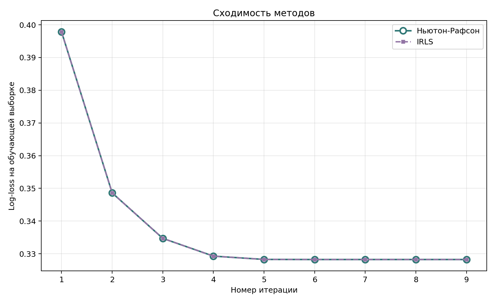
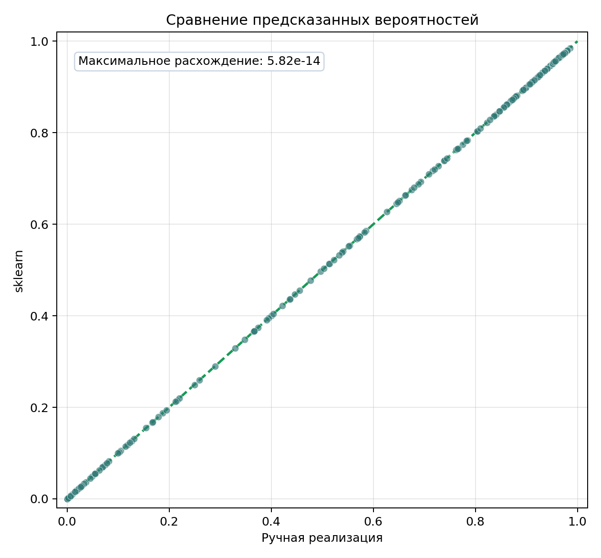

# Лабораторная работа №5. Логистическая регрессия

**Студент:** Гребенщиков Д. А.
**Группа:** Р4140
**ИСУ:** 563798

## Цель работы

Реализовать логистическую регрессию методами Ньютона-Рафсона и IRLS, проверить
эквивалентность методов и сравнить результат с эталонной реализацией из
`sklearn`.

## Данные и условия эксперимента

Набор `Raisin` загружается из репозитория UCI функцией
`fetch_ucirepo(id=850)`. Он содержит 900 объектов и 7 числовых признаков:
площадь, периметр, длины осей и характеристики формы. Пропусков в данных нет.
Каждый класс содержит по 450 объектов.

Класс `Kecimen` закодирован единицей и считается положительным. Класс `Besni`
закодирован нулём.

| Условие | Значение |
|---|---:|
| Обучающая выборка | 675 объектов |
| Тестовая выборка | 225 объектов |
| Фиксация разбиения | `random_state=42` |
| Стратификация | по целевому классу |
| Начальные веса | нулевые |
| Максимальное число итераций | 100 |
| Критерий остановки | изменение весов меньше `1e-10` |
| Порог классификации | 0,5 |
| Эталон | `sklearn.linear_model.LogisticRegression` |

Среднее и стандартное отклонение рассчитаны только по обучающей выборке. Этими
же значениями стандартизована тестовая часть, поэтому она не влияет на
подготовку модели.

## Логистическая регрессия

Модель сначала вычисляет линейный ответ объекта:

```text
eta = X @ w
```

`X` содержит признаки объектов, `w` содержит веса. В матрицу `X` добавлен
столбец единиц, чтобы первый вес выполнял роль свободного члена.

Сигмоида переводит линейный ответ в вероятность положительного класса:

```text
p = 1 / (1 + exp(-eta))
```

Вероятность находится в диапазоне от 0 до 1. При `p >= 0.5` объект относится к
классу `Kecimen`.

Качество весов оценивается средней логистической ошибкой:

```text
loss = mean(log(1 + exp(eta)) - y * eta)
```

`y` содержит правильные классы. В коде выражение вычисляется через
`numpy.logaddexp`, чтобы избежать переполнения и `log(0)` при больших по модулю
значениях `eta`.

## Метод Ньютона-Рафсона

Метод использует градиент и матрицу вторых производных, чтобы на каждой
итерации определить изменение весов:

```text
gradient = X.T @ (p - y) / n
W_ii = p_i * (1 - p_i)
H = X.T @ W @ X / n

w_new = w - solve(H, gradient)
```

`n` является числом обучающих объектов. `gradient` задаёт направление изменения
ошибки. Матрица `H` учитывает её кривизну, поэтому метод может сразу выбирать
величину шага.

В ручной реализации вычисляются вероятности, градиент и матрица `H`, после чего
решается линейная система:

```python
probabilities = stable_sigmoid(X @ weights)
diagonal_weights = probabilities * (1.0 - probabilities)
diagonal_weights = np.clip(diagonal_weights, 1e-12, None)

gradient = X.T @ (probabilities - y) / sample_count
hessian = X.T @ (X * diagonal_weights[:, None]) / sample_count
step = _solve_linear_system(hessian, gradient)
updated_weights = weights - step
```

Ограничение диагональных весов снизу защищает вычисления в случае очень
уверенного предсказания. Если матрица вырождена, вместо `numpy.linalg.solve`
используется `numpy.linalg.lstsq`. Полная реализация находится в
[`source/logistic_regression.py`](source/logistic_regression.py).

## Метод IRLS

IRLS представляет ту же задачу как последовательность взвешенных линейных
регрессий. На каждой итерации строится рабочий отклик:

```text
working_response = X @ w + (y - p) / diag(W)

w_new = solve(
    X.T @ W @ X,
    X.T @ W @ working_response
)
```

Объекты с вероятностью около 0,5 получают больший вес. Для них модель пока менее
уверена и изменение параметров сильнее влияет на результат.

```python
working_response = scores + (y - probabilities) / diagonal_weights
normal_matrix = X.T @ (X * diagonal_weights[:, None]) / sample_count
right_side = X.T @ (diagonal_weights * working_response) / sample_count
updated_weights = _solve_linear_system(normal_matrix, right_side)
```

Подстановка рабочего отклика показывает связь с методом Ньютона:

```text
X.T @ W @ working_response = X.T @ W @ X @ w + X.T @ (y - p)

w_new = w - solve(X.T @ W @ X, X.T @ (p - y))
```

Получается тот же шаг, что и в методе Ньютона. Оба метода начинают с одинаковых
нулевых весов и используют один критерий остановки.

## Эквивалентность методов

Значение log-loss сохранено после каждой итерации обучения.



Обе кривые совпадают. Методы достигли итогового обучающего log-loss `0,3283` за
9 итераций. Максимальное расхождение весов составило `2,89e-12`.

## Сравнение с эталонной реализацией

Эталонная модель обучена на тех же стандартизованных данных. Свободный член уже
включён в матрицу признаков, поэтому у `sklearn` указан параметр
`fit_intercept=False`. Регуляризация отключена через `penalty=None`, чтобы все
три реализации решали одну задачу.

| Метод | Точность | Сбалансированная точность | F1 | Логистическая ошибка | ROC-AUC | Итерации |
|---|---:|---:|---:|---:|---:|---:|
| Ньютон-Рафсон | 0,8711 | 0,8713 | 0,8766 | 0,3864 | 0,9297 | 9 |
| IRLS | 0,8711 | 0,8713 | 0,8766 | 0,3864 | 0,9297 | 9 |
| `sklearn` | 0,8711 | 0,8713 | 0,8766 | 0,3864 | 0,9297 | 8 |



Точки лежат на диагонали. Максимальное расхождение вероятностей ручной модели и
`sklearn` равно `5,82e-14`. Веса отличаются не более чем на `1,12e-12`, а
предсказанные классы полностью совпадают.

## Запуск

```bash
cd students/grebenshchikov-da/lab5
python -m venv .venv
source .venv/bin/activate
pip install -r requirements.txt
python source/run.py
```

Скрипт загружает набор данных из UCI, обучает три модели, проверяет совпадение
результатов, выводит метрики и строит оба графика. Для первого запуска требуется
подключение к интернету.

## Вывод

Методы Ньютона-Рафсона и IRLS сошлись за 9 итераций и дали одинаковые веса с
расхождением `2,89e-12`. Вероятности ручной реализации совпали с `sklearn` до
`5,82e-14`, поскольку модели решали одну задачу без регуляризации.
