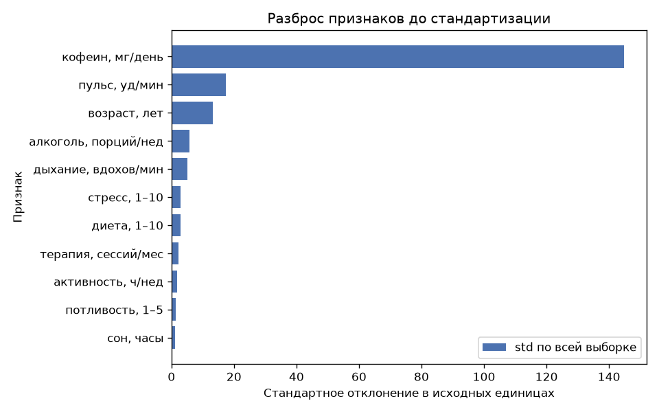
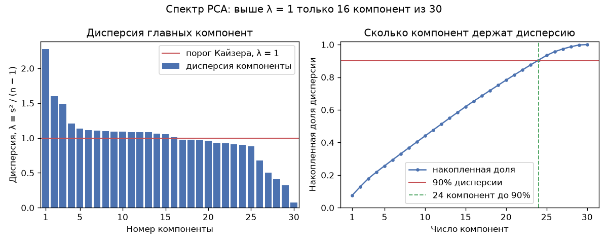
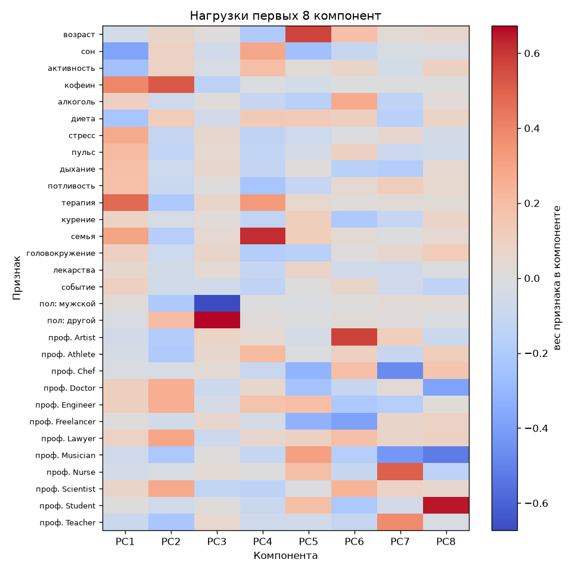
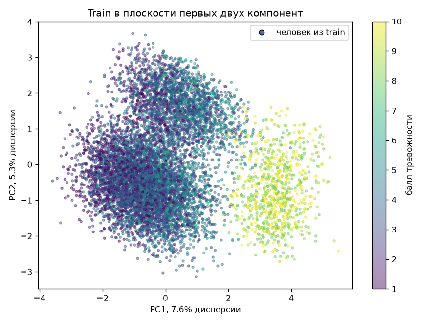

# Лабораторная 4. PCA

Датасет — [Social Anxiety](https://www.kaggle.com/datasets/natezhang123/social-anxiety-dataset), файл `enhanced_anxiety_dataset.csv`: 11 000 человек, цель — балл тревожности от 1 до 10. Это регрессия. CSV в репозиторий не кладётся.

Из каталога `lab4`:

```bash
pip install numpy pandas matplotlib seaborn scikit-learn scipy kagglehub
python source/data.py
python source/pca.py
```

`data.py` готовит матрицу. `pca.py` считает PCA через SVD и сверяет его с `sklearn.decomposition.PCA`.

## Данные

Пропусков нет. Средний балл 3.93, медиана 4. Сильнее всего с целью связаны стресс (корреляция 0.67), сессии терапии (0.52), сон (−0.49) и кофеин (0.35). Между собой признаки связаны слабо: максимум −0.31 у сна и терапии.

Кофеин измерен в миллиграммах, сон — в часах. Без стандартизации первая ось PCA была бы осью кофеина. `prepare_data` учит `StandardScaler` только на train.



Дальше матрица 8800×30 на train и 2200×30 на test. Yes/No записаны как 1/0, пол и профессия — one-hot без первого уровня (опорные категории Female и Other). Иначе dummy дают точный нуль в спектре. Цель в матрицу не входит. SVD строится по train, test только проецируется.

## PCA через SVD

Центрируем столбцы и раскладываем `X = U diag(s) Vᵀ`. Строки `Vᵀ` — оси. Дисперсия компоненты `λ = s² / (n − 1)`, доля дисперсии `s² / Σ s²`. Знак оси выбирается так же, как в sklearn: самая большая по модулю нагрузка положительна.

Первая компонента берёт 7.6% дисперсии при равной доле `1/30 ≈ 3.3%`. Её дисперсия `λ = 2.27`. Минимальная `λ = 0.072`, минимальное сингулярное число 25.2: матрица полного ранга 30, нулевой компоненты нет.



Эффективная размерность по правилу Кайзера — **16 из 30**. После стандартизации у каждого исходного столбца дисперсия 1, поэтому компонента с `λ ≤ 1` не несёт больше одного столбца. Эти 16 компонент держат только 65.3% дисперсии. Колена, на котором спектр обрывается, нет: самый большой разрыв сингулярных чисел стоит между 29-й и 30-й (отношение 2.11). Чтобы сохранить 90% разброса, нужно оставить 24 оси из 30.

| Правило | Компонент | Доля дисперсии |
|---|---:|---:|
| Кайзер, λ > 1 | 16 | 65.3% |
| накопленные 90% | 24 | 90.5% |
| накопленные 95% | 26 | 95.7% |
| коэффициент участия `(Σλ)² / Σλ²` | 26.1 | — |

Правило Кайзера здесь ещё считает оси, которые появились из кодировки. PC1 — общая ось терапии, кофеина и сна. PC3 противопоставляет пол. С PC6 по PC15 компоненты почти целиком состоят из профессий: после `StandardScaler` такой столбец имеет ту же дисперсию, что и стресс, и PCA выносит его отдельно.



PC1: терапия +0.48, кофеин +0.39, сон −0.38, семейная история +0.30, стресс +0.27. С баллом тревожности эта проекция коррелирует на 0.71, хотя цель в разложение не входила. PC2 коррелирует с баллом на −0.12.



На плоскости два облака. Справа балл около 8–10, слева 1–7. Это тот же скачок, что у сна и числа сессий терапии: до балла 7 сон держится около 6.5–7 часов, с балла 8 падает примерно к 4.5. PC1 собрала этот скачок в одну ось.

## Сверка со sklearn

Обе модели учились на том же `X_train`. Знак каждой оси перед вычитанием выровнен по скалярному произведению, чтобы переворот не считался ошибкой. У `PCA(svd_solver="full")` расхождение нулевое на сингулярных числах, долях дисперсии и осях: это тот же SVD. Проекция test отличается на уровне `10⁻¹⁵`.

`PCA()` на этой матрице сам выбирает `covariance_eigh`, потому что объектов больше, чем `10 × число признаков`. Собственные векторы ковариации совпадают с правыми сингулярными векторами. Расхождение осей `1.6·10⁻¹¹`, проекции test `6.8·10⁻¹¹`.

| | `svd_solver="full"` | `PCA()`, eigh ковариации |
|---|---:|---:|
| сингулярные числа | 0 | — |
| доля дисперсии | 0 | 5.6·10⁻¹⁶ |
| оси | 0 | 1.6·10⁻¹¹ |
| проекция train | 1.8·10⁻¹⁵ | — |
| проекция test | 1.3·10⁻¹⁵ | 6.8·10⁻¹¹ |
