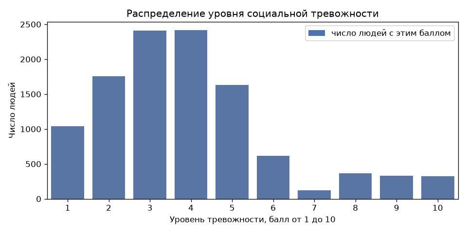
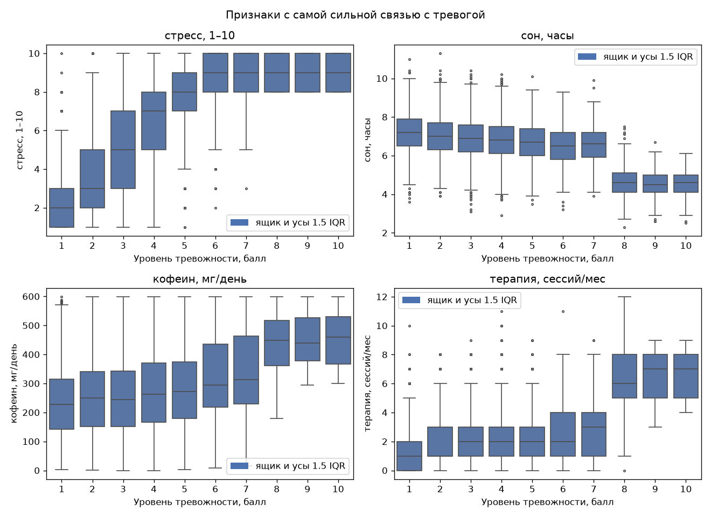
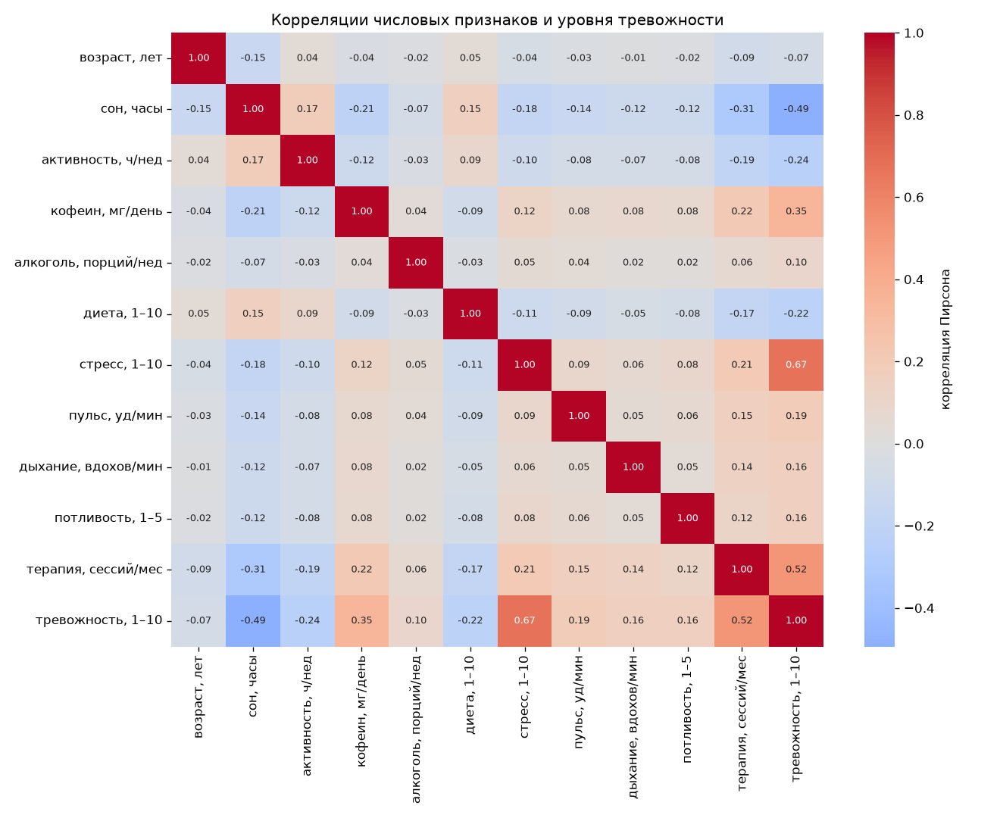
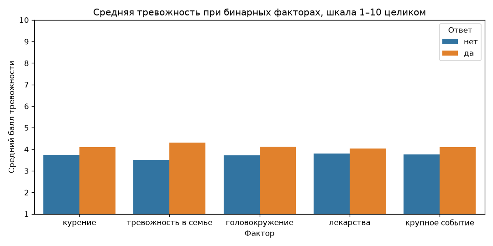
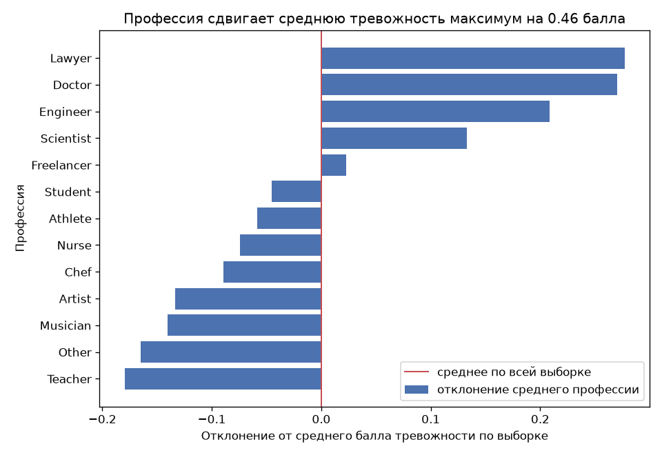

# Лабораторная 4. PCA

Датасет: [Social Anxiety Dataset](https://www.kaggle.com/datasets/natezhang123/social-anxiety-dataset), файл `enhanced_anxiety_dataset.csv`. 11 000 человек, 18 признаков и цель. Цель — `Anxiety Level (1-10)`, балл социальной тревожности от 1 до 10. Это регрессия: балл не переводится в классы.

В архиве Kaggle лежит ещё `family_anxiety_14_dataset.csv` с теми же колонками и другими строками. В работе он не используется.

CSV в репозиторий не кладётся. Из каталога `lab4`:

```bash
pip install numpy pandas matplotlib seaborn scikit-learn kagglehub
python source/data.py
```

`kagglehub` нужен только чтобы скачать файл. Если CSV уже лежит в `lab4/enhanced_anxiety_dataset.csv`, скрипт читает его с диска. Алгоритм PCA этим пакетом не считается.

`source/data.py` делает EDA и собирает матрицу для SVD. Самого разложения здесь нет.

## Признаки и цель

Пропусков нет, дубликатов строк нет, колонки-идентификатора нет.

| Группа | Колонки | Зачем так читать |
|---|---|---|
| образ жизни | сон, активность, кофеин, алкоголь, диета, курение, возраст, пол, профессия | измеряются отдельно от балла тревожности |
| состояние рядом с целью | стресс, пульс, дыхание, потливость, головокружение | сняты в тот же момент, что и цель |
| следствие тревожности | сессии терапии, лекарства, крупное событие, семейная история | терапия и лекарства часто появляются уже после тревоги |

Стресс коррелирует с целью на 0.67. Сессии терапии — на 0.52. Для предсказания это сильные столбцы, для интерпретации «что вызывает тревогу» — опасные: модель легко выучит симптом вместо причины. В матрицу они включены. Перед регрессией реши, оставлять ли их.

Балл тревожности целый, от 1 до 10, хотя в файле записан как float. Линейная регрессия считает его непрерывным. Сверху шкала упирается в 10, снизу в 1, поэтому остатки у краёв будут несимметричными.

## EDA

Средний балл 3.93, медиана 4, стандартное отклонение 2.12. Масса людей на баллах 2–5. Балл 7 встречается 123 раза, соседние 6 и 8 — 616 и 363. Это провал в середине хвоста, а не пропуск: строка заполнена.



Правило 1.5 IQR помечает 322 человека с баллом 10. Это весь потолок шкалы, распределение скошено вправо, и ящик считает хвост выбросом. Эти строки остаются. По признакам правило задевает сон (110 человек, 1.0%), активность (56, 0.5%) и число сессий терапии (178, 1.6%). Их тоже оставляем: крайние значения правдоподобны.

### Масштаб

Стандартные отклонения в исходных единицах, по всей выборке (`ddof=0`):

| Признак | std |
|---|---:|
| кофеин, мг/день | 144.81 |
| пульс, уд/мин | 17.33 |
| возраст, лет | 13.24 |
| алкоголь, порций/нед | 5.69 |
| дыхание, вдохов/мин | 5.16 |
| стресс, 1–10 | 2.93 |
| диета, 1–10 | 2.90 |
| терапия, сессий/мес | 2.18 |
| активность, ч/нед | 1.83 |
| потливость, 1–5 | 1.40 |
| сон, часы | 1.23 |

Кофеин измерен в миллиграммах, сон — в часах. В евклидовой геометрии PCA первая ось без стандартизации почти целиком станет осью кофеина, даже если по смыслу важнее стресс. Поэтому `prepare_data` приводит каждый столбец train к среднему 0 и std 1.


### Связь с целью и друг с другом

Корреляция с баллом тревожности:

| Признак | Пирсон | Спирмен |
|---|---:|---:|
| стресс | 0.668 | 0.721 |
| сессии терапии | 0.518 | 0.331 |
| сон | −0.494 | −0.351 |
| кофеин | 0.351 | 0.282 |
| активность | −0.243 | −0.181 |
| диета | −0.220 | −0.151 |
| пульс | 0.189 | 0.126 |
| потливость | 0.160 | 0.108 |
| дыхание | 0.157 | 0.101 |
| алкоголь | 0.101 | 0.073 |
| возраст | −0.074 | −0.029 |

У стресса ранговая связь сильнее линейной: балл растёт вместе со стрессом и наверху шкалы упирается в потолок. У сна и терапии наоборот. На ящиках виден скачок, а не прямая: до балла 7 сон держится около 6.5–7 часов и терапия около 2 сессий, с балла 8 сон падает примерно к 4.5 часам, а терапия поднимается примерно к 7 сессиям. Пирсон этот скачок растягивает в одну прямую. Линейная модель сон увидит, но остатки у баллов 8–10 будут систематическими.



Между самими признаками тесной связи нет. Самая большая по модулю корреляция — сон и терапия, −0.31. Остальные пары слабее 0.22. Облако уже почти выровнено по осям координат. PCA ищет общие направления разброса; если столбцы почти ортогональны, сингулярные числа будут близки друг к другу и «колено» на графике может не появиться. Это возможный честный итог, а не повод менять датасет до расчёта.



PCA цель не видит. После стандартизации стресс и возраст имеют одну и ту же дисперсию 1, хотя с тревогой они связаны совсем по-разному. Первая компонента — направление самого большого разброса `X`, а не лучший предиктор балла.

Пол на среднее почти не влияет: Female 3.931, Male 3.934, Other 3.923.

Бинарные факторы сдвигают средний балл меньше, чем стресс. Самый заметный — тревожность в семье: 3.50 без неё и 4.31 с ней.

| Фактор | среднее при No | среднее при Yes |
|---|---:|---:|
| курение | 3.747 | 4.094 |
| тревожность в семье | 3.498 | 4.310 |
| головокружение | 3.726 | 4.121 |
| лекарства | 3.806 | 4.046 |
| крупное событие | 3.760 | 4.092 |



Профессии от Teacher (3.75) до Lawyer (4.21). Размах средних 0.46 балла при стандартном отклонении цели 2.12. Двенадцать dummy-столбцов профессии добавляют размерность, а средний балл почти не двигают. После `StandardScaler` у каждого такого столбца std тоже станет 1, и PCA может потратить на них компоненты.



## Подготовленная матрица

`prepare_data()` возвращает словарь с `X_train`, `X_test`, `y_train`, `y_test`, списком столбцов и обученным `StandardScaler`.

- Разбиение 80/20, `random_state=42`, стратификация по целому баллу, чтобы редкий балл 7 попал и в train, и в test. Получилось 8800 и 2200 строк.
- Yes/No кодируются как 1/0.
- Пол и профессия — one-hot без первого уровня. Опорные категории: Female и Other. Иначе каждый набор dummy суммируется в столбец единиц, и одно сингулярное число становится нулём из-за кодировки, а не из-за данных.
- Scaler учится только на train. Среднее train после него порядка `10⁻¹⁶`, std (`ddof=0`) равен 1. Среднее test по столбцам доходит до 0.057 по модулю: на test преобразование только применяется.
- Цель в `X` не входит. `as_numpy()` отдаёт четыре массива `float` для SVD.
- В матрице 30 столбцов: 11 числовых, 5 бинарных, `gender_Male`, `gender_Other` и 12 профессий.

Дальше SVD нужно строить по `X_train`. Проекцию `X_test` считать уже найденными осями.

## Что осталось сделать

1. PCA через сингулярное разложение центрированной матрицы `X_train`. Доля дисперсии компоненты — это квадрат её сингулярного числа, делённый на сумму квадратов. Само сингулярное число долей дисперсии не является.
2. Эффективная размерность. Правило выбери сам и запиши его до того, как посмотришь на график: накопленная доля, порог на собственное число или что-то ещё. Обоснуй, почему оно подходит к почти некоррелированным столбцам.
3. Сравнение с `sklearn.decomposition.PCA` на той же матрице. Знак оси PCA не определён: если первая ненулевая координата разошлась, свой вектор можно умножить на −1 и сравнить снова. Проекции test тоже сравниваются с эталоном, обученным на train.
4. Дописать этот отчёт: график сингулярных чисел, выбранная размерность, таблица расхождения со sklearn.
