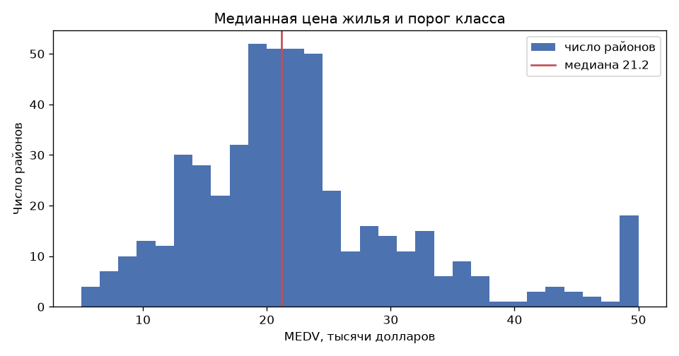
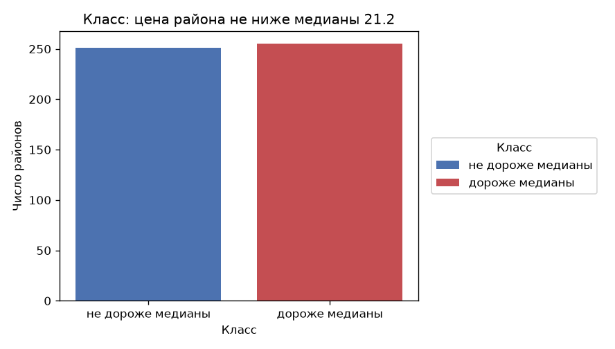
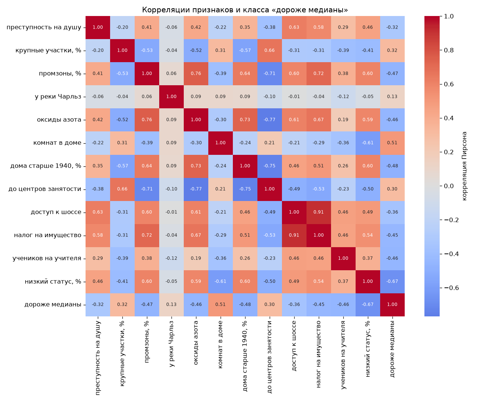
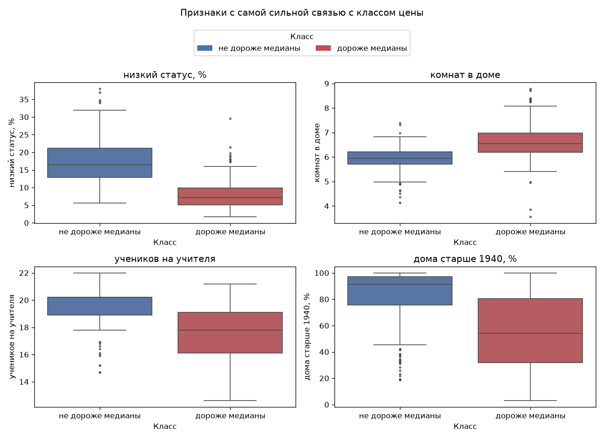
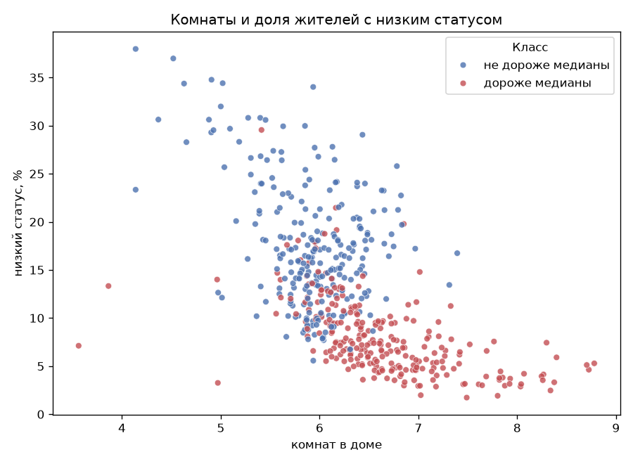
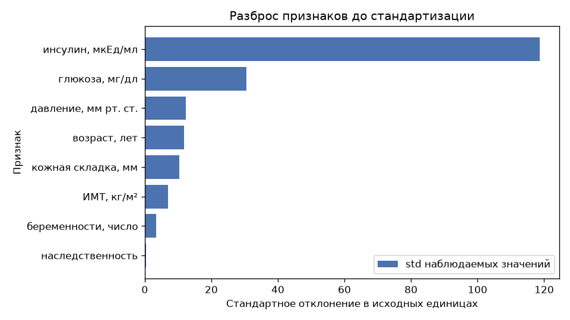
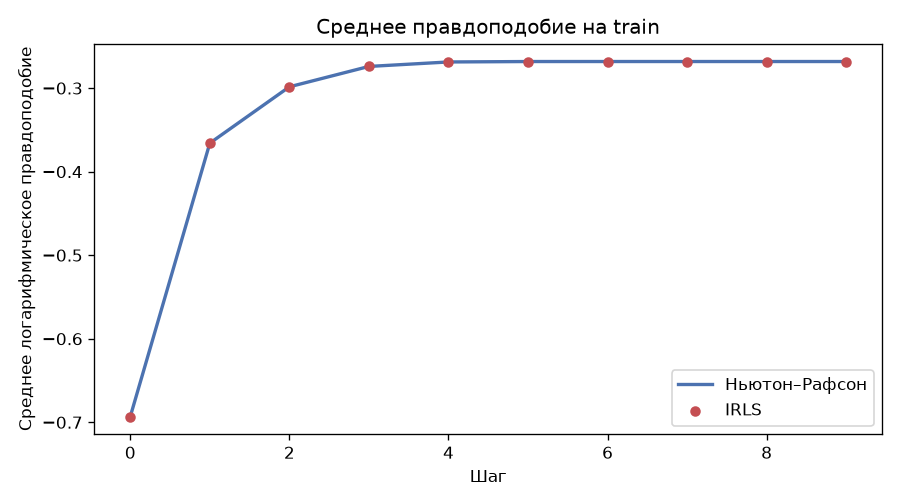
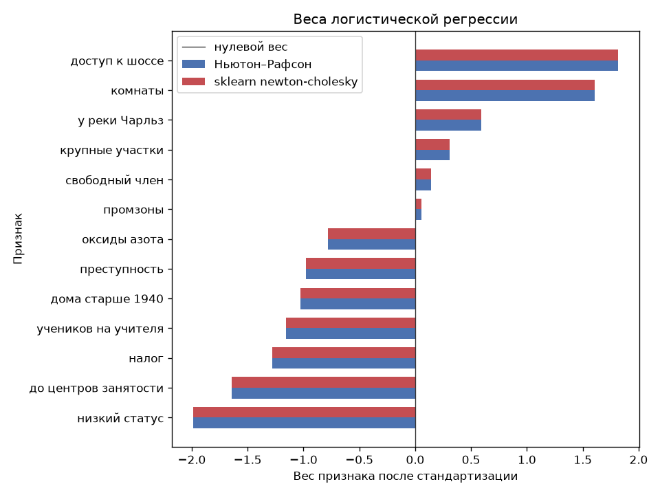

# Лабораторная 5. Логистическая регрессия

Датасет — Boston Housing, та же таблица, что в [статье GeeksforGeeks](https://www.geeksforgeeks.org/machine-learning/boston-dataset-in-sklearn/) и в старом `sklearn.datasets.load_boston`: 506 районов Бостона, 13 признаков, цель `MEDV` — медианная цена жилья в тысячах долларов. `load_boston` удалили в scikit-learn 1.2, поэтому `data.py` берёт OpenML-датасет `boston` версии 1. CSV в репозиторий не кладётся.

`MEDV` — число от 5 до 50. Логистическая регрессия отвечает на вопрос «да или нет», поэтому класс задан порогом: `high_value = 1`, если цена не ниже медианы 21.2. Сама цена в матрицу не входит.

Из каталога `lab5`:

```bash
pip install numpy pandas matplotlib seaborn scikit-learn
python source/data.py
python source/model.py
```

`data.py` готовит матрицу. `model.py` считает логистическую регрессию методом Ньютона–Рафсона и через IRLS и сверяет веса с `sklearn`.

## Данные

Пропусков и дубликатов нет. Столбец `B` в матрицу не входит: это функция от доли чернокожих жителей, из-за него sklearn и убрал `load_boston`. Остаётся 12 признаков.

| код | смысл |
|---|---|
| CRIM | преступность на душу населения |
| ZN | доля жилой земли под участки крупнее 25 000 кв. футов, % |
| INDUS | доля неторговой промышленности, % |
| CHAS | 1, если район выходит к реке Чарльз |
| NOX | концентрация оксидов азота |
| RM | среднее число комнат |
| AGE | доля домов, построенных до 1940, % |
| DIS | взвешенное расстояние до пяти центров занятости |
| RAD | индекс доступности радиальных шоссе |
| TAX | ставка налога на имущество на $10 000 |
| PTRATIO | учеников на одного учителя |
| LSTAT | доля населения с низким статусом, % |

У 16 районов цена записана как 50: это потолок шкалы, на гистограмме он виден отдельным столбиком справа. Все эти районы попадают в класс «дороже медианы». Ноль в `ZN` — настоящее измерение: у 372 районов (73.5%) нет крупной жилой застройки.



Класс почти ровный: 255 районов дороже медианы (50.4%) и 251 не дороже (49.6%).



Медианы признаков:

| | не дороже медианы | дороже медианы |
|---|---:|---:|
| преступность, CRIM | 1.36 | 0.11 |
| комнаты, RM | 5.95 | 6.55 |
| дома старше 1940, % | 91.2 | 54.0 |
| налог, TAX | 437 | 296 |
| учеников на учителя | 20.2 | 17.8 |
| низкий статус, % | 16.4 | 7.1 |

С классом сильнее всего связаны LSTAT (−0.67) и число комнат (0.51). С самой ценой связь ещё прямее: LSTAT −0.74, комнаты 0.70. Между признаками самая тесная пара — доступ к шоссе и налог, корреляция 0.91. Дальше оксиды азота и расстояние до работы (−0.77).





На плоскости «комнаты — низкий статус» дорогие районы сидят внизу справа: больше комнат и меньше LSTAT. Облака пересекаются, жёсткой границы нет.



Выбросы по правилу 1.5 IQR оставлены. Правило помечает 66 районов по преступности и 68 по ZN: у ZN ноль стоит у трёх кварталов из четырёх, и любой крупный участок выглядит хвостом. У реки Чарльз 35 районов, для бинарного CHAS это и есть весь класс «1».

Налог измерен сотнями, оксиды азота — долями единицы. Std: TAX 168, AGE 28, NOX 0.12, CHAS 0.25.



## Матрица для Ньютона

`prepare_data` делает три вещи.

1. Класс уже посчитан: `MEDV >= 21.2`. Колонка цены отброшена до разбиения.
2. Разбиение 80/20 с сохранением доли классов, `random_state=42`: train 404 района (200 и 204), test 102 (51 и 51).
3. `StandardScaler` учится только на train. Столбец единиц добавляется после масштаба и через scaler не проходит.

Итог: `X_train` 404×13, `X_test` 102×13. Столбцы: `intercept`, `CRIM`, `ZN`, `INDUS`, `CHAS`, `NOX`, `RM`, `AGE`, `DIS`, `RAD`, `TAX`, `PTRATIO`, `LSTAT`. Метки `y` — это 0 и 1. `as_numpy` отдаёт четыре массива `float`.

Число обусловленности матрицы со свободным членом до масштаба 11942, после 9.86. На старте Ньютона все веса равны нулю, вероятность каждого района равна 1/2, и гессиан равен `XᵀX / 4`. Его обусловленность — квадрат обусловленности `X`: около `11942²` до масштаба и `9.86² ≈ 97` после. Масштаб нужен, чтобы линейная система шага решалась в устойчивых числах. Пара RAD и TAX почти дублирует друг друга, поэтому обусловленность после масштаба выше, чем была бы у несвязанных столбцов, но матрица полного ранга 13.

На test классы разложены поровну, 51 и 51, так что ответ «всегда один класс» верен в половине случаев. Рядом с долей верных смотрелись log-loss, F1 по классу «дороже медианы» и ROC-AUC. Log-loss — это минус среднее правдоподобие, его метод и минимизирует.

## Ньютон–Рафсон и IRLS

Вероятность дорогого района — сигмоида от `Xw`. Правдоподобие Бернулли на одном районе равно `y log p + (1 − y) log(1 − p)`. На старте все веса нули, `p = 1/2` у каждого района, среднее правдоподобие `log(1/2) = −0.693`.

Градиент по весам — `Xᵀ(y − p)`. Гессиан — `−XᵀWX`, где на диагонали `W` стоит `p(1 − p)`. Ньютон сдвигает веса на решение системы `(XᵀWX) Δ = Xᵀ(y − p)`.

IRLS записывает тот же шаг как взвешенную линейную регрессию. Рабочий отклик `z = Xw + (y − p) / (p(1 − p))`, новые веса минимизируют `(z − Xw)ᵀ W (z − Xw)`. Произведение `Wz` считается без деления, как `p(1 − p)·Xw + (y − p)`: когда модель уже уверена, `p(1 − p)` почти ноль и прямое деление раздувает `z`. Алгебраически это тот же шаг Ньютона, поэтому траектории совпадают по шагам, а не только в конце.

Обе процедуры стартуют с нуля и останавливаются, когда максимальная координата шага меньше `10⁻¹²`. На train это 9 шагов. Среднее правдоподобие вырастает до −0.268. Расхождение двух кривых по шагам — `5.6·10⁻¹⁷`.



С четвёртого шага кривая уже лежит на полке: у Ньютона на логистической регрессии сходимость квадратичная, основная работа делается в первых шагах.

## Сверка с эталоном

Эталон — `LogisticRegression(C=np.inf, fit_intercept=False)` на той же матрице со столбцом единиц. `C=np.inf` выключает штраф на веса. `fit_intercept=False` обязателен: второй свободный член повторил бы столбец единиц, и гессиан стал бы вырожденным.

| сравнение | max \|Δ\| весов |
|---|---:|
| Ньютон и IRLS | 1.4·10⁻¹⁴ |
| Ньютон и `solver="newton-cholesky"` | 3.6·10⁻¹³ |
| Ньютон и `solver="lbfgs"` | 3.8·10⁻⁷ |

`newton-cholesky` — библиотечный Ньютон, он останавливается на шаг раньше и попадает в ту же точку. `lbfgs` — квазиньютоновский метод, у него более ранний допуск, поэтому хвост весов отличается на `10⁻⁷`. На вероятностях test это `5·10⁻¹⁴` против `newton-cholesky` и `2·10⁻⁷` против `lbfgs`.



Порог решения 0.5. На test три модели дают одни и те же метрики.

| | доля верных | F1 | ROC-AUC | log-loss |
|---|---:|---:|---:|---:|
| Ньютон, train | 0.886 | 0.887 | 0.956 | 0.268 |
| Ньютон, test | 0.863 | 0.860 | 0.936 | 0.324 |
| IRLS, test | 0.863 | 0.860 | 0.936 | 0.324 |
| newton-cholesky, test | 0.863 | 0.860 | 0.936 | 0.324 |
| lbfgs, test | 0.863 | 0.860 | 0.936 | 0.324 |

Знаки двух самых сильных сырых связей сохраняются: LSTAT −1.99, число комнат +1.60. Доступ к шоссе в сырой корреляции отрицательный (−0.36), а вес у него +1.82. Рядом налог весит −1.28, и эти два столбца коррелируют на 0.91: модель делит один общий фактор между ними, маргинальный знак шоссе при этом переворачивается.

## Выводы

1. Ньютон–Рафсон и IRLS на логистической регрессии — одна итерация, записанная двумя способами. Веса совпали до `10⁻¹⁴`, кривые правдоподобия — до `10⁻¹⁶`.
2. Библиотечный Ньютон (`newton-cholesky`) попадает в ту же точку с точностью `10⁻¹³`. `lbfgs` отличается только допуском остановки.
3. На test доля верных 0.863 при базе 0.50, ROC-AUC 0.936, log-loss 0.324. Train и test близки: модель не зазубрила 404 района.
4. Без стандартизации обусловленность матрицы 11942, и линейная система шага была бы плохо обусловлена. После масштаба она равна 9.86.
5. Пару RAD и TAX нельзя читать по отдельности: корреляция 0.91, и знак веса шоссе не совпадает с его сырой корреляцией.
