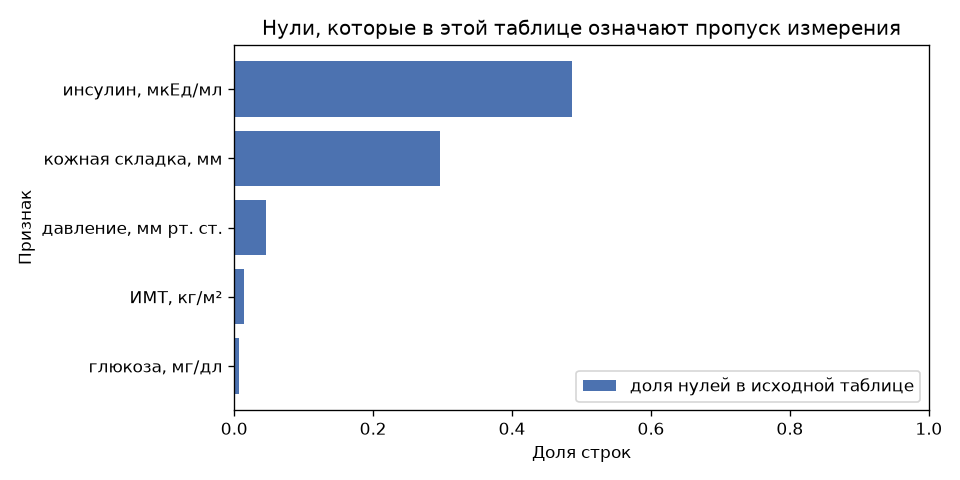
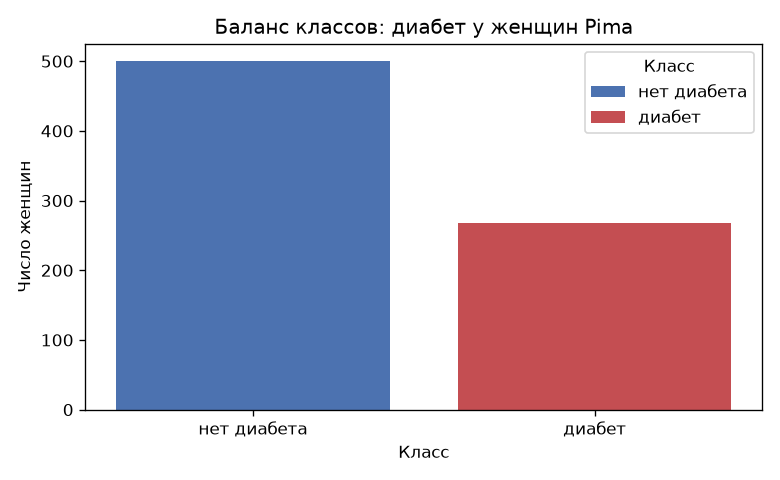
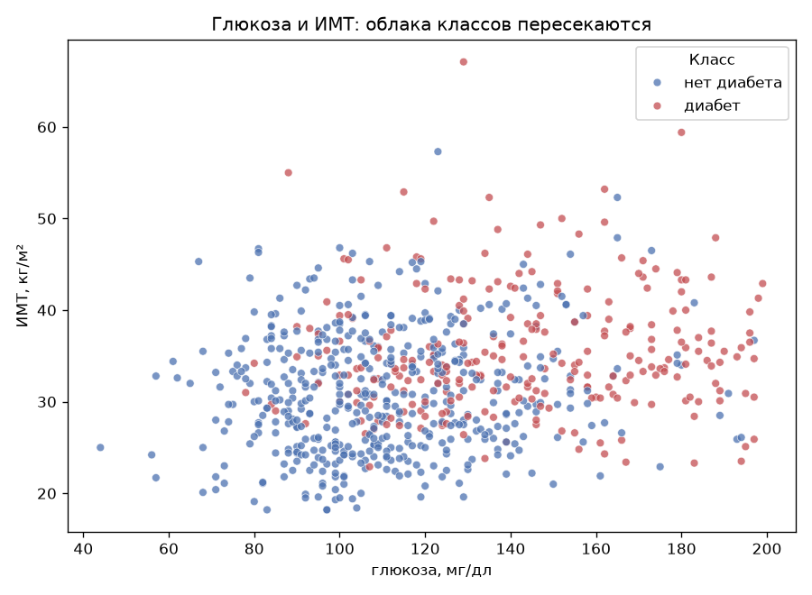

# Лабораторная 5. Логистическая регрессия

Датасет — [Pima Indians Diabetes](https://www.openml.org/d/37), OpenML id 37. 768 женщин народа пима, возраст от 21 года, 8 числовых признаков. Цель бинарная: диабет поставлен или нет. Это классификация. CSV в репозиторий не кладётся, таблицу забирает `sklearn.datasets.fetch_openml`.

`sklearn.datasets.load_diabetes` — другой датасет: там цель непрерывная, для этой работы он не подходит.

Из каталога `lab5`:

```bash
pip install numpy pandas matplotlib seaborn scikit-learn
python source/data.py
```

`data.py` готовит матрицу. Метода Ньютона–Рафсона и IRLS в этой ветке нет: их предстоит написать в `source/model.py` и сверить с эталоном.

## Данные

В файле OpenML пропусков нет, дубликатов строк нет. Ноль в глюкозе, давлении, толщине складки, инсулине и ИМТ означает «измерения не было»: давление 0 мм рт. ст. и ИМТ 0 живой женщине не поставить. Ноль беременностей — настоящее измерение, таких строк 111.

| признак | нулей-пропусков |
|---|---:|
| инсулин | 374 (48.7%) |
| кожная складка | 227 (29.6%) |
| давление | 35 (4.6%) |
| ИМТ | 11 (1.4%) |
| глюкоза | 5 (0.7%) |



Доля диабета среди пропущенного инсулина 0.369, среди измеренного 0.330. Отдельный индикатор пропуска почти не отделяет классы, поэтому в матрицу он не добавлен. Инсулин при этом остаётся: у тех, кого измерили, связь с диабетом есть.

Диабет у 268 женщин (34.9%), нет диабета у 500 (65.1%).



Медианы по классам, нули-пропуски в расчёт не входят:

| | нет диабета | диабет |
|---|---:|---:|
| беременности | 2 | 4 |
| глюкоза, мг/дл | 107 | 140 |
| давление | 70 | 74.5 |
| кожная складка, мм | 27 | 32 |
| инсулин | 102.5 | 169.5 |
| ИМТ | 30.1 | 34.3 |
| наследственность | 0.34 | 0.45 |
| возраст, лет | 27 | 36 |

Сильнее всего с диабетом связана глюкоза (корреляция Пирсона 0.49), затем ИМТ (0.31) и инсулин (0.30). Между собой сильнее всего связаны складка и ИМТ (0.65), глюкоза и инсулин (0.58), беременности и возраст (0.54).


Облака пересекаются. Медиана глюкозы без диабета равна 107, и 11.7% женщин с диабетом лежат ниже неё. Порог по одной глюкозе диагноз не закрывает. На плоскости глюкоза–ИМТ классы тоже перемешаны: логистическая регрессия как раз оценивает вероятность на таком перекрытии, а не ищет зазор между облаками.



Выбросы по правилу 1.5 IQR среди наблюдаемых значений оставлены в выборке. Больше всего их у наследственности (29, 3.8%) и инсулина (24, 3.1%). Инсулин тянется до 846 мкЕд/мл, поэтому пропуск заполняется медианой: среднее уехало бы в этот хвост.

Инсулин измерен в сотнях, наследственность — в долях единицы. Std наблюдаемых значений: инсулин 119, глюкоза 31, наследственность 0.33.


## Матрица для Ньютона

`prepare_data` делает четыре вещи в этом порядке.

1. Ноль в глюкозе, давлении, складке, инсулине и ИМТ становится пропуском.
2. Разбиение 80/20 с сохранением доли классов, `random_state=42`: train 614 строк (400 без диабета, 214 с диабетом), test 154 (100 и 54). Доля диабета 0.349 и 0.351.
3. Медианы считаются на train и ими заполняются пропуски train и test. Медиана инсулина на train равна 125, глюкозы 117, ИМТ 32.4.
4. `StandardScaler` учится только на train. Столбец единиц добавляется после масштаба и через scaler не проходит.

Итог: `X_train` 614×9, `X_test` 154×9. Столбцы: `intercept`, `preg`, `plas`, `pres`, `skin`, `insu`, `mass`, `pedi`, `age`. Метки `y` — это 0 и 1. `as_numpy` отдаёт четыре массива `float`.

Число обусловленности матрицы со свободным членом до масштаба 1571, после 2.46. На старте Ньютона все веса равны нулю, вероятность каждого объекта равна 1/2, и гессиан равен `XᵀX / 4`. Его обусловленность — квадрат обусловленности `X`: около `1571²` до масштаба и `2.46² ≈ 6` после. Масштаб нужен, чтобы линейная система шага решалась в устойчивых числах.

Ответ «диабета нет» для каждой женщины test уже верен в 64.9% случаев. Рядом с долей верных для отчёта нужны log-loss (минус среднее правдоподобие: его метод и минимизирует), F1 по классу «диабет» и ROC-AUC.

Эталон для сверки — `sklearn.linear_model.LogisticRegression(C=np.inf, solver="lbfgs", fit_intercept=False)` на этой же матрице, со столбцом `intercept`. `C=np.inf` выключает штраф на веса: Ньютон и IRLS ищут максимум правдоподобия. `fit_intercept=False` обязателен, потому что столбец единиц уже есть. Второй свободный член сделает два одинаковых столбца, и гессиан станет вырожденным. Сравнивать веса, вероятности и log-loss.

Отдельная проверка этим солвером показывает, что итерации сходятся, а веса остаются умеренными: классы гиперплоскостью не разделены, и метод Ньютона имеет конечную точку. Сами коэффициенты здесь не выписаны.

## Что осталось сделать

В `source/model.py`:

- логистическая регрессия методом Ньютона–Рафсона;
- та же модель через IRLS;
- сверка обеих траекторий друг с другом и с эталоном sklearn.
