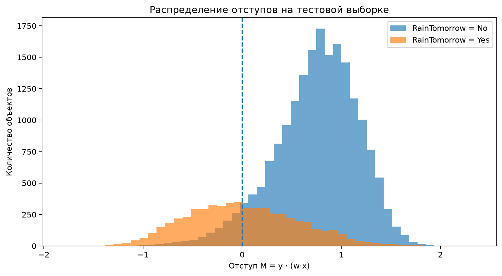
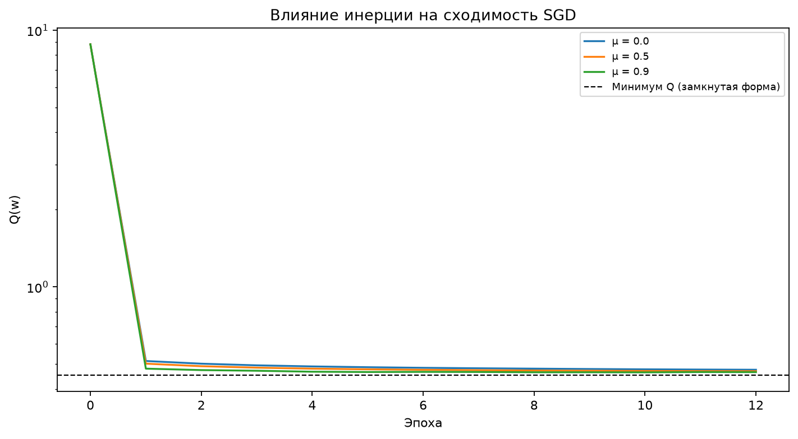
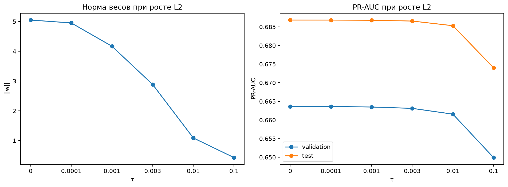
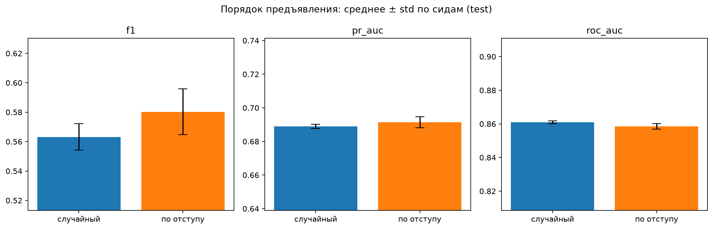
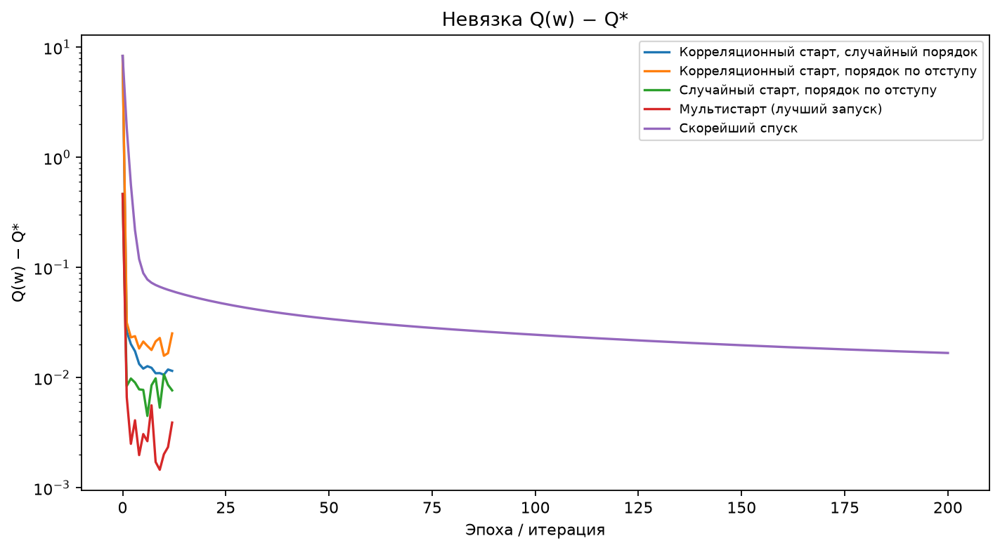
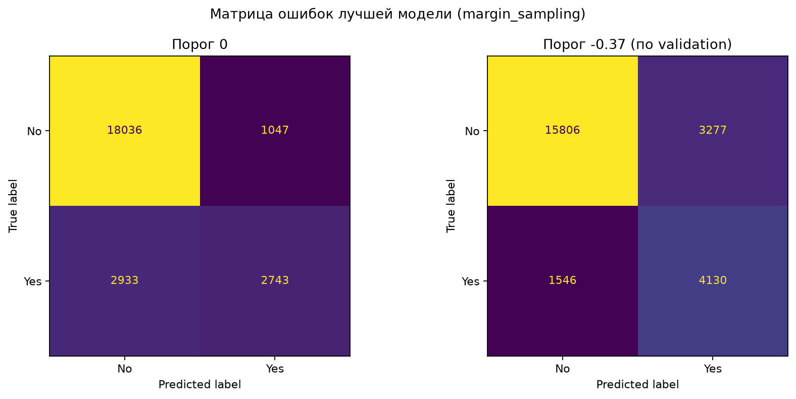
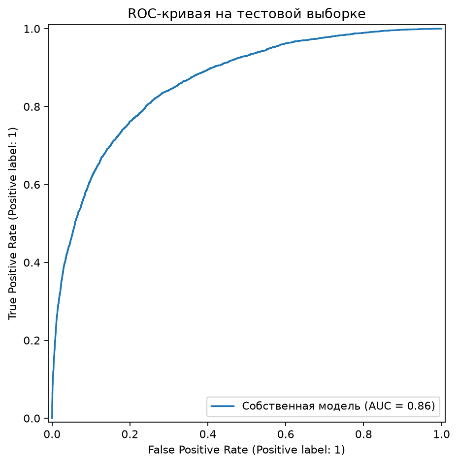
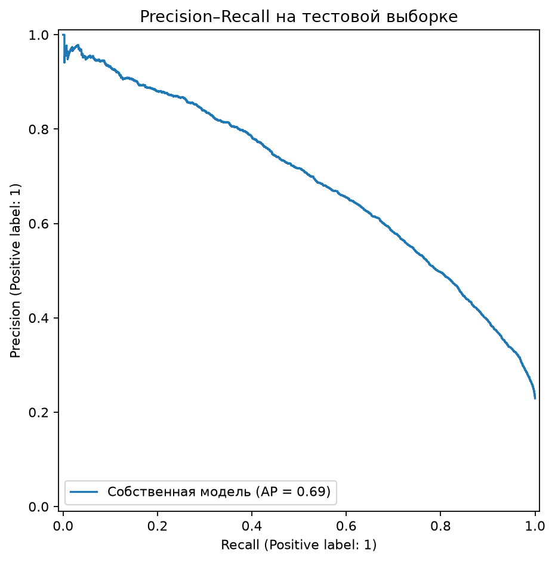
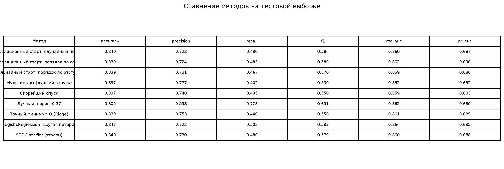
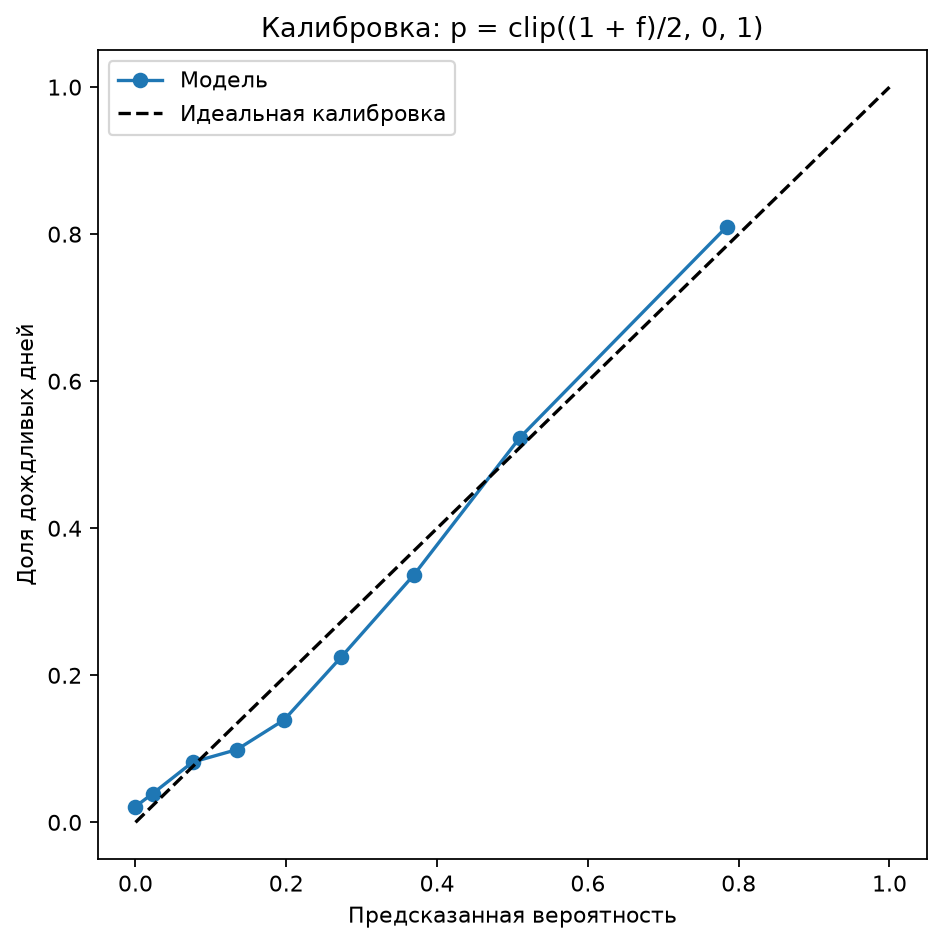

# Лабораторная работа №1. Линейная классификация

## Выбор и описание датасета

Используется датасет WeatherAUS — *Rain in Australia*, содержащий ежедневные метеорологические наблюдения на территории Австралии. Исходные данные доступны на [Kaggle](https://www.kaggle.com/datasets/jsphyg/weather-dataset-rattle-package).

Целевой признак — `RainTomorrow`, определяющий, будет ли дождь на следующий день. Метка `Yes` кодируется значением $+1$, а `No` — значением $-1$.

Основные характеристики подготовленной выборки:

| Параметр | Значение |
|---|---:|
| Количество строк в исходном CSV | 145 460 |
| Количество объектов после удаления строк без целевой метки | 142 193 |
| Количество признаков после кодирования | 130 |
| Обучающая выборка (train) | 93 076 |
| Валидационная выборка (validation) | 24 358 |
| Тестовая выборка (test) | 24 759 |
| Accuracy константного классификатора, предсказывающего `No` | 0,7708 |

Классы несбалансированы: наблюдений без дождя существенно больше, чем наблюдений с дождём. Поэтому accuracy не может выступать единственным показателем качества. Дополнительно используются precision, recall, F1, ROC-AUC и PR-AUC.

Данные разделяются хронологически, по целым датам, без случайного перемешивания. Хронологическое разбиение позволяет оценивать способность модели предсказывать будущие наблюдения по прошлым данным. В отличие от случайного разбиения, такой подход снижает риск получения чрезмерно оптимистичной оценки из-за смешивания соседних по времени наблюдений.

Признак `RISK_MM` исключён, так как он связан с осадками следующего дня и может давать лишнюю информацию о целевой переменной.

## Подготовка данных

1. Удалены строки без значения `RainTomorrow`.
2. Даты преобразованы в циклические признаки для учёта сезонности.
3. Добавлены индикаторы пропусков для `Evaporation`, `Sunshine`, `Cloud9am` и `Cloud3pm`.
4. Пропущенные значения заполнены медианами.
5. Категориальные признаки закодированы методом one-hot.

## Линейный классификатор и отступ объекта

Используется линейная функция классификации:

$$
f(x) = \langle w, x \rangle,
$$

где $x$ — вектор признаков, а $w$ — вектор обучаемых весов. Предсказание определяется знаком функции:

$$
a(x) = \operatorname{sign}(f(x)).
$$

Отступ объекта определяется формулой

$$
M_i = y_i\langle w, x_i\rangle.
$$

Интерпретация отступа:

- $M_i > 0$ — объект классифицирован правильно;
- $M_i < 0$ — объект классифицирован неправильно;
- $M_i \approx 0$ — объект расположен близко к разделяющей границе;
- $M_i \geq 1$ — объект классифицирован правильно с отступом не менее единицы.

По распределению тестовых отступов можно исследовать различия между классами. В частности, дождливые дни представляют более сложный для классификации класс: их признаки часто оказываются в области, где линейный классификатор не может уверенно отделить их от дней без дождя.

## Функция потерь и градиент

Для обучения используется квадратичная функция потерь:

$$
L(M_i) = (1 - M_i)^2.
$$

Регуляризованный функционал качества на обучающей выборке определяется следующим образом:

$$
Q(w) =
\frac{1}{n}\sum_{i=1}^{n}
\left(1 - y_i\langle w, x_i\rangle\right)^2
+\frac{\tau}{2}\left\lVert w_{\mathrm{features}}\right\rVert^2,
$$

где $n$ — количество объектов, а $\tau$ — коэффициент L2-регуляризации. Свободный член в регуляризацию не включается.

Градиент по мини-батчу $B$:

$$
\nabla Q_B(w) =
-\frac{2}{|B|}
\sum_{i\in B}
\left(1 - M_i\right)y_i x_i
+\tau w_{\mathrm{features}}.
$$

Для проверки реализации аналитический градиент сравнивается с численным приближением. Максимальная ошибка проверки в последнем запуске составила

$$
1{,}240\cdot 10^{-10}.
$$

## Реализованные методы оптимизации

### Стохастический градиентный спуск с инерцией

Для обучения реализован мини-батчевый SGD. На каждом шаге градиент вычисляется по части обучающей выборки.

Инерция учитывается с помощью рекуррентного обновления скорости:

$$
\begin{aligned}
v_{t+1} &= \mu v_t + \eta g_t,\\
w_{t+1} &= w_t - v_{t+1},
\end{aligned}
$$

где $g_t$ — градиент на текущем мини-батче, $\eta$ — скорость обучения, $\mu$ — коэффициент инерции.

Для исследования влияния инерции сравнивались значения $\mu=0$, $\mu=0{,}5$ и $\mu=0{,}9$.

| Коэффициент инерции $\mu$ | $Q$ | Validation PR-AUC | Test PR-AUC |
|---:|---:|---:|---:|
| 0,0 | 0,47576 | 0,6541 | 0,6777 |
| 0,5 | 0,46963 | 0,6628 | 0,6857 |
| 0,9 | 0,46567 | 0,6635 | 0,6868 |

Увеличение коэффициента инерции улучшает значения функционала и PR-AUC. Лучший результат достигается при $\mu=0{,}9$.

### Рекуррентная оценка функционала качества

Для сглаживания оценки потерь мини-батчей используется рекуррентное обновление:

$$
\widehat Q_t = (1-\lambda)\widehat Q_{t-1} + \lambda\xi_t,
$$

где $\xi_t$ — оценка потерь на текущем мини-батче, а $\lambda$ — коэффициент сглаживания.

### L2-регуляризация

L2-регуляризация добавляет к функционалу штраф, пропорциональный квадрату нормы весов:

$$
Q_{\mathrm{reg}}(w) = Q_{\mathrm{data}}(w)
+\frac{\tau}{2}\left\lVert w_{\mathrm{features}}\right\rVert^2.
$$

Она ограничивает величину весов и может уменьшать чувствительность модели к коррелированным признакам.

В последнем запуске коэффициент L2 выбирался по validation PR-AUC с использованием замкнутой формы. Выбранное значение:

$$
\tau = 0{,}001.
$$

### Скорейший градиентный спуск

Для квадратичного функционала реализован скорейший градиентный спуск с точным одномерным поиском шага вдоль антиградиента.

Пусть $g_k=\nabla Q(w_k)$, а $H$ — постоянный гессиан функционала. Тогда шаг вычисляется по формуле

$$
h_k = \frac{g_k^\top g_k}{g_k^\top H g_k},
$$

а веса обновляются следующим образом:

$$
w_{k+1} = w_k - h_k g_k.
$$

## Инициализация весов

### Инициализация через корреляцию

Начальные веса рассчитываются с использованием корреляции признаков с целевой переменной. Для каждого признака используется оценка вида

$$
w_j^{(0)} =
\frac{\langle y, f_j\rangle}
{\langle f_j, f_j\rangle}.
$$

Этот способ учитывает связь каждого признака с целевой переменной, но не учитывает полностью зависимости между признаками. При наличии корреляций между признаками отдельные вклады могут суммироваться, поэтому начальные отступы могут значительно отличаться от целевого значения $M=1$.

### Случайная инициализация и мультистарт

Для случайной инициализации веса задаются равномерно в небольшом диапазоне около нуля. Чтобы снизить чувствительность к удачному или неудачному начальному приближению, применяется мультистарт: обучение запускается несколько раз из разных случайных начальных весов, после чего выбирается лучший по validation PR-AUC вариант.

В последнем запуске использовалось 10 стартов. Средняя невязка функционала по стартам составила

$$
0{,}00275 \pm 0{,}00095.
$$

## Предъявление объектов по модулю отступа

При обычном стохастическом обучении объекты предъявляются в случайном порядке. В альтернативном варианте вероятность выбора зависит от модуля отступа:

$$
p_i =
\frac{\left(|M_i|+\varepsilon\right)^{-1}}
{\sum\limits_j \left(|M_j|+\varepsilon\right)^{-1}},
$$

где $\varepsilon>0$ предотвращает деление на ноль.

Объекты с меньшим модулем отступа получают более высокую вероятность предъявления. Предполагается, что такие объекты находятся ближе к разделяющей границе и могут быть более информативными для обучения.

Сравнение стратегий предъявления по нескольким seed:

| Стратегия предъявления | F1, среднее ± std | ROC-AUC, среднее ± std | PR-AUC, среднее ± std |
|---|---:|---:|---:|
| Случайная | 0,5632 ± 0,0090 | 0,8610 ± 0,0008 | 0,6889 ± 0,0012 |
| По модулю отступа | 0,5803 ± 0,0156 | 0,8585 ± 0,0017 | 0,6914 ± 0,0032 |

В усреднении по seed предъявление по модулю отступа дало более высокие F1 и PR-AUC, однако немного более низкий ROC-AUC. При этом разброс метрик для стратегии по отступу заметно выше, то есть результат сильнее зависит от seed.

## Сходимость и сравнение с точным минимумом

Для контроля оптимизации вычисляется точный минимум регуляризованного квадратичного функционала в замкнутой форме.

В последнем запуске:

$$
Q^* = 0{,}45414.
$$

Невязка функционала после обучения:

| Метод | Невязка $Q-Q^*$ |
|---|---:|
| Корреляционная инициализация | 0,01153 |
| Предъявление по отступу | 0,02524 |
| Предъявление по отступу со случайной инициализацией | 0,00767 |
| Мультистарт | 0,00391 |
| Скорейший градиентный спуск | 0,01676 |
| Мультистарт, среднее по 10 стартам | 0,00275 ± 0,00095 |

## Оценка качества классификации

### Лучшая собственная модель

Лучшая собственная модель выбрана по validation PR-AUC. Ею оказалась модель с предъявлением объектов по модулю отступа — `margin_sampling`.

При стандартном пороге классификации $0$ получены следующие результаты:

| Метрика | Значение на test |
|---|---:|
| Accuracy | 0,8393 |
| Precision | 0,7237 |
| Recall | 0,4833 |
| F1 | 0,5795 |
| ROC-AUC | 0,8616 |
| PR-AUC | 0,6902 |
| Loss | 0,4927 |
| Норма весов | 4,2262 |
| Brier score | 0,1158 |

Матрица ошибок при пороге $0$:

$$
\begin{pmatrix}
18036 & 1047\\
2933 & 2743
\end{pmatrix}.
$$

Строки соответствуют истинным классам, столбцы — предсказанным; порядок классов — $[-1,+1]$.

При пороге $0$ модель демонстрирует высокую precision, но сравнительно низкую полноту: recall равен $0{,}4833$. Это означает, что значительная часть дождливых дней остаётся нераспознанной.

### Подбор порога на validation

Для изменения компромисса между precision и recall порог классификации был подобран на валидационной выборке. Полученный порог равен $-0{,}366$.

| Метрика | Порог $0$ | Порог $-0{,}366$ |
|---|---:|---:|
| Accuracy | 0,8393 | 0,8052 |
| Precision | 0,7237 | 0,5576 |
| Recall | 0,4833 | 0,7276 |
| F1 | 0,5795 | 0,6314 |
| ROC-AUC | 0,8616 | 0,8616 |
| PR-AUC | 0,6902 | 0,6902 |

Матрица ошибок при пороге $-0{,}366$:

$$
\begin{pmatrix}
15806 & 3277\\
1546 & 4130
\end{pmatrix}.
$$

Подбор порога увеличил F1 с $0{,}5795$ до $0{,}6314$, а recall — с $0{,}4833$ до $0{,}7276$. При этом precision снизилась с $0{,}7237$ до $0{,}5576$, а accuracy — с $0{,}8393$ до $0{,}8052$.

### Сравнение с эталонными моделями

Для сравнения использованы точный минимум квадратичного функционала, `SGDClassifier` и `LogisticRegression`.

Сравнение при пороге $0$:

| Модель | Accuracy | Precision | Recall | F1 | ROC-AUC | PR-AUC |
|---|---:|---:|---:|---:|---:|---:|
| Собственная модель, `margin_sampling`, порог 0 | 0,8393 | 0,7237 | 0,4833 | 0,5795 | 0,8616 | 0,6902 |
| Точный минимум $Q$ | 0,8386 | 0,7532 | 0,4405 | 0,5559 | 0,8612 | 0,6892 |
| `SGDClassifier` (`eta0=0.0003`) | 0,8401 | 0,7298 | 0,4801 | 0,5792 | 0,8605 | 0,6884 |
| `LogisticRegression` (`C=1.0`) | 0,8416 | 0,7223 | 0,5023 | 0,5925 | 0,8637 | 0,6952 |

Сравнение с порогом, подобранным на validation:

| Модель | Порог | Accuracy | Precision | Recall | F1 | ROC-AUC | PR-AUC |
|---|---:|---:|---:|---:|---:|---:|---:|
| Собственная модель, `margin_sampling` | $-0{,}366$ | 0,8052 | 0,5576 | 0,7276 | 0,6314 | 0,8616 | 0,6902 |
| Точный минимум $Q$ | $-0{,}334$ | 0,8173 | 0,5852 | 0,6973 | 0,6363 | 0,8612 | 0,6892 |
| `SGDClassifier` | $-0{,}331$ | 0,8093 | 0,5669 | 0,7125 | 0,6314 | 0,8605 | 0,6884 |
| `LogisticRegression` | $-1{,}030$ | 0,8107 | 0,5687 | 0,7204 | 0,6356 | 0,8637 | 0,6952 |

Точное решение в замкнутой форме используется как эталон оптимизации того же квадратичного функционала. `SGDClassifier` служит ориентиром для стохастического обучения, а логистическая регрессия — дополнительным ориентиром для линейной классификации с другой функцией потерь.

Собственная реализация показывает результат, близкий к эталонным моделям. При пороге $0$ её F1 равен $0{,}5795$, что практически совпадает с `SGDClassifier` ($0{,}5792$) и немного выше точного минимума $Q$ ($0{,}5559$), но ниже логистической регрессии ($0{,}5925$). По PR-AUC собственная модель ($0{,}6902$) немного превосходит точный минимум $Q$ и `SGDClassifier`, но уступает логистической регрессии ($0{,}6952$). После подбора порога F1 собственной модели возрастает до $0{,}6314$, что соответствует уровню `SGDClassifier` и близко к эталонным значениям.

