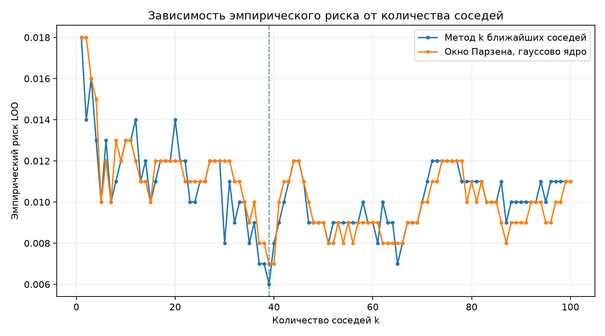
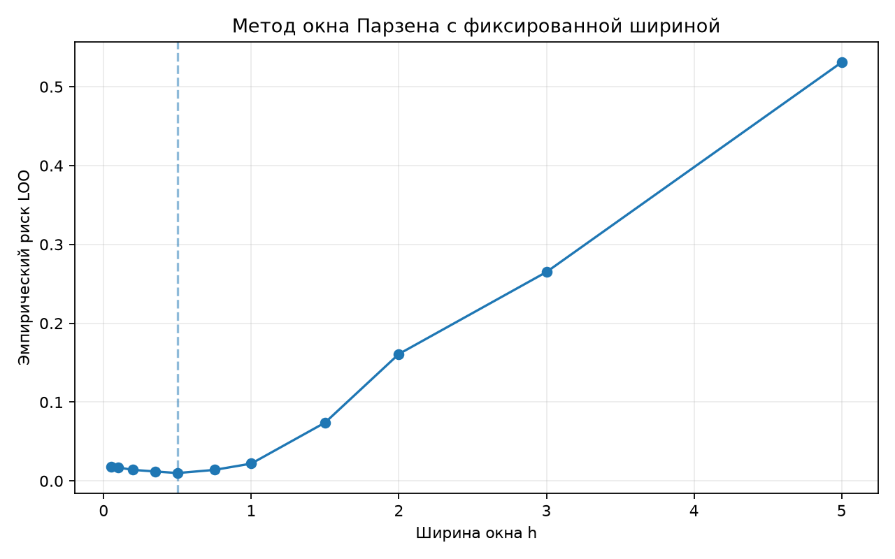
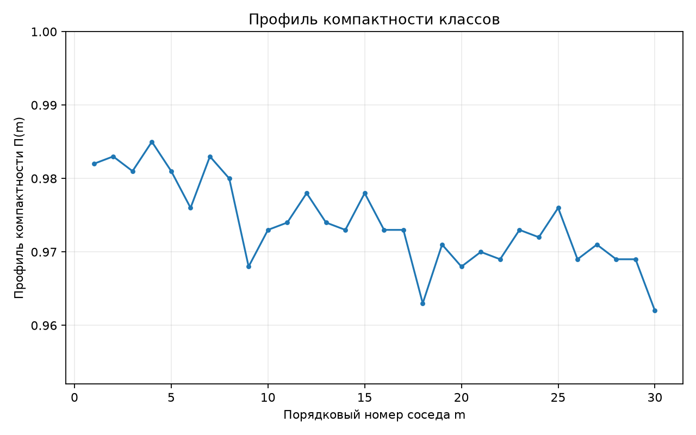
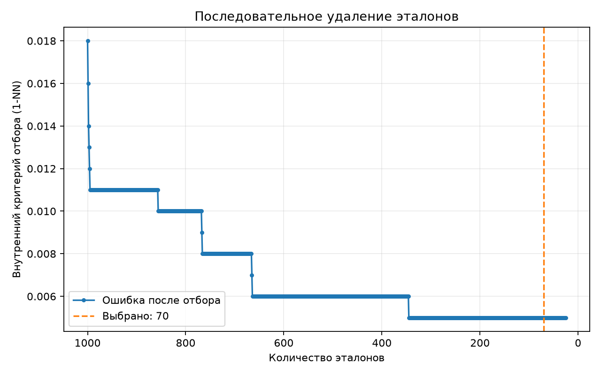
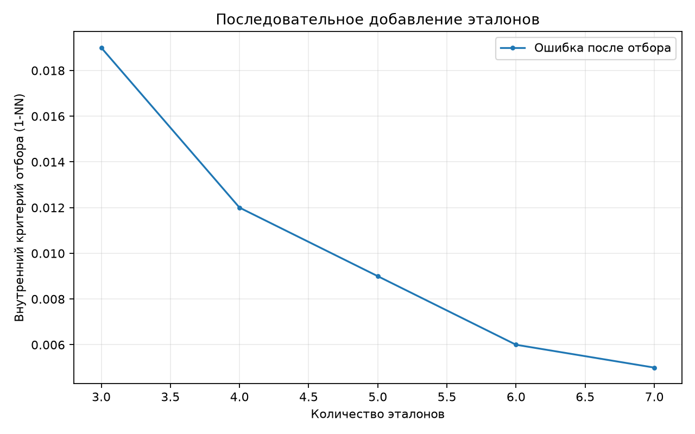
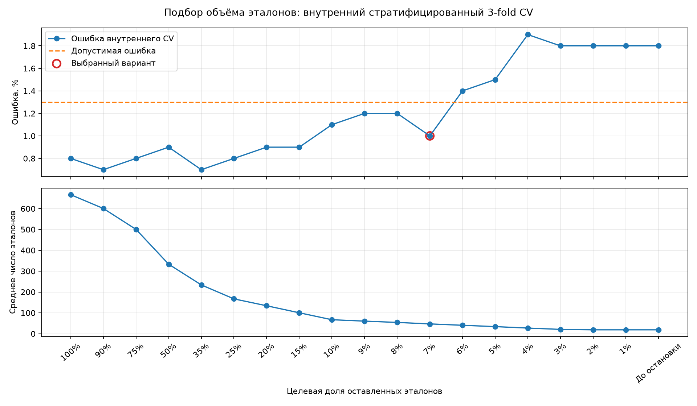
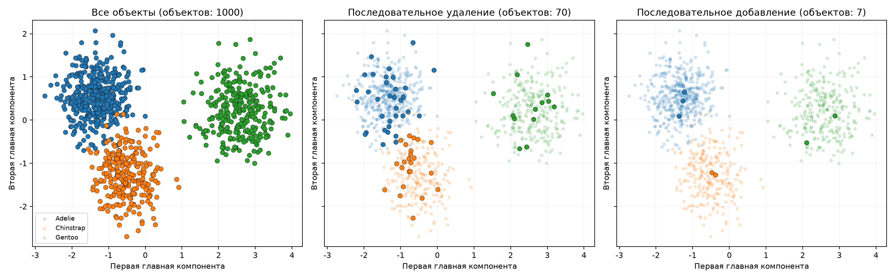
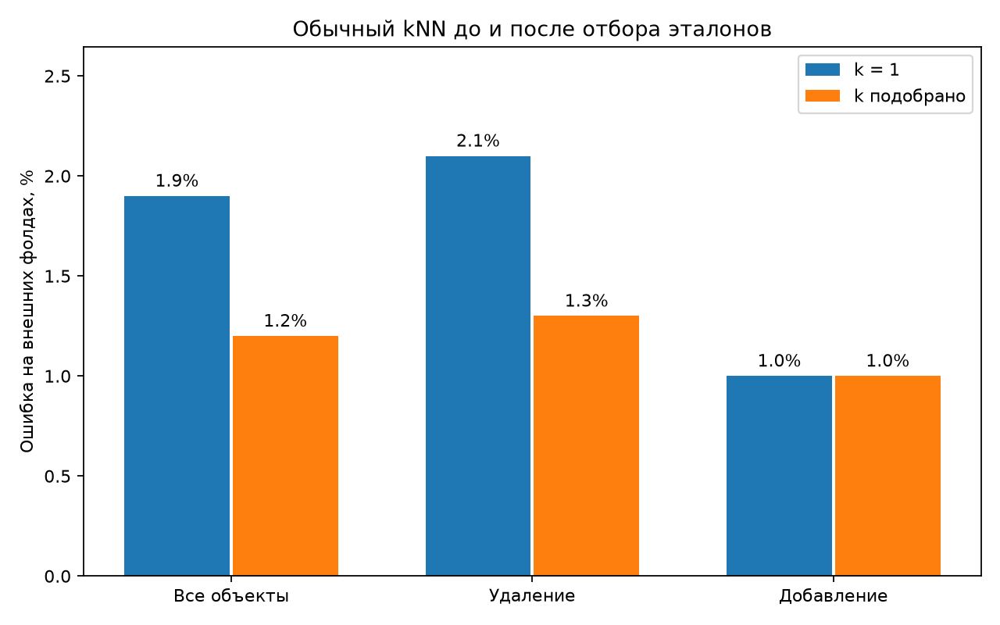
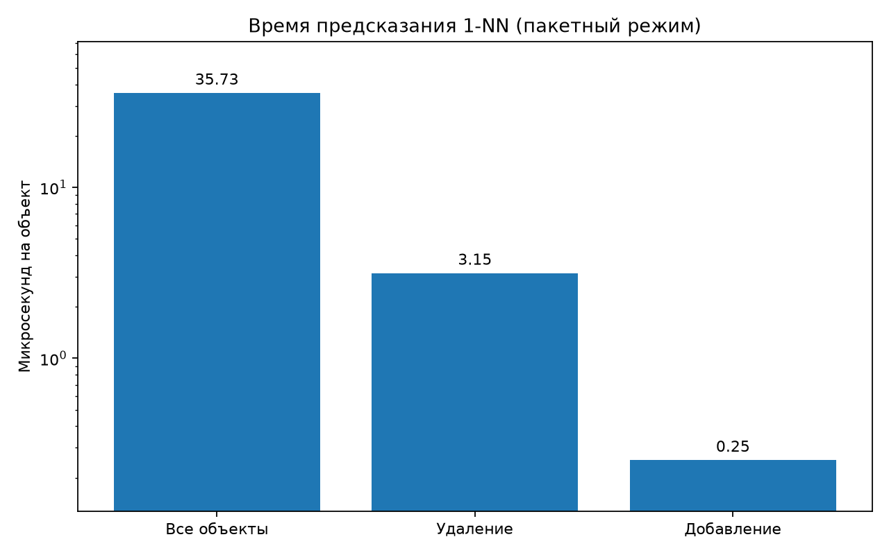

# Лабораторная работа №2. Метрическая классификация

## Выбор и описание датасета

Используется [Penguin Species Dataset](https://www.kaggle.com/datasets/srisyra02/penguin-species-dataset), содержащий синтетические данные о пингвинах трёх видов. Целевой признак — `species`. Метки `Adelie`, `Chinstrap` и `Gentoo` кодируются значениями $0$, $1$ и $2$ соответственно.

Основные характеристики выборки:

| Параметр | Значение |
|---|---:|
| Количество объектов | 1000 |
| Количество исходных признаков | 6 |
| Количество признаков после кодирования | 10 |
| Adelie | 461 |
| Chinstrap | 251 |
| Gentoo | 288 |
| Accuracy константного классификатора (Adelie) | 0,4610 |

Классы умеренно несбалансированы, поэтому для оценки качества используются accuracy, macro-precision, macro-recall и macro-F1. Макроусреднение позволяет учитывать качество классификации каждого вида независимо от количества его представителей.

## Подготовка данных

1. Числовые признаки `culmen_length_mm`, `culmen_depth_mm`, `flipper_length_mm` и `body_mass_g` преобразованы в числовые массивы. В каждом из этих признаков обнаружено по 10 пропусков, которые заполняются медианами.
2. Числовые признаки стандартизованы:

   $$
   z_j=\frac{x_j-\mu_j}{\sigma_j}.
   $$

3. Категориальные признаки `island` и `sex` закодированы методом one-hot. Для 10 пропущенных значений `sex` выделена отдельная категория `missing`.
4. Медианы, средние, стандартные отклонения и наборы категорий определяются только по обучающим объектам соответствующего разбиения. При полном LOO преобразования пересчитываются для каждого исключаемого объекта.

Стандартизация необходима, поскольку без неё признаки с большими числовыми значениями, например масса тела в граммах, оказывали бы непропорционально большое влияние на евклидово расстояние.

## Метод k ближайших соседей

Для определения близости объектов используется евклидова метрика в пространстве подготовленных признаков:

$$
\rho(x,z)=\sqrt{\sum_{j=1}^{d}(x_j-z_j)^2},
$$

где $d$ — размерность признакового пространства. Пусть $x^{(i)}$ — $i$-й ближайший к объекту $x$ сосед, а $y^{(i)}$ — его метка класса.

Предсказание обычного kNN определяется голосованием ближайших соседей:

$$
a_k(x)=\arg\max_{c\in Y}\sum_{i=1}^{k}[y^{(i)}=c].
$$

Все $k$ соседей имеют одинаковый вес. При малых значениях $k$ классификатор более чувствителен к шуму, а при больших — граница классификации сглаживается. Слишком большое значение $k$ может приводить к потере локальной структуры классов.

## Метод окна Парзена

В отличие от обычного kNN, метод окна Парзена учитывает расстояния до соседей при определении их вклада в голосование.

В качестве весовой функции используется гауссово ядро:

$$
K(u)=\exp\left(-\frac{u^2}{2}\right).
$$

Нормирующий множитель гауссова ядра опущен, поскольку он одинаков для всех классов и не влияет на результат выбора максимума.

### Окно переменной ширины

Ширина окна определяется расстоянием до $(k+1)$-го ближайшего соседа:

$$
h(x)=\rho(x,x^{(k+1)}).
$$

Предсказание вычисляется по формуле

$$
a_k(x)=\arg\max_{c\in Y}
\sum_{i=1}^{k}[y^{(i)}=c]
K\left(\frac{\rho(x,x^{(i)})}{h(x)}\right).
$$

Близкие объекты получают больший вес. В областях высокой плотности данных ширина окна уменьшается, а в разреженных областях увеличивается. Для предотвращения деления на ноль в программе используется нижняя граница $h(x)\geq 10^{-12}$.

Голосование ограничивается первыми $k$ соседями. Таким образом, используется локальный взвешенный kNN с адаптивной шириной окна, а не суммирование гауссовых весов по всей выборке.

### Окно фиксированной ширины

Дополнительно реализован метод окна Парзена с постоянной шириной $h$. В этом случае учитываются все обучающие объекты:

$$
a_h(x)=\arg\max_{c\in Y}
\sum_{i=1}^{n}[y_i=c]
K\left(\frac{\rho(x,x_i)}{h}\right).
$$

Для LOO проверяемый объект исключается из голосования. В отличие от переменного окна, ширина $h$ одинакова для всех классифицируемых объектов.

## Подбор параметров методом скользящего контроля

При leave-one-out (LOO) каждый объект поочерёдно исключается из выборки и классифицируется по оставшимся $n-1$ объектам. Включение самого объекта в список его соседей могло бы искусственно занизить ошибку классификации.

Эмпирический риск определяется долей ошибочных предсказаний:

$$
Q_{\mathrm{LOO}}(k)=\frac{1}{n}\sum_{i=1}^{n}
[a_{-i,k}(x_i)\ne y_i],
$$

где $a_{-i,k}$ — классификатор, построенный без объекта $x_i$. Оптимальный параметр выбирается по минимуму риска:

$$
k^*=\arg\min_{k\in\{1,\ldots,100\}}Q_{\mathrm{LOO}}(k).
$$

### Подбор количества соседей

Для обычного kNN и окна Парзена переменной ширины исследовались все целые значения $k$ от 1 до 100. Диапазон позволяет сравнить локальное голосование по одному соседу с голосованием по более широкой окрестности, включающей до 10% исходной выборки.

| $k$ | LOO-риск kNN | LOO-риск окна Парзена |
|---:|---:|---:|
| 1 | 0,018 | 0,018 |
| 5 | 0,010 | 0,010 |
| 10 | 0,013 | 0,013 |
| 20 | 0,014 | 0,012 |
| 30 | 0,008 | 0,012 |
| 39 | 0,006 | 0,007 |
| 40 | 0,008 | 0,007 |
| 50 | 0,009 | 0,009 |
| 75 | 0,012 | 0,012 |
| 100 | 0,011 | 0,011 |

Для обычного kNN минимальная ошибка составляет $0{,}006$ при $k=39$. Для окна Парзена минимальная ошибка составляет $0{,}007$ при $k=39$ и $k=40$. При равных значениях риска выбирается меньшее $k$, поэтому для обоих алгоритмов получено $k^*=39$.

### Подбор ширины фиксированного окна

Для фиксированной ширины использовалась сетка

$$
h\in\{0.05,0.1,0.2,0.35,0.5,0.75,1.0,1.5,2.0,3.0,5.0\}.
$$

Сетка неравномерная, т.к. в области малых значений ширины используется более частый перебор.

| $h$ | LOO-риск |
|---:|---:|
| 0,05 | 0,018 |
| 0,10 | 0,017 |
| 0,20 | 0,014 |
| 0,35 | 0,012 |
| 0,50 | 0,010 |
| 0,75 | 0,014 |
| 1,00 | 0,022 |
| 1,50 | 0,074 |
| 2,00 | 0,161 |
| 3,00 | 0,265 |
| 5,00 | 0,531 |

Минимум риска достигается при $h=0{,}5$. При увеличении ширины до $h=5$ ошибка возрастает до $0{,}531$, приближаясь к ошибке константного классификатора ($0{,}539$). Это связано с потерей локальности голосования и усилением влияния наиболее многочисленного класса.

## Оценка качества классификации и сравнение с эталонной реализацией

В качестве эталона используется `KNeighborsClassifier` из библиотеки scikit-learn с евклидовой метрикой, равномерными весами и $k=39$. Собственная и эталонная реализации оцениваются при одинаковой предобработке и одинаковом протоколе LOO.

| Алгоритм | Параметр | Accuracy | Precision macro | Recall macro | F1 macro |
|---|---:|---:|---:|---:|---:|
| Собственный kNN | $k=39$ | 0,9940 | 0,9944 | 0,9932 | 0,9938 |
| `KNeighborsClassifier` | $k=39$ | 0,9940 | 0,9944 | 0,9932 | 0,9938 |
| Парзен, переменное окно | $k=39$ | 0,9930 | 0,9931 | 0,9925 | 0,9928 |
| Парзен, фиксированное окно | $h=0{,}5$ | 0,9900 | 0,9903 | 0,9891 | 0,9897 |

Матрица ошибок собственного kNN:

$$
\begin{pmatrix}
459 & 2 & 0\\
4 & 247 & 0\\
0 & 0 & 288
\end{pmatrix}.
$$

Строки соответствуют истинным классам, столбцы — предсказанным; порядок классов — `[Adelie, Chinstrap, Gentoo]`.

Предсказания собственной реализации и scikit-learn совпали на всех 1000 объектах. Обычный kNN допустил 6 ошибок, окно Парзена переменной ширины — 7, фиксированной — 10. Все ошибки обычного kNN возникают между классами Adelie и Chinstrap, а класс Gentoo классифицируется без ошибок.

Приведённые метрики получены на том же LOO, по которому подбирались параметры.

## Профиль компактности

Для исследования структуры классов рассчитывается доля объектов, у которых $m$-й ближайший сосед принадлежит тому же классу:

$$
\Pi(m)=\frac{1}{n}\sum_{i=1}^{n}
[y_i=y_i^{(m)}],\qquad m=1,\ldots,30.
$$

В данной реализации профиль выражается через долю совпадений меток. Если определять его через долю несовпадений, соответствующее значение равно $1-\Pi(m)$.

| Номер соседа $m$ | $\Pi(m)$ |
|---:|---:|
| 1 | 0,982 |
| 10 | 0,973 |
| 20 | 0,968 |
| 30 | 0,962 |

Даже тридцатый ближайший сосед принадлежит тому же классу в 96,2% случаев. Это подтверждает выраженную компактность классов на исследуемой выборке при выбранном представлении данных и метрике. Профиль рассчитывается по всей подготовленной выборке и используется для описательного анализа её структуры.

## Отбор эталонов

Метрические алгоритмы хранят обучающие объекты и используют их при каждом предсказании. Отбор эталонов позволяет уменьшить число хранимых объектов и вычисляемых расстояний.

Пусть $S$ — множество индексов выбранных эталонов. В качестве внутреннего критерия отбора используется ошибка классификатора 1-NN:

$$
Q(S)=\frac{1}{n}\sum_{i=1}^{n}
\left[y_i\ne y_{j^*(i,S)}\right],
\qquad
j^*(i,S)=\arg\min_{j\in S\setminus\{i\}}\rho(x_i,x_j).
$$

Если проверяемый объект сам является эталоном, он исключается из голосования. Критерий вычисляется по всем объектам текущей обучающей выборки. 

### Последовательное удаление эталонов

Изначально все объекты входят в множество эталонов. На каждом шаге выбирается объект, удаление которого минимизирует значение внутреннего критерия:

$$
j^*=\arg\min_{j\in S}Q(S\setminus\{j\}).
$$

Удаление выполняется, если оно не увеличивает ошибку и не исключает последний эталон соответствующего класса. При равной стоимости выбирается кандидат с меньшим индексом. Для ускорения в `backward_path()` поддерживаются первый и второй ближайшие эталоны каждого объекта; при удалении обновляются только затронутые списки соседей. Это позволяет построить полную траекторию удаления за один проход алгоритма и затем получать промежуточные наборы функцией `path_subset()`.

Фиксированного ограничения на число итераций нет. Алгоритм прекращает удаление, когда нет допустимого кандидата с неувеличивающейся ошибкой, либо остаётся не более числа классов плюс один эталон. На полной выборке естественная остановка произошла после 975 удалений: осталось 25 эталонов, внутренний критерий снизился с $0{,}018$ до $0{,}005$.

Пунктиром отмечен выбранный набор из 70 эталонов. Его внутренний критерий также равен $0{,}005$. Дальнейшее удаление до 25 эталонов не уменьшает внутреннюю ошибку. Горизонтальные участки графика соответствуют удалению объектов, не изменяющему значение критерия.

### Последовательное добавление эталонов

Изначально выбирается по одному объекту каждого класса, ближайшему к центру этого класса в признаковом пространстве. Далее добавляется эталон, максимально уменьшающий внутренний критерий:

$$
j^*=\arg\min_{j\notin S}Q(S\cup\{j\}).
$$

Алгоритм останавливается, когда ни один кандидат не уменьшает ошибку либо достигается предусмотренная кодом граница размера набора.

| Количество эталонов | Внутренняя ошибка 1-NN |
|---:|---:|
| 3 | 0,019 |
| 4 | 0,012 |
| 5 | 0,009 |
| 6 | 0,006 |
| 7 | 0,005 |

На полной выборке остаётся 7 эталонов (0,7% исходного количества). Внутренняя ошибка снижается с 1,9% до 0,5%. 

## Подбор количества эталонов

### Критерий выбора 

Вместо фиксированного числа удалений исследуется целевая доля сохраняемых эталонов $p$. Для обучающего набора размера $n$ целевое количество объектов равно $\lceil pn\rceil$. Если алгоритм останавливается раньше, сохраняется фактически достигнутый набор. Значение $p=0$ обозначает естественную остановку, а не пустой набор.

Для каждой доли применяется стратифицированный 3-fold. На каждом внутреннем разбиении предобработка и отбор эталонов выполняются только на обучающей части. Контрольная часть используется для предсказания обычным kNN при всех допустимых $k$ от 1 до 100. Ошибка рассчитывается по объединённым контрольным предсказаниям:

$$
Q_{\mathrm{CV}}(p,k)=\frac{1}{n}\sum_{i=1}^{n}[a_{p,k}^{(-f(i))}(x_i)\ne y_i],
\qquad k^*(p)=\arg\min_k Q_{\mathrm{CV}}(p,k).
$$

Здесь $f(i)$ — внутренний фолд объекта $x_i$. При равных ошибках выбирается меньшее $k$.

Цель — минимизировать среднее фактическое количество эталонов $\overline m(p)$ при ограничении на увеличение ошибки относительно kNN без отбора:

$$
p^*=\arg\min_{p\in P}\overline m(p),\qquad
Q_{\mathrm{CV}}(p,k^*(p))\leq Q_{\mathrm{CV}}(1,k^*(1))+\varepsilon,
$$

где $\varepsilon=0{,}005$ — допустимая абсолютная потеря accuracy в 0,5 процентного пункта (`MAX_RISK_INCREASE`). 

### Исследование сетки параметров и устойчивости

В `run_experiments.py` выполняются два дополнительных эксперимента: грубая сетка и повторная проверка уточнённой сетки при другом seed. Основной эксперимент выполняется в `metric_classifier.py`.

Грубая сетка содержит доли 100%, 90%, 75%, 50%, 35%, 25%, 10%, 5% и вариант до естественной остановки. Уточнённая сетка дополнительно исследует 20%, 15% и все целые проценты от 1% до 9%, чтобы детальнее изучить область сильного сокращения выборки.

| Целевая доля | Среднее число эталонов, seed 42 | $k^*$, seed 42 | Риск, seed 42 | $k^*$, seed 123 | Риск, seed 123 |
|---:|---:|---:|---:|---:|---:|
| 100% | 666,7 | 21 | 0,008 | 29 | 0,008 |
| 90% | 600,7 | 21 | 0,007 | 27 | 0,006 |
| 75% | 500,3 | 17 | 0,008 | 23 | 0,007 |
| 50% | 333,3 | 15 | 0,009 | 23 | 0,007 |
| 35% | 234,0 | 13 | 0,007 | 9 | 0,008 |
| 25% | 167,0 | 11 | 0,008 | 7 | 0,009 |
| 20% | 134,0 | 9 | 0,009 | 11 | 0,010 |
| 15% | 100,3 | 9 | 0,009 | 5 | 0,009 |
| 10% | 67,0 | 5 | 0,011 | 5 | 0,009 |
| 9% | 60,3 | 3 | 0,012 | 5 | 0,011 |
| 8% | 54,0 | 5 | 0,012 | 3 | 0,014 |
| 7% | 47,0 | 5 | 0,010 | 3 | 0,016 |
| 6% | 40,3 | 3 | 0,014 | 3 | 0,016 |
| 5% | 34,0 | 5 | 0,015 | 3 | 0,017 |
| 4% | 27,0 | 3 | 0,019 | 1 | 0,019 |
| 3% | 20,7 | 3 | 0,018 | 1 | 0,020 |
| 2% | 18,7 | 3 | 0,018 | 1 | 0,020 |
| 1% | 18,7 | 3 | 0,018 | 1 | 0,020 |
| До остановки | 18,7 | 3 | 0,018 | 1 | 0,020 |

При обоих seed базовая ошибка равна $0{,}008$, поэтому порог допустимого риска составляет $0{,}013$. В основном эксперименте наименьшее допустимое число эталонов достигается при $p=0{,}07$: риск $0{,}010$, $k=5$, в среднем 47 эталонов на внутреннем обучающем фолде. При $p=0{,}06$ риск возрастает до $0{,}014$; все меньшие доли также превышают порог. При выборе на всей выборке доле 7% соответствуют 70 эталонов и 930 удалений. Среднее число 47 на внутреннем CV не противоречит 70 на полной выборке: размер внутреннего обучающего набора составляет около 667 объектов.

Сравнение трёх экспериментов:

| Эксперимент | Seed | Выбранная доля | Целевое число эталонов из 1000 | Целевое число удалений | $k^*$ | Риск CV |
|---|---:|---:|---:|---:|---:|---:|
| Грубая сетка | 42 | 10% | 100 | 900 | 5 | 0,011 |
| Уточнённая сетка | 42 | 7% | 70 | 930 | 5 | 0,010 |
| Уточнённая сетка, другой seed | 123 | 9% | 90 | 910 | 5 | 0,011 |

Грубая сетка дала 10%, уточнение — 7%. При seed 123 выбирается 9%, поскольку риск для 8% уже превышает порог. Таким образом, оптимальная доля зависит от разбиения
### Визуализация эталонов

Для отображения объектов на плоскости применяется метод главных компонент через сингулярное разложение центрированной матрицы признаков. На графике сопоставляются исходные 1000 объектов, 70 эталонов после удаления и 7 после добавления.

PCA используется только для визуализации. Отбор и классификация выполняются в исходном десятимерном пространстве после предобработки. Хорошая разделимость классов в проекции согласуется с высоким профилем компактности, но сама по себе не доказывает качество на новых данных. Признак `island` информативен, а выборка синтетическая; переносимость результатов на другие данные отдельно не исследовалась.

## Сравнение kNN с отбором эталонов и без отбора

Для независимой от внутреннего подбора оценки используется внешний стратифицированный 5-fold CV. В каждом внешнем фолде параметры $p$ и $k$ подбираются заново на его обучающих объектах внутренним 3-fold CV. Затем предобработка и отбор эталонов повторяются на всей внешней обучающей части, и классификатор применяется к отложенным объектам. Контрольные объекты не участвуют в подборе параметров и отборе эталонов этого фолда.

Сравниваются три варианта обычного kNN: все обучающие объекты, последовательное удаление и последовательное добавление. Для каждого исследуется фиксированное $k=1$ и индивидуально подобранное $k$. Итоговые метрики вычисляются по объединённым внешним предсказаниям на всех 1000 объектах. Результаты LOO при $k=39$ относятся к другому протоколу и не используются в качестве базового значения в этом сравнении.

### Количество эталонов и параметры классификатора

| Метод | Среднее число эталонов | Средняя сохранённая доля | Значения $k$ по фолдам |
|---|---:|---:|---|
| Без отбора | 800,0 | 100,00% | 16, 36, 45, 12, 11 |
| Последовательное удаление | 101,2 | 12,66% | 11, 7, 1, 3, 9 |
| Последовательное добавление | 8,0 | 1,00% | 1, 1, 1, 1, 1 |

Подбор доли для последовательного удаления на внешних фолдах:

| Фолд | Обучающих объектов | Выбранная доля | Эталонов | $k$ | Accuracy |
|---:|---:|---:|---:|---:|---:|
| 1 | 798 | 25% | 200 | 11 | 0,9901 |
| 2 | 800 | 20% | 160 | 7 | 0,9900 |
| 3 | 800 | 7% | 56 | 1 | 0,9850 |
| 4 | 801 | 5% | 41 | 3 | 0,9849 |
| 5 | 801 | 6% | 49 | 9 | 0,9849 |

Количество эталонов на внешнем контроле изменяется от 41 до 200, поскольку доля подбирается отдельно на каждом фолде.

### Сравнение качества при $k=1$

| Метод | Accuracy | Precision macro | Recall macro | F1 macro |
|---|---:|---:|---:|---:|
| Без отбора | 0,9810 | 0,9803 | 0,9808 | 0,9805 |
| Последовательное удаление | 0,9790 | 0,9763 | 0,9812 | 0,9786 |
| Последовательное добавление | 0,9900 | 0,9909 | 0,9885 | 0,9897 |

### Сравнение качества при подобранном $k$

| Метод | Accuracy | Precision macro | Recall macro | F1 macro | Std accuracy по фолдам |
|---|---:|---:|---:|---:|---:|
| Без отбора | 0,9880 | 0,9889 | 0,9865 | 0,9876 | 0,0051 |
| Последовательное удаление | 0,9870 | 0,9875 | 0,9858 | 0,9866 | 0,0025 |
| Последовательное добавление | 0,9900 | 0,9909 | 0,9885 | 0,9897 | 0,0032 |

 

## Вычислительная эффективность

При прямом поиске соседей вычисление расстояний от одного объекта до $m$ эталонов имеет сложность $O(md)$, где $d$ — количество признаков. Дополнительно выполняется полная сортировка расстояний со сложностью $O(m\log m)$.

| Метод | Время отбора по 5 фолдам, с | Время на объект при $k=1$, мкс | Время на объект при подобранном $k$, мкс |
|---|---:|---:|---:|
| Без отбора | 0,000 | 35,73 | 35,88 |
| Последовательное удаление | 0,322 | 3,15 | 3,15 |
| Последовательное добавление | 0,283 | 0,25 | 0,25 |

## Вывод

Самостоятельный kNN при $k=39$ показал accuracy 0,994 по LOO и полностью совпал с эталонным `KNeighborsClassifier`. Для окна Парзена выбраны $k=39$ и фиксированная ширина $h=0,5$; соответствующие значения accuracy составили 0,993 и 0,990.

Вместо произвольного ограничения на число удалений реализован подбор доли эталонов по внутреннему контролю. Основная конфигурация на полной выборке сохраняет 70 объектов; на внешнем контроле последовательное удаление сохраняет в среднем 101,2 эталона при accuracy 0,987. Последовательное добавление даёт наибольшее сокращение (в среднем до 8 эталонов) при accuracy 0,990. Таким образом, оба метода позволяют уменьшить вычислительную стоимость предсказания при сохранении высокого качества на исследуемом датасете.
