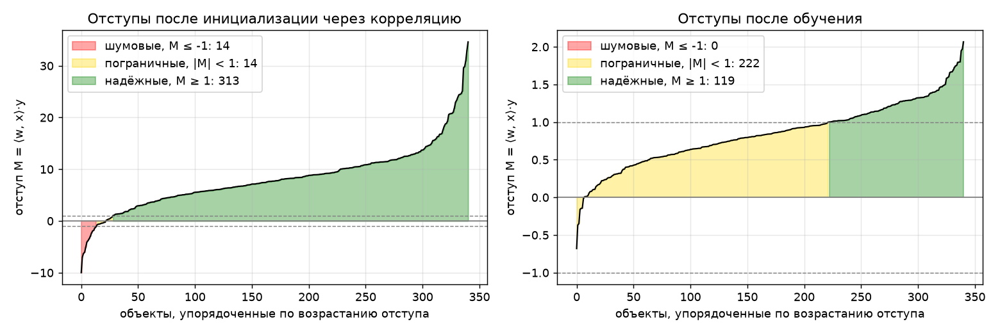
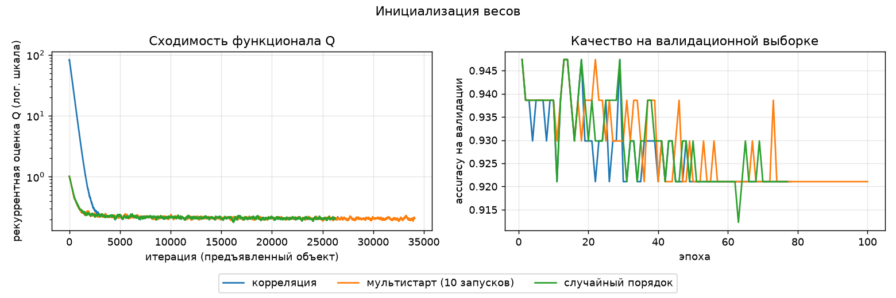
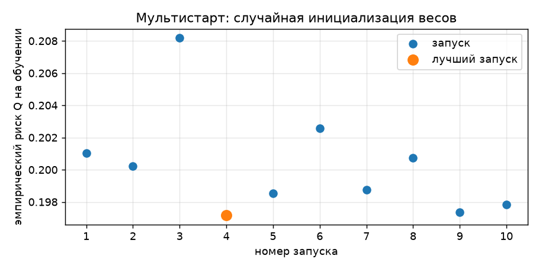
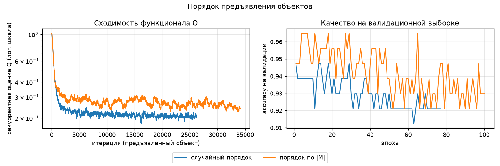
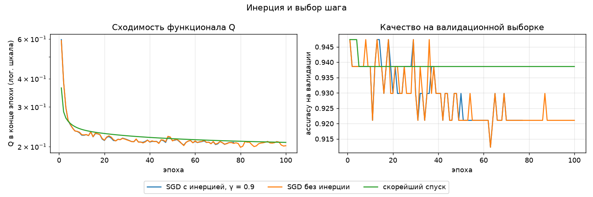
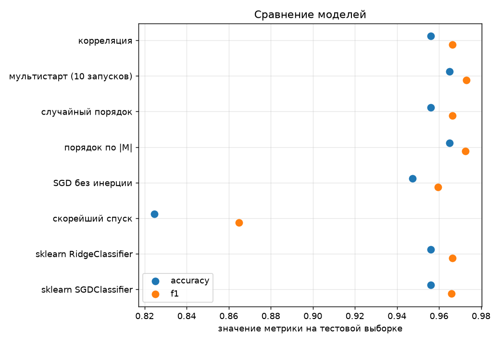

# Лабораторная работа №1. Линейная классификация

Линейный классификатор `a(x, w) = sign(⟨w, x⟩)`, обучаемый стохастическим градиентным спуском
с инерцией, L2-регуляризацией и квадратичной функцией потерь.


## Датасет

[Breast Cancer Wisconsin (Diagnostic)](https://archive.ics.uci.edu/dataset/17/breast+cancer+wisconsin+diagnostic)
загружается через `sklearn.datasets.load_breast_cancer`: 569 объектов, 30 числовых признаков,
2 класса (злокачественная опухоль → −1, доброкачественная → +1, доля +1 ≈ 0.63).

Предобработка: разбиение train/val/test 60/20/20 (341/114/114 объектов) со стратификацией,
стандартизация признаков по обучающей выборке, добавление константного признака `f0 = −1`
(вес `w0` играет роль порога).

Роли выборок:
- **train:** обучение всех моделей; внутри мультистарта лучший запуск выбирается по эмпирическому
  риску на train;
- **val:** выбор лучшего режима обучения и кривые качества по эпохам;
- **test:** только итоговая оценка, в выборе не участвует.

## Реализация

**Отступ** объекта: `M_i = ⟨w, x_i⟩·y_i`. При `M_i < 0` классификатор ошибается на объекте.

**Функция потерь** квадратичная: `L(M) = (1 − M)²`, градиент на объекте
`∇L(w, x_i) = −2(1 − M_i)·y_i·x_i`.

**Рекуррентная оценка функционала** (экспоненциальное скользящее среднее потерь):
`Q := λ·ξ_i + (1 − λ)·Q`, `ξ_i = L(w, x_i)`, `λ = 1/ℓ`. Начальное значение - средняя потеря
на случайном подмножестве из 50 объектов. Останов - когда `Q` за эпоху меняется меньше чем на `10⁻⁵`
или после 100 эпох.

**Метод накопления инерции**: `v := γv + (1 − γ)∇L(w, x_i)`, `w := w − h·v`, `γ = 0.9`.

**L2-регуляризация**: `w := w(1 − hτ) − h·v`, `τ = 10⁻³`.

**Скорейший градиентный спуск**. Для `Q(w) = (1/ℓ)Σ(1 − M_i)² + (τ/2)‖w‖²`
градиент `g = −(2/ℓ)Xᵀ(y(1 − M)) + τw`, гессиан `H = (2/ℓ)XᵀX + τI` постоянен (`Q` квадратичен).
Шаг вдоль `g` подбирается точно из условия `Q(w − hg) → min_h`:
**`h* = gᵀg / gᵀHg`**. Одна итерация - один шаг по всей выборке, инерция не используется.

**Инициализация весов:**
- случайная: `w_j ~ U[−1/(2n), 1/(2n)]`;
- через корреляцию: `w_j = ⟨y, f_j⟩ / ⟨f_j, f_j⟩`;
- мультистарт: 10 запусков со случайной инициализацией, выбирается модель с наименьшим
  эмпирическим риском на обучающей выборке.

**Порядок предъявления объектов:**
- случайный - перестановка выборки на каждой эпохе;
- по модулю отступа - объект выбирается с вероятностью `p_i ∝ exp(−|M_i| / T)`, `T = 1`:
  чем меньше уверенность классификатора на объекте, тем чаще он предъявляется. Отступы
  пересчитываются в начале каждой эпохи.

Общие параметры: `h = 10⁻³`, `γ = 0.9`, `τ = 10⁻³`, не более 100 эпох, `seed = 0`.

## Отступы



Слева отступы на train сразу после инициализации через корреляцию, справа после обучения.
Зоны выделяются по модулю отступа с порогом `δ = 1`:
- пограничные `|M| < δ`: объекты рядом с разделяющей гиперплоскостью с обеих сторон
  (и правильно, и неправильно классифицированные с малым отступом);
- надёжные `M ≥ δ`: далеко от границы со своей стороны;
- шумовые `M ≤ −δ`: далеко от границы с чужой стороны, кандидаты в выбросы.

Порог `δ = 1` выбран потому, что квадратичная потеря `(1 − M)²` стягивает отступы к 1, то есть 1 -
естественный масштаб уверенности модели; зоны симметричны относительно границы.

- Инициализация через корреляцию уже даёт осмысленный классификатор, но
  отступы огромные (до 35), а эмпирический риск ≈ 90: признаки датасета сильно коррелированы,
  а формула `⟨y, f_j⟩ / ⟨f_j, f_j⟩` оптимальна только для некоррелированных признаков, поэтому
  вклады признаков складываются и веса завышены. Зоны: 14 шумовых, 14 пограничных, 313 надёжных.
- После обучения квадратичная потеря стягивает отступы к 1: шумовых объектов нет,
  222 пограничных, 119 надёжных. Ошибок (`M < 0`) 7, и все они попадают в пограничную зону
  (наименьший отступ −0.68), то есть это объекты на границе классов, а не грубые выбросы.

## Эксперименты

Кривые `Q` построены на train, кривые accuracy по эпохам - на val.

### Инициализация весов



Корреляционная инициализация стартует с большой ошибки (из-за завышенных весов) и за первые
~4000 итераций приходит к тому же уровню `Q`, что и случайная. Итоговое качество одинаковое.



Разброс эмпирического риска между 10 случайными запусками небольшой:
функционал выпуклый, и разные старты приходят примерно в одну точку. Мультистарт даёт
небольшой выигрыш (риск 0.197-0.208, лучший 0.197), но стоит в 10 раз дороже.

### Порядок предъявления



Рекуррентная оценка `Q` при предъявлении по `|M|` выше, но это смещение оценки, а не плохое
обучение: чаще берутся объекты с `M ≈ 0`, у которых потеря ≈ 1. Эмпирический риск по всей
выборке тоже выше (0.263 против 0.201): модель тратит шаги на пограничные объекты, а не на
минимизацию квадратичной потери в среднем. Зато точность на валидации выше (0.930 против 0.921):
для классификации важнее правильно расположить границу, чем подогнать отступы к 1.

### Инерция и скорейший спуск



- SGD с инерцией и без почти совпадают: в формулировке лекции `v` - скользящее среднее
  градиента, длина шага от этого не меняется, а при маленьком `h` траектория и так гладкая.
  Инерция немного сглаживает шум и позволила раньше выполнить критерий останова (77 эпох против 100).
- Скорейший спуск (по полному градиенту) монотонно снижает `Q` (0.36 после первой итерации,
  0.21 к сотой) и держит accuracy на валидации 0.939-0.947: каждая итерация гарантированно
  уменьшает `Q`, поэтому нет скачков качества, как у SGD.
  Для сравнения по оси эпох у SGD взято `Q` в конце эпохи.

## Выбор модели и сравнение с эталоном

Процедура: все режимы обучаются на train, лучший режим выбирается по F1 (при равенстве
по accuracy) на val, после чего выбранная модель (и для сравнения все остальные) оценивается
на test (114 объектов). `Q (train)` - эмпирический риск на обучающей выборке.

| Модель | Accuracy (val) | F1 (val) | Accuracy (test) | Precision (test) | Recall (test) | F1 (test) | Q (train) | Эпох | Время, с |
|---|---|---|---|---|---|---|---|---|---|
| корреляция | 0.921 | 0.940 | 0.956 | 0.947 | 0.986 | 0.966 | 0.202 | 78 | 0.15 |
| мультистарт (10 запусков) | 0.921 | 0.940 | 0.965 | 0.947 | 1.000 | 0.973 | **0.197** | 100 | 1.81 |
| случайный порядок | 0.921 | 0.940 | 0.965 | 0.947 | 1.000 | 0.973 | 0.201 | 77 | 0.14 |
| порядок по \|M\| | 0.930 | 0.947 | 0.956 | 0.947 | 0.986 | 0.966 | 0.263 | 100 | 0.19 |
| SGD без инерции | 0.921 | 0.940 | 0.965 | 0.947 | 1.000 | 0.973 | **0.197** | 100 | 0.18 |
| **скорейший спуск** | **0.939** | **0.953** | 0.965 | 0.959 | 0.986 | 0.973 | 0.209 | 100 | 0.00 |
| sklearn RidgeClassifier | 0.921 | 0.940 | 0.965 | 0.947 | 1.000 | 0.973 | - | - | 0.00 |
| sklearn SGDClassifier | 0.939 | 0.953 | 0.965 | 0.959 | 0.986 | 0.973 | - | - | 0.00 |



По валидации выбран **скорейший спуск** (F1 = 0.953 на val). Его итоговая оценка на test:
accuracy 0.965, F1 0.973. Матрица ошибок на test, `[[TN, FP], [FN, TP]]`:

```
[[39  3]
 [ 1 71]]
```

Различия между режимами и на val, и на test - 1-2 объекта из 114, то есть в пределах шума
выборки: на test все модели дают 0.956-0.965.

Эталоны: `RidgeClassifier` (квадратичная потеря + L2, решается аналитически) и
`SGDClassifier(loss="squared_error", penalty="l2")` с теми же `h`, `τ` и числом эпох.
Выбранная модель (скорейший спуск) совпадает с `SGDClassifier` по метрикам и на val, и на test,
остальные собственные модели не уступают эталонам на test. По времени эталоны быстрее
на 2-3 порядка: они написаны на C/Cython, а собственная реализация делает шаг SGD в цикле Python.

## Выводы

1. Линейный классификатор с квадратичной потерей даёт на Breast Cancer точность 95-97% на test,
   на уровне эталонных реализаций sklearn. Режим обучения выбирается по валидации,
   test в выборе не участвует.
2. Инициализация через корреляцию при коррелированных признаках сильно завышает веса; качество
   после обучения то же, что и при случайной инициализации.
3. Мультистарт улучшает результат незначительно: функционал выпуклый, разброс между запусками мал.
4. Предъявление объектов по модулю отступа повышает точность на валидации за счёт пограничных
   объектов, хотя средняя квадратичная потеря при этом растёт.
5. Инерция в форме скользящего среднего градиента почти не влияет на результат при малом шаге.
6. Скорейший спуск по полному градиенту с точным шагом `gᵀg / gᵀHg` выбран по валидации
   как лучший режим (test: accuracy 0.965, F1 0.973). По `Q` он за 100 итераций ещё не дошёл
   до минимума (0.209 против 0.197 у SGD): сходится медленно из-за зигзагообразной траектории
   на плохо обусловленной задаче. При этом он устойчивее: качество не скачет между итерациями.
