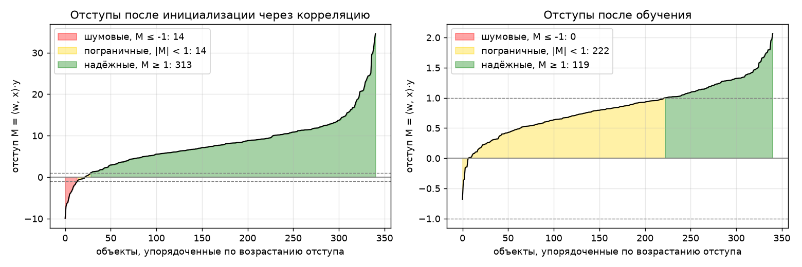
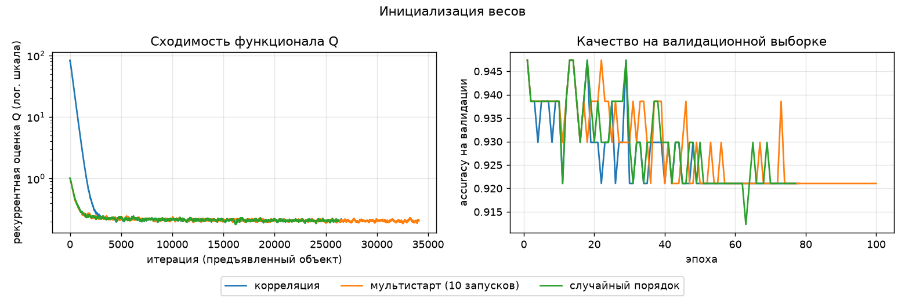
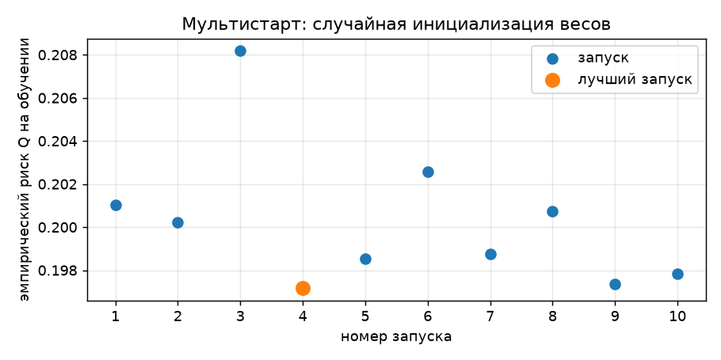
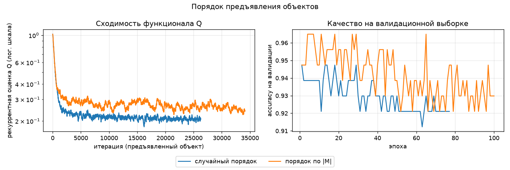
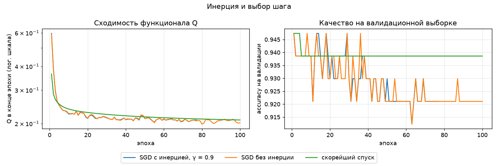
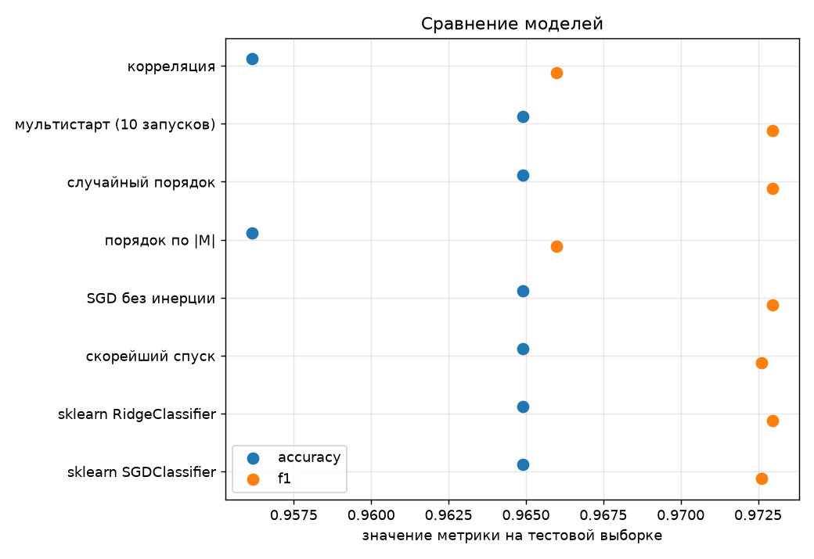

# Лабораторная работа №1. Линейная классификация

Линейный классификатор `a(x, w) = sign(⟨w, x⟩)`, обучаемый стохастическим градиентным спуском
с инерцией, L2-регуляризацией и квадратичной функцией потерь (по материалам лекции 1).


## Датасет

[Breast Cancer Wisconsin (Diagnostic)](https://archive.ics.uci.edu/dataset/17/breast+cancer+wisconsin+diagnostic)
загружается через `sklearn.datasets.load_breast_cancer`: 569 объектов, 30 числовых признаков,
2 класса (злокачественная опухоль → −1, доброкачественная → +1, доля +1 ≈ 0.63).

Предобработка: разбиение train/test 80/20 со стратификацией,
стандартизация признаков по обучающей выборке, добавление константного признака `f0 = −1`
(вес `w0` играет роль порога).

## Реализация

**Отступ** объекта: `M_i = ⟨w, x_i⟩·y_i`. При `M_i < 0` классификатор ошибается на объекте.

**Функция потерь** квадратичная: `L(M) = (1 − M)²`, градиент на объекте
`∇L(w, x_i) = −2(1 − M_i)·y_i·x_i`.

**Рекуррентная оценка функционала** (экспоненциальное скользящее среднее потерь):
`Q := λ·ξ_i + (1 − λ)·Q`, `ξ_i = L(w, x_i)`, `λ = 1/ℓ`. Начальное значение — средняя потеря
на случайном подмножестве из 50 объектов. Останов — когда `Q` за эпоху меняется меньше чем на `10⁻⁵`
или после 100 эпох.

**Метод накопления инерции**: `v := γv + (1 − γ)∇L(w, x_i)`, `w := w − h·v`, `γ = 0.9`.

**L2-регуляризация**: `w := w(1 − hτ) − h·v`, `τ = 10⁻³`.

**Скорейший градиентный спуск** (по полному градиенту). Для `Q(w) = (1/ℓ)Σ(1 − M_i)² + (τ/2)‖w‖²`
градиент `g = −(2/ℓ)Xᵀ(y(1 − M)) + τw`, гессиан `H = (2/ℓ)XᵀX + τI` постоянен (`Q` квадратичен).
Шаг вдоль `g` подбирается точно из условия `Q(w − hg) → min_h`:
**`h* = gᵀg / gᵀHg`**. Одна итерация - один шаг по всей выборке, инерция не используется.

**Инициализация весов:**
- случайная: `w_j ~ U[−1/(2n), 1/(2n)]`;
- через корреляцию: `w_j = ⟨y, f_j⟩ / ⟨f_j, f_j⟩`;
- мультистарт: 10 запусков со случайной инициализацией, выбирается модель с наименьшим
  эмпирическим риском на обучающей выборке.

**Порядок предъявления объектов:**
- случайный — перестановка выборки на каждой эпохе;
- по модулю отступа — объект выбирается с вероятностью `p_i ∝ exp(−|M_i| / T)`, `T = 1`:
  чем меньше уверенность классификатора на объекте, тем чаще он предъявляется. Отступы
  пересчитываются в начале каждой эпохи.

Общие параметры: `h = 10⁻³`, `γ = 0.9`, `τ = 10⁻³`, не более 100 эпох, `seed = 0`.

## Отступы



Слева — отступы сразу после инициализации через корреляцию, справа — после обучения.
Зоны: ошибки (`M < 0`), пограничные объекты (`0 ≤ M < 1`), надёжные (`M ≥ 1`).

- Инициализация через корреляцию уже даёт осмысленный классификатор, но
  отступы огромные, а эмпирический риск ≈ 90: признаки датасета сильно коррелированы,
  а формула `⟨y, f_j⟩ / ⟨f_j, f_j⟩` оптимальна только для некоррелированных признаков, поэтому
  вклады признаков складываются и веса завышены.
- После обучения квадратичная потеря стягивает отступы к 1: большинство объектов оказывается
  в полосе `0 ≤ M < 1`, ошибок 13. Объекты с наименьшими отступами — кандидаты в выбросы
  или объекты на границе классов.

## Эксперименты

### Инициализация весов (п. 9.1, 9.2)



Корреляционная инициализация стартует с большой ошибки (из-за завышенных весов) и за первые
~4000 итераций приходит к тому же уровню `Q`, что и случайная. Итоговое качество одинаковое.



Разброс эмпирического риска между 10 случайными запусками небольшой:
функционал выпуклый, и разные старты приходят примерно в одну точку. Мультистарт даёт
небольшой выигрыш (лучший риск 0.208), но стоит в 10 раз дороже.

### Порядок предъявления (п. 9.3)



Рекуррентная оценка `Q` при предъявлении по `|M|` выше, но это смещение оценки, а не плохое
обучение: чаще берутся объекты с `M ≈ 0`, у которых потеря ≈ 1. Эмпирический риск по всей
выборке тоже выше: модель тратит шаги на пограничные объекты, а не на
минимизацию квадратичной потери в среднем. Зато точность на тесте выше — для классификации важнее правильно расположить границу, чем подогнать отступы к 1.

### Инерция и скорейший спуск



- SGD с инерцией и без почти совпадают: в формулировке лекции `v` — скользящее среднее
  градиента, длина шага от этого не меняется, а при маленьком `h` траектория и так гладкая.
  Инерция немного сглаживает шум и позволила раньше выполнить критерий останова (41 эпоха против 100).
- Скорейший спуск (по полному градиенту) монотонно снижает `Q` (0.37 после первой итерации,
  0.22 к сотой) и держит accuracy на тесте 0.95-0.97: каждая итерация гарантированно уменьшает `Q`.
  Для сравнения по оси эпох у SGD взято `Q` в конце эпохи.

## Качество классификации и сравнение с эталоном

Метрики на тестовой выборке (114 объектов); `Q (train)` — эмпирический риск на обучающей выборке.

| Модель | Accuracy | Precision | Recall | F1 | Q (train) | Эпох | Время, с |
|---|---|---|---|---|---|---|---|
| корреляция | 0.956 | 0.935 | 1.000 | 0.966 | 0.211 | 57 | 0.15 |
| мультистарт (10 запусков) | **0.965** | 0.947 | 1.000 | **0.973** | **0.208** | 100 | 3.70 |
| случайный порядок | 0.956 | 0.935 | 1.000 | 0.966 | 0.215 | 41 | 0.10 |
| порядок по \|M\| | **0.965** | **0.959** | 0.986 | **0.973** | 0.242 | 100 | 0.26 |
| SGD без инерции | 0.947 | 0.934 | 0.986 | 0.959 | 0.216 | 100 | 0.25 |
| скорейший спуск | 0.947 | 0.934 | 0.986 | 0.959 | 0.218 | 100 | 0.00 |
| sklearn RidgeClassifier | 0.956 | 0.935 | 1.000 | 0.966 | — | — | 0.00 |
| sklearn SGDClassifier | 0.956 | 0.947 | 0.986 | 0.966 | — | — | 0.00 |



Матрица ошибок лучшей модели (мультистарт), `[[TN, FP], [FN, TP]]`:

```
[[38  4]
 [ 0 72]]
```

Эталоны: `RidgeClassifier` (квадратичная потеря + L2, решается аналитически) и
`SGDClassifier(loss="squared_error", penalty="l2")` с теми же `h`, `τ` и числом эпох.
Лучшие собственные модели (мультистарт и предъявление по `|M|`) не уступают эталонам по качеству
и ошибаются на тесте на 1 объект меньше. По времени эталоны быстрее на 2–3 порядка: они написаны
на C/Cython, а собственная реализация делает шаг SGD в цикле Python.

## Выводы

1. Линейный классификатор с квадратичной потерей и SGD даёт на Breast Cancer точность 95–97%,
   на уровне эталонных реализаций sklearn.
2. Инициализация через корреляцию при коррелированных признаках сильно завышает веса; качество
   после обучения то же, что и при случайной инициализации.
3. Мультистарт улучшает результат незначительно: функционал выпуклый, разброс между запусками мал.
4. Предъявление объектов по модулю отступа повышает точность за счёт пограничных объектов,
   хотя средняя квадратичная потеря при этом растёт.
5. Инерция в форме скользящего среднего градиента почти не влияет на результат при малом шаге.
6. Скорейший спуск по полному градиенту с точным шагом `gᵀg / gᵀHg` работает на уровне остальных
   (accuracy 0.947, `Q = 0.218`), но за 100 итераций ещё не дошёл до минимума: сходится медленно
   из-за зигзагообразной траектории на плохо обусловленной задаче.
