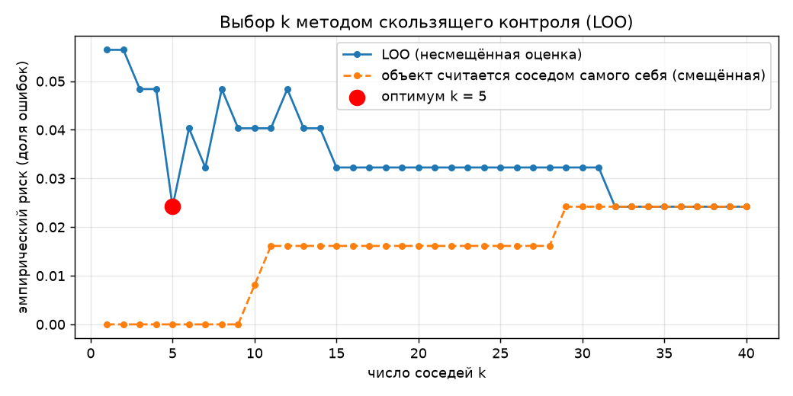
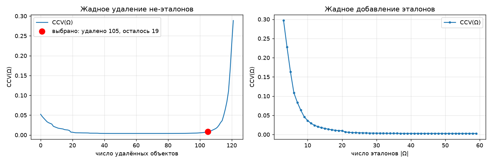
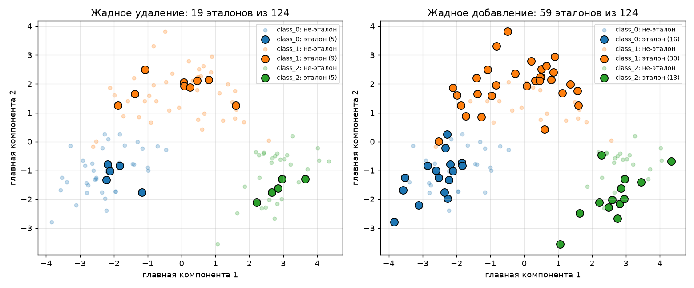
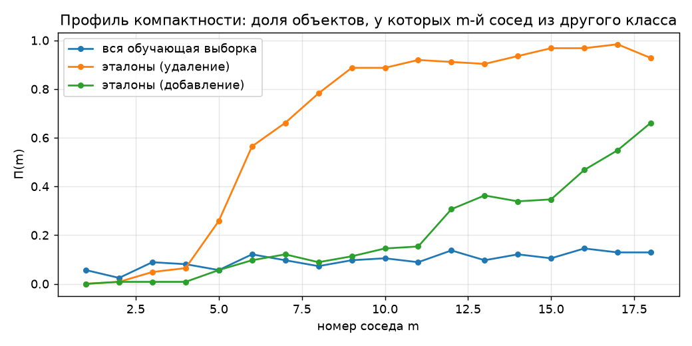

# Лабораторная работа №2. Метрическая классификация

Реализованы метод k ближайших соседей с окном Парзена переменной ширины, подбор k по LOO
и отбор эталонов по критерию полного скользящего контроля CCV.

## Датасет

[Wine](https://archive.ics.uci.edu/dataset/109/wine): 178 вин трёх сортов,
13 числовых признаков (химический состав: алкоголь, кислотность, флавоноиды, пролин и т.д.).

## Метод

### KNN с окном Парзена переменной ширины

Для объекта `x` обучающие объекты упорядочиваются по расстоянию:
`ρ(x, x^(1)) ≤ ρ(x, x^(2)) ≤ …`. Ширина окна - расстояние до `(k+1)`-го соседа,
вес `i`-го соседа задаётся ядром:

```
h(x) = ρ(x, x^(k+1))
a(x) = argmax_y Σ_{i=1..k} [y^(i) = y] · K(ρ(x, x^(i)) / h(x))
K(r) = exp(−2r²)            - гауссовское ядро
```

Окно «подстраивается» под плотность: в густых областях оно узкое, в разреженных - широкое.
В отличие от обычного kNN, голоса соседей зависят не от номера, а от расстояния, поэтому реже
возникают ничьи. Метрика - евклидова на стандартизованных признаках.

### Подбор k по LOO

```
LOO(k) = (1/ℓ) Σ_i [a(x_i; X^ℓ \ {x_i}, k) ≠ y_i]  →  min_k
```

Матрица расстояний считается один раз; исключение объекта - это `ρ(x_i, x_i) = ∞`.
Для сравнения считается и смещённая оценка, когда объект
не исключается и является соседом самого себя.

### Отбор эталонов по CCV

Для 1NN, использующего только эталоны `Ω ⊆ X^L`, в лекции выведено точное выражение полного
скользящего контроля:

```
CCV(Ω) = (1/L) Σ_{i=1..L} Σ_{m=1..k} [y_i ≠ y_i^(m|Ω)] · R(m),
R(m)   = C(L−1−m, ℓ−1) / C(L−1, ℓ)
```

- `y_i^(m|Ω)` - класс `m`-го соседа `x_i` среди эталонов (сам `x_i` соседом не считается);
- `ℓ` и `k` - длины обучения и контроля, `L = ℓ + k`; взято `k = 0.3·L` (как в нашем разбиении);
- `R(m)` - вероятность того, что у контрольного объекта соседи `1..m−1` тоже в контроле,
  а `m`-й - в обучении. Сумма `R(m)` по `m` равна 1, убывают они быстрее геометрической прогрессии,
  поэтому хвост `< 10⁻¹²` отбрасывается (остаётся 19 слагаемых);
- при `k = 1` получается `CCV = Π(1) = LOO` для 1NN - это проверено в коде.

Профиль компактности `Π(m) = (1/L) Σ_i [y_i ≠ y_i^(m)]` - доля объектов, у которых `m`-й сосед из другого класса.

Реализованы обе жадные стратегии из лекции:
- **удаление не-эталонов:** `Ω := X^L`; на каждом шаге удаляется объект, без которого `CCV`
  минимален; в `Ω` остаётся хотя бы один объект каждого класса. Проходится весь путь, затем
  выбирается наименьшее `Ω`, у которого `CCV` не больше минимума на пути + 0.005
  («пока CCV уменьшается или почти не увеличивается»);
- **добавление эталонов:** `Ω :=` по одному объекту от класса (ближайший к центру класса);
  добавляется объект, с которым `CCV` минимален, пока `CCV` уменьшается.

После отбора `k` для KNN на эталонах снова подбирается по LOO (соседями служат только эталоны).

## Результаты

### Выбор k



| k | 1 | 2 | 3 | 4 | **5** | 6 | 7 | 8 | 10 | 15 | 20 | 32–40 |
|---|---|---|---|---|---|---|---|---|---|---|---|---|
| LOO | 0.056 | 0.056 | 0.048 | 0.048 | **0.024** | 0.040 | 0.032 | 0.048 | 0.040 | 0.032 | 0.032 | 0.024 |

Выбрано **k = 5** (LOO = 0.024, 3 ошибки из 124):
- это глобальный минимум, и из равных по риску значений (5 и 32–40) выбрано наименьшее -
  при больших k окно захватывает объекты чужих классов и модель становится грубее,
  а предсказание медленнее;
- при k = 1–2 риск в 2 раза выше: решение определяется одним-двумя соседями и чувствительно к шуму;
- выборка маленькая, одна ошибка меняет риск на 0.008, поэтому кривая «пилообразная»,
  и минимум при k = 5 не стоит переоценивать: значения 5–40 различаются на 1–3 ошибки.

Смещённая оценка равна 0 при k ≤ 9: объект сам себе ближайший сосед с весом `K(0) = 1`
и почти всегда «перевешивает» остальных. Она бесполезна для выбора k - поэтому объект
обязательно исключают из выборки.

### Сравнение с sklearn

- `KNeighborsClassifier(n_neighbors=k+1, weights=…)` с тем же окном Парзена (последний сосед задаёт ширину
  окна и не голосует): **LOO-кривые при всех k и предсказания на тесте полностью совпадают** с собственной реализацией.
- Стандартный `KNeighborsClassifier`, k и вид весов (`uniform` / `distance`) подобраны по LOO
  через `GridSearchCV(cv=LeaveOneOut())`: лучший k = 7, `uniform`, LOO = 0.024 - тот же уровень риска.

### Отбор эталонов



- **Удаление:** CCV падает с 0.052 (вся выборка) до ~0.004 и держится на этом уровне,
  пока удаляются «внутренние» объекты; резко растёт, только когда в классах остаётся по 2–3 объекта.
  Выбрано 19 эталонов (5 / 9 / 5 по классам), CCV = 0.008. Переобучения нет - как и сказано в лекции,
  CCV не уменьшается за счёт подгонки.
- **Добавление:** с 3 стартовых эталонов CCV быстро падает и к 20 эталонам выходит на плато;
  алгоритм продолжает добавлять объекты, пока CCV хоть немного уменьшается, и останавливается на 59 (16 / 30 / 13), CCV = 0.003.



Проекция на две главные компоненты (PCA через SVD). При удалении эталоны - небольшое число
объектов, покрывающих каждый класс;
объекты в глубине класса и одиночные «выбросы» в чужой области (например, оранжевый квадрат среди синих)
удалены. При добавлении эталонов втрое больше, они покрывают классы плотнее.



На всей выборке `Π(m) ≈ 0.02–0.15` - классы компактны (гипотеза компактности выполняется).
Для эталонов `Π(1–2) ≈ 0` - ближайший эталон почти всегда своего класса (именно это и
оптимизирует CCV). При больших `m` профиль эталонов растёт: эталонов каждого класса
всего 5–16, и дальние соседи неизбежно из других классов. Поэтому на эталонах
оптимальным по LOO оказывается k = 1.

### Качество классификации с отбором эталонов и без

Тестовая выборка - 54 объекта.

| Модель | Accuracy | Macro-F1 | Опорных объектов | Сжатие | Предсказание, мс |
|---|---|---|---|---|---|
| ParzenKNN, k=5 (своя) | 0.944 | 0.945 | 124 | 0% | 0.40 |
| sklearn, окно Парзена, k=5 | 0.944 | 0.945 | 124 | 0% | 0.83 |
| sklearn KNN, k=7, uniform | 0.944 | 0.945 | 124 | 0% | 1.67 |
| 1NN, вся выборка | 0.963 | 0.964 | 124 | 0% | 0.09 |
| 1NN, эталоны (удаление) | 0.963 | 0.961 | 19 | 85% | 0.04 |
| ParzenKNN, k=1, эталоны (удаление) | 0.963 | 0.961 | 19 | 85% | 0.11 |
| 1NN, эталоны (добавление) | 0.944 | 0.942 | 59 | 52% | 0.06 |
| ParzenKNN, k=1, эталоны (добавление) | 0.944 | 0.942 | 59 | 52% | 0.20 |

(ParzenKNN с k = 1 совпадает с 1NN: голосует один сосед.)

- Отбор эталонов удалением **сократил выборку на 85% без потери качества**:
  accuracy 0.963, как у 1NN на всей выборке; предсказание в 2 раза быстрее.
- Отбор добавлением сохранил 52% объектов, качество на 1 объект ниже.
- Все модели различаются на тесте не больше чем на 1 объект из 54 (≈ 0.019) - в пределах шума.
  В частности, 1NN на тесте оказался на 1 объект лучше KNN с k = 5, хотя по LOO на обучении
  k = 5 лучше (3 ошибки против 7) - на 54 тестовых объектах это не значимо.

## Выводы

1. KNN с окном Парзена переменной ширины и гауссовским ядром даёт на Wine 94–96% точности;
   собственная реализация совпадает с sklearn и по LOO-кривой, и по предсказаниям.
2. LOO позволяет подобрать k без отдельной валидационной выборки; оптимум k = 5. Смещённая оценка
   (объект - сосед самому себе) непригодна: она равна 0 при малых k.
3. На маленькой выборке LOO-кривая шумная: соседние k отличаются на 1–2 ошибки, поэтому выбор
   k имеет смысл обосновывать и формой кривой, а не только точкой минимума.
4. Жадный отбор эталонов по CCV удалением оставляет 15% выборки без потери качества и ускоряет
   классификацию; выбросы удаляются. Добавление при критерии «пока CCV уменьшается» оставляет
   больше эталонов, чем нужно - его стоит останавливать на плато.
5. Классы Wine компактны (`Π(m)` мал), поэтому метрические методы работают хорошо.
