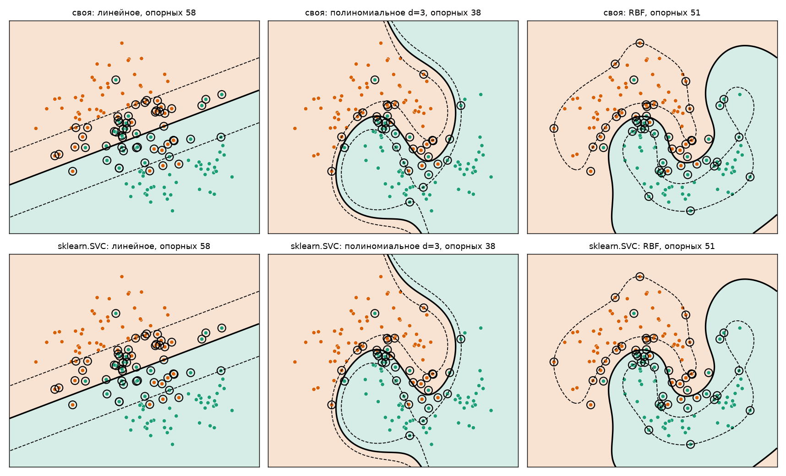
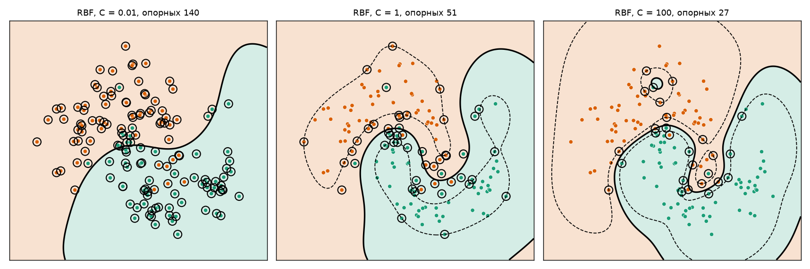
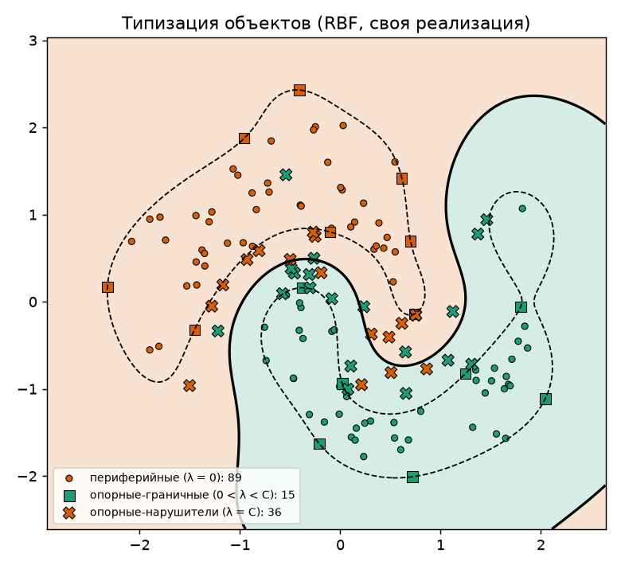
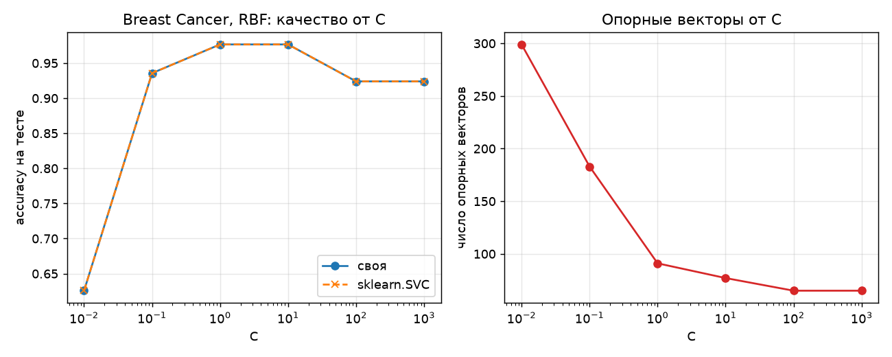

# Лабораторная работа №3. SVM

Реализован метод опорных векторов через решение двойственной задачи по λ с трюком с ядром. Результат сравнивается с `sklearn.svm.SVC`.

## Датасеты

- [Breast Cancer Wisconsin](https://archive.ics.uci.edu/dataset/17): 569 объектов, 30 числовых признаков,
  бинарная классификация (злокачественная / доброкачественная). Разбиение 70/30 со стратификацией.

## Метод

Двойственная задача:

```
-L(λ) = -Σ λ_i + 1/2 Σ Σ λ_i λ_j y_i y_j K(x_i, x_j)  ->  min_λ
Σ λ_i y_i = 0,   0 <= λ_i <= C
```

- Решается `scipy.optimize.minimize(method="SLSQP")` с аналитическими градиентом и якобианом ограничения.
- Решение прямой задачи: `w0 = <w, x_i> - y_i`, для опорных-граничных `0 < λ_i < C`.
- Классификатор: `a(x) = sign(Σ λ_i y_i K(x, x_i) - w0)`; `w` явно не хранится, достаточно опорных объектов.
- Типизация объектов: периферийные (`λ = 0`), опорные-граничные (`0 < λ < C`), опорные-нарушители (`λ = C`).

Ядра:
```
линейное         K = <x, x'>
полиномиальное   K = (<x, x'> + 1)^3
RBF              K = exp(-γ ||x - x'||²)
```

## Результаты

### Визуализация, moons, C = 1



Сверху своя реализация, снизу `SVC`. Сплошная линия - граница `<w,x> - w0 = 0`, пунктир - края полосы `±1`,
обведены опорные объекты.

| Ядро | Accuracy своя | Accuracy sklearn | Опорных (своя / sklearn) | Совпадение предсказаний |
|---|---|---|---|---|
| линейное | 0.883 | 0.883 | 58 / 58 | 1.000 |
| полиномиальное d=3 | 0.933 | 0.933 | 38 / 38 | 1.000 |
| RBF, γ=1 | 0.950 | 0.950 | 51 / 51 | 1.000 |


### Влияние C



| C | 0.01 | 1 | 100 |
|---|---|---|---|
| Опорных (из 140) | 140 | 51 | 27 |
| Accuracy на тесте | 0.900 | 0.950 | 0.933 |

Малое C - сильная регуляризация: широкая полоса, все объекты опорные и граница слишком гладкая.
Большое C - слабая регуляризация: полоса уже, опорных меньше, граница подстраивается под выбросы.

### Типы объектов



RBF, C = 1: периферийных 89, опорных-граничных 15, опорных-нарушителей 36.

### Breast Cancer, C = 1

Тест - 171 объект. γ для RBF = 1 / 30.

| Ядро | Accuracy своя | F1 своя | Accuracy sklearn | F1 sklearn | Опорных (своя / sklearn) | Совпадение |
|---|---|---|---|---|---|---|
| линейное | 0.982 | 0.986 | 0.982 | 0.986 | 31 / 31 | 1.000 |
| полиномиальное d=3 | 0.971 | 0.977 | 0.971 | 0.977 | 64 / 65 | 1.000 |
| RBF | 0.977 | 0.981 | 0.977 | 0.981 | 91 / 91 | 1.000 |



| C | 0.01 | 0.1 | 1 | 10 | 100 | 1000 |
|---|---|---|---|---|---|---|
| Accuracy (своя = sklearn) | 0.626 | 0.936 | 0.977 | 0.977 | 0.924 | 0.924 |
| Опорных | 299 | 183 | 91 | 77 | 65 | 65 |

## Выводы

1. Собственная реализация двойственной задачи совпадает с `SVC`: предсказания на тесте идентичны
   для всех ядер и значений C, число опорных объектов совпадает (единственное отличие - 64 против 65
   для полиномиального ядра, объект на границе допуска).
2. Линейное ядро хорошо работает на Breast Cancer (0.982): данные почти линейно разделимы в 30 признаках.
   На moons линейное ядро хуже, там нужны полиномиальное или RBF.
3. C задаёт баланс между шириной полосы и числом нарушений: при C = 0.01 модель недообучена
   (0.626), при C = 1-10 оптимум, при C >= 100 качество снижается (0.924).
   Чем больше C, тем меньше опорных объектов.
4. Своя реализация намного медленнее (SLSQP на 398 переменных: 5-27 с против 3 мс у libsvm, который
   использует SMO). SLSQP подходит для обучения и небольших выборок, но не масштабируется.
