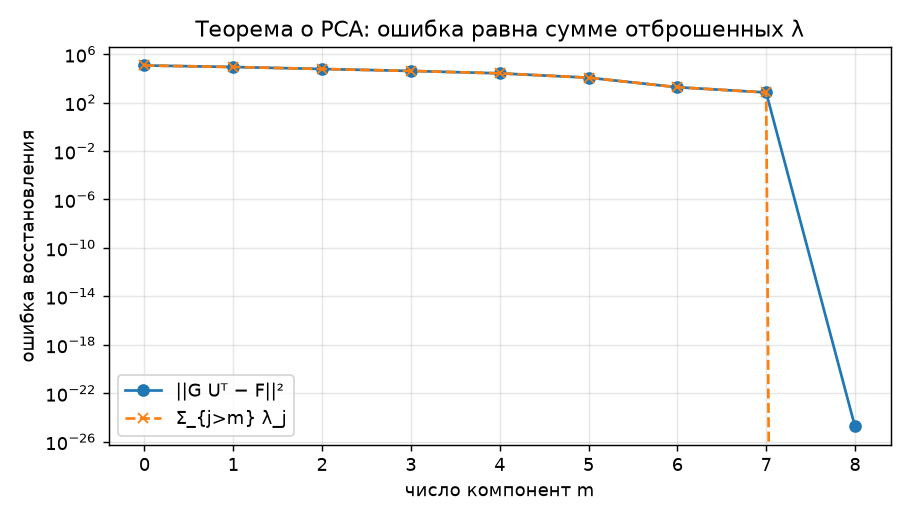
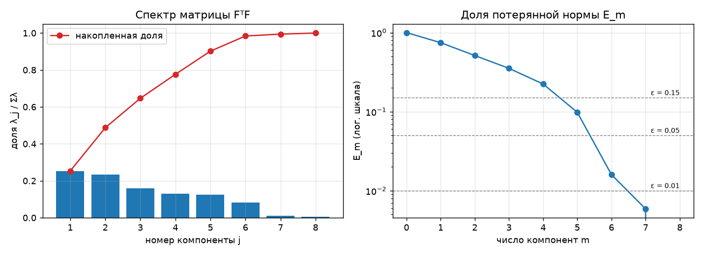
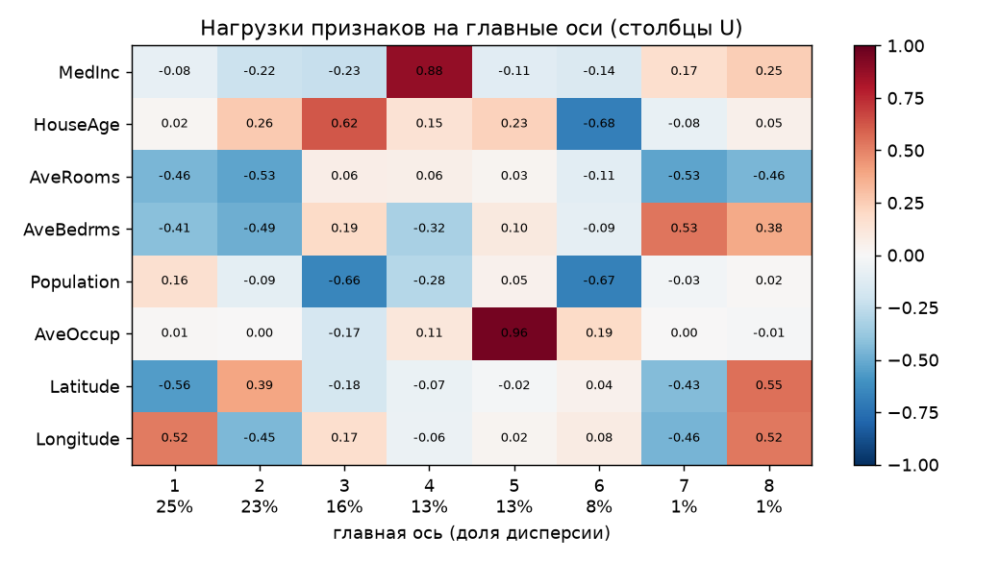
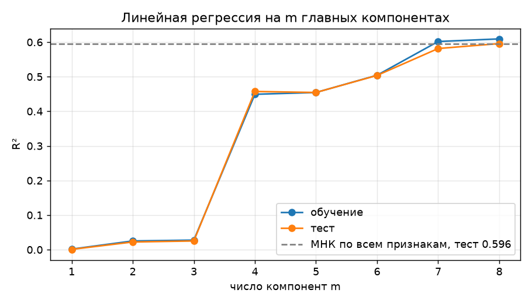

# Лабораторная работа №4. PCA

Реализован метод главных компонент через сингулярное разложение, определена эффективная размерность выборки,
результат сверен с `sklearn.decomposition.PCA`.

## Датасет

[California Housing](https://scikit-learn.org/stable/datasets/real_world.html#california-housing-dataset):
20640 районов, 8 числовых признаков, цель - медианная стоимость дома (в сотнях тысяч долларов).

## Метод

Матрица объекты-признаки `F` (ℓ × n) центрируется, затем раскладывается через SVD:

```
F = V D Uᵀ,
D = diag(√λ_1, ..., √λ_n),
G = F U,
F ≈ G_m U_mᵀ,
||G_m U_mᵀ - F||² = Σ_{j>m} λ_j
```

Столбцы `U` - главные оси (собственные векторы `FᵀF`), `λ_j` - собственные числа `FᵀF`, равные квадратам сингулярных чисел.
SVD вместо собственных векторов `FᵀF`: возведение матрицы в квадрат удваивает число обусловленности.

### Эффективная размерность

Наименьшее `m`, при котором потерянная доля нормы не превышает порога:

```
E_m = (λ_{m+1} + ... + λ_n) / (λ_1 + ... + λ_n) <= ε
```

Дополнительно считаются критерий «крутого склона» (`E_{m-1} / E_m`) и критерий Кайзера (`λ_j` больше среднего).

### Регрессия на главных компонентах

МНК в `m` новых признаках: `α = U_m D_m⁻¹ V_mᵀ y`. При `m = n` совпадает с обычным МНК.
## Результаты

### Свойства PCA

| свойство | расхождение |
|---|---|
| оси ортонормированы, `UᵀU = I` | 1.6e-15 |
| новые признаки некоррелированы, `GᵀG = Λ` | 7.7e-11 |
| `||G_m Uᵀ - F||² = Σ_{j>m} λ_j` для всех `m` | совпадает |



### Эффективная размерность



| m | 1 | 2 | 3 | 4 | 5 | 6 | 7 | 8 |
|---|---|---|---|---|---|---|---|---|
| доля дисперсии | 0.253 | 0.234 | 0.159 | 0.130 | 0.126 | 0.082 | 0.010 | 0.006 |
| `E_m` | 0.747 | 0.513 | 0.353 | 0.224 | 0.098 | 0.016 | 0.006 | 0.000 |
| `E_{m-1} / E_m` | 1.34 | 1.46 | 1.45 | 1.58 | 2.28 | **6.14** | 2.72 | - |

| критерий | ответ |
|---|---|
| ε = 15% | 5 |
| ε = 5% | 6 |
| ε = 1% | 7 |
| крутой склон (максимум `E_{m-1} / E_m`) | 6 |
| Кайзер | 5 |

Спектр плоский: первые шесть компонент несут 98.4% дисперсии, на оставшиеся две приходится 1.6%.
Резкий излом на `m = 6` даёт эффективную размерность **6 из 8**.



Последние две оси - комбинации из двух коррелированных пар (`AveRooms` и `AveBedrms`, `Latitude` и `Longitude`).

### Сравнение с эталоном

`PCA(svd_solver="full")` на тех же данных, максимальная разница:

| что сравниваем | расхождение |
|---|---|
| `mean_` | 0 |
| `explained_variance_` | 0 |
| `components_` (с учётом знака) | 0 |
| `transform()` на тесте (с учётом знака) | 7.1e-15 |

### Регрессия на главных компонентах



| m | 1 | 2 | 3 | 4 | 5 | 6 | 7 | 8 |
|---|---|---|---|---|---|---|---|---|
| R² обучение | 0.002 | 0.025 | 0.028 | 0.449 | 0.454 | 0.504 | 0.602 | 0.609 |
| R² тест | 0.001 | 0.022 | 0.025 | 0.457 | 0.454 | 0.504 | 0.582 | 0.596 |

МНК по всем признакам на тесте: R² = 0.5958. Результат через SVD при `m = 8` с ним совпадает.

## Выводы

1. PCA реализован через SVD.
2. Разложение совпадает с `sklearn.decomposition.PCA` с точностью до знака осей.
3. Эффективная размерность выборки равна 6 из 8: критерий `E_m <= 5%` и крутой склон дают 6, критерий Кайзера и порог 15% дают 5, порог 1% даёт 7.
   Две последние компоненты соответствуют избыточности в парах `AveRooms`/`AveBedrms` и `Latitude`/`Longitude`.
4. Порядок компонент по дисперсии не совпадает с порядком по полезности для регрессии: PCA не знает про `y`.
   Первые три компоненты почти ничего не объясняют, четвёртая даёт скачок до 0.457,
   а седьмая, несущая всего 1% дисперсии, поднимает R² на тесте с 0.504 до 0.582.
5. Снижение размерности здесь не улучшает регрессию: лучший результат даёт МНК по всем признакам.
   Мультиколлинеарность умеренная, поэтому отбрасывание «лишних» компонент только теряет информацию.
   Критерий эффективной размерности по `E_m` отвечает на вопрос о сжатии данных, а не о качестве предсказания.
