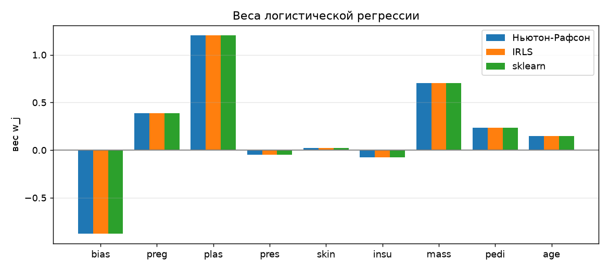
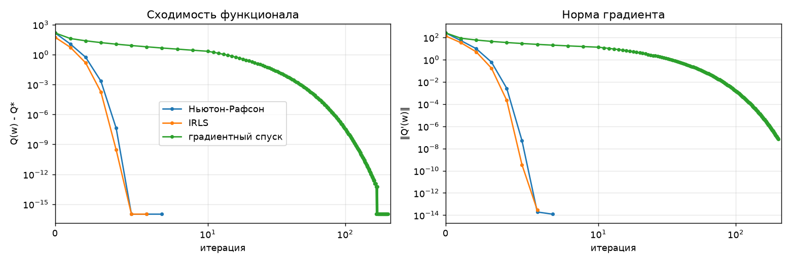
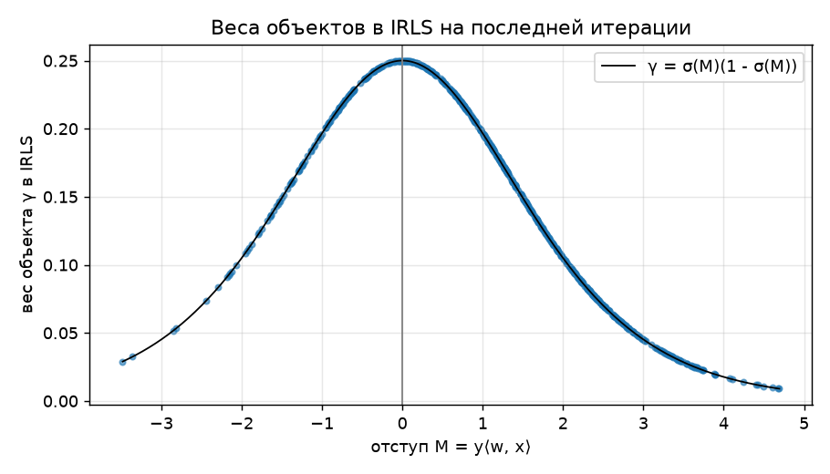
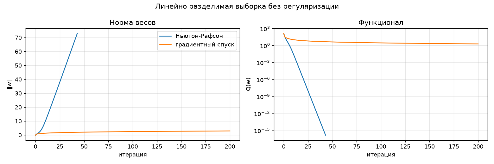

# Лабораторная работа №5. Логистическая регрессия

Логистическая регрессия `a(x) = sign(⟨w, x⟩)`, `P(y = +1 | x) = σ(⟨w, x⟩)`, обучаемая методом
Ньютона-Рафсона и методом IRLS, и сравнение
с эталонной реализацией `sklearn.linear_model.LogisticRegression`.

## Датасет

[Pima Indians Diabetes](https://www.openml.org/d/37), загружается через
`sklearn.datasets.fetch_openml("diabetes", version=1)`: 768 пациенток, 8 числовых признаков
(число беременностей, глюкоза, давление, толщина кожной складки, инсулин, индекс массы тела,
наследственность, возраст), 2 класса (`tested_positive` → +1, `tested_negative` → -1, доля +1 ≈ 0.35).


Предобработка:
- разбиение train/test 80/20 со стратификацией (614/154 объекта);
- нули в признаках `plas`, `pres`, `skin`, `insu`, `mass` физически невозможны, это пропуски:
  заменяются медианой по обучающей выборке;
- стандартизация признаков по обучающей выборке;
- константный признак `f0 = 1` (вес `w0` играет роль сдвига).

Гиперпараметров у модели нет, поэтому валидационная выборка не нужна: test используется
только для итоговой оценки.

## Реализация

Код: `source/logistic_regression.py`.

**Функционал** (аппроксимированный эмпирический риск): `Q(w) = Σ ln(1 + exp(-M_i))`,
отступ `M_i = y_i⟨w, x_i⟩`, `σ_i = σ(M_i)`, `σ(z) = 1 / (1 + e^(-z))`.
Считается через `np.logaddexp`, чтобы не было переполнения при больших отступах.

**Градиент и гессиан**:
- `∂Q/∂w_j = -Σ (1 - σ_i) y_i f_j(x_i)`, в матричном виде `Q' = -Fᵀ((1 - σ) ∘ y)`;
- `∂²Q/∂w_j∂w_k = Σ (1 - σ_i) σ_i f_j(x_i) f_k(x_i)`, то есть `Q'' = FᵀDF`, `D = diag((1 - σ_i)σ_i)`.

**Метод Ньютона-Рафсона**: `w := w - h (Q'')⁻¹ Q'`, `h = 1`, старт `w = 0`.
Гессиан не обращается явно, решается система `Q'' d = Q'` (`np.linalg.solve`).

**IRLS** (Iteratively Reweighted Least Squares):
1. `w := (FᵀF)⁻¹Fᵀy` - нулевое приближение, обычный МНК;
2. на каждой итерации:
   - `σ_i = σ(y_i⟨w, x_i⟩)`;
   - веса объектов `γ_i = (1 - σ_i)σ_i`;
   - `F̃ = diag(√γ_i) F`, `ỹ_i = y_i √((1 - σ_i) / σ_i)`;
   - `w := w + h (F̃ᵀF̃)⁻¹F̃ᵀỹ` - решение задачи взвешенного МНК `‖F̃β - ỹ‖² → min` (`np.linalg.lstsq`);
3. выход, когда `σ_i` перестают меняться (`max|Δσ_i| < 10⁻¹⁰`).

Это тот же шаг Ньютона: `F̃ᵀF̃ = FᵀDF = Q''` и `F̃ᵀỹ = Σ (1 - σ_i) y_i x_i = -Q'`. То есть
логистическая регрессия сводится к последовательности задач взвешенного МНК, в которых
веса объектов пересчитываются на каждой итерации.

**Градиентный спуск** (для сравнения скорости сходимости): `w := w - h Q'` с шагом `h = 1/L`,
`L = λ_max(FᵀF) / 4` - константа Липшица градиента (`σ(1 - σ) ≤ 1/4`).

## Эквивалентность Ньютона-Рафсона и IRLS

В одной и той же точке шаг IRLS и шаг Ньютона совпадают с точностью до
машинного нуля: `max|Δ| = 3.9·10⁻¹⁶`. Итоговые веса двух методов тоже совпадают
(расхождение с эталоном у обоих `1.0·10⁻¹¹`). IRLS сделал на одну итерацию меньше только
потому, что стартует с МНК-решения, которое ближе к оптимуму, чем `w = 0`.

## Сравнение с эталоном

Эталон: `sklearn.linear_model.LogisticRegression(C=np.inf, solver="newton-cg", tol=1e-10)` -
без регуляризации (`C = ∞`), то есть та же задача максимального правдоподобия.

| Модель | Итераций | Q (train) | ‖Q'‖ | max\|w - w_sklearn\| | max\|p - p_sklearn\| (test) | Accuracy | Precision | Recall | F1 | Время, с |
|---|---|---|---|---|---|---|---|---|---|---|
| Ньютон-Рафсон | 7 | 278.189047 | 1.2e-14 | 1.0e-11 | 8.2e-12 | 0.708 | 0.600 | 0.500 | 0.545 | 0.0007 |
| IRLS | 6 | 278.189047 | 2.9e-14 | 1.0e-11 | 8.2e-12 | 0.708 | 0.600 | 0.500 | 0.545 | 0.0006 |
| градиентный спуск | 204 | 278.189047 | 7.0e-08 | 1.5e-09 | 6.1e-10 | 0.708 | 0.600 | 0.500 | 0.545 | 0.0142 |
| sklearn LogisticRegression | 7 | 278.189047 | 7.3e-10 | 0 | 0 | 0.708 | 0.600 | 0.500 | 0.545 | 0.0024 |

- Веса Ньютона-Рафсона и IRLS совпадают с sklearn до `10⁻¹¹`, вероятности на test до `10⁻¹¹`,
  предсказания совпадают на 100%. Значение функционала одинаковое во всех знаках.
- Норма градиента у собственных методов даже меньше, чем у sklearn (`10⁻¹⁴` против `10⁻⁹`).
- Качество на test: accuracy 0.708, F1 0.545. Классы несбалансированы, при пороге 0.5
  модель чаще ошибается на положительном классе (recall 0.5).

Матрица ошибок на test, `[[TN, FP], [FN, TP]]`:

```
[[82 18]
 [27 27]]
```



### Интерпретация весов

| Признак | w | exp(w) |
|---|---|---|
| bias | -0.877 | 0.416 |
| preg (беременности) | 0.386 | 1.471 |
| plas (глюкоза) | 1.207 | 3.343 |
| pres (давление) | -0.051 | 0.951 |
| skin (кожная складка) | 0.021 | 1.022 |
| insu (инсулин) | -0.076 | 0.927 |
| mass (ИМТ) | 0.706 | 2.026 |
| pedi (наследственность) | 0.237 | 1.267 |
| age (возраст) | 0.147 | 1.158 |

`⟨w, x⟩ = ln(P(+1|x) / P(-1|x))` - логит, поэтому `exp(w_j)` показывает, во сколько раз
меняются шансы диабета при росте признака на одно стандартное отклонение. Самый сильный
признак - глюкоза, затем ИМТ и число беременностей.
Давление, кожная складка и инсулин почти не влияют.

## Сходимость



Ньютон-Рафсон и IRLS сходятся за 6-7 итераций, причём число верных знаков примерно удваивается
на каждой итерации (квадратичная сходимость: на логарифмической шкале кривая загибается вниз).
Градиентный спуск использует только первые производные и сходится линейно: ему нужно 204 итерации,
и по времени он в 20 раз медленнее, хотя одна итерация дешевле.

## Веса объектов в IRLS



Вес объекта `γ_i = σ_i(1 - σ_i)` максимален (1/4) на границе классов (`M = 0`) и убывает
при удалении от неё в обе стороны. На каждой итерации IRLS точнее
настраивается на «наиболее трудных» объектах: уверенно классифицированные объекты почти не
влияют на решение.

## Линейно разделимая выборка



Синтетика: 2 облака по 100 точек, которые разделяются прямой. Без регуляризации
`Q(w) → 0` только при `‖w‖ → ∞`: увеличение весов увеличивает все отступы `M_i > 0`.
- Ньютон-Рафсон: `‖w‖` растёт линейно, `Q` падает до `10⁻¹⁶`, а на 43-й итерации гессиан
  `FᵀDF` вырождается (все `σ_i → 1`, веса `γ_i → 0`) и метод останавливается.
- Градиентный спуск: `‖w‖` растёт медленно (логарифмически), но тоже неограниченно.

Конечного решения нет, поэтому на разделимых выборках нужна регуляризация
(или ранний останов).

## Выводы

1. Логистическая регрессия реализована методом Ньютона-Рафсона и IRLS, оба метода дают те же веса,
   вероятности и предсказания, что и `sklearn.LogisticRegression` без регуляризации
   (расхождение `10⁻¹¹`).
2. IRLS - это метод Ньютона-Рафсона, записанный как последовательность задач взвешенного МНК:
   шаги совпадают до машинной точности.
3. Методы второго порядка сходятся за 6-7 итераций против 204 у градиентного спуска.
4. В IRLS наибольший вес получают объекты возле разделяющей границы.
5. На линейно разделимой выборке без регуляризации веса уходят в бесконечность, а гессиан вырождается.
