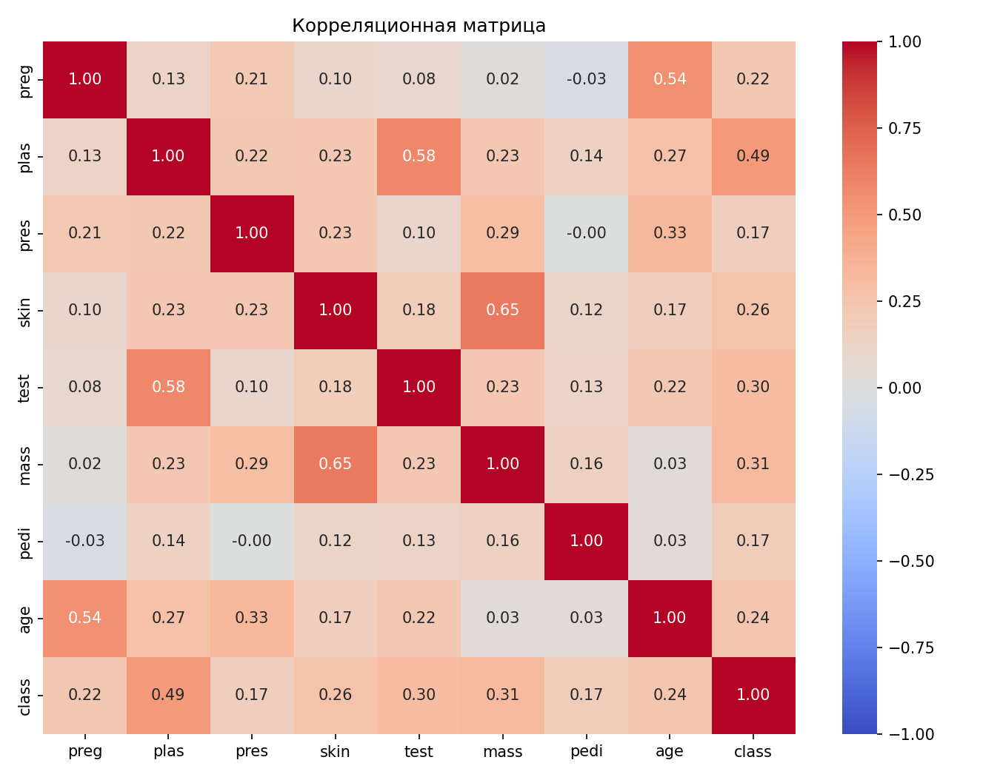
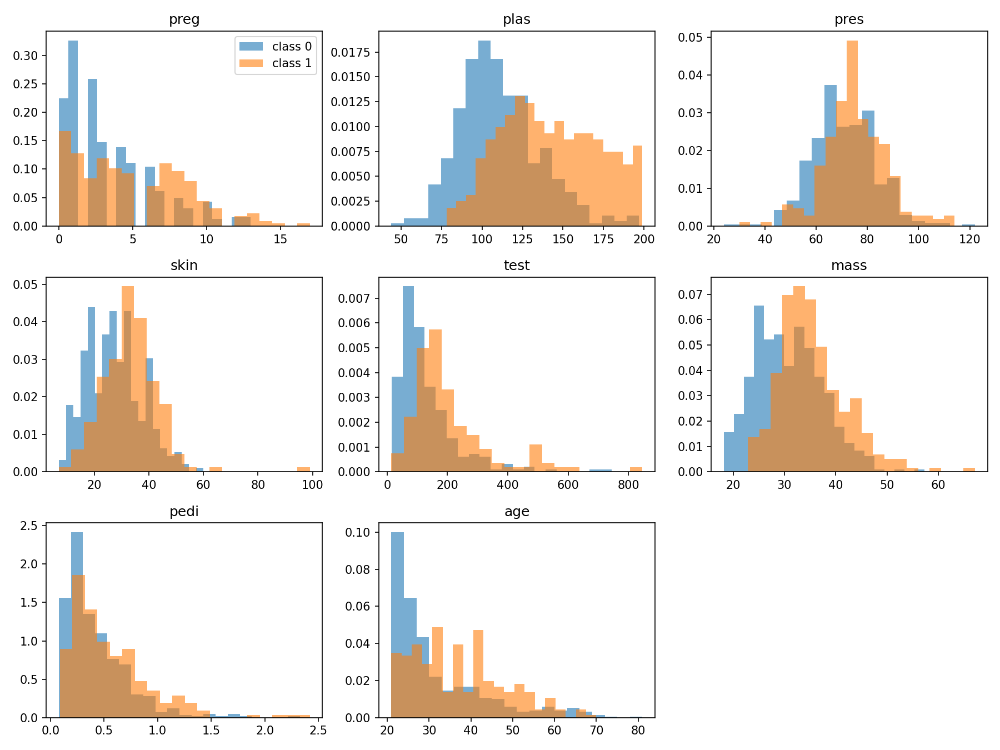
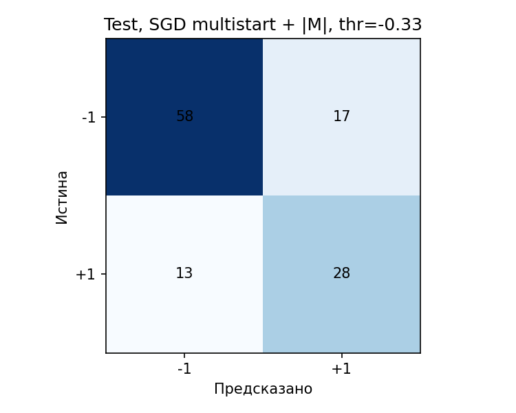
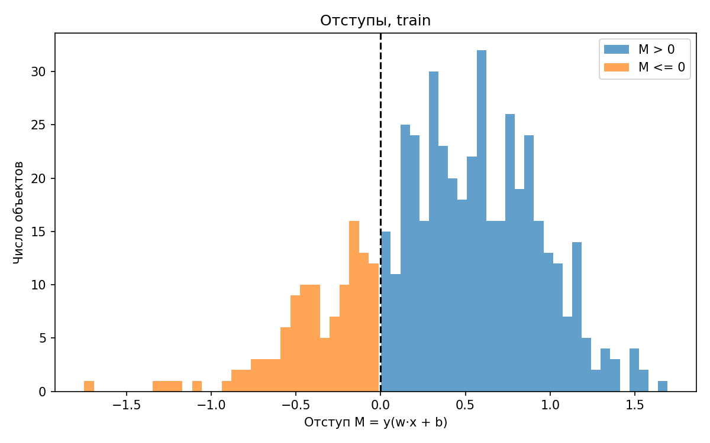
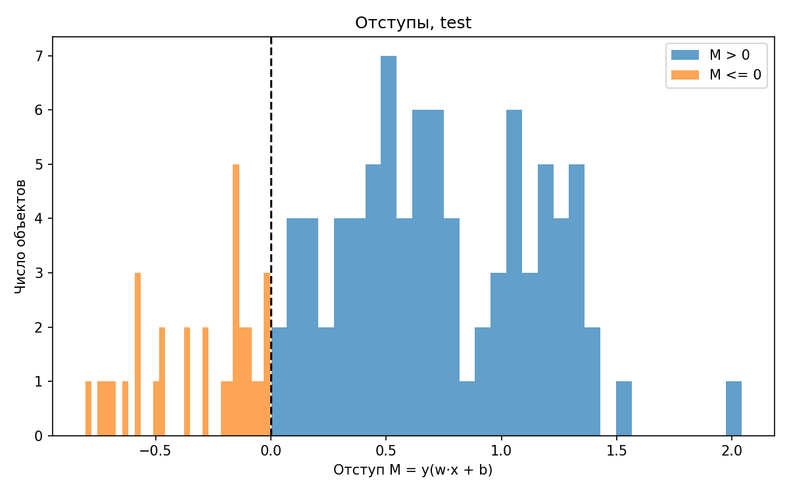
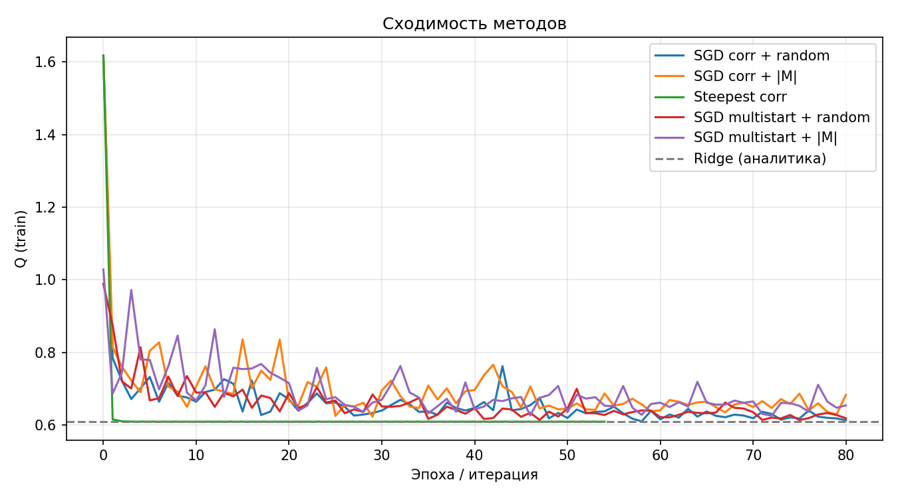
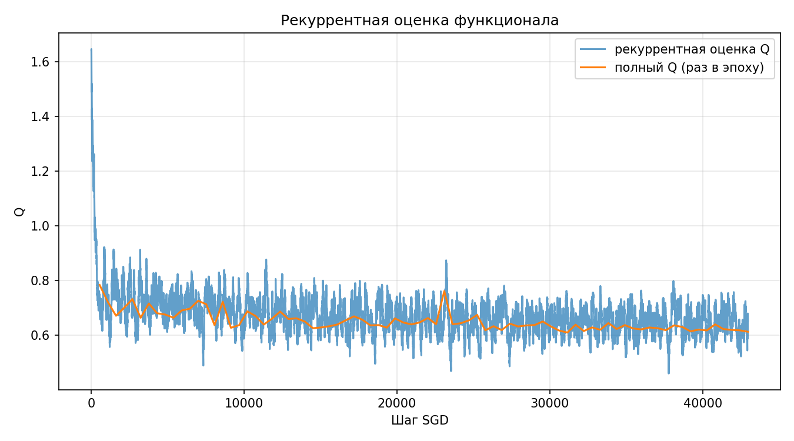
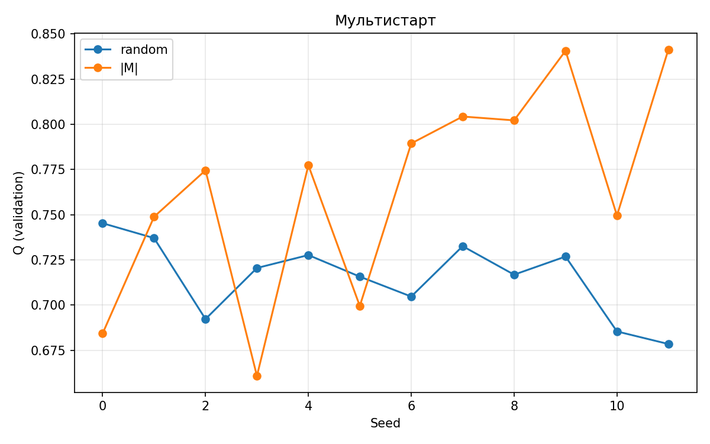

# Лабораторная работа №1. Линейный классификатор

Бинарная классификация на **Pima Indians Diabetes** (768 пациенток, 8 признаков). Линейная модель `f(x) = wᵀx + b` обучается на квадратичной потере по отступу с L2-регуляризацией. Все методы оптимизации написаны на NumPy, sklearn используется только как эталон.

## Итог

- Лучшая обучаемая модель (SGD, мультистарт, предъявление по |M|): **ROC-AUC 0.822** и accuracy 0.74 на тесте.
- Скорейший спуск совпал с аналитическим Ridge и `sklearn.Ridge`: расстояние между весами ~6·10⁻¹¹, Q(train) = 0.60882 у всех.
- Тривиальный классификатор «всегда класс 0» даёт ≈ 0.65 accuracy, модели его превосходят.
- На малых val/test (115 и 116 объектов) различия между вариантами SGD лежат в пределах шума.

## Что реализовано

| Компонент | Файл |
|---|---|
| Отступ `M = y(wᵀx + b)` | `margin.py` |
| Потеря `(1 − M)²`, функционал `Q = mean(L) + λ‖w‖²` | `loss.py` |
| Аналитический градиент и проверка численным | `gradient.py` |
| Инициализация: случайная, корреляционная | `initialization.py` |
| Предъявление: случайное, по \|M\| | `presentation.py` |
| SGD с инерцией, рекуррентная оценка Q, скорейший спуск | `optimizer.py` |
| Классификатор, мультистарт, сравнение вариантов | `classifier.py`, `experiments.py` |
| Метрики (accuracy, balanced acc., precision, recall, F1, ROC-AUC) | `metrics.py` |
| Эталон: аналитический Ridge и `sklearn.Ridge` | `reference.py` |
| Данные, EDA, графики, запуск | `data.py`, `explore.py`, `plots.py`, `main.py` |

Ключевые детали:

- **Функционал** один для всех методов: смещение `b` не регуляризуется, λ = 10⁻³.
- **Рекуррентная оценка**: `Q <- α·Lᵢ + (1 − α)·Q`, α = 0.01. Считается по потере текущего объекта, без прохода по выборке.
- **SGD**: шаг 0.002 с затуханием `lr/(1 + 0.05·эпоха)`, инерция 0.9, 80 эпох, новая перестановка на каждой эпохе.
- **Предъявление по \|M\|**: объекты выбираются с вероятностью `p -> 1 / (|M| + 0.05)`, то есть чаще те, что у границы.
- **Скорейший спуск**: шаг точный, `α = gᵀg / gᵀHg`, где `H = (2/N)·XᵀX + 2λR` с учётом L2.
- **Корреляционная инициализация**: `w` -> корреляции признаков с меткой, нормирована к единичной длине; `b` = среднее меток.
- **Мультистарт**: 12 случайных стартов (seed 0–11), лучший выбирается по Q на validation.

## Данные

| | |
|---|---|
| Объектов / признаков | 768 / 8 |
| Классы 0 / 1 | 500 / 268 (65.1% / 34.9%) |
| Разбиение (стратифицированное) | 537 train / 115 val / 116 test |

Нули в `plas` (5), `pres` (35), `skin` (227), `test` (374), `mass` (11) физически невозможны, поэтому трактуются как пропуски. Подготовка, все статистики по train:

1. нули -> NaN -> медиана;
2. клиппинг по 1% и 99% квантилям (выбросы, например `test` до 846);
3. стандартизация;
4. метки `{0, 1}` -> `{−1, +1}`.





## Результаты

Градиент проверен численно: максимальное расхождение **1.6·10⁻¹¹**.

### Validation (порог 0)

| Модель | Q | Acc | Bal. acc | Precision | Recall | F1 | ROC-AUC |
|---|---|---|---|---|---|---|---|
| SGD, корреляция + случайный порядок | 0.745 | 0.713 | 0.675 | 0.595 | 0.550 | 0.571 | 0.790 |
| SGD, корреляция + \|M\| | 0.720 | 0.704 | 0.657 | 0.588 | 0.500 | 0.541 | 0.799 |
| Скорейший спуск | 0.707 | 0.704 | 0.663 | 0.583 | 0.525 | 0.553 | 0.805 |
| SGD, мультистарт + случайный порядок | 0.679 | 0.704 | 0.663 | 0.583 | 0.525 | 0.553 | 0.808 |
| **SGD, мультистарт + \|M\|** | 0.661 | 0.748 | 0.713 | 0.649 | 0.600 | 0.623 | **0.826** |

Лучший SGD выбран по ROC-AUC на validation, потому что эта метрика не зависит от порога.

### Test

| Модель | Порог | Acc | Bal. acc | Precision | Recall | F1 | ROC-AUC |
|---|---|---|---|---|---|---|---|
| SGD, мультистарт + \|M\| | 0 | 0.733 | 0.655 | 0.727 | 0.390 | 0.508 | 0.822 |
| SGD, мультистарт + \|M\| | с val | 0.741 | 0.728 | 0.622 | 0.683 | 0.651 | 0.822 |
| Скорейший спуск = Ridge = sklearn.Ridge | 0 | 0.750 | 0.685 | 0.731 | 0.463 | 0.567 | 0.864 |
| Скорейший спуск = Ridge = sklearn.Ridge | с val | 0.733 | 0.760 | 0.583 | 0.854 | 0.693 | 0.864 |

Порог «с val» подобран по максимуму F1 на validation. Он повышает полноту ценой точности: для диагностики пропуск больного обычно хуже ложной тревоги.

Матрица ошибок лучшего SGD (test, порог с val):

| | Предсказано −1 | Предсказано +1 |
|---|---|---|
| Истина −1 | 58 | 17 |
| Истина +1 | 13 | 28 |



### Отступы лучшей модели

| | M < 0 | \|M\| < 0.2 | Средний M |
|---|---|---|---|
| train | 21.8% | 19.7% | 0.385 |
| test | 26.7% | 19.8% | 0.461 |

Примерно пятая часть объектов лежит у границы решения, классы разделяются линейно лишь частично.





### Сходимость







## Выводы

1. Линейный классификатор на Pima даёт ROC-AUC 0.82–0.86 и превосходит константный ответ.
2. Скорейший спуск сходится к тому же минимуму, что и замкнутое решение Ridge. Это подтверждает корректность градиента, L2 и шага.
3. Функционал выпуклый, поэтому SGD лишь приближается к точному решению. По ROC-AUC на тесте он уступает Ridge (0.822 против 0.864), и обогнать его здесь он не может.
4. Преимущество предъявления по \|M\| проявилось на validation (AUC 0.826 против 0.808), но на тесте не подтвердилось. Одно разбиение с ~40 положительными объектами не позволяет считать эффект реальным.
5. При пороге 0 модель осторожна: высокая точность, низкая полнота. Порог, подобранный на validation, поднимает balanced accuracy.

## Ограничения

- Val и test малы (по ~40 положительных объектов), поэтому метрики шумные.
- Эксперименты выполнены на одном разбиении (seed 42).
- Порог выбран на 115 объектах, на другом разбиении он может сместиться.

## Запуск

Файл `pima-indians-diabetes.csv` (без заголовка) положить рядом с `main.py`.

```bash
python main.py
```

Графики и таблицы (`validation_metrics.csv`, `test_metrics.csv`) сохраняются в `source/res/`.
