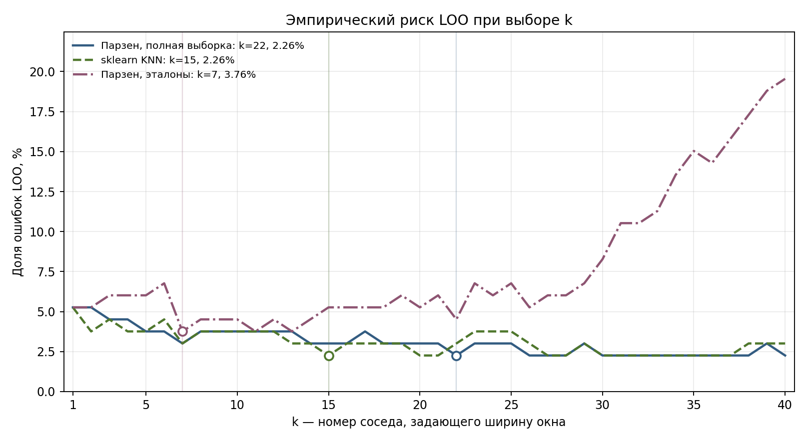
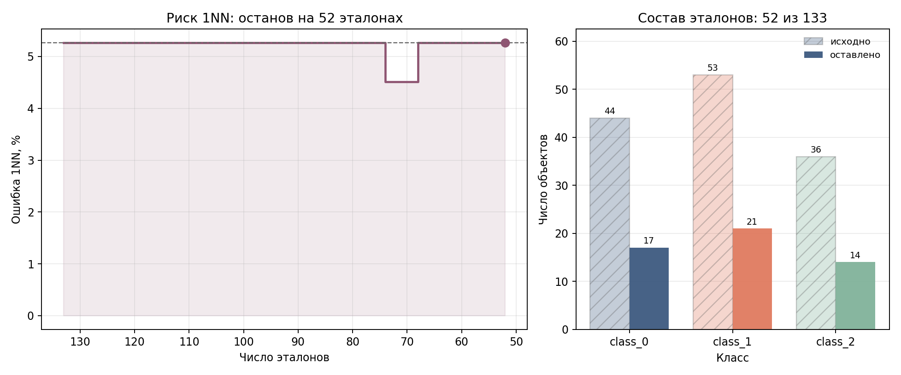
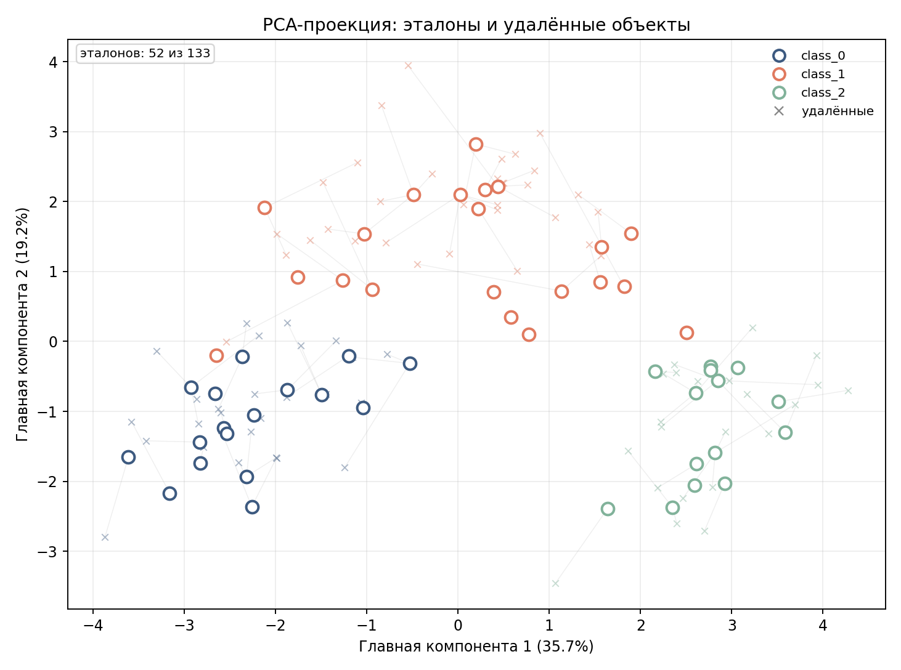
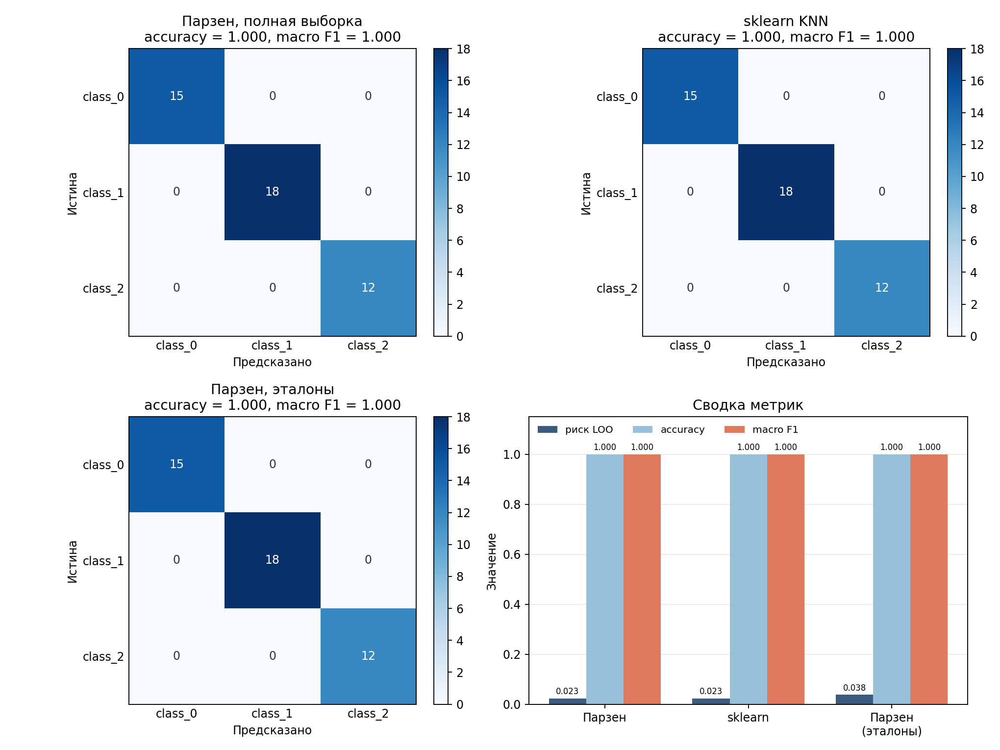

# Лабораторная работа №2. Метрическая классификация

## 1. Данные

Используется встроенный датасет `sklearn.datasets.load_wine`: **178 объектов**, **13 числовых признаков**, **3 класса** (сорта вина). Данные загружаются из scikit-learn.

| Выборка | Объектов | class_0 | class_1 | class_2 |
|---|---:|---:|---:|---:|
| Обучающая | 133 | 44 | 53 | 36 |
| Тестовая | 45 | 15 | 18 | 12 |

Деление стратифицированное, `test_size=0.25`, `random_state=42`. Признаки стандартизированы по среднему и стандартному отклонению **только обучающей** выборки; тестовая преобразуется теми же статистиками. Это необходимо для евклидовой метрики: иначе признаки с крупным масштабом, например proline, доминировали бы. Пропусков в датасете нет.

## 2. KNN с окном Парзена переменной ширины

Реализация модели написана самостоятельно на NumPy. Расстояние — евклидово, ядро — гауссово. Ширина окна для запроса задаётся расстоянием до его k-го соседа:

$$\rho(x,x') = \sqrt{\sum_j (x_j - x'_j)^2}$$

$$h_k(x) = \rho(x, x_{(k)}), \qquad w_i(x) = \exp\left(-\frac{\rho(x,x_i)^2}{2h_k(x)^2}\right), \quad i \in N_k(x)$$

$$S_c(x) = \sum_i w_i(x)\,\mathbf{1}[y_i=c], \qquad \hat y(x) = \arg\max_c S_c(x)$$

В голосовании участвуют только k ближайших объектов; остальные получают нулевой вес. Нормировочная константа гауссова ядра опущена: она одинакова для всех классов при фиксированном x и не влияет на argmax. Множитель 1/2 в показателе соответствует стандартному гауссову ядру, поэтому единственный подбираемый параметр модели — k. При k = 1 модель совпадает с 1NN. Если окно вырождается в ноль (совпадающие точки), вес 1 получают только объекты на нулевом расстоянии.

Классы в wine сопоставимы по размеру, поэтому голосование не нормируется на априорные вероятности классов. Все признаки участвуют с равным весом после стандартизации.

## 3. Подбор k методом LOO

Для каждого k от 1 до 40 проверяемый объект исключается из эталонов, после чего окно и веса пересчитываются по оставшимся объектам. Эмпирический риск — доля ошибок на 133 обучающих объектах. При равенстве рисков выбирается меньший k как более простая модель.



Минимальные значения:

- собственная модель на полной выборке: **k = 22**, риск **2.26%**;
- эталонный `sklearn.neighbors.KNeighborsClassifier`: **k = 15**, риск **2.26%**;
- собственная модель после отбора эталонов: **k = 7**, риск **3.76%**.

Кривая на полной выборке имеет широкое плато: после k ≈ 20 риск меняется на один-два объекта. Поэтому выбранное k — компромисс между гладкостью окна и локальностью, а не резко выделенный минимум.

## 4. Сравнение с эталонной реализацией

Для sklearn выполнен корректный LOO: модель обучается с `n_neighbors=k+1`, затем из списка соседей удаляется индекс самого проверяемого объекта и проводится голосование большинством по k оставшимся. Эталонная модель использует равные веса и евклидову метрику; собственная модель — гауссовы веса.

| Модель | k | Эталонов | Риск LOO | Accuracy | Macro F1 | Ошибок | Время, мс |
|---|---:|---:|---:|---:|---:|---:|---:|
| Парзен, полная выборка | 22 | 133 | 2.26% | 1.0000 | 1.0000 | 0 | 0.221 |
| sklearn KNN | 15 | 133 | 2.26% | 1.0000 | 1.0000 | 0 | 2.045 |
| Парзен, эталоны | 7 | 52 | 3.76% | 1.0000 | 1.0000 | 0 | 0.119 |

Предсказания собственной и эталонной моделей на тесте различаются на **0 объектах** из 45. Время — медиана 51 замера предсказания всей тестовой выборки после прогрева. На 45 объектах абсолютные времена малы, разница в мc объясняется накладными расходами вызова.

## 5. Алгоритм отбора эталонов

Реализован вариант **прореживания (condensation)**:

1. Строится матрица попарных расстояний и находится 1NN-прогноз LOO. Объекты с ошибкой 1NN считаются критическими; они и их ближайшие соседи того же класса защищаются от удаления (всего 13 объектов).
2. Для каждого объекта считается влияние — сколько обучающих объектов имеют его своим ближайшим соседом.
3. Объекты просматриваются в порядке возрастания влияния. Объект удаляется, если после этого:
   - остаётся не меньше 40% исходного числа объектов этого класса (квота 40%);
   - риск 1NN по **всем** обучающим объектам при классификации по текущим эталонам не превышает исходный риск.
4. Проходы повторяются, пока удаления возможны. Итоговый риск 1NN: **5.26% → 5.26%**.

Квота нужна как регуляризатор: без неё критерий на обучающей выборке легко «схлопывает» набор. В чувствительном прогоне при минимуме в 2 объекта на класс остаётся **17 эталонов** (по классам 2/13/2), риск 1NN — **4.51%**, но такой набор вырожден и плохо представляет классы. Поэтому в основном эксперименте зафиксирована квота 40%.

Сложность: матрица расстояний — O(n²d); каждая проверка удаления — O(nm); в худшем случае несколько проходов дают O(n³) при n = 133, что для такого размера данных приемлемо.

Итог: **52 эталона из 133 (39.1%)**, по классам — 17/21/14.





На PCA-проекции кружками показаны оставленные эталоны, крестиками — удалённые объекты; серые отрезки соединяют удалённый объект с ближайшим эталоном (близость считается в исходном 13-мерном пространстве, проекция только иллюстрирует структуру).

## 6. Качество с отбором и без

| Модель | k | Эталонов | Риск LOO | Accuracy | Macro F1 | Ошибок | Время, мс |
|---|---:|---:|---:|---:|---:|---:|---:|
| Парзен, полная выборка | 22 | 133 | 2.26% | 1.0000 | 1.0000 | 0 | 0.221 |
| sklearn KNN | 15 | 133 | 2.26% | 1.0000 | 1.0000 | 0 | 2.045 |
| Парзен, эталоны | 7 | 52 | 3.76% | 1.0000 | 1.0000 | 0 | 0.119 |

После сокращения базы в **2.56 раза** число ошибок на тесте осталось равным нулю (0 → 0). Исправлено 0 ответов, внесено 0 новых ошибок; совпало 45 ответов из 45. Ускорение предсказания — примерно **1.86×** (по медиане замеров). LOO-риск вырос с 2.26% до 3.76%, что ожидаемо при удалении 60.9% объектов, но остаётся на уровне нескольких ошибок.



Тестовая выборка содержит всего 45 объектов: одна ошибка — это 2.22 п.п. accuracy, поэтому различия в один-два объекта не следует интерпретировать как устойчивое превосходство одной модели.

## 7. Кросс-валидация

Чтобы сравнение не зависело от одного удачного разбиения, выполнена стратифицированная 5-блочная кросс-валидация на всех 178 объектах, `random_state=42`. Внутри каждого фолда заново выполнялись стандартизация, подбор k по LOO и отбор эталонов, поэтому утечки тестовой части фолда нет.

| Модель | k, среднее | Эталонов, среднее | Accuracy, mean ± std | Macro F1, mean ± std |
|---|---:|---:|---:|---:|
| Парзен, полная выборка | 24.8 | 142.4 | 0.9662 ± 0.0236 | 0.9674 ± 0.0236 |
| sklearn KNN | 22.2 | 142.4 | 0.9719 ± 0.0282 | 0.9726 ± 0.0279 |
| Парзен, эталоны | 5.8 | 55.2 | 0.9497 ± 0.0363 | 0.9519 ± 0.0348 |

Средние значения по фолдам: полная модель и sklearn практически совпадают, прореживание теряет около 1.5–2 п.п. accuracy и macro F1, сохраняя в среднем 55 эталонов из 142. Разброс по фолдам заметен (std около 2–4 п.п.), что типично для выборки из 178 объектов. Кросс-валидация подтверждает выводы тестового разбиения: сокращение выборки примерно в 2.6 раза даёт небольшое, но измеримое снижение качества.

## 8. Выводы

- Датасет wine хорошо разделяется метрическими методами: LOO-риск полной модели — 2.26%, на тесте — 1.0000 accuracy, в кросс-валидации — 0.9662.
- Собственная реализация с гауссовым окном Парзена и подбором k по LOO даёт качество, сопоставимое с sklearn KNN; предсказания на тесте различаются на 0 объектах.
- Прореживание сохранило 39.1% обучающей выборки; на тесте качество не изменилось, в кросс-валидации снизилось примерно на 1.65 п.п. LOO-риск вырос незначительно, время предсказания сократилось примерно в 1.86 раза.
- Основные ограничения: маленькая выборка, широкое плато LOO-кривой и чувствительность прореживания к квоте. Для более надёжных выводов полезны повторная кросс-валидация с другими случайными seed и подбор квоты по внутренней валидации.

## 9. Запуск

```bash
cd source
python -m pip install -r requirements.txt
python main.py
```

Из корня лабораторной также работает `python source/main.py`. Скрипт создаёт `images/` в корне `lab2`, а таблицы — в `source/res/`. Графики сохраняются без окна (backend `Agg`).

## 10. Структура проекта

| Файл | Назначение |
|---|---|
| `source/dataset.py` | загрузка wine, стратифицированное деление, стандартизация |
| `source/kernel_knn.py` | гауссово окно, взвешенное голосование, класс `WindowVoteKNN` |
| `source/loo.py` | LOO-кривые собственной и эталонной моделей, выбор k |
| `source/pruning.py` | прореживание обучающей выборки и защита граничных объектов |
| `source/crosscheck.py` | стратифицированная кросс-валидация вариантов |
| `source/quality.py` | accuracy, macro F1, матрица ошибок, время предсказания |
| `source/figures.py` | графики LOO, прореживания, PCA и качества |
| `source/main.py` | полный пайплайн и сохранение результатов |
| `source/requirements.txt` | зависимости |
