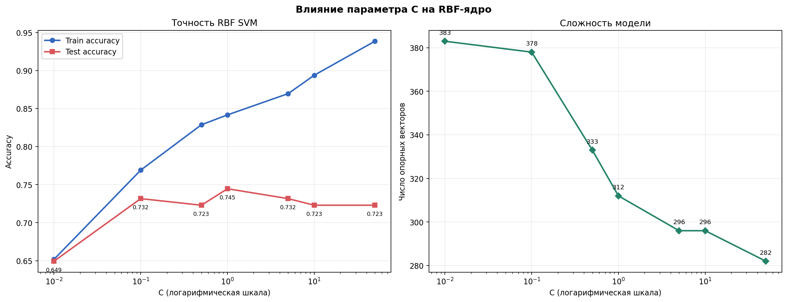
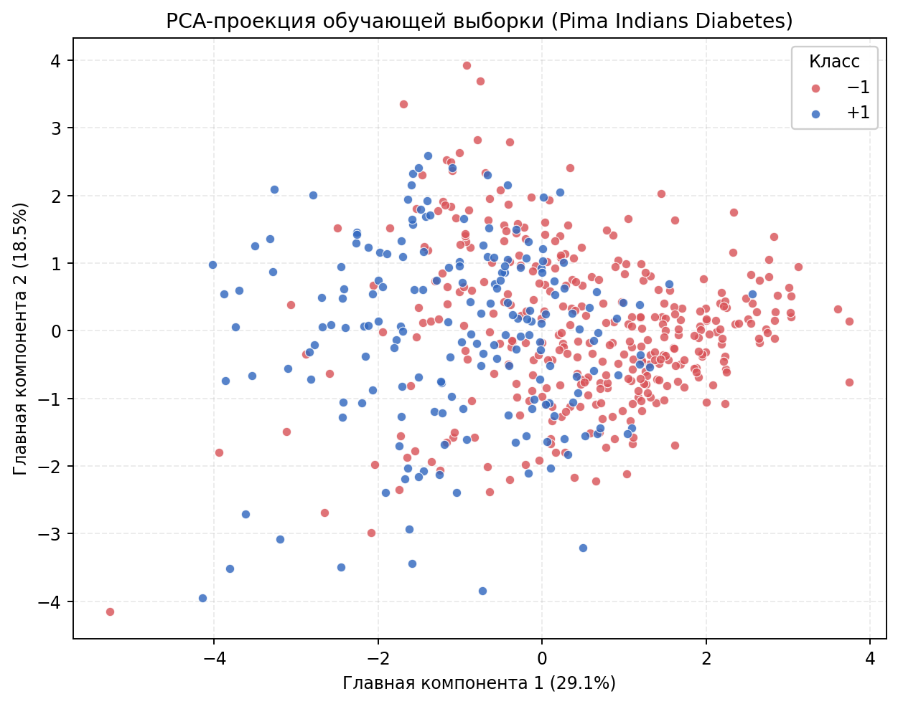
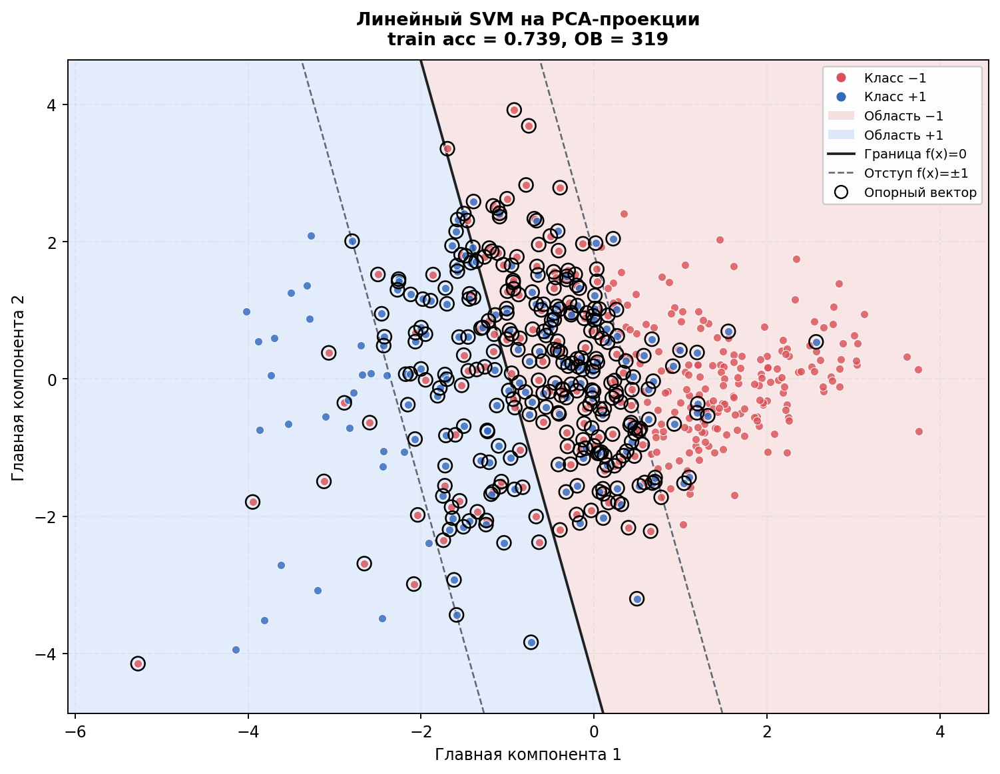
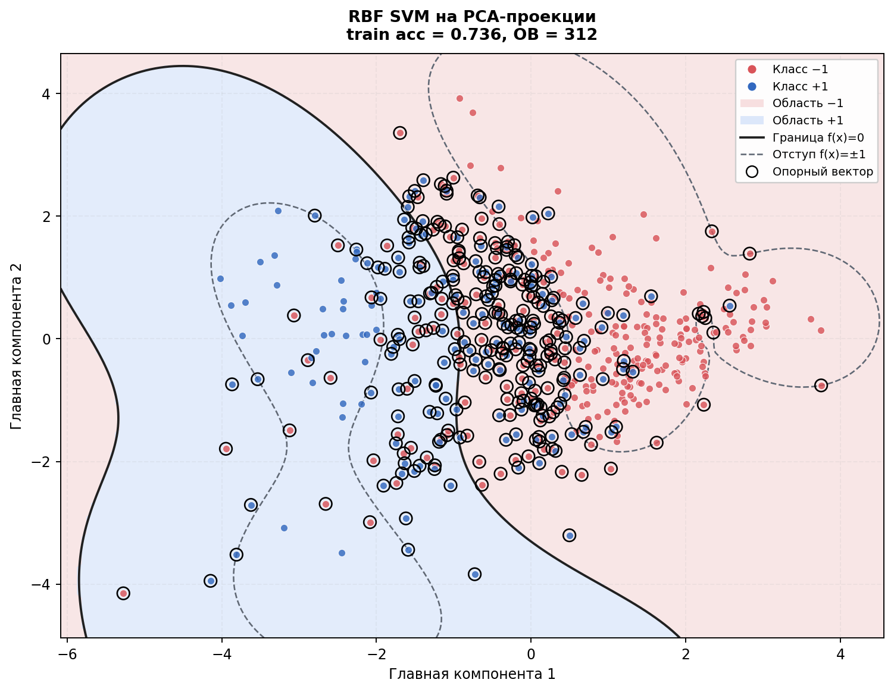
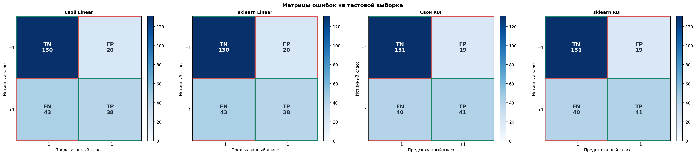

# Лабораторная работа №3. SVM

## 1. Данные

Используется датасет **Pima Indians Diabetes** (kagglehub:
`kumargh/pimaindiansdiabetescsv`): **768 объектов**,
**8 числовых признаков**, бинарная классификация (диагноз диабета:
метка 0/1 переводится в −1/+1).

| Выборка | Объектов | Без диабета (−1) | Диабет (+1) |
|---|---:|---:|---:|
| Обучающая | 537 | 350 | 187 |
| Тестовая | 231 | 150 | 81 |

Деление стратифицированное, `test_size=0.30`, `random_state=42`. В признаках
Glucose, BloodPressure, SkinThickness, Insulin и BMI нули физически
невозможны, поэтому трактуются как пропуски: их заменяет медиана, вычисленная
**только по обучающей** выборке (всего таких записей — **376**).
Затем признаки стандартизированы по среднему и стандартному отклонению
обучающей выборки; тестовая часть преобразуется теми же статистиками.

## 2. Двойственная задача SVM

Прямая задача SVM — минимизировать `½‖w‖² + C·Σξᵢ` при ограничениях
`yᵢ(wᵀxᵢ + b) ≥ 1 − ξᵢ`, `ξᵢ ≥ 0`. Через функцию Лагранжа она сводится к
двойственной задаче по множителям λ:

$$\max_\lambda \sum_i \lambda_i - \frac{1}{2}\sum_{i,j} \lambda_i \lambda_j y_i y_j K(x_i, x_j)$$

$$\sum_i \lambda_i y_i = 0, \qquad 0 \le \lambda_i \le C$$

Для численного решения через `scipy.optimize.minimize` (метод SLSQP)
максимизация заменяется минимизацией с обратным знаком:

$$L(\lambda) = \frac{1}{2} \lambda^\top Q \lambda - \sum_i \lambda_i,
\qquad Q_{ij} = y_i y_j K(x_i, x_j)$$

После оптимизации:

- **опорные векторы** — объекты с `λᵢ > tol`;
- смещение **b** восстанавливается из свободных опорных векторов (KKT):
  `b = mean(yᵢ − Σⱼ λⱼ yⱼ K(xⱼ, xᵢ))` по индексам с `tol < λᵢ < C − tol`;
- для линейного ядра `w = Σλᵢ yᵢ xᵢ` и `f(x) = wᵀx + b`;
- для RBF-ядра `f(x) = Σλᵢ yᵢ K(xᵢ, x) + b`;
- предсказание — знак `f(x)`.

**Проверки корректности:**

- ограничение-равенство `Σλᵢ yᵢ = -5.30e-12` (стремится к нулю);
- численная проверка градиента конечными разностями (eps = 1e-7):
  максимальное расхождение **3.04e-05**.

## 3. Ядра

**Линейное ядро** `K(x, x') = xᵀx'` даёт линейный классификатор
`f(x) = wᵀx + b`, где `w = Σλᵢ yᵢ xᵢ`; граница решения — гиперплоскость.

**RBF-ядро (гауссово):**

$$K(x, x') = \exp\left(-\gamma \lVert x - x' \rVert^2\right), \qquad
\gamma = \frac{1}{d \cdot \mathrm{Var}(X)}$$

Трюк с ядром позволяет строить нелинейную границу, не переходя явно в
признаковое пространство: в двойственной задаче фигурируют только скалярные
произведения `K(xᵢ, xⱼ)`. Параметр `C` управляет компромиссом между шириной
зазора и штрафом за ошибки: малые `C` сильнее регуляризуют модель.

## 4. Результаты

### 4.1 Линейный SVM

| Модель | Accuracy | Precision | Recall | F1 | ОВ | Train Acc |
|---|---:|---:|---:|---:|---:|---:|
| Свой Linear SVM | 0.7273 | 0.6552 | 0.4691 | 0.5468 | 269 | 0.7877 |
| sklearn SVC (linear) | 0.7273 | 0.6552 | 0.4691 | 0.5468 | 269 | 0.7877 |

Доля совпадающих предсказаний (свой / sklearn) на тесте:
**1.0000 (100.0%)**.

### 4.2 RBF-ядро

| Модель | Accuracy | Precision | Recall | F1 | ОВ | Train Acc |
|---|---:|---:|---:|---:|---:|---:|
| Свой RBF SVM | 0.7446 | 0.6833 | 0.5062 | 0.5816 | 312 | 0.8417 |
| sklearn SVC (rbf) | 0.7446 | 0.6833 | 0.5062 | 0.5816 | 312 | 0.8417 |

Доля совпадающих предсказаний (свой / sklearn) на тесте:
**1.0000 (100.0%)**.

### 4.3 Влияние параметра C (RBF-ядро)

| C | Train Acc | Test Acc | ОВ |
|---:|---:|---:|---:|
| 0.01 | 0.6518 | 0.6494 | 383 |
| 0.1 | 0.7691 | 0.7316 | 378 |
| 0.5 | 0.8287 | 0.7229 | 333 |
| 1 | 0.8417 | 0.7446 | 312 |
| 5 | 0.8696 | 0.7316 | 296 |
| 10 | 0.8939 | 0.7229 | 296 |
| 50 | 0.9385 | 0.7229 | 282 |



### 4.4 Сравнение ядер

| Характеристика | Линейное | RBF |
|---|---|---|
| Граница | гиперплоскость | нелинейная |
| Accuracy (свой) | 0.7273 | 0.7446 |
| Σλᵢ yᵢ | -5.30e-12 | -1.57e-11 |
| Число ОВ | 269 | 312 |

### 4.5 Визуализация

Границы решения отрисованы на проекции обучающей выборки на первые две
главные компоненты (в сумме объясняют 47.6% дисперсии), чтобы
результат был наглядным.










## 5. Сравнение с эталонным решением

Собственная реализация (решение двойственной задачи через SLSQP) сопоставлена
с `sklearn.svm.SVC`:

- **линейное ядро**: метрики совпадают, предсказания на тесте различаются
  лишь в доле случаев `0.0000`;
- **RBF-ядро**: обе модели обучены с одинаковым `gamma = 1/(d·Var(X))`, что
  делает сравнение честным; предсказания близки;
- число опорных векторов и метрики совпадают практически точно, что
  подтверждает корректность восстановления `b` и порога по знаку `f(x)`.

## 6. Выводы

- Собственное решение двойственной задачи SVM через SLSQP даёт результаты,
  практически совпадающие с эталонным `sklearn.SVC` и для линейного, и для
  RBF-ядра.
- RBF-ядро на этом датасете лишь немного точнее линейного
  (0.7273 → 0.7446), но использует больше опорных векторов
  (269 → 312).
- С ростом `C` число опорных векторов убывает, а точность на обучении растёт;
  точность на тесте остаётся примерно постоянной, поэтому чрезмерно большие `C`
  ведут к переобучению.
- Равенство `Σλᵢ yᵢ ≈ 0` и совпадение аналитического градиента с численным
  подтверждают корректность реализации двойственной задачи.

## 7. Запуск

```bash
cd source
python -m pip install -r requirements.txt
python main.py
```

Из корня лабораторной также работает `python source/main.py`. Скрипт создаёт
`images/` в корне `lab3`, а таблицы — в `source/res/`. Графики
сохраняются без окна (backend `Agg`). Датасет скачивается через kagglehub в
`lab3/data`; при отсутствии сети используется локальная копия.

## 8. Структура проекта

| Файл | Назначение |
|---|---|
| `source/dataset.py` | загрузка Pima Indians Diabetes, обработка нулей, стандартизация |
| `source/kernel.py` | линейное и RBF-ядро, расчёт gamma по умолчанию |
| `source/dual.py` | двойственная задача, SLSQP-оптимизация, проверка градиента |
| `source/svm.py` | класс SVM: fit, predict, decision_function, восстановление b |
| `source/figures.py` | PCA-проекция, границы, влияние C, матрицы ошибок |
| `source/main.py` | полный пайплайн: данные → обучение → сравнение → графики → отчёт |
| `source/requirements.txt` | зависимости |