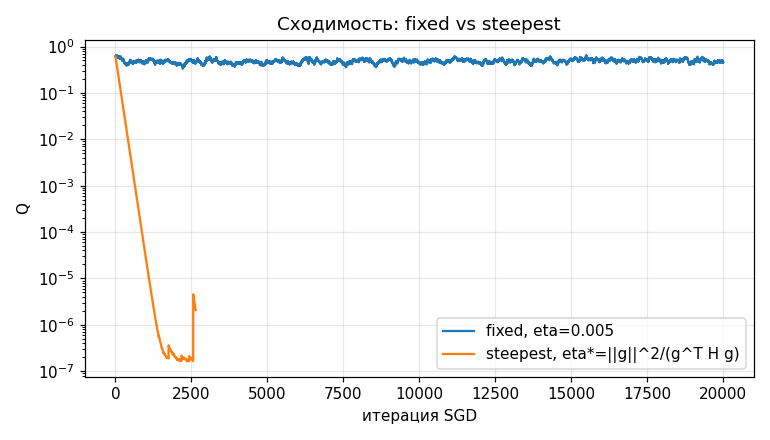
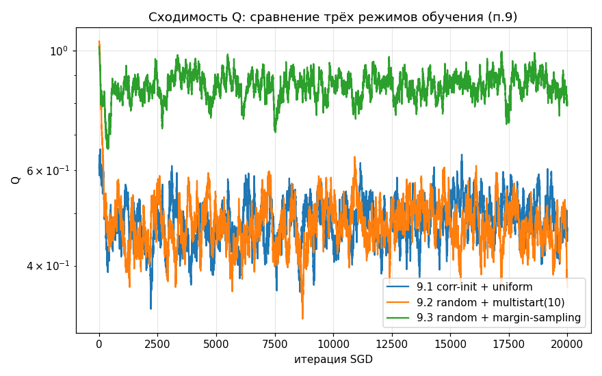
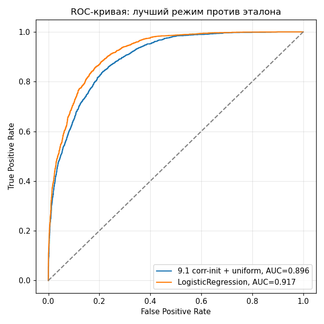
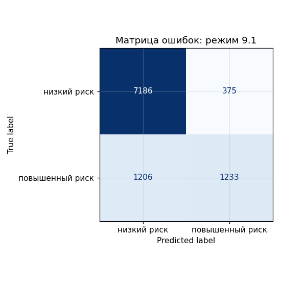

# Лабораторная работа №1. Линейная классификация

## Запуск и данные

Из корня репозитория:

```sh
python -m pip install numpy pandas scikit-learn matplotlib
python students/kustarev-ap/lab1/source/run_experiment.py
```

Отсутствующий CSV автоматически скачивается и распаковывается в `students/kustarev-ap/lab1/data/`. Для первого запуска нужен интернет. Загрузка проверена в пустую временную папку: 50000 строк, 53 столбца.

Источник: https://www.kaggle.com/datasets/datascikhan/e-commerce-customer-segmentation-2026

Архив: https://www.kaggle.com/api/v1/datasets/download/datascikhan/e-commerce-customer-segmentation-2026

Если API недоступен, скачайте архив со страницы источника и поместите E-commerce_Customer_Segmentation_2026.csv в указанную папку.

## Протокол

Задача — классификация риска оттока. Very Low/Low соответствуют -1, Medium/High/Very High — +1. Используются 12 числовых и 9 категориальных признаков; производные от таргета исключены.

Стратифицированное разбиение train/validation/test = 60/20/20, random_state=42. Препроцессинг обучается только на train. Все исследования используют validation. Мультистарт выбирает веса по обучающей Q. Итоговый режим выбирается по validation ROC-AUC; затем он и заранее заданные DummyClassifier/LogisticRegression оцениваются на test. ROC и матрица ошибок показывают ту же итоговую оценку.

## Скорейший шаг

Для steepest momentum отключён независимо от gamma: w := w - eta*g. Для fixed сохраняется gamma=0.9. Здесь g — градиент квадратичной потери текущего объекта плюс L2, bias не регуляризуется. Формула eta = (gᵀg)/(gᵀHg) даёт точную минимизацию вдоль -g для текущего объекта с регуляризацией, а не всей выборки. При L2=0 обновление приводит к отступу 1.

Validation ROC-AUC: fixed 0.893323, steepest 0.825913. Точный шаг отдельного объекта не гарантирует лучшего обобщения. Прежнее объяснение через чрезмерно осторожный шаг исключено.



## Сравнение режимов

| Режим | Validation ROC-AUC |
|---|---:|
| 9.1 correlation + uniform | 0.893323 |
| 9.2 random + multistart(10) | 0.883830 |
| 9.3 random + margin | 0.885402 |

Выбран режим 9.1. На test: accuracy 0.8419, ROC-AUC 0.896132. LogisticRegression: accuracy 0.8541, ROC-AUC 0.916569; DummyClassifier: accuracy 0.7561, ROC-AUC 0.5. Разрыв с эталоном по AUC — 0.020437. Margin sampling в этом запуске не улучшает AUC; мультистарт по обучающей Q не гарантирует лучшую validation-метрику.





Полный вывод запуска — в results.txt.
